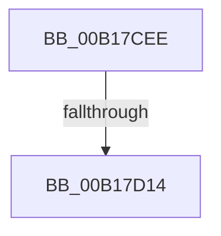

# sub_00B17CEE

- RVA: `0x00B17CEE`–`0x00B17D1F` (길이 `49` bytes)
- VA: `0x0000000140B17CEE`
- 실행 섹션: `PAGE`
- PDB 이름 있음: `아니요`; PDB Function 태그: `아니요`
- unwind 정보 RVA: `0x0006CBCC`
- 디코드: `12`개 명령, `49/49` bytes 표시
- 미해석 바이트: `0` (있으면 어셈블리에 `.byte`로 보존)

> 이 문서는 커널 이미지의 기계어와 PDB 기호를 분석해 생성했습니다. 4번과 5번은 함수 원형과 자료형을 바이너리 사용 방식에서 추정한 C 해석이며 원본 소스 복구 결과는 아닙니다.

## 1. Dependencies

- 직접 호출 지점: **3**; 고유 호출 대상: **3**
- 직접 호출자로 확인된 함수: **0**
- RIP 상대 이미지 참조: **0**

### Outgoing calls
- `0x00B17CFA` → [CmpRemoveHiveFromNamespace](../../text/49/CmpRemoveHiveFromNamespace_function_0049C4CC.md) (function, `0x0049C4CC`)
- `0x00B17D06` → [CmpDrainDelayDerefContext](../../text/41/CmpDrainDelayDerefContext_function_0041B9A0.md) (function, `0x0041B9A0`)
- `0x00B17D14` → [CmpUnlockRegistry](../../pagecmrc/BC/CmpUnlockRegistry_function_00BC9A84.md) (function, `0x00BC9A84`)

### Direct callers
- 이 함수 시작 RVA로 연결되는 직접 call은 확인되지 않았습니다. 간접 호출은 완전히 역산할 수 없습니다.

### Static image references
- 디코드된 RIP-relative 메모리 참조가 없습니다.

## 2. Other-region calls and transfers

- 다른 실행 섹션으로 향하는 call: **3**
  - `0x00B17CFA` → [CmpRemoveHiveFromNamespace](../../text/49/CmpRemoveHiveFromNamespace_function_0049C4CC.md) (`PAGE` → `.text`)
  - `0x00B17D06` → [CmpDrainDelayDerefContext](../../text/41/CmpDrainDelayDerefContext_function_0041B9A0.md) (`PAGE` → `.text`)
  - `0x00B17D14` → [CmpUnlockRegistry](../../pagecmrc/BC/CmpUnlockRegistry_function_00BC9A84.md) (`PAGE` → `PAGECMRC`)
- call이 아닌 외부 분기/꼬리 이동: **2**
  - `0x00B17D0E` → [CmpLinkHiveToMaster + 0x36A](../87/CmpLinkHiveToMaster_function_00877D6C.md) (`tail-transfer`)
  - `0x00B17D1A` → [CmpLinkHiveToMaster + 0x36A](../87/CmpLinkHiveToMaster_function_00877D6C.md) (`tail-transfer`)

## 3. Assembly (complete function range)

```asm
00B17CEE  48 8B 56 08                     mov rdx, qword ptr [rsi + 8]
00B17CF2  4C 8D 44 24 78                  lea r8, [rsp + 0x78]
00B17CF7  48 8B CF                        mov rcx, rdi
00B17CFA  E8 CD 47 98 FF                  call 0x14049c4cc
00B17CFF  33 D2                           xor edx, edx
00B17D01  48 8D 4C 24 78                  lea rcx, [rsp + 0x78]
00B17D06  E8 95 3C 90 FF                  call 0x14041b9a0
00B17D0B  45 84 F6                        test r14b, r14b
00B17D0E  0F 85 C2 03 D6 FF               jne 0x1408780d6
00B17D14  E8 6B 1D 0B 00                  call 0x140bc9a84
00B17D19  90                              nop
00B17D1A  E9 B7 03 D6 FF                  jmp 0x1408780d6
```

## 4. C-style interpretation (structured pseudocode)

```c
__int64 __fastcall sub_00B17CEE(__int64 a1, __int64 a2, __int64 a3, __int64 a4, __int64 a5, __int64 a6, __int64 a7, __int64 a8, __int64 a9, __int64 a10, __int64 a11, __int64 a12, __int64 a13, __int64 a14, __int64 a15)
{
    __int64 result;

    result = CmpRemoveHiveFromNamespace(v_rdi, *(unsigned __int64 *)(v_rsi + 8), a15, a4);
    a2 = 0;
    result = CmpDrainDelayDerefContext(a15, a2, a15, a4);
    result = CmpUnlockRegistry(a15, a2, a15, a4);
}
```

## 5. (Beta) C Style

```c
int64_t sub_00B17CEE(int64_t Arg1, int64_t Arg2, int64_t Arg3, int64_t Arg4, uint64_t Arg5, uint64_t Arg6, uint64_t Arg7, uint64_t Arg8, uint64_t Arg9, uint64_t Arg10, uint64_t Arg11, uint64_t Arg12, uint64_t Arg13, uint64_t Arg14, int64_t Arg15)
{
    int64_t result;

    result = CmpRemoveHiveFromNamespace(local_rdi, *(uint64_t *)(local_rsi + 0x8), Arg15, Arg4);
    Arg2 = 0;
    result = CmpDrainDelayDerefContext(Arg15, Arg2, Arg15, Arg4);
    result = CmpUnlockRegistry(Arg15, Arg2, Arg15, Arg4);
}
```

## 6. Execution-region graph

[열기: 2D/3D 그래프와 함수 탐색 컨트롤 패널](../../../control-panel.html?section=page&rva=0x00B17CEE&view=graph)

- 2D 그래프는 위에서 아래로 흐르고, 3D 그래프는 빈 공간을 드래그해 회전합니다. Shift+드래그는 이동, 휠은 확대·축소, 함수 노드 선택은 대상 보고서 이동입니다.

### Static fallback


