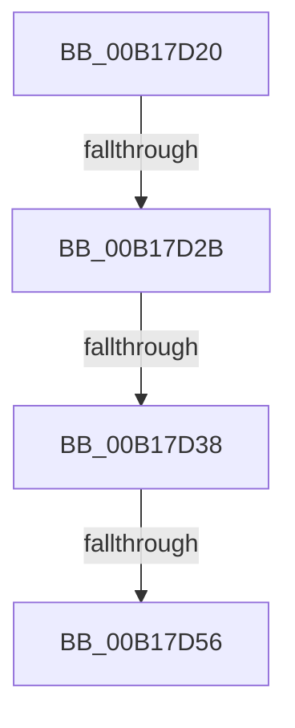

# sub_00B17D20

- RVA: `0x00B17D20`–`0x00B17DB0` (길이 `144` bytes)
- VA: `0x0000000140B17D20`
- 실행 섹션: `PAGE`
- PDB 이름 있음: `아니요`; PDB Function 태그: `아니요`
- unwind 정보 RVA: `0x0006CC74`
- 디코드: `24`개 명령, `144/144` bytes 표시
- 미해석 바이트: `0` (있으면 어셈블리에 `.byte`로 보존)

> 이 문서는 커널 이미지의 기계어와 PDB 기호를 분석해 생성했습니다. 4번과 5번은 함수 원형과 자료형을 바이너리 사용 방식에서 추정한 C 해석이며 원본 소스 복구 결과는 아닙니다.

## 1. Dependencies

- 직접 호출 지점: **2**; 고유 호출 대상: **2**
- 직접 호출자로 확인된 함수: **0**
- RIP 상대 이미지 참조: **2**

### Outgoing calls
- `0x00B17D49` → [tlgKeywordOn](../../text/42/tlgKeywordOn_function_0042EAA0.md) (function, `0x0042EAA0`)
- `0x00B17DA5` → [tlgWriteTransfer_EtwWriteTransfer](../../text/42/tlgWriteTransfer_EtwWriteTransfer_function_004260E0.md) (function, `0x004260E0`)

### Direct callers
- 이 함수 시작 RVA로 연결되는 직접 call은 확인되지 않았습니다. 간접 호출은 완전히 역산할 수 없습니다.

### Static image references
- `0x00B17D2B` → RVA `0x00E09F58` (`.data`; read)
- `0x00B17D6B` → RVA `0x00056038` (`.rdata`; read)

## 2. Other-region calls and transfers

- 다른 실행 섹션으로 향하는 call: **2**
  - `0x00B17D49` → [tlgKeywordOn](../../text/42/tlgKeywordOn_function_0042EAA0.md) (`PAGE` → `.text`)
  - `0x00B17DA5` → [tlgWriteTransfer_EtwWriteTransfer](../../text/42/tlgWriteTransfer_EtwWriteTransfer_function_004260E0.md) (`PAGE` → `.text`)
- call이 아닌 외부 분기/꼬리 이동: **4**
  - `0x00B17D25` → [CmpCmdHiveOpen + 0x1E5](../87/CmpCmdHiveOpen_function_00878404.md) (`tail-transfer`)
  - `0x00B17D32` → [CmpCmdHiveOpen + 0x1E5](../87/CmpCmdHiveOpen_function_00878404.md) (`tail-transfer`)
  - `0x00B17D50` → [CmpCmdHiveOpen + 0x1E5](../87/CmpCmdHiveOpen_function_00878404.md) (`tail-transfer`)
  - `0x00B17DAB` → [CmpCmdHiveOpen + 0x1E5](../87/CmpCmdHiveOpen_function_00878404.md) (`tail-transfer`)

## 3. Assembly (complete function range)

```asm
00B17D20  41 0F BA E4 19                  bt r12d, 0x19
00B17D25  0F 83 BE 08 D6 FF               jae 0x1408785e9
00B17D2B  83 3D 26 22 2F 00 05            cmp dword ptr [rip + 0x2f2226], 5
00B17D32  0F 86 B1 08 D6 FF               jbe 0x1408785e9
00B17D38  48 BA 08 00 00 00 00 40 00 00   movabs rdx, 0x400000000008
00B17D42  48 8D 0D 0F 22 2F 00            lea rcx, [rip + 0x2f220f]
00B17D49  E8 52 6D 91 FF                  call 0x14042eaa0
00B17D4E  84 C0                           test al, al
00B17D50  0F 84 93 08 D6 FF               je 0x1408785e9
00B17D56  83 A4 24 A4 00 00 00 00         and dword ptr [rsp + 0xa4], 0
00B17D5E  48 8D 44 24 58                  lea rax, [rsp + 0x58]
00B17D63  48 89 84 24 98 00 00 00         mov qword ptr [rsp + 0x98], rax
00B17D6B  48 8D 15 C6 E2 53 FF            lea rdx, [rip - 0xac1d3a]
00B17D72  48 8D 44 24 78                  lea rax, [rsp + 0x78]
00B17D77  48 C7 44 24 58 00 00 00 01      mov qword ptr [rsp + 0x58], 0x1000000
00B17D80  48 89 44 24 28                  mov qword ptr [rsp + 0x28], rax
00B17D85  48 8D 0D CC 21 2F 00            lea rcx, [rip + 0x2f21cc]
00B17D8C  45 33 C9                        xor r9d, r9d
00B17D8F  C7 44 24 20 03 00 00 00         mov dword ptr [rsp + 0x20], 3
00B17D97  45 33 C0                        xor r8d, r8d
00B17D9A  C7 84 24 A0 00 00 00 08 00 00 00  mov dword ptr [rsp + 0xa0], 8
00B17DA5  E8 36 E3 90 FF                  call 0x1404260e0
00B17DAA  90                              nop
00B17DAB  E9 39 08 D6 FF                  jmp 0x1408785e9
```

## 4. C-style interpretation (structured pseudocode)

```c
__int64 __fastcall sub_00B17D20(__int64 a1, __int64 a2, int a3, int a4, __int64 a5, __int64 a6, __int64 a7, __int64 a8, __int64 a9, __int64 a10, __int64 a11, __int64 a12, __int64 a13, __int64 a14, __int64 a15)
{
    __int64 result;
    unsigned int v_stack_p20;
    unsigned __int64 v_stack_p28;
    unsigned __int64 v_stack_p58;
    unsigned __int64 v_stack_p98;
    unsigned int v_stack_pA0;
    unsigned int v_stack_pA4;

    result = tlgKeywordOn(v_rip + 3088911, a2, a3, a4);
    v_stack_p98 = a11;
    v_stack_p58 = 0x1000000ULL;
    v_stack_p28 = a15;
    a4 = 0;
    v_stack_p20 = 3;
    a3 = 0;
    v_stack_pA0 = 8;
    result = tlgWriteTransfer_EtwWriteTransfer(v_rip + 3088844, v_rip - 11279674, a3, a4);
}
```

## 5. (Beta) C Style

```c
int64_t sub_00B17D20(int64_t Arg1, int64_t Arg2, int32_t Arg3, int32_t Arg4, uint64_t Arg5, uint64_t Arg6, uint64_t Arg7, uint64_t Arg8, uint64_t Arg9, uint64_t Arg10, int64_t Arg11, uint64_t Arg12, uint64_t Arg13, uint64_t Arg14, int64_t Arg15)
{
    int64_t result;
    uint32_t v_stack_p20;
    uint64_t v_stack_p28;
    uint64_t v_stack_p58;
    uint64_t v_stack_p98;
    uint32_t v_stack_pA0;
    uint32_t v_stack_pA4;

    result = tlgKeywordOn(v_rip + 3088911, Arg2, Arg3, Arg4);
    v_stack_p98 = Arg11;
    v_stack_p58 = 0x1000000ULL;
    v_stack_p28 = Arg15;
    Arg4 = 0;
    v_stack_p20 = 3;
    Arg3 = 0;
    v_stack_pA0 = 8;
    result = tlgWriteTransfer_EtwWriteTransfer(v_rip + 3088844, v_rip - 11279674, Arg3, Arg4);
}
```

## 6. Execution-region graph

[열기: 2D/3D 그래프와 함수 탐색 컨트롤 패널](../../../control-panel.html?section=page&rva=0x00B17D20&view=graph)

- 2D 그래프는 위에서 아래로 흐르고, 3D 그래프는 빈 공간을 드래그해 회전합니다. Shift+드래그는 이동, 휠은 확대·축소, 함수 노드 선택은 대상 보고서 이동입니다.

### Static fallback


