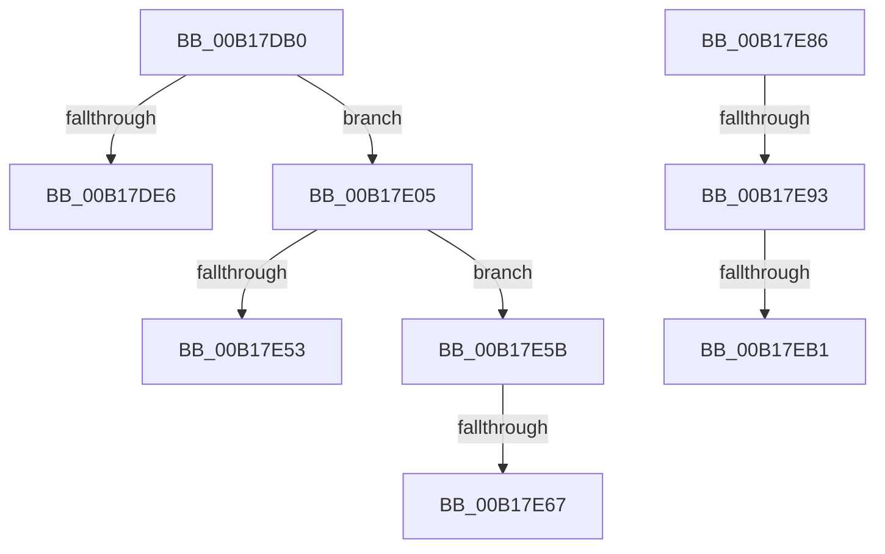

# sub_00B17DB0

- RVA: `0x00B17DB0`–`0x00B17EE1` (길이 `305` bytes)
- VA: `0x0000000140B17DB0`
- 실행 섹션: `PAGE`
- PDB 이름 있음: `아니요`; PDB Function 태그: `아니요`
- unwind 정보 RVA: `0x0006CCB8`
- 디코드: `68`개 명령, `305/305` bytes 표시
- 미해석 바이트: `0` (있으면 어셈블리에 `.byte`로 보존)

> 이 문서는 커널 이미지의 기계어와 PDB 기호를 분석해 생성했습니다. 4번과 5번은 함수 원형과 자료형을 바이너리 사용 방식에서 추정한 C 해석이며 원본 소스 복구 결과는 아닙니다.

## 1. Dependencies

- 직접 호출 지점: **6**; 고유 호출 대상: **5**
- 직접 호출자로 확인된 함수: **0**
- RIP 상대 이미지 참조: **3**

### Outgoing calls
- `0x00B17DDB` → [ObReferenceObjectByHandle](../86/ObReferenceObjectByHandle_function_00868DB0.md) (function, `0x00868DB0`)
- `0x00B17DFA` → [SetFailureLocation](../../text/46/SetFailureLocation_function_0046EF54.md) (function, `0x0046EF54`)
- `0x00B17E3F` → [CmpResolveHiveLoadConflict](../A9/CmpResolveHiveLoadConflict_function_00A9E78C.md) (function, `0x00A9E78C`)
- `0x00B17E4A` → [ObfDereferenceObject](../../text/2F/ObfDereferenceObject_function_002F9350.md) (function, `0x002F9350`)
- `0x00B17E7B` → [SetFailureLocation](../../text/46/SetFailureLocation_function_0046EF54.md) (function, `0x0046EF54`)
- `0x00B17EA4` → [tlgKeywordOn](../../text/42/tlgKeywordOn_function_0042EAA0.md) (function, `0x0042EAA0`)

### Direct callers
- 이 함수 시작 RVA로 연결되는 직접 call은 확인되지 않았습니다. 간접 호출은 완전히 역산할 수 없습니다.

### Static image references
- `0x00B17DB0` → RVA `0x00EF7C68` (`.data`; read)
- `0x00B17E86` → RVA `0x00E09F58` (`.data`; read)
- `0x00B17EC2` → RVA `0x0005686B` (`.rdata`; read)

## 2. Other-region calls and transfers

- 다른 실행 섹션으로 향하는 call: **4**
  - `0x00B17DFA` → [SetFailureLocation](../../text/46/SetFailureLocation_function_0046EF54.md) (`PAGE` → `.text`)
  - `0x00B17E4A` → [ObfDereferenceObject](../../text/2F/ObfDereferenceObject_function_002F9350.md) (`PAGE` → `.text`)
  - `0x00B17E7B` → [SetFailureLocation](../../text/46/SetFailureLocation_function_0046EF54.md) (`PAGE` → `.text`)
  - `0x00B17EA4` → [tlgKeywordOn](../../text/42/tlgKeywordOn_function_0042EAA0.md) (`PAGE` → `.text`)
- call이 아닌 외부 분기/꼬리 이동: **7**
  - `0x00B17E00` → [CmLoadKey + 0x262](../87/CmLoadKey_function_008787CC.md) (`tail-transfer`)
  - `0x00B17E56` → [CmLoadKey + 0x25F](../87/CmLoadKey_function_008787CC.md) (`tail-transfer`)
  - `0x00B17E61` → [CmLoadKey + 0x1F7](../87/CmLoadKey_function_008787CC.md) (`tail-transfer`)
  - `0x00B17E81` → [CmLoadKey + 0x6C2](../87/CmLoadKey_function_008787CC.md) (`tail-transfer`)
  - `0x00B17E8D` → [CmLoadKey + 0x28A](../87/CmLoadKey_function_008787CC.md) (`tail-transfer`)
  - `0x00B17EAB` → [CmLoadKey + 0x28A](../87/CmLoadKey_function_008787CC.md) (`tail-transfer`)
  - `0x00B17EDC` → [CmLoadKey + 0x669](../87/CmLoadKey_function_008787CC.md) (`tail-transfer`)

## 3. Assembly (complete function range)

```asm
00B17DB0  48 8B 05 B1 FE 3D 00            mov rax, qword ptr [rip + 0x3dfeb1]
00B17DB7  45 33 ED                        xor r13d, r13d
00B17DBA  48 8B 8E 08 06 00 00            mov rcx, qword ptr [rsi + 0x608]
00B17DC1  45 33 C9                        xor r9d, r9d
00B17DC4  4C 89 6C 24 28                  mov qword ptr [rsp + 0x28], r13
00B17DC9  33 D2                           xor edx, edx
00B17DCB  4C 89 6D 80                     mov qword ptr [rbp - 0x80], r13
00B17DCF  4C 8B 00                        mov r8, qword ptr [rax]
00B17DD2  48 8D 45 80                     lea rax, [rbp - 0x80]
00B17DD6  48 89 44 24 20                  mov qword ptr [rsp + 0x20], rax
00B17DDB  E8 D0 0F D5 FF                  call 0x140868db0
00B17DE0  8B D8                           mov ebx, eax
00B17DE2  85 C0                           test eax, eax
00B17DE4  79 1F                           jns 0x140b17e05
00B17DE6  44 8B C8                        mov r9d, eax
00B17DE9  C7 44 24 20 50 00 00 00         mov dword ptr [rsp + 0x20], 0x50
00B17DF1  33 D2                           xor edx, edx
00B17DF3  45 8D 45 1F                     lea r8d, [r13 + 0x1f]
00B17DF7  48 8B CF                        mov rcx, rdi
00B17DFA  E8 55 71 95 FF                  call 0x14046ef54
00B17DFF  90                              nop
00B17E00  E9 29 0C D6 FF                  jmp 0x140878a2e
00B17E05  48 8B 45 98                     mov rax, qword ptr [rbp - 0x68]
00B17E09  45 8B C4                        mov r8d, r12d
00B17E0C  44 8A AD C8 01 00 00            mov r13b, byte ptr [rbp + 0x1c8]
00B17E13  49 8B CF                        mov rcx, r15
00B17E16  4C 8B 4D A8                     mov r9, qword ptr [rbp - 0x58]
00B17E1A  48 8B 55 80                     mov rdx, qword ptr [rbp - 0x80]
00B17E1E  48 89 44 24 40                  mov qword ptr [rsp + 0x40], rax
00B17E23  48 8B 45 B8                     mov rax, qword ptr [rbp - 0x48]
00B17E27  48 89 44 24 38                  mov qword ptr [rsp + 0x38], rax
00B17E2C  48 8B 45 A0                     mov rax, qword ptr [rbp - 0x60]
00B17E30  44 88 6C 24 30                  mov byte ptr [rsp + 0x30], r13b
00B17E35  48 89 7C 24 28                  mov qword ptr [rsp + 0x28], rdi
00B17E3A  48 89 44 24 20                  mov qword ptr [rsp + 0x20], rax
00B17E3F  E8 48 69 F8 FF                  call 0x140a9e78c
00B17E44  48 8B 4D 80                     mov rcx, qword ptr [rbp - 0x80]
00B17E48  8B D8                           mov ebx, eax
00B17E4A  E8 01 15 7E FF                  call 0x1402f9350
00B17E4F  85 DB                           test ebx, ebx
00B17E51  78 08                           js 0x140b17e5b
00B17E53  45 33 ED                        xor r13d, r13d
00B17E56  E9 D0 0B D6 FF                  jmp 0x140878a2b
00B17E5B  81 FB 25 02 00 C0               cmp ebx, 0xc0000225
00B17E61  0F 84 5C 0B D6 FF               je 0x1408789c3
00B17E67  33 D2                           xor edx, edx
00B17E69  C7 44 24 20 60 00 00 00         mov dword ptr [rsp + 0x20], 0x60
00B17E71  44 8B CB                        mov r9d, ebx
00B17E74  48 8B CF                        mov rcx, rdi
00B17E77  44 8D 42 1F                     lea r8d, [rdx + 0x1f]
00B17E7B  E8 D4 70 95 FF                  call 0x14046ef54
00B17E80  90                              nop
00B17E81  E9 08 10 D6 FF                  jmp 0x140878e8e
00B17E86  83 3D CB 20 2F 00 05            cmp dword ptr [rip + 0x2f20cb], 5
00B17E8D  0F 86 C3 0B D6 FF               jbe 0x140878a56
00B17E93  48 BA 00 00 00 00 00 40 00 00   movabs rdx, 0x400000000000
00B17E9D  48 8D 0D B4 20 2F 00            lea rcx, [rip + 0x2f20b4]
00B17EA4  E8 F7 6B 91 FF                  call 0x14042eaa0
00B17EA9  84 C0                           test al, al
00B17EAB  0F 84 A5 0B D6 FF               je 0x140878a56
00B17EB1  48 8D 45 88                     lea rax, [rbp - 0x78]
00B17EB5  41 B9 04 00 00 00               mov r9d, 4
00B17EBB  48 89 85 00 01 00 00            mov qword ptr [rbp + 0x100], rax
00B17EC2  48 8D 15 A2 E9 53 FF            lea rdx, [rip - 0xac165e]
00B17EC9  48 8D 44 24 70                  lea rax, [rsp + 0x70]
00B17ECE  48 89 85 10 01 00 00            mov qword ptr [rbp + 0x110], rax
00B17ED5  48 8D 85 E0 00 00 00            lea rax, [rbp + 0xe0]
00B17EDC  E9 54 0F D6 FF                  jmp 0x140878e35
```

## 4. C-style interpretation (structured pseudocode)

```c
__int64 __fastcall sub_00B17DB0(__int64 a1, int a2, __int64 a3, int a4)
{
    __int64 result;
    __int64 v_r13;
    unsigned __int64 v_stack_p20;
    unsigned __int64 v_stack_p28;
    unsigned __int8 v_stack_p30;
    unsigned __int64 v_stack_p38;
    unsigned __int64 v_stack_p40;
    unsigned __int64 v_stack_p70;

    v_r13 = 0;
    a4 = 0;
    v_stack_p28 = 0;
    a2 = 0;
    *(unsigned __int64 *)(v_rbp - 128) = 0;
    v_stack_p20 = v_rbp - 128;
    result = ObReferenceObjectByHandle(*(unsigned __int64 *)(v_rsi + 1544), a2, *(unsigned __int64 *)(*(unsigned __int64 *)(v_rip + 4062897)), a4);
    if (!sign_flag) goto loc_00B17E05;
    v_stack_p20 = 80;
    a2 = 0;
    result = SetFailureLocation(v_rdi, a2, v_r13 + 31, (unsigned int)((unsigned int)(result)));
loc_00B17E05:
    v_stack_p40 = *(unsigned __int64 *)(v_rbp - 104);
    v_stack_p38 = *(unsigned __int64 *)(v_rbp - 72);
    v_stack_p30 = (unsigned __int8)(*(unsigned __int8 *)(v_rbp + 456));
    v_stack_p28 = v_rdi;
    v_stack_p20 = *(unsigned __int64 *)(v_rbp - 96);
    result = CmpResolveHiveLoadConflict(v_r15, *(unsigned __int64 *)(v_rbp - 128), (unsigned int)((unsigned int)(v_r12)), *(unsigned __int64 *)(v_rbp - 88));
    result = ObfDereferenceObject(*(unsigned __int64 *)(v_rbp - 128), *(unsigned __int64 *)(v_rbp - 128), (unsigned int)((unsigned int)(v_r12)), *(unsigned __int64 *)(v_rbp - 88));
    if (sign_flag) goto loc_00B17E5B;
    v_r13 = 0;
loc_00B17E5B:
    a2 = 0;
    v_stack_p20 = 96;
    result = SetFailureLocation(v_rdi, a2, a2 + 31, (unsigned int)((unsigned int)((unsigned int)((unsigned int)(result)))));
}
```

## 5. (Beta) C Style

```c
int64_t sub_00B17DB0(int64_t Arg1, int32_t Arg2, int64_t Arg3, int32_t Arg4)
{
    int64_t result;
    int64_t local_r13;
    uint64_t v_stack_p20;
    uint64_t v_stack_p28;
    uint8_t v_stack_p30;
    uint64_t v_stack_p38;
    uint64_t v_stack_p40;
    uint64_t v_stack_p70;

    local_r13 = 0;
    Arg4 = 0;
    v_stack_p28 = 0;
    Arg2 = 0;
    *(uint64_t *)(local_rbp - 0x80) = 0;
    v_stack_p20 = local_rbp - 128;
    result = ObReferenceObjectByHandle(*(uint64_t *)(local_rsi + 0x608), Arg2, *(uint64_t *)(*(uint64_t *)(v_rip + 0x3DFEB1)), Arg4);
    if (!sign_flag) goto loc_00B17E05;
    v_stack_p20 = 80;
    Arg2 = 0;
    result = SetFailureLocation(local_rdi, Arg2, local_r13 + 31, (uint32_t)((uint32_t)(result)));
loc_00B17E05:
    v_stack_p40 = *(uint64_t *)(local_rbp - 0x68);
    v_stack_p38 = *(uint64_t *)(local_rbp - 0x48);
    v_stack_p30 = (uint8_t)(*(uint8_t *)(local_rbp + 0x1C8));
    v_stack_p28 = local_rdi;
    v_stack_p20 = *(uint64_t *)(local_rbp - 0x60);
    result = CmpResolveHiveLoadConflict(local_r15, *(uint64_t *)(local_rbp - 0x80), (uint32_t)((uint32_t)(local_r12)), *(uint64_t *)(local_rbp - 0x58));
    result = ObfDereferenceObject(*(uint64_t *)(local_rbp - 0x80), *(uint64_t *)(local_rbp - 0x80), (uint32_t)((uint32_t)(local_r12)), *(uint64_t *)(local_rbp - 0x58));
    if (sign_flag) goto loc_00B17E5B;
    local_r13 = 0;
loc_00B17E5B:
    Arg2 = 0;
    v_stack_p20 = 96;
    result = SetFailureLocation(local_rdi, Arg2, Arg2 + 31, (uint32_t)((uint32_t)((uint32_t)((uint32_t)(result)))));
}
```

## 6. Execution-region graph

[열기: 2D/3D 그래프와 함수 탐색 컨트롤 패널](../../../control-panel.html?section=page&rva=0x00B17DB0&view=graph)

- 2D 그래프는 위에서 아래로 흐르고, 3D 그래프는 빈 공간을 드래그해 회전합니다. Shift+드래그는 이동, 휠은 확대·축소, 함수 노드 선택은 대상 보고서 이동입니다.

### Static fallback


