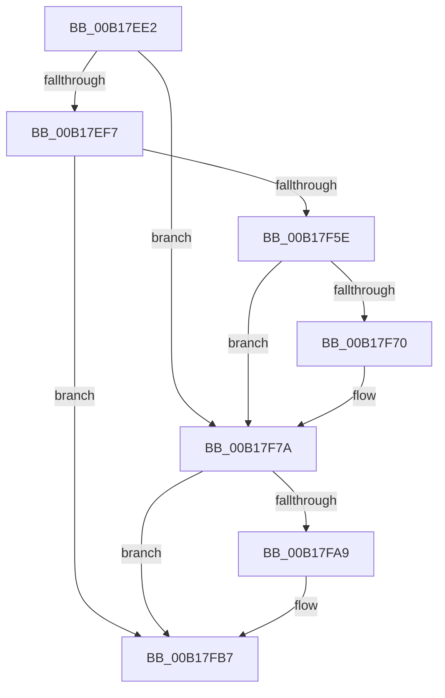

# sub_00B17EE2

- RVA: `0x00B17EE2`–`0x00B17FBF` (길이 `221` bytes)
- VA: `0x0000000140B17EE2`
- 실행 섹션: `PAGE`
- PDB 이름 있음: `아니요`; PDB Function 태그: `아니요`
- unwind 정보 RVA: `0x0006CCE8`
- 디코드: `46`개 명령, `221/221` bytes 표시
- 미해석 바이트: `0` (있으면 어셈블리에 `.byte`로 보존)

> 이 문서는 커널 이미지의 기계어와 PDB 기호를 분석해 생성했습니다. 4번과 5번은 함수 원형과 자료형을 바이너리 사용 방식에서 추정한 C 해석이며 원본 소스 복구 결과는 아닙니다.

## 1. Dependencies

- 직접 호출 지점: **5**; 고유 호출 대상: **5**
- 직접 호출자로 확인된 함수: **0**
- RIP 상대 이미지 참조: **2**

### Outgoing calls
- `0x00B17F02` → [RtlInitUnicodeString](../../text/42/RtlInitUnicodeString_function_0042A780.md) (function, `0x0042A780`)
- `0x00B17F55` → [ZwCreateKey](../../text/6A/ZwCreateKey_function_006AD470.md) (function, `0x006AD470`)
- `0x00B17F75` → [ZwClose](../../text/6A/ZwClose_function_006AD2B0.md) (function, `0x006AD2B0`)
- `0x00B17FA0` → [ZwQueryValueKey](../../text/6A/ZwQueryValueKey_function_006AD3B0.md) (function, `0x006AD3B0`)
- `0x00B17FB0` → [RtlAppendUnicodeToString](../../text/40/RtlAppendUnicodeToString_function_0040F990.md) (function, `0x0040F990`)

### Direct callers
- 이 함수 시작 RVA로 연결되는 직접 call은 확인되지 않았습니다. 간접 호출은 완전히 역산할 수 없습니다.

### Static image references
- `0x00B17EE2` → RVA `0x00EEFC58` (`.data`; read)
- `0x00B17EF7` → RVA `0x00B099C0` (` ?? ::NNGAKEGL::`string'`; read)

## 2. Other-region calls and transfers

- 다른 실행 섹션으로 향하는 call: **5**
  - `0x00B17F02` → [RtlInitUnicodeString](../../text/42/RtlInitUnicodeString_function_0042A780.md) (`PAGE` → `.text`)
  - `0x00B17F55` → [ZwCreateKey](../../text/6A/ZwCreateKey_function_006AD470.md) (`PAGE` → `.text`)
  - `0x00B17F75` → [ZwClose](../../text/6A/ZwClose_function_006AD2B0.md) (`PAGE` → `.text`)
  - `0x00B17FA0` → [ZwQueryValueKey](../../text/6A/ZwQueryValueKey_function_006AD3B0.md) (`PAGE` → `.text`)
  - `0x00B17FB0` → [RtlAppendUnicodeToString](../../text/40/RtlAppendUnicodeToString_function_0040F990.md) (`PAGE` → `.text`)
- call이 아닌 외부 분기/꼬리 이동: **1**
  - `0x00B17FBA` → [CmpQueryHiveRedirectionFileList + 0x5E](../87/CmpQueryHiveRedirectionFileList_function_00879094.md) (`tail-transfer`)

## 3. Assembly (complete function range)

```asm
00B17EE2  48 39 05 6F 7D 3D 00            cmp qword ptr [rip + 0x3d7d6f], rax
00B17EE9  C7 44 24 40 00 02 00 00         mov dword ptr [rsp + 0x40], 0x200
00B17EF1  0F 85 83 00 00 00               jne 0x140b17f7a
00B17EF7  48 8D 15 C2 1A FF FF            lea rdx, [rip - 0xe53e]
00B17EFE  48 8D 4D 80                     lea rcx, [rbp - 0x80]
00B17F02  E8 79 28 91 FF                  call 0x14042a780
00B17F07  48 83 64 24 30 00               and qword ptr [rsp + 0x30], 0
00B17F0D  48 8D 45 80                     lea rax, [rbp - 0x80]
00B17F11  48 83 64 24 58 00               and qword ptr [rsp + 0x58], 0
00B17F17  4C 8D 44 24 50                  lea r8, [rsp + 0x50]
00B17F1C  0F 57 C0                        xorps xmm0, xmm0
00B17F1F  C7 44 24 28 01 00 00 00         mov dword ptr [rsp + 0x28], 1
00B17F27  48 83 64 24 20 00               and qword ptr [rsp + 0x20], 0
00B17F2D  48 8D 4C 24 48                  lea rcx, [rsp + 0x48]
00B17F32  45 33 C9                        xor r9d, r9d
00B17F35  48 89 44 24 60                  mov qword ptr [rsp + 0x60], rax
00B17F3A  BA 1F 00 02 00                  mov edx, 0x2001f
00B17F3F  C7 44 24 50 30 00 00 00         mov dword ptr [rsp + 0x50], 0x30
00B17F47  F3 0F 7F 44 24 70               movdqu xmmword ptr [rsp + 0x70], xmm0
00B17F4D  C7 44 24 68 40 02 00 00         mov dword ptr [rsp + 0x68], 0x240
00B17F55  E8 16 55 B9 FF                  call 0x1406ad470
00B17F5A  85 C0                           test eax, eax
00B17F5C  78 59                           js 0x140b17fb7
00B17F5E  48 8B 4C 24 48                  mov rcx, qword ptr [rsp + 0x48]
00B17F63  33 C0                           xor eax, eax
00B17F65  F0 48 0F B1 0D EA 7C 3D 00      lock cmpxchg qword ptr [rip + 0x3d7cea], rcx
00B17F6E  74 0A                           je 0x140b17f7a
00B17F70  48 8B 4C 24 48                  mov rcx, qword ptr [rsp + 0x48]
00B17F75  E8 36 53 B9 FF                  call 0x1406ad2b0
00B17F7A  48 8B 0D D7 7C 3D 00            mov rcx, qword ptr [rip + 0x3d7cd7]
00B17F81  48 8D 44 24 40                  lea rax, [rsp + 0x40]
00B17F86  48 89 44 24 28                  mov qword ptr [rsp + 0x28], rax
00B17F8B  4C 8D 4D 90                     lea r9, [rbp - 0x70]
00B17F8F  8B 44 24 40                     mov eax, dword ptr [rsp + 0x40]
00B17F93  41 B8 02 00 00 00               mov r8d, 2
00B17F99  48 8B D7                        mov rdx, rdi
00B17F9C  89 44 24 20                     mov dword ptr [rsp + 0x20], eax
00B17FA0  E8 0B 54 B9 FF                  call 0x1406ad3b0
00B17FA5  85 C0                           test eax, eax
00B17FA7  78 0E                           js 0x140b17fb7
00B17FA9  48 8D 55 9C                     lea rdx, [rbp - 0x64]
00B17FAD  48 8B CB                        mov rcx, rbx
00B17FB0  E8 DB 79 8F FF                  call 0x14040f990
00B17FB5  85 C0                           test eax, eax
00B17FB7  0F 94 C0                        sete al
00B17FBA  E9 33 11 D6 FF                  jmp 0x1408790f2
```

## 4. C-style interpretation (structured pseudocode)

```c
__int64 __fastcall sub_00B17EE2(__int64 a1, __int64 a2, __int64 a3, int a4, __int64 a5, __int64 a6, __int64 a7, unsigned int a8, __int64 a9, __int64 a10, __int64 a11)
{
    __int64 result;
    unsigned __int64 v_stack_p20;
    unsigned int v_stack_p28;
    unsigned int v_stack_p40;
    unsigned int v_stack_p50;
    unsigned __int64 v_stack_p60;
    unsigned int v_stack_p68;
    unsigned __int64 v_stack_p70;

    v_stack_p40 = 512;
    if ((*(unsigned __int64 *)(v_rip + 4029807)) != result) goto loc_00B17F7A;
    result = RtlInitUnicodeString(v_rbp - 128, v_rip - 58686, a3, a4);
    v_stack_p28 = 1;
    a4 = 0;
    v_stack_p60 = v_rbp - 128;
    v_stack_p50 = 48;
    v_stack_p70 = v_xmm0;
    v_stack_p68 = 576;
    result = ZwCreateKey(a9, (unsigned int)(0x2001FULL), a10, a4);
    if (sign_flag) goto loc_00B17FB7;
    result = 0;
    if (!(condition_is_equal)) {
        a1 = a9;
        result = ZwClose(a1, (unsigned int)(0x2001FULL), a10, a4);
    }
    v_stack_p28 = a8;
    v_stack_p20 = (unsigned int)((unsigned int)(a8));
    result = ZwQueryValueKey(*(unsigned __int64 *)(v_rip + 4029655), v_rdi, 2, v_rbp - 112);
    if (!(sign_flag)) {
        a2 = v_rbp - 100;
        a1 = v_rbx;
        result = RtlAppendUnicodeToString(a1, a2, 2, v_rbp - 112);
    }
    result = ((unsigned int)(result) == 0) ? 1 : 0;
}
```

## 5. (Beta) C Style

```c
int64_t sub_00B17EE2(int64_t Arg1, int64_t Arg2, int64_t Arg3, int32_t Arg4, uint64_t Arg5, int64_t Arg6, uint64_t Arg7, uint32_t Arg8, int64_t Arg9, int64_t Arg10, int64_t Arg11)
{
    int64_t result;
    uint64_t v_stack_p20;
    uint32_t v_stack_p28;
    uint32_t v_stack_p40;
    uint32_t v_stack_p50;
    uint64_t v_stack_p60;
    uint32_t v_stack_p68;
    uint64_t v_stack_p70;

    v_stack_p40 = 512;
    if ((*(uint64_t *)(v_rip + 0x3D7D6F)) != result) goto loc_00B17F7A;
    result = RtlInitUnicodeString(local_rbp - 128, v_rip - 58686, Arg3, Arg4);
    v_stack_p28 = 1;
    Arg4 = 0;
    v_stack_p60 = local_rbp - 128;
    v_stack_p50 = 48;
    v_stack_p70 = v_xmm0;
    v_stack_p68 = 576;
    result = ZwCreateKey(Arg9, (uint32_t)(0x2001FULL), Arg10, Arg4);
    if (sign_flag) goto loc_00B17FB7;
    result = 0;
    if (!(condition_is_equal)) {
        Arg1 = Arg9;
        result = ZwClose(Arg1, (uint32_t)(0x2001FULL), Arg10, Arg4);
    }
    v_stack_p28 = Arg8;
    v_stack_p20 = (uint32_t)((uint32_t)(Arg8));
    result = ZwQueryValueKey(*(uint64_t *)(v_rip + 0x3D7CD7), local_rdi, 2, local_rbp - 112);
    if (!(sign_flag)) {
        Arg2 = local_rbp - 100;
        Arg1 = local_rbx;
        result = RtlAppendUnicodeToString(Arg1, Arg2, 2, local_rbp - 112);
    }
    result = ((uint32_t)(result) == 0) ? 1 : 0;
}
```

## 6. Execution-region graph

[열기: 2D/3D 그래프와 함수 탐색 컨트롤 패널](../../../control-panel.html?section=page&rva=0x00B17EE2&view=graph)

- 2D 그래프는 위에서 아래로 흐르고, 3D 그래프는 빈 공간을 드래그해 회전합니다. Shift+드래그는 이동, 휠은 확대·축소, 함수 노드 선택은 대상 보고서 이동입니다.

### Static fallback


