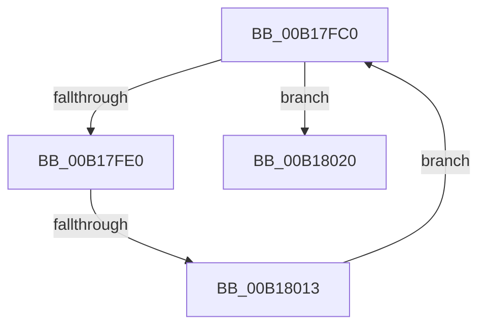

# sub_00B17FC0

- RVA: `0x00B17FC0`–`0x00B1802A` (길이 `106` bytes)
- VA: `0x0000000140B17FC0`
- 실행 섹션: `PAGE`
- PDB 이름 있음: `아니요`; PDB Function 태그: `아니요`
- unwind 정보 RVA: `0x0006CD14`
- 디코드: `24`개 명령, `106/106` bytes 표시
- 미해석 바이트: `0` (있으면 어셈블리에 `.byte`로 보존)

> 이 문서는 커널 이미지의 기계어와 PDB 기호를 분석해 생성했습니다. 4번과 5번은 함수 원형과 자료형을 바이너리 사용 방식에서 추정한 C 해석이며 원본 소스 복구 결과는 아닙니다.

## 1. Dependencies

- 직접 호출 지점: **3**; 고유 호출 대상: **3**
- 직접 호출자로 확인된 함수: **0**
- RIP 상대 이미지 참조: **0**

### Outgoing calls
- `0x00B17FD2` → [ExAllocatePool2](../../poolcode/B8/ExAllocatePool2_function_00B820F0.md) (function, `0x00B820F0`)
- `0x00B18003` → [ZwAdjustPrivilegesToken](../../text/6A/ZwAdjustPrivilegesToken_function_006AD8F0.md) (function, `0x006AD8F0`)
- `0x00B18019` → [ExFreePoolWithTag](../../poolcode/B8/ExFreePoolWithTag_function_00B82870.md) (function, `0x00B82870`)

### Direct callers
- 이 함수 시작 RVA로 연결되는 직접 call은 확인되지 않았습니다. 간접 호출은 완전히 역산할 수 없습니다.

### Static image references
- 디코드된 RIP-relative 메모리 참조가 없습니다.

## 2. Other-region calls and transfers

- 다른 실행 섹션으로 향하는 call: **3**
  - `0x00B17FD2` → [ExAllocatePool2](../../poolcode/B8/ExAllocatePool2_function_00B820F0.md) (`PAGE` → `POOLCODE`)
  - `0x00B18003` → [ZwAdjustPrivilegesToken](../../text/6A/ZwAdjustPrivilegesToken_function_006AD8F0.md) (`PAGE` → `.text`)
  - `0x00B18019` → [ExFreePoolWithTag](../../poolcode/B8/ExFreePoolWithTag_function_00B82870.md) (`PAGE` → `POOLCODE`)
- call이 아닌 외부 분기/꼬리 이동: **2**
  - `0x00B1800D` → [RtlAcquirePrivilege + 0x195](../87/RtlAcquirePrivilege_function_00879120.md) (`tail-transfer`)
  - `0x00B18025` → [RtlAcquirePrivilege + 0x1C9](../87/RtlAcquirePrivilege_function_00879120.md) (`tail-transfer`)

## 3. Assembly (complete function range)

```asm
00B17FC0  8B 94 24 80 00 00 00            mov edx, dword ptr [rsp + 0x80]
00B17FC7  B9 41 00 00 00                  mov ecx, 0x41
00B17FCC  41 B8 52 74 50 62               mov r8d, 0x62507452
00B17FD2  E8 19 A1 06 00                  call 0x140b820f0
00B17FD7  48 89 43 10                     mov qword ptr [rbx + 0x10], rax
00B17FDB  48 85 C0                        test rax, rax
00B17FDE  74 40                           je 0x140b18020
00B17FE0  44 8B 8C 24 80 00 00 00         mov r9d, dword ptr [rsp + 0x80]
00B17FE8  48 8D 8C 24 80 00 00 00         lea rcx, [rsp + 0x80]
00B17FF0  4C 8B 43 18                     mov r8, qword ptr [rbx + 0x18]
00B17FF4  33 D2                           xor edx, edx
00B17FF6  48 89 4C 24 28                  mov qword ptr [rsp + 0x28], rcx
00B17FFB  48 8B 0B                        mov rcx, qword ptr [rbx]
00B17FFE  48 89 44 24 20                  mov qword ptr [rsp + 0x20], rax
00B18003  E8 E8 58 B9 FF                  call 0x1406ad8f0
00B18008  8B F8                           mov edi, eax
00B1800A  41 3B C6                        cmp eax, r14d
00B1800D  0F 85 A2 12 D6 FF               jne 0x1408792b5
00B18013  48 8B 4B 10                     mov rcx, qword ptr [rbx + 0x10]
00B18017  33 D2                           xor edx, edx
00B18019  E8 52 A8 06 00                  call 0x140b82870
00B1801E  EB A0                           jmp 0x140b17fc0
00B18020  BF 17 00 00 C0                  mov edi, 0xc0000017
00B18025  E9 BF 12 D6 FF                  jmp 0x1408792e9
```

## 4. C-style interpretation (structured pseudocode)

```c
__int64 __fastcall sub_00B17FC0(__int64 a1, __int64 a2, __int64 a3, __int64 a4, __int64 a5, __int64 a6, __int64 a7, __int64 a8, __int64 a9, __int64 a10, __int64 a11, __int64 a12, __int64 a13, __int64 a14, __int64 a15, unsigned int a16)
{
    __int64 result;
    unsigned __int64 v_stack_p20;
    unsigned __int64 v_stack_p28;

    result = ExAllocatePool2(65, (unsigned int)(a16), (unsigned int)(0x62507452ULL), a4);
    *(unsigned __int64 *)(v_rbx + 16) = result;
    if (result == 0) goto loc_00B18020;
    a2 = 0;
    v_stack_p28 = a16;
    v_stack_p20 = result;
    result = ZwAdjustPrivilegesToken(*(unsigned __int64 *)(v_rbx), a2, *(unsigned __int64 *)(v_rbx + 24), (unsigned int)(a16));
    a2 = 0;
    result = ExFreePoolWithTag(*(unsigned __int64 *)(v_rbx + 16), a2, *(unsigned __int64 *)(v_rbx + 24), (unsigned int)(a16));
    goto loc_00B17FC0;
loc_00B18020:
}
```

## 5. (Beta) C Style

```c
int64_t sub_00B17FC0(int64_t Arg1, int64_t Arg2, int64_t Arg3, int64_t Arg4, uint64_t Arg5, uint64_t Arg6, uint64_t Arg7, uint64_t Arg8, uint64_t Arg9, uint64_t Arg10, uint64_t Arg11, uint64_t Arg12, uint64_t Arg13, uint64_t Arg14, uint64_t Arg15, uint32_t Arg16)
{
    int64_t result;
    uint64_t v_stack_p20;
    uint64_t v_stack_p28;

    result = ExAllocatePool2(65, (uint32_t)(Arg16), (uint32_t)(0x62507452ULL), Arg4);
    *(uint64_t *)(local_rbx + 0x10) = result;
    if (result == 0) goto loc_00B18020;
    Arg2 = 0;
    v_stack_p28 = Arg16;
    v_stack_p20 = result;
    result = ZwAdjustPrivilegesToken(*(uint64_t *)(local_rbx), Arg2, *(uint64_t *)(local_rbx + 0x18), (uint32_t)(Arg16));
    Arg2 = 0;
    result = ExFreePoolWithTag(*(uint64_t *)(local_rbx + 0x10), Arg2, *(uint64_t *)(local_rbx + 0x18), (uint32_t)(Arg16));
    goto loc_00B17FC0;
loc_00B18020:
}
```

## 6. Execution-region graph

[열기: 2D/3D 그래프와 함수 탐색 컨트롤 패널](../../../control-panel.html?section=page&rva=0x00B17FC0&view=graph)

- 2D 그래프는 위에서 아래로 흐르고, 3D 그래프는 빈 공간을 드래그해 회전합니다. Shift+드래그는 이동, 휠은 확대·축소, 함수 노드 선택은 대상 보고서 이동입니다.

### Static fallback


