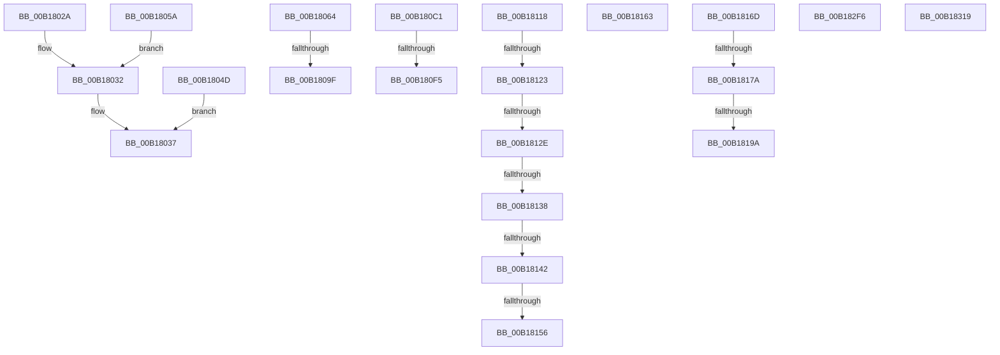

# sub_00B1802A

- RVA: `0x00B1802A`–`0x00B1833D` (길이 `787` bytes)
- VA: `0x0000000140B1802A`
- 실행 섹션: `PAGE`
- PDB 이름 있음: `아니요`; PDB Function 태그: `아니요`
- unwind 정보 RVA: `0x0006CDA8`
- 디코드: `154`개 명령, `787/787` bytes 표시
- 미해석 바이트: `0` (있으면 어셈블리에 `.byte`로 보존)

> 이 문서는 커널 이미지의 기계어와 PDB 기호를 분석해 생성했습니다. 4번과 5번은 함수 원형과 자료형을 바이너리 사용 방식에서 추정한 C 해석이며 원본 소스 복구 결과는 아닙니다.

## 1. Dependencies

- 직접 호출 지점: **11**; 고유 호출 대상: **9**
- 직접 호출자로 확인된 함수: **0**
- RIP 상대 이미지 참조: **4**

### Outgoing calls
- `0x00B18042` → [SetFailureLocation](../../text/46/SetFailureLocation_function_0046EF54.md) (function, `0x0046EF54`)
- `0x00B18090` → [ObDuplicateObject](../8C/ObDuplicateObject_function_008C4FA0.md) (function, `0x008C4FA0`)
- `0x00B180B6` → [ZwSetInformationObject](../../text/6A/ZwSetInformationObject_function_006ADC50.md) (function, `0x006ADC50`)
- `0x00B180E6` → [ObDuplicateObject](../8C/ObDuplicateObject_function_008C4FA0.md) (function, `0x008C4FA0`)
- `0x00B1810D` → [ZwSetInformationObject](../../text/6A/ZwSetInformationObject_function_006ADC50.md) (function, `0x006ADC50`)
- `0x00B18149` → [CmpAdjustFileCFSafety](../../text/4B/CmpAdjustFileCFSafety_function_004BCEF8.md) (function, `0x004BCEF8`)
- `0x00B1818B` → [tlgKeywordOn](../../text/42/tlgKeywordOn_function_0042EAA0.md) (function, `0x0042EAA0`)
- `0x00B182EB` → [tlgWriteTransfer_EtwWriteTransfer](../../text/42/tlgWriteTransfer_EtwWriteTransfer_function_004260E0.md) (function, `0x004260E0`)
- `0x00B182F9` → [HvMarkBaseBlockDirty](../87/HvMarkBaseBlockDirty_function_0087BD04.md) (function, `0x0087BD04`)
- `0x00B1832A` → [CmpUnlockHiveList](../84/CmpUnlockHiveList_function_0084E424.md) (function, `0x0084E424`)
- `0x00B18332` → [CmpRecheckHiveVolumePolicy](../../text/46/CmpRecheckHiveVolumePolicy_function_0046EE14.md) (function, `0x0046EE14`)

### Direct callers
- 이 함수 시작 RVA로 연결되는 직접 call은 확인되지 않았습니다. 간접 호출은 완전히 역산할 수 없습니다.

### Static image references
- `0x00B18064` → RVA `0x00FC6AB0` (`ALMOSTRO`; read)
- `0x00B1816D` → RVA `0x00E09F58` (`.data`; read)
- `0x00B18236` → RVA `0x00056FB5` (`.rdata`; read)
- `0x00B18323` → RVA `0x00FD9D20` (`PAGEDATA`; write)

## 2. Other-region calls and transfers

- 다른 실행 섹션으로 향하는 call: **7**
  - `0x00B18042` → [SetFailureLocation](../../text/46/SetFailureLocation_function_0046EF54.md) (`PAGE` → `.text`)
  - `0x00B180B6` → [ZwSetInformationObject](../../text/6A/ZwSetInformationObject_function_006ADC50.md) (`PAGE` → `.text`)
  - `0x00B1810D` → [ZwSetInformationObject](../../text/6A/ZwSetInformationObject_function_006ADC50.md) (`PAGE` → `.text`)
  - `0x00B18149` → [CmpAdjustFileCFSafety](../../text/4B/CmpAdjustFileCFSafety_function_004BCEF8.md) (`PAGE` → `.text`)
  - `0x00B1818B` → [tlgKeywordOn](../../text/42/tlgKeywordOn_function_0042EAA0.md) (`PAGE` → `.text`)
  - `0x00B182EB` → [tlgWriteTransfer_EtwWriteTransfer](../../text/42/tlgWriteTransfer_EtwWriteTransfer_function_004260E0.md) (`PAGE` → `.text`)
  - `0x00B18332` → [CmpRecheckHiveVolumePolicy](../../text/46/CmpRecheckHiveVolumePolicy_function_0046EE14.md) (`PAGE` → `.text`)
- call이 아닌 외부 분기/꼬리 이동: **17**
  - `0x00B18048` → [CmpCreateHive + 0x4A3](../87/CmpCreateHive_function_00879DF0.md) (`tail-transfer`)
  - `0x00B18099` → [CmpCreateHive + 0x62C](../87/CmpCreateHive_function_00879DF0.md) (`tail-transfer`)
  - `0x00B180BC` → [CmpCreateHive + 0x58D](../87/CmpCreateHive_function_00879DF0.md) (`tail-transfer`)
  - `0x00B180EF` → [CmpCreateHive + 0x62C](../87/CmpCreateHive_function_00879DF0.md) (`tail-transfer`)
  - `0x00B18113` → [CmpCreateHive + 0x1BE](../87/CmpCreateHive_function_00879DF0.md) (`tail-transfer`)
  - `0x00B1811D` → [CmpCreateHive + 0x317](../87/CmpCreateHive_function_00879DF0.md) (`tail-transfer`)
  - `0x00B18128` → [CmpCreateHive + 0x317](../87/CmpCreateHive_function_00879DF0.md) (`tail-transfer`)
  - `0x00B18132` → [CmpCreateHive + 0x317](../87/CmpCreateHive_function_00879DF0.md) (`tail-transfer`)
  - `0x00B1813C` → [CmpCreateHive + 0x31C](../87/CmpCreateHive_function_00879DF0.md) (`tail-transfer`)
  - `0x00B18150` → [CmpCreateHive + 0x317](../87/CmpCreateHive_function_00879DF0.md) (`tail-transfer`)
  - `0x00B1815E` → [CmpCreateHive + 0x31C](../87/CmpCreateHive_function_00879DF0.md) (`tail-transfer`)
  - `0x00B18168` → [CmpCreateHive + 0x62C](../87/CmpCreateHive_function_00879DF0.md) (`tail-transfer`)
  - `0x00B18174` → [CmpCreateHive + 0x3EC](../87/CmpCreateHive_function_00879DF0.md) (`tail-transfer`)
  - `0x00B18194` → [CmpCreateHive + 0x3EE](../87/CmpCreateHive_function_00879DF0.md) (`tail-transfer`)
  - `0x00B182F1` → [CmpCreateHive + 0x3EE](../87/CmpCreateHive_function_00879DF0.md) (`tail-transfer`)
  - `0x00B18314` → [CmpCreateHive + 0x3F9](../87/CmpCreateHive_function_00879DF0.md) (`tail-transfer`)
  - `0x00B18338` → [CmpCreateHive + 0x469](../87/CmpCreateHive_function_00879DF0.md) (`tail-transfer`)

## 3. Assembly (complete function range)

```asm
00B1802A  C7 44 24 20 50 00 00 00         mov dword ptr [rsp + 0x20], 0x50
00B18032  44 8B C6                        mov r8d, esi
00B18035  33 D2                           xor edx, edx
00B18037  BB 0D 00 00 C0                  mov ebx, 0xc000000d
00B1803C  49 8B CE                        mov rcx, r14
00B1803F  44 8B CB                        mov r9d, ebx
00B18042  E8 0D 6F 95 FF                  call 0x14046ef54
00B18047  90                              nop
00B18048  E9 46 22 D6 FF                  jmp 0x14087a293
00B1804D  C7 44 24 20 40 00 00 00         mov dword ptr [rsp + 0x20], 0x40
00B18055  44 8B C6                        mov r8d, esi
00B18058  EB DD                           jmp 0x140b18037
00B1805A  C7 44 24 20 80 00 00 00         mov dword ptr [rsp + 0x20], 0x80
00B18062  EB CE                           jmp 0x140b18032
00B18064  48 8B 0D 45 EA 4A 00            mov rcx, qword ptr [rip + 0x4aea45]
00B1806B  4C 8D AF 18 06 00 00            lea r13, [rdi + 0x618]
00B18072  88 5C 24 38                     mov byte ptr [rsp + 0x38], bl
00B18076  4D 8B CD                        mov r9, r13
00B18079  C7 44 24 30 02 00 00 00         mov dword ptr [rsp + 0x30], 2
00B18081  45 33 C0                        xor r8d, r8d
00B18084  C7 44 24 28 00 02 00 00         mov dword ptr [rsp + 0x28], 0x200
00B1808C  89 5C 24 20                     mov dword ptr [rsp + 0x20], ebx
00B18090  E8 0B CF DA FF                  call 0x1408c4fa0
00B18095  8B D8                           mov ebx, eax
00B18097  85 C0                           test eax, eax
00B18099  0F 88 7D 23 D6 FF               js 0x14087a41c
00B1809F  49 8B 4D 00                     mov rcx, qword ptr [r13]
00B180A3  4C 8D 45 80                     lea r8, [rbp - 0x80]
00B180A7  33 DB                           xor ebx, ebx
00B180A9  66 C7 45 80 00 01               mov word ptr [rbp - 0x80], 0x100
00B180AF  44 8D 4B 02                     lea r9d, [rbx + 2]
00B180B3  8D 53 04                        lea edx, [rbx + 4]
00B180B6  E8 95 5B B9 FF                  call 0x1406adc50
00B180BB  90                              nop
00B180BC  E9 BC 22 D6 FF                  jmp 0x14087a37d
00B180C1  48 8B 0D E8 E9 4A 00            mov rcx, qword ptr [rip + 0x4ae9e8]
00B180C8  4D 8B CD                        mov r9, r13
00B180CB  88 5C 24 38                     mov byte ptr [rsp + 0x38], bl
00B180CF  45 33 C0                        xor r8d, r8d
00B180D2  C7 44 24 30 02 00 00 00         mov dword ptr [rsp + 0x30], 2
00B180DA  C7 44 24 28 00 02 00 00         mov dword ptr [rsp + 0x28], 0x200
00B180E2  89 5C 24 20                     mov dword ptr [rsp + 0x20], ebx
00B180E6  E8 B5 CE DA FF                  call 0x1408c4fa0
00B180EB  8B D8                           mov ebx, eax
00B180ED  85 C0                           test eax, eax
00B180EF  0F 88 27 23 D6 FF               js 0x14087a41c
00B180F5  49 8B 4D 00                     mov rcx, qword ptr [r13]
00B180F9  4C 8D 45 80                     lea r8, [rbp - 0x80]
00B180FD  41 B9 02 00 00 00               mov r9d, 2
00B18103  66 C7 45 80 00 01               mov word ptr [rbp - 0x80], 0x100
00B18109  41 8D 51 02                     lea edx, [r9 + 2]
00B1810D  E8 3E 5B B9 FF                  call 0x1406adc50
00B18112  90                              nop
00B18113  E9 96 1E D6 FF                  jmp 0x140879fae
00B18118  41 0F BA E5 19                  bt r13d, 0x19
00B1811D  0F 82 E4 1F D6 FF               jb 0x14087a107
00B18123  41 0F BA E7 0F                  bt r15d, 0xf
00B18128  0F 82 D9 1F D6 FF               jb 0x14087a107
00B1812E  41 F6 C5 40                     test r13b, 0x40
00B18132  0F 85 CF 1F D6 FF               jne 0x14087a107
00B18138  41 F6 C5 20                     test r13b, 0x20
00B1813C  0F 85 CA 1F D6 FF               jne 0x14087a10c
00B18142  49 8B 0C 24                     mov rcx, qword ptr [r12]
00B18146  40 8A D6                        mov dl, sil
00B18149  E8 AA 4D 9A FF                  call 0x1404bcef8
00B1814E  85 C0                           test eax, eax
00B18150  0F 88 B1 1F D6 FF               js 0x14087a107
00B18156  0F BA AF 10 10 00 00 10         bts dword ptr [rdi + 0x1010], 0x10
00B1815E  E9 A9 1F D6 FF                  jmp 0x14087a10c
00B18163  BB 0D 00 00 C0                  mov ebx, 0xc000000d
00B18168  E9 AF 22 D6 FF                  jmp 0x14087a41c
00B1816D  83 3D E4 1D 2F 00 05            cmp dword ptr [rip + 0x2f1de4], 5
00B18174  0F 86 62 20 D6 FF               jbe 0x14087a1dc
00B1817A  48 BA 00 00 00 00 00 40 00 00   movabs rdx, 0x400000000000
00B18184  48 8D 0D CD 1D 2F 00            lea rcx, [rip + 0x2f1dcd]
00B1818B  E8 10 69 91 FF                  call 0x14042eaa0
00B18190  33 DB                           xor ebx, ebx
00B18192  84 C0                           test al, al
00B18194  0F 84 44 20 D6 FF               je 0x14087a1de
00B1819A  44 89 45 88                     mov dword ptr [rbp - 0x78], r8d
00B1819E  48 8D 45 88                     lea rax, [rbp - 0x78]
00B181A2  48 89 45 70                     mov qword ptr [rbp + 0x70], rax
00B181A6  48 8D 4D 80                     lea rcx, [rbp - 0x80]
00B181AA  49 8D 46 08                     lea rax, [r14 + 8]
00B181AE  48 89 8D 80 00 00 00            mov qword ptr [rbp + 0x80], rcx
00B181B5  0F B7 10                        movzx edx, word ptr [rax]
00B181B8  49 8D 4E 0A                     lea rcx, [r14 + 0xa]
00B181BC  44 0F B7 09                     movzx r9d, word ptr [rcx]
00B181C0  4C 8D 45 8C                     lea r8, [rbp - 0x74]
00B181C4  48 89 85 B0 00 00 00            mov qword ptr [rbp + 0xb0], rax
00B181CB  4C 8D 5D 90                     lea r11, [rbp - 0x70]
00B181CF  49 8D 46 0C                     lea rax, [r14 + 0xc]
00B181D3  4C 89 85 90 00 00 00            mov qword ptr [rbp + 0x90], r8
00B181DA  48 89 85 C0 00 00 00            mov qword ptr [rbp + 0xc0], rax
00B181E1  4D 8D 86 8A 01 00 00            lea r8, [r14 + 0x18a]
00B181E8  45 0F B6 10                     movzx r10d, byte ptr [r8]
00B181EC  8D 04 52                        lea eax, [rdx + rdx*2]
00B181EF  C1 E0 02                        shl eax, 2
00B181F2  89 85 C8 00 00 00               mov dword ptr [rbp + 0xc8], eax
00B181F8  49 8D 46 6C                     lea rax, [r14 + 0x6c]
00B181FC  48 89 85 E0 00 00 00            mov qword ptr [rbp + 0xe0], rax
00B18203  43 8D 04 49                     lea eax, [r9 + r9*2]
00B18207  C1 E0 02                        shl eax, 2
00B1820A  89 85 E8 00 00 00               mov dword ptr [rbp + 0xe8], eax
00B18210  49 8D 86 8C 01 00 00            lea rax, [r14 + 0x18c]
00B18217  48 89 85 00 01 00 00            mov qword ptr [rbp + 0x100], rax
00B1821E  48 8D 45 A0                     lea rax, [rbp - 0x60]
00B18222  48 89 85 10 01 00 00            mov qword ptr [rbp + 0x110], rax
00B18229  48 8D 45 50                     lea rax, [rbp + 0x50]
00B1822D  66 44 89 55 90                  mov word ptr [rbp - 0x70], r10w
00B18232  66 89 55 80                     mov word ptr [rbp - 0x80], dx
00B18236  48 8D 15 78 ED 53 FF            lea rdx, [rip - 0xac1288]
00B1823D  66 44 89 4D 8C                  mov word ptr [rbp - 0x74], r9w
00B18242  45 33 C9                        xor r9d, r9d
00B18245  48 89 8D D0 00 00 00            mov qword ptr [rbp + 0xd0], rcx
00B1824C  48 8D 0D 05 1D 2F 00            lea rcx, [rip + 0x2f1d05]
00B18253  4C 89 85 F0 00 00 00            mov qword ptr [rbp + 0xf0], r8
00B1825A  45 33 C0                        xor r8d, r8d
00B1825D  41 C1 E2 03                     shl r10d, 3
00B18261  48 89 44 24 28                  mov qword ptr [rsp + 0x28], rax
00B18266  C7 44 24 20 0D 00 00 00         mov dword ptr [rsp + 0x20], 0xd
00B1826E  48 C7 45 78 04 00 00 00         mov qword ptr [rbp + 0x78], 4
00B18276  48 C7 85 88 00 00 00 02 00 00 00  mov qword ptr [rbp + 0x88], 2
00B18281  48 C7 85 98 00 00 00 02 00 00 00  mov qword ptr [rbp + 0x98], 2
00B1828C  4C 89 9D A0 00 00 00            mov qword ptr [rbp + 0xa0], r11
00B18293  48 C7 85 A8 00 00 00 02 00 00 00  mov qword ptr [rbp + 0xa8], 2
00B1829E  48 C7 85 B8 00 00 00 02 00 00 00  mov qword ptr [rbp + 0xb8], 2
00B182A9  89 9D CC 00 00 00               mov dword ptr [rbp + 0xcc], ebx
00B182AF  48 C7 85 D8 00 00 00 02 00 00 00  mov qword ptr [rbp + 0xd8], 2
00B182BA  89 9D EC 00 00 00               mov dword ptr [rbp + 0xec], ebx
00B182C0  48 C7 85 F8 00 00 00 02 00 00 00  mov qword ptr [rbp + 0xf8], 2
00B182CB  44 89 95 08 01 00 00            mov dword ptr [rbp + 0x108], r10d
00B182D2  89 9D 0C 01 00 00               mov dword ptr [rbp + 0x10c], ebx
00B182D8  48 C7 45 A0 00 00 00 01         mov qword ptr [rbp - 0x60], 0x1000000
00B182E0  48 C7 85 18 01 00 00 08 00 00 00  mov qword ptr [rbp + 0x118], 8
00B182EB  E8 F0 DD 90 FF                  call 0x1404260e0
00B182F0  90                              nop
00B182F1  E9 E8 1E D6 FF                  jmp 0x14087a1de
00B182F6  48 8B CF                        mov rcx, rdi
00B182F9  E8 06 3A D6 FF                  call 0x14087bd04
00B182FE  48 8B 47 40                     mov rax, qword ptr [rdi + 0x40]
00B18302  C7 40 18 06 00 00 00            mov dword ptr [rax + 0x18], 6
00B18309  48 8B 47 40                     mov rax, qword ptr [rdi + 0x40]
00B1830D  44 09 B8 90 00 00 00            or dword ptr [rax + 0x90], r15d
00B18314  E9 D0 1E D6 FF                  jmp 0x14087a1e9
00B18319  48 89 0B                        mov qword ptr [rbx], rcx
00B1831C  48 89 43 08                     mov qword ptr [rbx + 8], rax
00B18320  48 89 18                        mov qword ptr [rax], rbx
00B18323  48 89 1D F6 19 4C 00            mov qword ptr [rip + 0x4c19f6], rbx
00B1832A  E8 F5 60 D3 FF                  call 0x14084e424
00B1832F  48 8B CF                        mov rcx, rdi
00B18332  E8 DD 6A 95 FF                  call 0x14046ee14
00B18337  90                              nop
00B18338  E9 1C 1F D6 FF                  jmp 0x14087a259
```

## 4. C-style interpretation (structured pseudocode)

```c
__int64 __fastcall sub_00B1802A(__int64 a1, int a2)
{
    __int64 result;
    unsigned int v_stack_p20;
    unsigned int v_stack_p28;
    unsigned int v_stack_p30;
    unsigned __int8 v_stack_p38;

    v_stack_p20 = 80;
loc_00B18032:
    a2 = 0;
loc_00B18037:
    result = SetFailureLocation(v_r14, a2, (unsigned int)((unsigned int)(v_rsi)), (unsigned int)((unsigned int)((unsigned int)(0xC000000DULL))));
}
```

## 5. (Beta) C Style

```c
int64_t sub_00B1802A(int64_t Arg1, int32_t Arg2)
{
    int64_t result;
    uint32_t v_stack_p20;
    uint32_t v_stack_p28;
    uint32_t v_stack_p30;
    uint8_t v_stack_p38;

    v_stack_p20 = 80;
loc_00B18032:
    Arg2 = 0;
loc_00B18037:
    result = SetFailureLocation(local_r14, Arg2, (uint32_t)((uint32_t)(local_rsi)), (uint32_t)((uint32_t)((uint32_t)(0xC000000DULL))));
}
```

## 6. Execution-region graph

[열기: 2D/3D 그래프와 함수 탐색 컨트롤 패널](../../../control-panel.html?section=page&rva=0x00B1802A&view=graph)

- 2D 그래프는 위에서 아래로 흐르고, 3D 그래프는 빈 공간을 드래그해 회전합니다. Shift+드래그는 이동, 휠은 확대·축소, 함수 노드 선택은 대상 보고서 이동입니다.

### Static fallback


