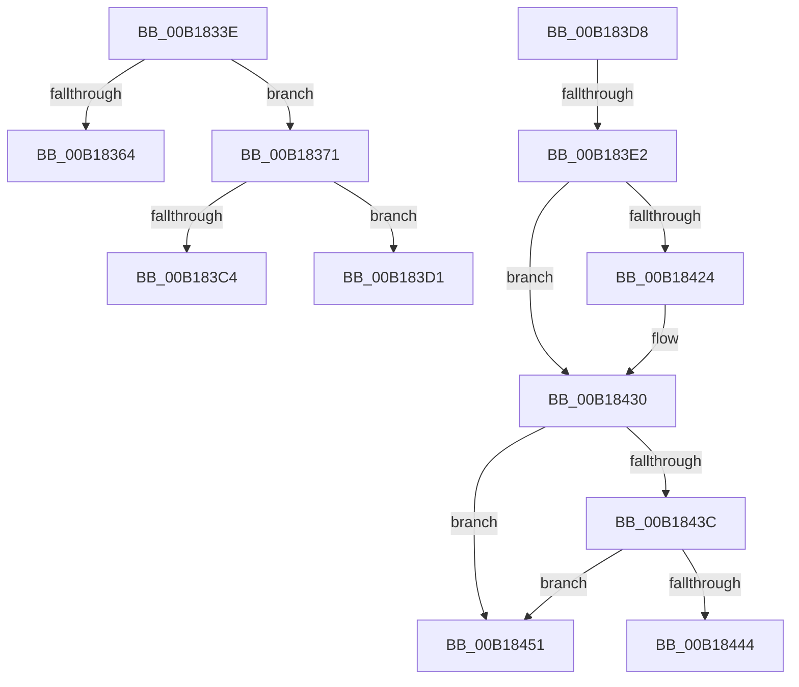

# sub_00B1833E

- RVA: `0x00B1833E`–`0x00B1845B` (길이 `285` bytes)
- VA: `0x0000000140B1833E`
- 실행 섹션: `PAGE`
- PDB 이름 있음: `아니요`; PDB Function 태그: `아니요`
- unwind 정보 RVA: `0x0006CDF4`
- 디코드: `65`개 명령, `285/285` bytes 표시
- 미해석 바이트: `0` (있으면 어셈블리에 `.byte`로 보존)

> 이 문서는 커널 이미지의 기계어와 PDB 기호를 분석해 생성했습니다. 4번과 5번은 함수 원형과 자료형을 바이너리 사용 방식에서 추정한 C 해석이며 원본 소스 복구 결과는 아닙니다.

## 1. Dependencies

- 직접 호출 지점: **5**; 고유 호출 대상: **5**
- 직접 호출자로 확인된 함수: **0**
- RIP 상대 이미지 참조: **0**

### Outgoing calls
- `0x00B18359` → [ZwSetInformationFile](../../text/6A/ZwSetInformationFile_function_006AD5B0.md) (function, `0x006AD5B0`)
- `0x00B18376` → [ZwClose](../../text/6A/ZwClose_function_006AD2B0.md) (function, `0x006AD2B0`)
- `0x00B183B9` → [ZwCreateFile](../../text/6A/ZwCreateFile_function_006ADB70.md) (function, `0x006ADB70`)
- `0x00B18416` → [ZwFsControlFile](../../text/6A/ZwFsControlFile_function_006AD7F0.md) (function, `0x006AD7F0`)
- `0x00B18428` → [CmSiWaitForSingleEvent](../../text/49/CmSiWaitForSingleEvent_function_0049E4BC.md) (function, `0x0049E4BC`)

### Direct callers
- 이 함수 시작 RVA로 연결되는 직접 call은 확인되지 않았습니다. 간접 호출은 완전히 역산할 수 없습니다.

### Static image references
- 디코드된 RIP-relative 메모리 참조가 없습니다.

## 2. Other-region calls and transfers

- 다른 실행 섹션으로 향하는 call: **5**
  - `0x00B18359` → [ZwSetInformationFile](../../text/6A/ZwSetInformationFile_function_006AD5B0.md) (`PAGE` → `.text`)
  - `0x00B18376` → [ZwClose](../../text/6A/ZwClose_function_006AD2B0.md) (`PAGE` → `.text`)
  - `0x00B183B9` → [ZwCreateFile](../../text/6A/ZwCreateFile_function_006ADB70.md) (`PAGE` → `.text`)
  - `0x00B18416` → [ZwFsControlFile](../../text/6A/ZwFsControlFile_function_006AD7F0.md) (`PAGE` → `.text`)
  - `0x00B18428` → [CmSiWaitForSingleEvent](../../text/49/CmSiWaitForSingleEvent_function_0049E4BC.md) (`PAGE` → `.text`)
- call이 아닌 외부 분기/꼬리 이동: **6**
  - `0x00B1836C` → [CmpOpenHiveFile + 0x26E](../87/CmpOpenHiveFile_function_0087A71C.md) (`tail-transfer`)
  - `0x00B183CC` → [CmpOpenHiveFile + 0x26E](../87/CmpOpenHiveFile_function_0087A71C.md) (`tail-transfer`)
  - `0x00B183D3` → [CmpOpenHiveFile + 0x27F](../87/CmpOpenHiveFile_function_0087A71C.md) (`tail-transfer`)
  - `0x00B183DC` → [CmpOpenHiveFile + 0x2F5](../87/CmpOpenHiveFile_function_0087A71C.md) (`tail-transfer`)
  - `0x00B1844C` → [CmpOpenHiveFile + 0x440](../87/CmpOpenHiveFile_function_0087A71C.md) (`tail-transfer`)
  - `0x00B18456` → [CmpOpenHiveFile + 0x2F5](../87/CmpOpenHiveFile_function_0087A71C.md) (`tail-transfer`)

## 3. Assembly (complete function range)

```asm
00B1833E  48 8B 4C 24 70                  mov rcx, qword ptr [rsp + 0x70]
00B18343  4C 8D 45 40                     lea r8, [rbp + 0x40]
00B18347  41 B9 28 00 00 00               mov r9d, 0x28
00B1834D  C7 44 24 20 04 00 00 00         mov dword ptr [rsp + 0x20], 4
00B18355  48 8D 55 D0                     lea rdx, [rbp - 0x30]
00B18359  E8 52 52 B9 FF                  call 0x1406ad5b0
00B1835E  8B D8                           mov ebx, eax
00B18360  85 C0                           test eax, eax
00B18362  79 0D                           jns 0x140b18371
00B18364  C7 44 24 20 30 00 00 00         mov dword ptr [rsp + 0x20], 0x30
00B1836C  E9 19 26 D6 FF                  jmp 0x14087a98a
00B18371  48 8B 4C 24 70                  mov rcx, qword ptr [rsp + 0x70]
00B18376  E8 35 4F B9 FF                  call 0x1406ad2b0
00B1837B  8B 44 24 78                     mov eax, dword ptr [rsp + 0x78]
00B1837F  4C 8D 4D 90                     lea r9, [rbp - 0x70]
00B18383  33 C9                           xor ecx, ecx
00B18385  4C 8D 45 E0                     lea r8, [rbp - 0x20]
00B18389  89 4C 24 50                     mov dword ptr [rsp + 0x50], ecx
00B1838D  48 89 4C 24 48                  mov qword ptr [rsp + 0x48], rcx
00B18392  44 89 6C 24 40                  mov dword ptr [rsp + 0x40], r13d
00B18397  C7 44 24 38 01 00 00 00         mov dword ptr [rsp + 0x38], 1
00B1839F  8D 51 03                        lea edx, [rcx + 3]
00B183A2  89 4C 24 30                     mov dword ptr [rsp + 0x30], ecx
00B183A6  89 44 24 28                     mov dword ptr [rsp + 0x28], eax
00B183AA  48 89 4C 24 20                  mov qword ptr [rsp + 0x20], rcx
00B183AF  48 89 4C 24 70                  mov qword ptr [rsp + 0x70], rcx
00B183B4  48 8D 4C 24 68                  lea rcx, [rsp + 0x68]
00B183B9  E8 B2 57 B9 FF                  call 0x1406adb70
00B183BE  8B D8                           mov ebx, eax
00B183C0  85 C0                           test eax, eax
00B183C2  79 0D                           jns 0x140b183d1
00B183C4  C7 44 24 20 40 00 00 00         mov dword ptr [rsp + 0x20], 0x40
00B183CC  E9 B9 25 D6 FF                  jmp 0x14087a98a
00B183D1  33 DB                           xor ebx, ebx
00B183D3  E9 C3 25 D6 FF                  jmp 0x14087a99b
00B183D8  41 F6 C7 20                     test r15b, 0x20
00B183DC  0F 85 2F 26 D6 FF               jne 0x14087aa11
00B183E2  48 8B 55 A8                     mov rdx, qword ptr [rbp - 0x58]
00B183E6  48 8D 45 90                     lea rax, [rbp - 0x70]
00B183EA  48 8B 4C 24 68                  mov rcx, qword ptr [rsp + 0x68]
00B183EF  45 33 C9                        xor r9d, r9d
00B183F2  44 89 6C 24 48                  mov dword ptr [rsp + 0x48], r13d
00B183F7  45 33 C0                        xor r8d, r8d
00B183FA  4C 89 6C 24 40                  mov qword ptr [rsp + 0x40], r13
00B183FF  44 89 6C 24 38                  mov dword ptr [rsp + 0x38], r13d
00B18404  4C 89 6C 24 30                  mov qword ptr [rsp + 0x30], r13
00B18409  C7 44 24 28 4F 00 09 00         mov dword ptr [rsp + 0x28], 0x9004f
00B18411  48 89 44 24 20                  mov qword ptr [rsp + 0x20], rax
00B18416  E8 D5 53 B9 FF                  call 0x1406ad7f0
00B1841B  8B D8                           mov ebx, eax
00B1841D  3D 03 01 00 00                  cmp eax, 0x103
00B18422  75 0C                           jne 0x140b18430
00B18424  48 8D 4D A8                     lea rcx, [rbp - 0x58]
00B18428  E8 8F 60 98 FF                  call 0x14049e4bc
00B1842D  8B 5D 90                        mov ebx, dword ptr [rbp - 0x70]
00B18430  B9 00 00 00 80                  mov ecx, 0x80000000
00B18435  8D 04 0B                        lea eax, [rbx + rcx]
00B18438  85 C1                           test ecx, eax
00B1843A  75 15                           jne 0x140b18451
00B1843C  81 FB 10 00 00 C0               cmp ebx, 0xc0000010
00B18442  74 0D                           je 0x140b18451
00B18444  C7 44 24 20 60 00 00 00         mov dword ptr [rsp + 0x20], 0x60
00B1844C  E9 0B 27 D6 FF                  jmp 0x14087ab5c
00B18451  BB 02 00 00 00                  mov ebx, 2
00B18456  E9 B6 25 D6 FF                  jmp 0x14087aa11
```

## 4. C-style interpretation (structured pseudocode)

```c
__int64 __fastcall sub_00B1833E(__int64 a1, __int64 a2, __int64 a3, __int64 a4, __int64 a5, __int64 a6, __int64 a7, __int64 a8, __int64 a9, __int64 a10, __int64 a11, __int64 a12, __int64 a13, __int64 a14, unsigned int a15)
{
    __int64 result;
    __int64 v_rbx;
    unsigned int v_stack_p20;
    unsigned int v_stack_p28;
    unsigned int v_stack_p30;
    unsigned int v_stack_p38;
    unsigned int v_stack_p40;
    unsigned __int64 v_stack_p48;
    unsigned int v_stack_p50;
    unsigned __int64 v_stack_p68;
    unsigned __int64 v_stack_p70;

    v_stack_p20 = 4;
    result = ZwSetInformationFile(a14, v_rbp - 48, v_rbp + 64, 40);
    if (!sign_flag) goto loc_00B18371;
    v_stack_p20 = 48;
loc_00B18371:
    result = ZwClose(a14, v_rbp - 48, v_rbp + 64, 40);
    a1 = 0;
    v_stack_p50 = 0;
    v_stack_p48 = 0;
    v_stack_p40 = (unsigned int)(v_r13);
    v_stack_p38 = 1;
    v_stack_p30 = 0;
    v_stack_p28 = (unsigned int)((unsigned int)(a15));
    v_stack_p20 = 0;
    v_stack_p70 = 0;
    result = ZwCreateFile(a13, a1 + 3, v_rbp - 32, v_rbp - 112);
    if (!sign_flag) goto loc_00B183D1;
    v_stack_p20 = 64;
loc_00B183D1:
    v_rbx = 0;
}
```

## 5. (Beta) C Style

```c
int64_t sub_00B1833E(int64_t Arg1, int64_t Arg2, int64_t Arg3, int64_t Arg4, uint64_t Arg5, uint64_t Arg6, uint64_t Arg7, uint64_t Arg8, uint64_t Arg9, uint64_t Arg10, uint64_t Arg11, uint64_t Arg12, int64_t Arg13, int64_t Arg14, uint32_t Arg15)
{
    int64_t result;
    int64_t local_rbx;
    uint32_t v_stack_p20;
    uint32_t v_stack_p28;
    uint32_t v_stack_p30;
    uint32_t v_stack_p38;
    uint32_t v_stack_p40;
    uint64_t v_stack_p48;
    uint32_t v_stack_p50;
    uint64_t v_stack_p68;
    uint64_t v_stack_p70;

    v_stack_p20 = 4;
    result = ZwSetInformationFile(Arg14, local_rbp - 48, local_rbp + 64, 40);
    if (!sign_flag) goto loc_00B18371;
    v_stack_p20 = 48;
loc_00B18371:
    result = ZwClose(Arg14, local_rbp - 48, local_rbp + 64, 40);
    Arg1 = 0;
    v_stack_p50 = 0;
    v_stack_p48 = 0;
    v_stack_p40 = (uint32_t)(local_r13);
    v_stack_p38 = 1;
    v_stack_p30 = 0;
    v_stack_p28 = (uint32_t)((uint32_t)(Arg15));
    v_stack_p20 = 0;
    v_stack_p70 = 0;
    result = ZwCreateFile(Arg13, Arg1 + 3, local_rbp - 32, local_rbp - 112);
    if (!sign_flag) goto loc_00B183D1;
    v_stack_p20 = 64;
loc_00B183D1:
    local_rbx = 0;
}
```

## 6. Execution-region graph

[열기: 2D/3D 그래프와 함수 탐색 컨트롤 패널](../../../control-panel.html?section=page&rva=0x00B1833E&view=graph)

- 2D 그래프는 위에서 아래로 흐르고, 3D 그래프는 빈 공간을 드래그해 회전합니다. Shift+드래그는 이동, 휠은 확대·축소, 함수 노드 선택은 대상 보고서 이동입니다.

### Static fallback


