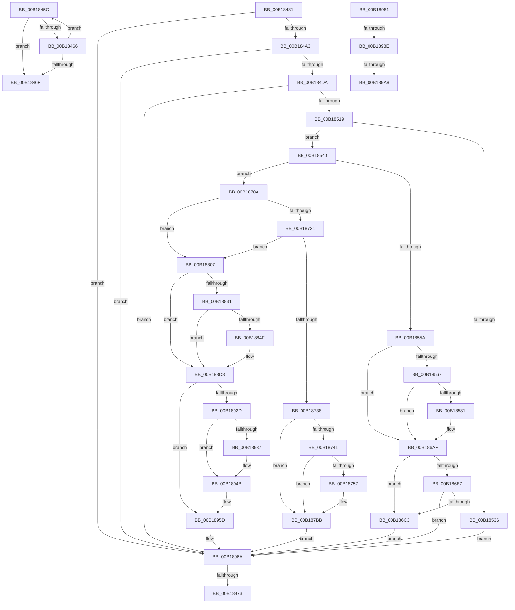

# sub_00B1845C

- RVA: `0x00B1845C`–`0x00B18A03` (길이 `1,447` bytes)
- VA: `0x0000000140B1845C`
- 실행 섹션: `PAGE`
- PDB 이름 있음: `아니요`; PDB Function 태그: `아니요`
- unwind 정보 RVA: `0x0006CEDC`
- 디코드: `305`개 명령, `1,447/1,447` bytes 표시
- 미해석 바이트: `0` (있으면 어셈블리에 `.byte`로 보존)

> 이 문서는 커널 이미지의 기계어와 PDB 기호를 분석해 생성했습니다. 4번과 5번은 함수 원형과 자료형을 바이너리 사용 방식에서 추정한 C 해석이며 원본 소스 복구 결과는 아닙니다.

## 1. Dependencies

- 직접 호출 지점: **39**; 고유 호출 대상: **18**
- 직접 호출자로 확인된 함수: **0**
- RIP 상대 이미지 참조: **10**

### Outgoing calls
- `0x00B1848F` → [CmpCreateEmptyHiveClone](../7E/CmpCreateEmptyHiveClone_function_007EE2E0.md) (function, `0x007EE2E0`)
- `0x00B184CB` → [CmpCopyKeyPartial](../85/CmpCopyKeyPartial_function_0085AFF4.md) (function, `0x0085AFF4`)
- `0x00B184E8` → [HvMarkBaseBlockDirty](../87/HvMarkBaseBlockDirty_function_0087BD04.md) (function, `0x0087BD04`)
- `0x00B1850A` → [CmpCopySyncTree](../7F/CmpCopySyncTree_function_007F21A0.md) (function, `0x007F21A0`)
- `0x00B18529` → [CmpAllocatePool](../../text/3C/CmpAllocatePool_function_003CD504.md) (function, `0x003CD504`)
- `0x00B1854B` → [CmCheckRegistry](../96/CmCheckRegistry_function_0096D2F4.md) (function, `0x0096D2F4`)
- `0x00B18574` → [tlgKeywordOn](../../text/42/tlgKeywordOn_function_0042EAA0.md) (function, `0x0042EAA0`)
- `0x00B186AA` → [tlgWriteTransfer_EtwWriteTransfer](../../text/42/tlgWriteTransfer_EtwWriteTransfer_function_004260E0.md) (function, `0x004260E0`)
- `0x00B186C3` → [CmpLockRegistry](../../pagecmrc/BC/CmpLockRegistry_function_00BC9B34.md) (function, `0x00BC9B34`)
- `0x00B186CB` → [HvLockHiveFlusherShared](../84/HvLockHiveFlusherShared_function_0084F95C.md) (function, `0x0084F95C`)
- `0x00B186D3` → [HvLockHiveWriter](../85/HvLockHiveWriter_function_00859894.md) (function, `0x00859894`)
- `0x00B186DB` → [HvMarkBaseBlockDirty](../87/HvMarkBaseBlockDirty_function_0087BD04.md) (function, `0x0087BD04`)
- `0x00B186F3` → [HvUnlockHiveWriter](../85/HvUnlockHiveWriter_function_008598E4.md) (function, `0x008598E4`)
- `0x00B186FB` → [HvUnlockHiveFlusherShared](../84/HvUnlockHiveFlusherShared_function_00848738.md) (function, `0x00848738`)
- `0x00B18700` → [CmpUnlockRegistry](../../pagecmrc/BC/CmpUnlockRegistry_function_00BC9A84.md) (function, `0x00BC9A84`)
- `0x00B1874E` → [tlgKeywordOn](../../text/42/tlgKeywordOn_function_0042EAA0.md) (function, `0x0042EAA0`)
- `0x00B187B6` → [tlgWriteTransfer_EtwWriteTransfer](../../text/42/tlgWriteTransfer_EtwWriteTransfer_function_004260E0.md) (function, `0x004260E0`)
- `0x00B187BB` → [CmpLockRegistry](../../pagecmrc/BC/CmpLockRegistry_function_00BC9B34.md) (function, `0x00BC9B34`)
- `0x00B187C3` → [HvLockHiveFlusherShared](../84/HvLockHiveFlusherShared_function_0084F95C.md) (function, `0x0084F95C`)
- `0x00B187CB` → [HvLockHiveWriter](../85/HvLockHiveWriter_function_00859894.md) (function, `0x00859894`)
- `0x00B187D3` → [HvMarkBaseBlockDirty](../87/HvMarkBaseBlockDirty_function_0087BD04.md) (function, `0x0087BD04`)
- `0x00B187EB` → [HvUnlockHiveWriter](../85/HvUnlockHiveWriter_function_008598E4.md) (function, `0x008598E4`)
- `0x00B187F3` → [HvUnlockHiveFlusherShared](../84/HvUnlockHiveFlusherShared_function_00848738.md) (function, `0x00848738`)
- `0x00B187F8` → [CmpUnlockRegistry](../../pagecmrc/BC/CmpUnlockRegistry_function_00BC9A84.md) (function, `0x00BC9A84`)
- `0x00B1881F` → [CmpSwapHiveStorage](../7E/CmpSwapHiveStorage_function_007EE54C.md) (function, `0x007EE54C`)
- `0x00B18842` → [tlgKeywordOn](../../text/42/tlgKeywordOn_function_0042EAA0.md) (function, `0x0042EAA0`)
- `0x00B188D3` → [tlgWriteTransfer_EtwWriteTransfer](../../text/42/tlgWriteTransfer_EtwWriteTransfer_function_004260E0.md) (function, `0x004260E0`)
- `0x00B188D8` → [CmpLockRegistry](../../pagecmrc/BC/CmpLockRegistry_function_00BC9B34.md) (function, `0x00BC9B34`)
- `0x00B188E0` → [HvLockHiveFlusherShared](../84/HvLockHiveFlusherShared_function_0084F95C.md) (function, `0x0084F95C`)
- `0x00B188E8` → [HvLockHiveWriter](../85/HvLockHiveWriter_function_00859894.md) (function, `0x00859894`)
- `0x00B188F0` → [HvMarkBaseBlockDirty](../87/HvMarkBaseBlockDirty_function_0087BD04.md) (function, `0x0087BD04`)
- `0x00B18908` → [HvUnlockHiveWriter](../85/HvUnlockHiveWriter_function_008598E4.md) (function, `0x008598E4`)
- `0x00B18910` → [HvUnlockHiveFlusherShared](../84/HvUnlockHiveFlusherShared_function_00848738.md) (function, `0x00848738`)
- `0x00B18915` → [CmpUnlockRegistry](../../pagecmrc/BC/CmpUnlockRegistry_function_00BC9A84.md) (function, `0x00BC9A84`)
- `0x00B18923` → [CmpLogReorganizeEvent](../7E/CmpLogReorganizeEvent_function_007E22A4.md) (function, `0x007E22A4`)
- `0x00B18958` → [CmpUpdateReorganizeRegistryValues](../7E/CmpUpdateReorganizeRegistryValues_function_007EA7D4.md) (function, `0x007EA7D4`)
- `0x00B18976` → [CmpDestroyHive](../9B/CmpDestroyHive_function_009B1708.md) (function, `0x009B1708`)
- `0x00B1899B` → [tlgKeywordOn](../../text/42/tlgKeywordOn_function_0042EAA0.md) (function, `0x0042EAA0`)
- `0x00B189F8` → [tlgWriteTransfer_EtwWriteTransfer](../../text/42/tlgWriteTransfer_EtwWriteTransfer_function_004260E0.md) (function, `0x004260E0`)

### Direct callers
- 이 함수 시작 RVA로 연결되는 직접 call은 확인되지 않았습니다. 간접 호출은 완전히 역산할 수 없습니다.

### Static image references
- `0x00B1855A` → RVA `0x00E09F58` (`.data`; read)
- `0x00B1860F` → RVA `0x00056DB0` (`.rdata`; read)
- `0x00B18765` → RVA `0x00056D48` (`.rdata`; read)
- `0x00B18853` → RVA `0x00056F5F` (`.rdata`; read)
- `0x00B1892F` → RVA `0x00E0ECB0` (`.data`; read)
- `0x00B18937` → RVA `0x00EEFC48` (`.data`; write)
- `0x00B1893E` → RVA `0x00EEFC40` (`.data`; write)
- `0x00B18945` → RVA `0x00E0ECB0` (`.data`; write)
- `0x00B18951` → RVA `0x00EEFC48` (`.data`; read/write)
- `0x00B189B5` → RVA `0x00056F1D` (`.rdata`; read)

## 2. Other-region calls and transfers

- 다른 실행 섹션으로 향하는 call: **15**
  - `0x00B18529` → [CmpAllocatePool](../../text/3C/CmpAllocatePool_function_003CD504.md) (`PAGE` → `.text`)
  - `0x00B18574` → [tlgKeywordOn](../../text/42/tlgKeywordOn_function_0042EAA0.md) (`PAGE` → `.text`)
  - `0x00B186AA` → [tlgWriteTransfer_EtwWriteTransfer](../../text/42/tlgWriteTransfer_EtwWriteTransfer_function_004260E0.md) (`PAGE` → `.text`)
  - `0x00B186C3` → [CmpLockRegistry](../../pagecmrc/BC/CmpLockRegistry_function_00BC9B34.md) (`PAGE` → `PAGECMRC`)
  - `0x00B18700` → [CmpUnlockRegistry](../../pagecmrc/BC/CmpUnlockRegistry_function_00BC9A84.md) (`PAGE` → `PAGECMRC`)
  - `0x00B1874E` → [tlgKeywordOn](../../text/42/tlgKeywordOn_function_0042EAA0.md) (`PAGE` → `.text`)
  - `0x00B187B6` → [tlgWriteTransfer_EtwWriteTransfer](../../text/42/tlgWriteTransfer_EtwWriteTransfer_function_004260E0.md) (`PAGE` → `.text`)
  - `0x00B187BB` → [CmpLockRegistry](../../pagecmrc/BC/CmpLockRegistry_function_00BC9B34.md) (`PAGE` → `PAGECMRC`)
  - `0x00B187F8` → [CmpUnlockRegistry](../../pagecmrc/BC/CmpUnlockRegistry_function_00BC9A84.md) (`PAGE` → `PAGECMRC`)
  - `0x00B18842` → [tlgKeywordOn](../../text/42/tlgKeywordOn_function_0042EAA0.md) (`PAGE` → `.text`)
  - `0x00B188D3` → [tlgWriteTransfer_EtwWriteTransfer](../../text/42/tlgWriteTransfer_EtwWriteTransfer_function_004260E0.md) (`PAGE` → `.text`)
  - `0x00B188D8` → [CmpLockRegistry](../../pagecmrc/BC/CmpLockRegistry_function_00BC9B34.md) (`PAGE` → `PAGECMRC`)
  - `0x00B18915` → [CmpUnlockRegistry](../../pagecmrc/BC/CmpUnlockRegistry_function_00BC9A84.md) (`PAGE` → `PAGECMRC`)
  - `0x00B1899B` → [tlgKeywordOn](../../text/42/tlgKeywordOn_function_0042EAA0.md) (`PAGE` → `.text`)
  - `0x00B189F8` → [tlgWriteTransfer_EtwWriteTransfer](../../text/42/tlgWriteTransfer_EtwWriteTransfer_function_004260E0.md) (`PAGE` → `.text`)
- call이 아닌 외부 분기/꼬리 이동: **6**
  - `0x00B1847C` → [CmpReorganizeHive + 0x178](../87/CmpReorganizeHive_function_0087B92C.md) (`tail-transfer`)
  - `0x00B1896D` → [CmpReorganizeHive + 0x107](../87/CmpReorganizeHive_function_0087B92C.md) (`tail-transfer`)
  - `0x00B1897C` → [CmpReorganizeHive + 0x107](../87/CmpReorganizeHive_function_0087B92C.md) (`tail-transfer`)
  - `0x00B18988` → [CmpReorganizeHive + 0x11D](../87/CmpReorganizeHive_function_0087B92C.md) (`tail-transfer`)
  - `0x00B189A2` → [CmpReorganizeHive + 0x11D](../87/CmpReorganizeHive_function_0087B92C.md) (`tail-transfer`)
  - `0x00B189FE` → [CmpReorganizeHive + 0x11D](../87/CmpReorganizeHive_function_0087B92C.md) (`tail-transfer`)

## 3. Assembly (complete function range)

```asm
00B1845C  0F B7 C1                        movzx eax, cx
00B1845F  66 45 39 34 42                  cmp word ptr [r10 + rax*2], r14w
00B18464  74 09                           je 0x140b1846f
00B18466  66 03 CE                        add cx, si
00B18469  66 83 F9 1F                     cmp cx, 0x1f
00B1846D  72 ED                           jb 0x140b1845c
00B1846F  66 03 C9                        add cx, cx
00B18472  4C 8D 64 24 70                  lea r12, [rsp + 0x70]
00B18477  66 89 4C 24 70                  mov word ptr [rsp + 0x70], cx
00B1847C  E9 23 36 D6 FF                  jmp 0x14087baa4
00B18481  0B D6                           or edx, esi
00B18483  48 8D 4C 24 48                  lea rcx, [rsp + 0x48]
00B18488  89 54 24 50                     mov dword ptr [rsp + 0x50], edx
00B1848C  48 8B D7                        mov rdx, rdi
00B1848F  E8 4C 5E CD FF                  call 0x1407ee2e0
00B18494  48 8B 74 24 48                  mov rsi, qword ptr [rsp + 0x48]
00B18499  8B D8                           mov ebx, eax
00B1849B  85 C0                           test eax, eax
00B1849D  0F 88 C7 04 00 00               js 0x140b1896a
00B184A3  48 8B 57 40                     mov rdx, qword ptr [rdi + 0x40]
00B184A7  48 8D 44 24 40                  lea rax, [rsp + 0x40]
00B184AC  48 89 44 24 38                  mov qword ptr [rsp + 0x38], rax
00B184B1  41 83 C9 FF                     or r9d, 0xffffffff
00B184B5  44 89 74 24 30                  mov dword ptr [rsp + 0x30], r14d
00B184BA  4C 8B C6                        mov r8, rsi
00B184BD  48 8B CF                        mov rcx, rdi
00B184C0  C7 44 24 20 06 00 00 00         mov dword ptr [rsp + 0x20], 6
00B184C8  8B 52 24                        mov edx, dword ptr [rdx + 0x24]
00B184CB  E8 24 2B D4 FF                  call 0x14085aff4
00B184D0  8B D8                           mov ebx, eax
00B184D2  85 C0                           test eax, eax
00B184D4  0F 88 90 04 00 00               js 0x140b1896a
00B184DA  48 8B 46 40                     mov rax, qword ptr [rsi + 0x40]
00B184DE  48 8B CE                        mov rcx, rsi
00B184E1  8B 5C 24 40                     mov ebx, dword ptr [rsp + 0x40]
00B184E5  89 58 24                        mov dword ptr [rax + 0x24], ebx
00B184E8  E8 17 38 D6 FF                  call 0x14087bd04
00B184ED  48 8B 47 40                     mov rax, qword ptr [rdi + 0x40]
00B184F1  44 8B CB                        mov r9d, ebx
00B184F4  44 89 74 24 28                  mov dword ptr [rsp + 0x28], r14d
00B184F9  4C 8B C6                        mov r8, rsi
00B184FC  48 8B CF                        mov rcx, rdi
00B184FF  C7 44 24 20 42 00 00 00         mov dword ptr [rsp + 0x20], 0x42
00B18507  8B 50 24                        mov edx, dword ptr [rax + 0x24]
00B1850A  E8 91 9C CD FF                  call 0x1407f21a0
00B1850F  8B D8                           mov ebx, eax
00B18511  85 C0                           test eax, eax
00B18513  0F 88 51 04 00 00               js 0x140b1896a
00B18519  BA B0 01 00 00                  mov edx, 0x1b0
00B1851E  B9 00 01 00 00                  mov ecx, 0x100
00B18523  41 B8 43 4D 39 33               mov r8d, 0x33394d43
00B18529  E8 D6 4F 8B FF                  call 0x1403cd504
00B1852E  4C 8B E8                        mov r13, rax
00B18531  48 85 C0                        test rax, rax
00B18534  75 0A                           jne 0x140b18540
00B18536  BB 9A 00 00 C0                  mov ebx, 0xc000009a
00B1853B  E9 2A 04 00 00                  jmp 0x140b1896a
00B18540  4D 8B C5                        mov r8, r13
00B18543  BA 00 00 1F 00                  mov edx, 0x1f0000
00B18548  48 8B CE                        mov rcx, rsi
00B1854B  E8 A4 4D E5 FF                  call 0x14096d2f4
00B18550  8B D8                           mov ebx, eax
00B18552  85 C0                           test eax, eax
00B18554  0F 89 B0 01 00 00               jns 0x140b1870a
00B1855A  83 3D F7 19 2F 00 05            cmp dword ptr [rip + 0x2f19f7], 5
00B18561  0F 86 48 01 00 00               jbe 0x140b186af
00B18567  48 BA 00 00 00 00 00 40 00 00   movabs rdx, 0x400000000000
00B18571  49 8B CF                        mov rcx, r15
00B18574  E8 27 65 91 FF                  call 0x14042eaa0
00B18579  84 C0                           test al, al
00B1857B  0F 84 2E 01 00 00               je 0x140b186af
00B18581  48 8D 44 24 48                  lea rax, [rsp + 0x48]
00B18586  89 5C 24 48                     mov dword ptr [rsp + 0x48], ebx
00B1858A  48 89 45 00                     mov qword ptr [rbp], rax
00B1858E  48 8D 4C 24 58                  lea rcx, [rsp + 0x58]
00B18593  49 8D 45 08                     lea rax, [r13 + 8]
00B18597  48 89 4D 10                     mov qword ptr [rbp + 0x10], rcx
00B1859B  0F B7 10                        movzx edx, word ptr [rax]
00B1859E  49 8D 4D 0A                     lea rcx, [r13 + 0xa]
00B185A2  44 0F B7 09                     movzx r9d, word ptr [rcx]
00B185A6  4C 8D 44 24 5C                  lea r8, [rsp + 0x5c]
00B185AB  48 89 45 40                     mov qword ptr [rbp + 0x40], rax
00B185AF  4C 8D 5C 24 40                  lea r11, [rsp + 0x40]
00B185B4  49 8D 45 0C                     lea rax, [r13 + 0xc]
00B185B8  4C 89 45 20                     mov qword ptr [rbp + 0x20], r8
00B185BC  48 89 45 50                     mov qword ptr [rbp + 0x50], rax
00B185C0  4D 8D 85 8A 01 00 00            lea r8, [r13 + 0x18a]
00B185C7  45 0F B6 10                     movzx r10d, byte ptr [r8]
00B185CB  8D 04 52                        lea eax, [rdx + rdx*2]
00B185CE  C1 E0 02                        shl eax, 2
00B185D1  89 45 58                        mov dword ptr [rbp + 0x58], eax
00B185D4  49 8D 45 6C                     lea rax, [r13 + 0x6c]
00B185D8  48 89 45 70                     mov qword ptr [rbp + 0x70], rax
00B185DC  43 8D 04 49                     lea eax, [r9 + r9*2]
00B185E0  C1 E0 02                        shl eax, 2
00B185E3  89 45 78                        mov dword ptr [rbp + 0x78], eax
00B185E6  49 8D 85 8C 01 00 00            lea rax, [r13 + 0x18c]
00B185ED  48 89 85 90 00 00 00            mov qword ptr [rbp + 0x90], rax
00B185F4  48 8D 44 24 60                  lea rax, [rsp + 0x60]
00B185F9  48 89 85 A0 00 00 00            mov qword ptr [rbp + 0xa0], rax
00B18600  48 8D 45 E0                     lea rax, [rbp - 0x20]
00B18604  66 44 89 54 24 40               mov word ptr [rsp + 0x40], r10w
00B1860A  66 89 54 24 58                  mov word ptr [rsp + 0x58], dx
00B1860F  48 8D 15 9A E7 53 FF            lea rdx, [rip - 0xac1866]
00B18616  66 44 89 4C 24 5C               mov word ptr [rsp + 0x5c], r9w
00B1861C  45 33 C9                        xor r9d, r9d
00B1861F  48 89 4D 60                     mov qword ptr [rbp + 0x60], rcx
00B18623  49 8B CF                        mov rcx, r15
00B18626  4C 89 85 80 00 00 00            mov qword ptr [rbp + 0x80], r8
00B1862D  45 33 C0                        xor r8d, r8d
00B18630  41 C1 E2 03                     shl r10d, 3
00B18634  48 89 44 24 28                  mov qword ptr [rsp + 0x28], rax
00B18639  C7 44 24 20 0D 00 00 00         mov dword ptr [rsp + 0x20], 0xd
00B18641  48 C7 45 08 04 00 00 00         mov qword ptr [rbp + 8], 4
00B18649  48 C7 45 18 02 00 00 00         mov qword ptr [rbp + 0x18], 2
00B18651  48 C7 45 28 02 00 00 00         mov qword ptr [rbp + 0x28], 2
00B18659  4C 89 5D 30                     mov qword ptr [rbp + 0x30], r11
00B1865D  48 C7 45 38 02 00 00 00         mov qword ptr [rbp + 0x38], 2
00B18665  48 C7 45 48 02 00 00 00         mov qword ptr [rbp + 0x48], 2
00B1866D  44 89 75 5C                     mov dword ptr [rbp + 0x5c], r14d
00B18671  48 C7 45 68 02 00 00 00         mov qword ptr [rbp + 0x68], 2
00B18679  44 89 75 7C                     mov dword ptr [rbp + 0x7c], r14d
00B1867D  48 C7 85 88 00 00 00 02 00 00 00  mov qword ptr [rbp + 0x88], 2
00B18688  44 89 95 98 00 00 00            mov dword ptr [rbp + 0x98], r10d
00B1868F  44 89 B5 9C 00 00 00            mov dword ptr [rbp + 0x9c], r14d
00B18696  48 C7 44 24 60 00 00 00 01      mov qword ptr [rsp + 0x60], 0x1000000
00B1869F  48 C7 85 A8 00 00 00 08 00 00 00  mov qword ptr [rbp + 0xa8], 8
00B186AA  E8 31 DA 90 FF                  call 0x1404260e0
00B186AF  81 FB 4C 01 00 C0               cmp ebx, 0xc000014c
00B186B5  74 0C                           je 0x140b186c3
00B186B7  81 FB 2A 00 00 80               cmp ebx, 0x8000002a
00B186BD  0F 85 A7 02 00 00               jne 0x140b1896a
00B186C3  E8 6C 14 0B 00                  call 0x140bc9b34
00B186C8  48 8B CF                        mov rcx, rdi
00B186CB  E8 8C 72 D3 FF                  call 0x14084f95c
00B186D0  48 8B CF                        mov rcx, rdi
00B186D3  E8 BC 11 D4 FF                  call 0x140859894
00B186D8  48 8B CF                        mov rcx, rdi
00B186DB  E8 24 36 D6 FF                  call 0x14087bd04
00B186E0  48 8B 57 40                     mov rdx, qword ptr [rdi + 0x40]
00B186E4  48 8B CF                        mov rcx, rdi
00B186E7  48 8B 44 24 50                  mov rax, qword ptr [rsp + 0x50]
00B186EC  48 89 82 A8 00 00 00            mov qword ptr [rdx + 0xa8], rax
00B186F3  E8 EC 11 D4 FF                  call 0x1408598e4
00B186F8  48 8B CF                        mov rcx, rdi
00B186FB  E8 38 00 D3 FF                  call 0x140848738
00B18700  E8 7F 13 0B 00                  call 0x140bc9a84
00B18705  E9 60 02 00 00                  jmp 0x140b1896a
00B1870A  48 8B 47 40                     mov rax, qword ptr [rdi + 0x40]
00B1870E  BB 04 00 00 00                  mov ebx, 4
00B18713  8B 88 F8 0F 00 00               mov ecx, dword ptr [rax + 0xff8]
00B18719  84 CB                           test bl, cl
00B1871B  0F 85 E6 00 00 00               jne 0x140b18807
00B18721  44 8B 87 9C 12 00 00            mov r8d, dword ptr [rdi + 0x129c]
00B18728  44 8B 8E 9C 12 00 00            mov r9d, dword ptr [rsi + 0x129c]
00B1872F  45 3B C1                        cmp r8d, r9d
00B18732  0F 84 CF 00 00 00               je 0x140b18807
00B18738  83 3D 19 18 2F 00 05            cmp dword ptr [rip + 0x2f1819], 5
00B1873F  76 7A                           jbe 0x140b187bb
00B18741  48 BA 00 00 00 00 00 40 00 00   movabs rdx, 0x400000000000
00B1874B  49 8B CF                        mov rcx, r15
00B1874E  E8 4D 63 91 FF                  call 0x14042eaa0
00B18753  84 C0                           test al, al
00B18755  74 64                           je 0x140b187bb
00B18757  48 8D 44 24 48                  lea rax, [rsp + 0x48]
00B1875C  44 89 44 24 48                  mov dword ptr [rsp + 0x48], r8d
00B18761  48 89 45 A0                     mov qword ptr [rbp - 0x60], rax
00B18765  48 8D 15 DC E5 53 FF            lea rdx, [rip - 0xac1a24]
00B1876C  48 8D 44 24 40                  lea rax, [rsp + 0x40]
00B18771  44 89 4C 24 40                  mov dword ptr [rsp + 0x40], r9d
00B18776  48 89 45 B0                     mov qword ptr [rbp - 0x50], rax
00B1877A  45 33 C9                        xor r9d, r9d
00B1877D  48 8D 44 24 60                  lea rax, [rsp + 0x60]
00B18782  48 89 5D A8                     mov qword ptr [rbp - 0x58], rbx
00B18786  48 89 45 C0                     mov qword ptr [rbp - 0x40], rax
00B1878A  45 33 C0                        xor r8d, r8d
00B1878D  48 8D 45 80                     lea rax, [rbp - 0x80]
00B18791  48 89 5D B8                     mov qword ptr [rbp - 0x48], rbx
00B18795  48 89 44 24 28                  mov qword ptr [rsp + 0x28], rax
00B1879A  49 8B CF                        mov rcx, r15
00B1879D  C7 44 24 20 05 00 00 00         mov dword ptr [rsp + 0x20], 5
00B187A5  48 C7 44 24 60 00 00 00 01      mov qword ptr [rsp + 0x60], 0x1000000
00B187AE  48 C7 45 C8 08 00 00 00         mov qword ptr [rbp - 0x38], 8
00B187B6  E8 25 D9 90 FF                  call 0x1404260e0
00B187BB  E8 74 13 0B 00                  call 0x140bc9b34
00B187C0  48 8B CF                        mov rcx, rdi
00B187C3  E8 94 71 D3 FF                  call 0x14084f95c
00B187C8  48 8B CF                        mov rcx, rdi
00B187CB  E8 C4 10 D4 FF                  call 0x140859894
00B187D0  48 8B CF                        mov rcx, rdi
00B187D3  E8 2C 35 D6 FF                  call 0x14087bd04
00B187D8  48 8B 4F 40                     mov rcx, qword ptr [rdi + 0x40]
00B187DC  48 8B 44 24 50                  mov rax, qword ptr [rsp + 0x50]
00B187E1  48 89 81 A8 00 00 00            mov qword ptr [rcx + 0xa8], rax
00B187E8  48 8B CF                        mov rcx, rdi
00B187EB  E8 F4 10 D4 FF                  call 0x1408598e4
00B187F0  48 8B CF                        mov rcx, rdi
00B187F3  E8 40 FF D2 FF                  call 0x140848738
00B187F8  E8 87 12 0B 00                  call 0x140bc9a84
00B187FD  BB 4C 01 00 C0                  mov ebx, 0xc000014c
00B18802  E9 63 01 00 00                  jmp 0x140b1896a
00B18807  4C 89 76 38                     mov qword ptr [rsi + 0x38], r14
00B1880B  48 8B D6                        mov rdx, rsi
00B1880E  44 8B BE 18 01 00 00            mov r15d, dword ptr [rsi + 0x118]
00B18815  48 8B CF                        mov rcx, rdi
00B18818  44 8B B7 18 01 00 00            mov r14d, dword ptr [rdi + 0x118]
00B1881F  E8 28 5D CD FF                  call 0x1407ee54c
00B18824  83 3D 2D 17 2F 00 05            cmp dword ptr [rip + 0x2f172d], 5
00B1882B  0F 86 A7 00 00 00               jbe 0x140b188d8
00B18831  48 BA 00 00 00 00 00 40 00 00   movabs rdx, 0x400000000000
00B1883B  48 8D 0D 16 17 2F 00            lea rcx, [rip + 0x2f1716]
00B18842  E8 59 62 91 FF                  call 0x14042eaa0
00B18847  84 C0                           test al, al
00B18849  0F 84 89 00 00 00               je 0x140b188d8
00B1884F  48 8B 47 40                     mov rax, qword ptr [rdi + 0x40]
00B18853  48 8D 15 05 E7 53 FF            lea rdx, [rip - 0xac18fb]
00B1885A  45 33 C9                        xor r9d, r9d
00B1885D  45 33 C0                        xor r8d, r8d
00B18860  48 8B 88 A8 00 00 00            mov rcx, qword ptr [rax + 0xa8]
00B18867  48 8D 44 24 60                  lea rax, [rsp + 0x60]
00B1886C  48 89 45 A0                     mov qword ptr [rbp - 0x60], rax
00B18870  48 8D 44 24 48                  lea rax, [rsp + 0x48]
00B18875  48 89 45 B0                     mov qword ptr [rbp - 0x50], rax
00B18879  48 8D 44 24 40                  lea rax, [rsp + 0x40]
00B1887E  48 89 45 C0                     mov qword ptr [rbp - 0x40], rax
00B18882  48 8D 44 24 68                  lea rax, [rsp + 0x68]
00B18887  48 89 45 D0                     mov qword ptr [rbp - 0x30], rax
00B1888B  48 8D 45 80                     lea rax, [rbp - 0x80]
00B1888F  48 89 4C 24 60                  mov qword ptr [rsp + 0x60], rcx
00B18894  48 8D 0D BD 16 2F 00            lea rcx, [rip + 0x2f16bd]
00B1889B  48 89 44 24 28                  mov qword ptr [rsp + 0x28], rax
00B188A0  C7 44 24 20 06 00 00 00         mov dword ptr [rsp + 0x20], 6
00B188A8  48 C7 45 A8 08 00 00 00         mov qword ptr [rbp - 0x58], 8
00B188B0  44 89 74 24 48                  mov dword ptr [rsp + 0x48], r14d
00B188B5  48 89 5D B8                     mov qword ptr [rbp - 0x48], rbx
00B188B9  44 89 7C 24 40                  mov dword ptr [rsp + 0x40], r15d
00B188BE  48 89 5D C8                     mov qword ptr [rbp - 0x38], rbx
00B188C2  48 C7 44 24 68 00 00 00 01      mov qword ptr [rsp + 0x68], 0x1000000
00B188CB  48 C7 45 D8 08 00 00 00         mov qword ptr [rbp - 0x28], 8
00B188D3  E8 08 D8 90 FF                  call 0x1404260e0
00B188D8  E8 57 12 0B 00                  call 0x140bc9b34
00B188DD  48 8B CF                        mov rcx, rdi
00B188E0  E8 77 70 D3 FF                  call 0x14084f95c
00B188E5  48 8B CF                        mov rcx, rdi
00B188E8  E8 A7 0F D4 FF                  call 0x140859894
00B188ED  48 8B CF                        mov rcx, rdi
00B188F0  E8 0F 34 D6 FF                  call 0x14087bd04
00B188F5  48 8B 47 40                     mov rax, qword ptr [rdi + 0x40]
00B188F9  48 8B CF                        mov rcx, rdi
00B188FC  48 8B 5C 24 50                  mov rbx, qword ptr [rsp + 0x50]
00B18901  48 89 98 A8 00 00 00            mov qword ptr [rax + 0xa8], rbx
00B18908  E8 D7 0F D4 FF                  call 0x1408598e4
00B1890D  48 8B CF                        mov rcx, rdi
00B18910  E8 23 FE D2 FF                  call 0x140848738
00B18915  E8 6A 11 0B 00                  call 0x140bc9a84
00B1891A  45 8B C7                        mov r8d, r15d
00B1891D  41 8B D6                        mov edx, r14d
00B18920  49 8B CC                        mov rcx, r12
00B18923  E8 7C 99 CC FF                  call 0x1407e22a4
00B18928  45 3B FE                        cmp r15d, r14d
00B1892B  73 30                           jae 0x140b1895d
00B1892D  33 C0                           xor eax, eax
00B1892F  38 05 7B 63 2F 00               cmp byte ptr [rip + 0x2f637b], al
00B18935  74 14                           je 0x140b1894b
00B18937  48 89 05 0A 73 3D 00            mov qword ptr [rip + 0x3d730a], rax
00B1893E  48 89 1D FB 72 3D 00            mov qword ptr [rip + 0x3d72fb], rbx
00B18945  88 05 65 63 2F 00               mov byte ptr [rip + 0x2f6365], al
00B1894B  45 2B F7                        sub r14d, r15d
00B1894E  41 8B C6                        mov eax, r14d
00B18951  48 01 05 F0 72 3D 00            add qword ptr [rip + 0x3d72f0], rax
00B18958  E8 77 1E CD FF                  call 0x1407ea7d4
00B1895D  45 33 F6                        xor r14d, r14d
00B18960  4C 8D 3D F1 15 2F 00            lea r15, [rip + 0x2f15f1]
00B18967  41 8B DE                        mov ebx, r14d
00B1896A  48 85 F6                        test rsi, rsi
00B1896D  0F 84 C0 30 D6 FF               je 0x14087ba33
00B18973  48 8B CE                        mov rcx, rsi
00B18976  E8 8D 8D E9 FF                  call 0x1409b1708
00B1897B  90                              nop
00B1897C  E9 B2 30 D6 FF                  jmp 0x14087ba33
00B18981  83 3D D0 15 2F 00 05            cmp dword ptr [rip + 0x2f15d0], 5
00B18988  0F 86 BB 30 D6 FF               jbe 0x14087ba49
00B1898E  48 BA 00 00 00 00 00 40 00 00   movabs rdx, 0x400000000000
00B18998  49 8B CF                        mov rcx, r15
00B1899B  E8 00 61 91 FF                  call 0x14042eaa0
00B189A0  84 C0                           test al, al
00B189A2  0F 84 A1 30 D6 FF               je 0x14087ba49
00B189A8  48 8D 44 24 48                  lea rax, [rsp + 0x48]
00B189AD  89 5C 24 48                     mov dword ptr [rsp + 0x48], ebx
00B189B1  48 89 45 A0                     mov qword ptr [rbp - 0x60], rax
00B189B5  48 8D 15 61 E5 53 FF            lea rdx, [rip - 0xac1a9f]
00B189BC  48 8D 44 24 68                  lea rax, [rsp + 0x68]
00B189C1  48 C7 45 A8 04 00 00 00         mov qword ptr [rbp - 0x58], 4
00B189C9  48 89 45 B0                     mov qword ptr [rbp - 0x50], rax
00B189CD  45 33 C9                        xor r9d, r9d
00B189D0  48 8D 45 80                     lea rax, [rbp - 0x80]
00B189D4  48 C7 44 24 68 00 00 00 01      mov qword ptr [rsp + 0x68], 0x1000000
00B189DD  48 89 44 24 28                  mov qword ptr [rsp + 0x28], rax
00B189E2  45 33 C0                        xor r8d, r8d
00B189E5  49 8B CF                        mov rcx, r15
00B189E8  C7 44 24 20 04 00 00 00         mov dword ptr [rsp + 0x20], 4
00B189F0  48 C7 45 B8 08 00 00 00         mov qword ptr [rbp - 0x48], 8
00B189F8  E8 E3 D6 90 FF                  call 0x1404260e0
00B189FD  90                              nop
00B189FE  E9 46 30 D6 FF                  jmp 0x14087ba49
```

## 4. C-style interpretation (structured pseudocode)

```c
__int64 __fastcall sub_00B1845C(unsigned __int16 a1, int a2, __int64 a3, int a4, __int64 a5, __int64 a6, __int64 a7, __int64 a8, __int64 a9, __int64 a10, __int64 a11, __int64 a12, __int64 a13, __int64 a14)
{
    unsigned int v_stack_p20;
    unsigned int v_stack_p28;
    unsigned int v_stack_p30;
    unsigned __int64 v_stack_p38;
    unsigned __int64 v_stack_p40;
    unsigned __int64 v_stack_p48;
    unsigned int v_stack_p50;
    unsigned __int64 v_stack_p58;
    unsigned __int64 v_stack_p5C;
    unsigned __int64 v_stack_p60;
    unsigned __int64 v_stack_p68;
    unsigned __int16 v_stack_p70;

    if ((*(unsigned __int16 *)(v_r10 + a1 * 2)) == ((unsigned __int16)(v_r14))) goto loc_00B1846F;
    a1 = (unsigned __int16)((a1) + ((unsigned __int16)(v_rsi)));
    if (a1 < 31) goto loc_00B1845C;
loc_00B1846F:
    a1 = (unsigned __int16)((a1) + (a1));
    v_stack_p70 = a1;
}
```

## 5. (Beta) C Style

```c
int64_t sub_00B1845C(uint16_t Arg1, int32_t Arg2, int64_t Arg3, int32_t Arg4, uint64_t Arg5, uint64_t Arg6, uint64_t Arg7, uint64_t Arg8, uint64_t Arg9, uint64_t Arg10, uint64_t Arg11, uint64_t Arg12, uint64_t Arg13, int64_t Arg14)
{
    uint32_t v_stack_p20;
    uint32_t v_stack_p28;
    uint32_t v_stack_p30;
    uint64_t v_stack_p38;
    uint64_t v_stack_p40;
    uint64_t v_stack_p48;
    uint32_t v_stack_p50;
    uint64_t v_stack_p58;
    uint64_t v_stack_p5C;
    uint64_t v_stack_p60;
    uint64_t v_stack_p68;
    uint16_t v_stack_p70;

    if ((*(uint16_t *)(local_r10 + Arg1 * 2)) == ((uint16_t)(local_r14))) goto loc_00B1846F;
    Arg1 = (uint16_t)((Arg1) + ((uint16_t)(local_rsi)));
    if (Arg1 < 31) goto loc_00B1845C;
loc_00B1846F:
    Arg1 = (uint16_t)((Arg1) + (Arg1));
    v_stack_p70 = Arg1;
}
```

## 6. Execution-region graph

[열기: 2D/3D 그래프와 함수 탐색 컨트롤 패널](../../../control-panel.html?section=page&rva=0x00B1845C&view=graph)

- 2D 그래프는 위에서 아래로 흐르고, 3D 그래프는 빈 공간을 드래그해 회전합니다. Shift+드래그는 이동, 휠은 확대·축소, 함수 노드 선택은 대상 보고서 이동입니다.

### Static fallback


