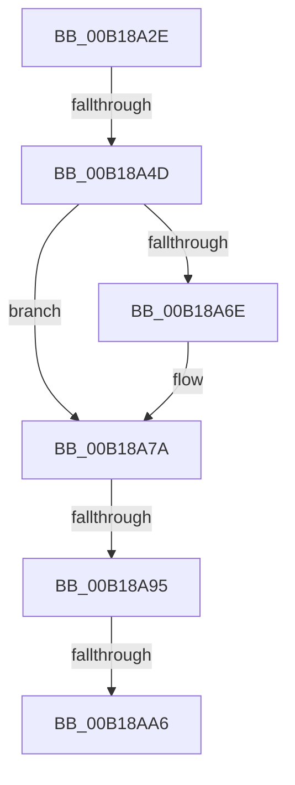

# sub_00B18A2E

- RVA: `0x00B18A2E`–`0x00B18AB1` (길이 `131` bytes)
- VA: `0x0000000140B18A2E`
- 실행 섹션: `PAGE`
- PDB 이름 있음: `아니요`; PDB Function 태그: `아니요`
- unwind 정보 RVA: `0x0007BFF4`
- 디코드: `28`개 명령, `131/131` bytes 표시
- 미해석 바이트: `0` (있으면 어셈블리에 `.byte`로 보존)

> 이 문서는 커널 이미지의 기계어와 PDB 기호를 분석해 생성했습니다. 4번과 5번은 함수 원형과 자료형을 바이너리 사용 방식에서 추정한 C 해석이며 원본 소스 복구 결과는 아닙니다.

## 1. Dependencies

- 직접 호출 지점: **4**; 고유 호출 대상: **4**
- 직접 호출자로 확인된 함수: **0**
- RIP 상대 이미지 참조: **2**

### Outgoing calls
- `0x00B18A3E` → [MmAdjustWorkingSetSize](../../text/47/MmAdjustWorkingSetSize_function_0047D7F0.md) (function, `0x0047D7F0`)
- `0x00B18A75` → [ExfTryToWakePushLock](../../text/26/ExfTryToWakePushLock_function_00265DD0.md) (function, `0x00265DD0`)
- `0x00B18A81` → [KeAbPostRelease](../../text/2E/KeAbPostRelease_function_002E1600.md) (function, `0x002E1600`)
- `0x00B18AA6` → [KiCheckForKernelApcDelivery](../../text/2E/KiCheckForKernelApcDelivery_function_002E2C80.md) (function, `0x002E2C80`)

### Direct callers
- 이 함수 시작 RVA로 연결되는 직접 call은 확인되지 않았습니다. 간접 호출은 완전히 역산할 수 없습니다.

### Static image references
- `0x00B18A5D` → RVA `0x00FC70B0` (`ALMOSTRO`; read/write)
- `0x00B18A6E` → RVA `0x00FC70B0` (`ALMOSTRO`; read)

## 2. Other-region calls and transfers

- 다른 실행 섹션으로 향하는 call: **4**
  - `0x00B18A3E` → [MmAdjustWorkingSetSize](../../text/47/MmAdjustWorkingSetSize_function_0047D7F0.md) (`PAGE` → `.text`)
  - `0x00B18A75` → [ExfTryToWakePushLock](../../text/26/ExfTryToWakePushLock_function_00265DD0.md) (`PAGE` → `.text`)
  - `0x00B18A81` → [KeAbPostRelease](../../text/2E/KeAbPostRelease_function_002E1600.md) (`PAGE` → `.text`)
  - `0x00B18AA6` → [KiCheckForKernelApcDelivery](../../text/2E/KiCheckForKernelApcDelivery_function_002E2C80.md) (`PAGE` → `.text`)
- call이 아닌 외부 분기/꼬리 이동: **4**
  - `0x00B18A47` → [PspApplyWorkingSetLimitsToProcess + 0xFF](../87/PspApplyWorkingSetLimitsToProcess_function_0087DE9C.md) (`tail-transfer`)
  - `0x00B18A8F` → [PspApplyWorkingSetLimitsToProcess + 0x1BE](../87/PspApplyWorkingSetLimitsToProcess_function_0087DE9C.md) (`tail-transfer`)
  - `0x00B18AA0` → [PspApplyWorkingSetLimitsToProcess + 0x1BE](../87/PspApplyWorkingSetLimitsToProcess_function_0087DE9C.md) (`tail-transfer`)
  - `0x00B18AAC` → [PspApplyWorkingSetLimitsToProcess + 0x1BE](../87/PspApplyWorkingSetLimitsToProcess_function_0087DE9C.md) (`tail-transfer`)

## 3. Assembly (complete function range)

```asm
00B18A2E  45 8A CF                        mov r9b, r15b
00B18A31  45 33 C0                        xor r8d, r8d
00B18A34  48 8B 54 24 28                  mov rdx, qword ptr [rsp + 0x28]
00B18A39  48 8B 4C 24 20                  mov rcx, qword ptr [rsp + 0x20]
00B18A3E  E8 AD 4D 96 FF                  call 0x14047d7f0
00B18A43  8B F8                           mov edi, eax
00B18A45  85 C0                           test eax, eax
00B18A47  0F 89 4E 55 D6 FF               jns 0x14087df9b
00B18A4D  F0 41 81 A6 10 06 00 00 FF FE FF FF  lock and dword ptr [r14 + 0x610], 0xfffffeff
00B18A59  48 83 CA FF                     or rdx, 0xffffffffffffffff
00B18A5D  F0 48 0F C1 15 4A E6 4A 00      lock xadd qword ptr [rip + 0x4ae64a], rdx
00B18A66  80 E2 06                        and dl, 6
00B18A69  80 FA 02                        cmp dl, 2
00B18A6C  75 0C                           jne 0x140b18a7a
00B18A6E  48 8D 0D 3B E6 4A 00            lea rcx, [rip + 0x4ae63b]
00B18A75  E8 56 D3 74 FF                  call 0x140265dd0
00B18A7A  48 8D 0D 2F E6 4A 00            lea rcx, [rip + 0x4ae62f]
00B18A81  E8 7A 8B 7C FF                  call 0x1402e1600
00B18A86  90                              nop
00B18A87  66 44 01 BB E6 01 00 00         add word ptr [rbx + 0x1e6], r15w
00B18A8F  0F 85 C5 55 D6 FF               jne 0x14087e05a
00B18A95  90                              nop
00B18A96  48 8D 83 98 00 00 00            lea rax, [rbx + 0x98]
00B18A9D  48 39 00                        cmp qword ptr [rax], rax
00B18AA0  0F 84 B4 55 D6 FF               je 0x14087e05a
00B18AA6  E8 D5 A1 7C FF                  call 0x1402e2c80
00B18AAB  90                              nop
00B18AAC  E9 A9 55 D6 FF                  jmp 0x14087e05a
```

## 4. C-style interpretation (structured pseudocode)

```c
__int64 __fastcall sub_00B18A2E(__int64 a1, __int64 a2, int a3, __int64 a4, __int64 a5)
{
    __int64 result;
    unsigned __int64 v_stack_p20;

    a3 = 0;
    result = MmAdjustWorkingSetSize(v_stack_p20, a5, a3, (unsigned __int8)(v_r15));
    a2 = (a5) | (-1);
    a2 = (unsigned __int8)((a2) & (6));
    if (((unsigned __int8)(a2)) == 2) {
        a1 = v_rip + 4908603;
        result = ExfTryToWakePushLock(a1, a2, a3, (unsigned __int8)(v_r15));
    }
    result = KeAbPostRelease(v_rip + 4908591, a2, a3, (unsigned __int8)(v_r15));
    result = KiCheckForKernelApcDelivery(v_rip + 4908591, a2, a3, (unsigned __int8)(v_r15));
}
```

## 5. (Beta) C Style

```c
int64_t sub_00B18A2E(int64_t Arg1, int64_t Arg2, int32_t Arg3, int64_t Arg4, int64_t Arg5)
{
    int64_t result;
    uint64_t v_stack_p20;

    Arg3 = 0;
    result = MmAdjustWorkingSetSize(v_stack_p20, Arg5, Arg3, (uint8_t)(local_r15));
    Arg2 = (Arg5) | (-1);
    Arg2 = (uint8_t)((Arg2) & (6));
    if (((uint8_t)(Arg2)) == 2) {
        Arg1 = v_rip + 4908603;
        result = ExfTryToWakePushLock(Arg1, Arg2, Arg3, (uint8_t)(local_r15));
    }
    result = KeAbPostRelease(v_rip + 4908591, Arg2, Arg3, (uint8_t)(local_r15));
    result = KiCheckForKernelApcDelivery(v_rip + 4908591, Arg2, Arg3, (uint8_t)(local_r15));
}
```

## 6. Execution-region graph

[열기: 2D/3D 그래프와 함수 탐색 컨트롤 패널](../../../control-panel.html?section=page&rva=0x00B18A2E&view=graph)

- 2D 그래프는 위에서 아래로 흐르고, 3D 그래프는 빈 공간을 드래그해 회전합니다. Shift+드래그는 이동, 휠은 확대·축소, 함수 노드 선택은 대상 보고서 이동입니다.

### Static fallback


