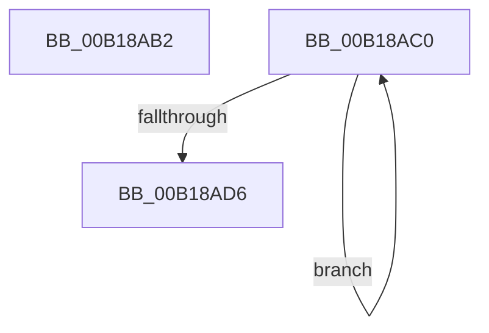

# sub_00B18AB2

- RVA: `0x00B18AB2`–`0x00B18ADB` (길이 `41` bytes)
- VA: `0x0000000140B18AB2`
- 실행 섹션: `PAGE`
- PDB 이름 있음: `아니요`; PDB Function 태그: `아니요`
- unwind 정보 RVA: `0x0007C038`
- 디코드: `8`개 명령, `41/41` bytes 표시
- 미해석 바이트: `0` (있으면 어셈블리에 `.byte`로 보존)

> 이 문서는 커널 이미지의 기계어와 PDB 기호를 분석해 생성했습니다. 4번과 5번은 함수 원형과 자료형을 바이너리 사용 방식에서 추정한 C 해석이며 원본 소스 복구 결과는 아닙니다.

## 1. Dependencies

- 직접 호출 지점: **0**; 고유 호출 대상: **0**
- 직접 호출자로 확인된 함수: **0**
- RIP 상대 이미지 참조: **0**

### Outgoing calls
- 직접 디코드된 call 명령이 없습니다.

### Direct callers
- 이 함수 시작 RVA로 연결되는 직접 call은 확인되지 않았습니다. 간접 호출은 완전히 역산할 수 없습니다.

### Static image references
- 디코드된 RIP-relative 메모리 참조가 없습니다.

## 2. Other-region calls and transfers

- 다른 실행 섹션으로 향하는 call: **0**
- call이 아닌 외부 분기/꼬리 이동: **2**
  - `0x00B18ABB` → [PspEstablishJobHierarchy + 0x1B4](../87/PspEstablishJobHierarchy_function_0087E17C.md) (`tail-transfer`)
  - `0x00B18AD6` → [PspEstablishJobHierarchy + 0x3B2](../87/PspEstablishJobHierarchy_function_0087E17C.md) (`tail-transfer`)

## 3. Assembly (complete function range)

```asm
00B18AB2  F0 0F BA AB 14 06 00 00 00      lock bts dword ptr [rbx + 0x614], 0
00B18ABB  E9 70 58 D6 FF                  jmp 0x14087e330
00B18AC0  48 8B 87 40 05 00 00            mov rax, qword ptr [rdi + 0x540]
00B18AC7  48 8B 4C D0 F8                  mov rcx, qword ptr [rax + rdx*8 - 8]
00B18ACC  49 89 0C D7                     mov qword ptr [r15 + rdx*8], rcx
00B18AD0  48 83 EA 01                     sub rdx, 1
00B18AD4  75 EA                           jne 0x140b18ac0
00B18AD6  E9 53 5A D6 FF                  jmp 0x14087e52e
```

## 4. C-style interpretation (structured pseudocode)

```c
__int64 __fastcall sub_00B18AB2(__int64 a1, __int64 a2)
{
}
```

## 5. (Beta) C Style

```c
int64_t sub_00B18AB2(int64_t Arg1, int64_t Arg2)
{
}
```

## 6. Execution-region graph

[열기: 2D/3D 그래프와 함수 탐색 컨트롤 패널](../../../control-panel.html?section=page&rva=0x00B18AB2&view=graph)

- 2D 그래프는 위에서 아래로 흐르고, 3D 그래프는 빈 공간을 드래그해 회전합니다. Shift+드래그는 이동, 휠은 확대·축소, 함수 노드 선택은 대상 보고서 이동입니다.

### Static fallback


