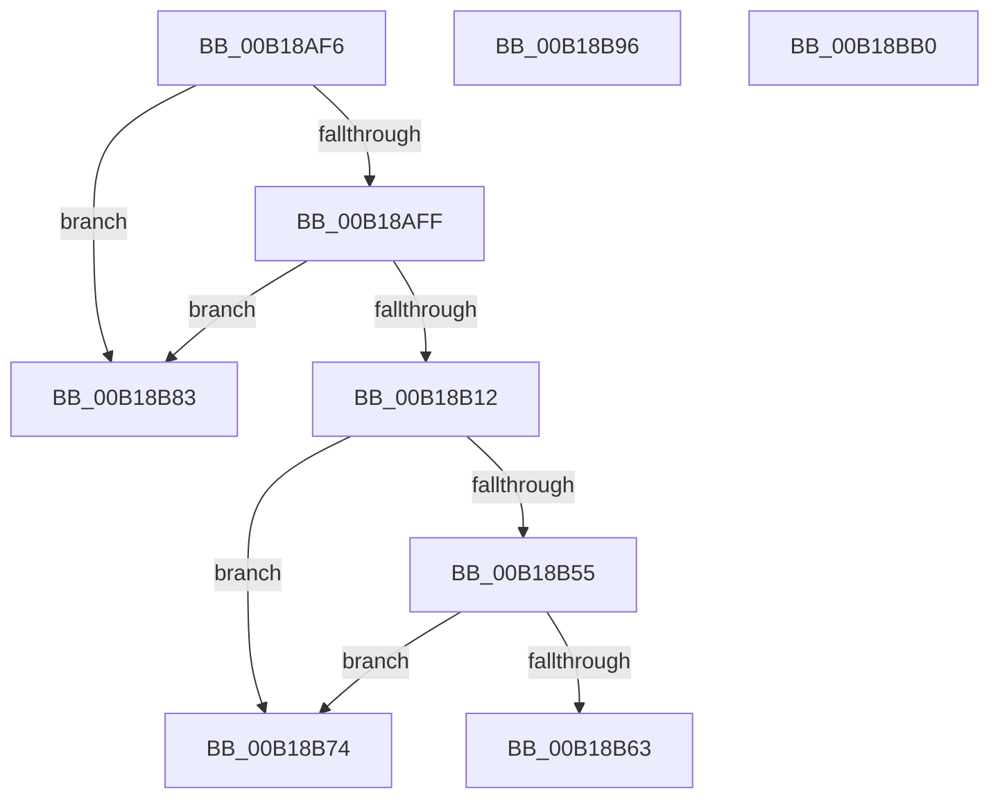

# sub_00B18AF6

- RVA: `0x00B18AF6`–`0x00B18BC3` (길이 `205` bytes)
- VA: `0x0000000140B18AF6`
- 실행 섹션: `PAGE`
- PDB 이름 있음: `아니요`; PDB Function 태그: `아니요`
- unwind 정보 RVA: `0x0007C09C`
- 디코드: `43`개 명령, `205/205` bytes 표시
- 미해석 바이트: `0` (있으면 어셈블리에 `.byte`로 보존)

> 이 문서는 커널 이미지의 기계어와 PDB 기호를 분석해 생성했습니다. 4번과 5번은 함수 원형과 자료형을 바이너리 사용 방식에서 추정한 C 해석이며 원본 소스 복구 결과는 아닙니다.

## 1. Dependencies

- 직접 호출 지점: **5**; 고유 호출 대상: **4**
- 직접 호출자로 확인된 함수: **0**
- RIP 상대 이미지 참조: **0**

### Outgoing calls
- `0x00B18B09` → [KeIsEmptyAffinityEx](../../text/2D/KeIsEmptyAffinityEx_function_002D1580.md) (function, `0x002D1580`)
- `0x00B18B28` → [memset](../../text/6C/memset_function_006C6C40.md) (function, `0x006C6C40`)
- `0x00B18B3F` → [KeAndAffinityEx2](../../text/3C/KeAndAffinityEx2_function_003C0740.md) (function, `0x003C0740`)
- `0x00B18B4C` → [KeIsEqualAffinityEx](../../text/30/KeIsEqualAffinityEx_function_00305230.md) (function, `0x00305230`)
- `0x00B18B5A` → [KeIsEmptyAffinityEx](../../text/2D/KeIsEmptyAffinityEx_function_002D1580.md) (function, `0x002D1580`)

### Direct callers
- 이 함수 시작 RVA로 연결되는 직접 call은 확인되지 않았습니다. 간접 호출은 완전히 역산할 수 없습니다.

### Static image references
- 디코드된 RIP-relative 메모리 참조가 없습니다.

## 2. Other-region calls and transfers

- 다른 실행 섹션으로 향하는 call: **5**
  - `0x00B18B09` → [KeIsEmptyAffinityEx](../../text/2D/KeIsEmptyAffinityEx_function_002D1580.md) (`PAGE` → `.text`)
  - `0x00B18B28` → [memset](../../text/6C/memset_function_006C6C40.md) (`PAGE` → `.text`)
  - `0x00B18B3F` → [KeAndAffinityEx2](../../text/3C/KeAndAffinityEx2_function_003C0740.md) (`PAGE` → `.text`)
  - `0x00B18B4C` → [KeIsEqualAffinityEx](../../text/30/KeIsEqualAffinityEx_function_00305230.md) (`PAGE` → `.text`)
  - `0x00B18B5A` → [KeIsEmptyAffinityEx](../../text/2D/KeIsEmptyAffinityEx_function_002D1580.md) (`PAGE` → `.text`)
- call이 아닌 외부 분기/꼬리 이동: **5**
  - `0x00B18B6F` → [PspSetEffectiveJobLimits + 0x243](../87/PspSetEffectiveJobLimits_function_0087E738.md) (`tail-transfer`)
  - `0x00B18B7E` → [PspSetEffectiveJobLimits + 0x243](../87/PspSetEffectiveJobLimits_function_0087E738.md) (`tail-transfer`)
  - `0x00B18B91` → [PspSetEffectiveJobLimits + 0x243](../87/PspSetEffectiveJobLimits_function_0087E738.md) (`tail-transfer`)
  - `0x00B18BAB` → [PspSetEffectiveJobLimits + 0xA0](../87/PspSetEffectiveJobLimits_function_0087E738.md) (`tail-transfer`)
  - `0x00B18BBE` → [PspSetEffectiveJobLimits + 0xF6](../87/PspSetEffectiveJobLimits_function_0087E738.md) (`tail-transfer`)

## 3. Assembly (complete function range)

```asm
00B18AF6  48 85 F6                        test rsi, rsi
00B18AF9  0F 84 84 00 00 00               je 0x140b18b83
00B18AFF  48 8D AE D8 02 00 00            lea rbp, [rsi + 0x2d8]
00B18B06  48 8B CD                        mov rcx, rbp
00B18B09  E8 72 8A 7B FF                  call 0x1402d1580
00B18B0E  85 C0                           test eax, eax
00B18B10  75 71                           jne 0x140b18b83
00B18B12  21 44 24 24                     and dword ptr [rsp + 0x24], eax
00B18B16  48 8D 4C 24 28                  lea rcx, [rsp + 0x28]
00B18B1B  4D 8B C5                        mov r8, r13
00B18B1E  C7 44 24 20 01 00 20 00         mov dword ptr [rsp + 0x20], 0x200001
00B18B26  33 D2                           xor edx, edx
00B18B28  E8 13 E1 BA FF                  call 0x1406c6c40
00B18B2D  48 8D 9F 08 01 00 00            lea rbx, [rdi + 0x108]
00B18B34  48 8B CD                        mov rcx, rbp
00B18B37  48 8B D3                        mov rdx, rbx
00B18B3A  4C 8D 44 24 20                  lea r8, [rsp + 0x20]
00B18B3F  E8 FC 7B 8A FF                  call 0x1403c0740
00B18B44  48 8D 54 24 20                  lea rdx, [rsp + 0x20]
00B18B49  48 8B CB                        mov rcx, rbx
00B18B4C  E8 DF C6 7E FF                  call 0x140305230
00B18B51  85 C0                           test eax, eax
00B18B53  74 1F                           je 0x140b18b74
00B18B55  48 8D 4C 24 20                  lea rcx, [rsp + 0x20]
00B18B5A  E8 21 8A 7B FF                  call 0x1402d1580
00B18B5F  85 C0                           test eax, eax
00B18B61  75 11                           jne 0x140b18b74
00B18B63  48 8D 8F D8 02 00 00            lea rcx, [rdi + 0x2d8]
00B18B6A  4C 8D 44 24 20                  lea r8, [rsp + 0x20]
00B18B6F  E9 07 5E D6 FF                  jmp 0x14087e97b
00B18B74  48 8D 8F D8 02 00 00            lea rcx, [rdi + 0x2d8]
00B18B7B  4C 8B C5                        mov r8, rbp
00B18B7E  E9 F8 5D D6 FF                  jmp 0x14087e97b
00B18B83  48 8D 8F D8 02 00 00            lea rcx, [rdi + 0x2d8]
00B18B8A  4C 8D 87 08 01 00 00            lea r8, [rdi + 0x108]
00B18B91  E9 E5 5D D6 FF                  jmp 0x14087e97b
00B18B96  48 89 87 F0 03 00 00            mov qword ptr [rdi + 0x3f0], rax
00B18B9D  48 8B 87 F0 00 00 00            mov rax, qword ptr [rdi + 0xf0]
00B18BA4  48 89 87 E8 03 00 00            mov qword ptr [rdi + 0x3e8], rax
00B18BAB  E9 28 5C D6 FF                  jmp 0x14087e7d8
00B18BB0  48 89 8F E0 03 00 00            mov qword ptr [rdi + 0x3e0], rcx
00B18BB7  48 89 BF 08 04 00 00            mov qword ptr [rdi + 0x408], rdi
00B18BBE  E9 6B 5C D6 FF                  jmp 0x14087e82e
```

## 4. C-style interpretation (structured pseudocode)

```c
__int64 __fastcall sub_00B18AF6(__int64 a1, int a2, __int64 a3, __int64 a4, __int64 a5)
{
    __int64 result;
    unsigned int v_stack_p20;
    unsigned int v_stack_p24;

    if (v_rsi == 0) goto loc_00B18B83;
    result = KeIsEmptyAffinityEx(v_rsi + 728, a2, a3, a4);
    if ((unsigned int)(result) != 0) goto loc_00B18B83;
    v_stack_p20 = 0x200001ULL;
    a2 = 0;
    result = memset(a5, a2, v_r13, a4);
    result = KeAndAffinityEx2(v_rsi + 728, v_rdi + 264, v_stack_p20, a4);
    result = KeIsEqualAffinityEx(v_rdi + 264, v_stack_p20, v_stack_p20, a4);
    if ((unsigned int)(result) == 0) goto loc_00B18B74;
    result = KeIsEmptyAffinityEx(v_stack_p20, v_stack_p20, v_stack_p20, a4);
    if ((unsigned int)(result) != 0) goto loc_00B18B74;
loc_00B18B74:
loc_00B18B83:
}
```

## 5. (Beta) C Style

```c
int64_t sub_00B18AF6(int64_t Arg1, int32_t Arg2, int64_t Arg3, int64_t Arg4, int64_t Arg5)
{
    int64_t result;
    uint32_t v_stack_p20;
    uint32_t v_stack_p24;

    if (local_rsi == 0) goto loc_00B18B83;
    result = KeIsEmptyAffinityEx(local_rsi + 728, Arg2, Arg3, Arg4);
    if ((uint32_t)(result) != 0) goto loc_00B18B83;
    v_stack_p20 = 0x200001ULL;
    Arg2 = 0;
    result = memset(Arg5, Arg2, local_r13, Arg4);
    result = KeAndAffinityEx2(local_rsi + 728, local_rdi + 264, v_stack_p20, Arg4);
    result = KeIsEqualAffinityEx(local_rdi + 264, v_stack_p20, v_stack_p20, Arg4);
    if ((uint32_t)(result) == 0) goto loc_00B18B74;
    result = KeIsEmptyAffinityEx(v_stack_p20, v_stack_p20, v_stack_p20, Arg4);
    if ((uint32_t)(result) != 0) goto loc_00B18B74;
loc_00B18B74:
loc_00B18B83:
}
```

## 6. Execution-region graph

[열기: 2D/3D 그래프와 함수 탐색 컨트롤 패널](../../../control-panel.html?section=page&rva=0x00B18AF6&view=graph)

- 2D 그래프는 위에서 아래로 흐르고, 3D 그래프는 빈 공간을 드래그해 회전합니다. Shift+드래그는 이동, 휠은 확대·축소, 함수 노드 선택은 대상 보고서 이동입니다.

### Static fallback


