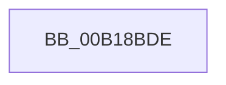

# sub_00B18BDE

- RVA: `0x00B18BDE`–`0x00B18C55` (길이 `119` bytes)
- VA: `0x0000000140B18BDE`
- 실행 섹션: `PAGE`
- PDB 이름 있음: `아니요`; PDB Function 태그: `아니요`
- unwind 정보 RVA: `0x0007C328`
- 디코드: `23`개 명령, `119/119` bytes 표시
- 미해석 바이트: `0` (있으면 어셈블리에 `.byte`로 보존)

> 이 문서는 커널 이미지의 기계어와 PDB 기호를 분석해 생성했습니다. 4번과 5번은 함수 원형과 자료형을 바이너리 사용 방식에서 추정한 C 해석이며 원본 소스 복구 결과는 아닙니다.

## 1. Dependencies

- 직접 호출 지점: **3**; 고유 호출 대상: **2**
- 직접 호출자로 확인된 함수: **0**
- RIP 상대 이미지 참조: **0**

### Outgoing calls
- `0x00B18C21` → [PspGetBaseTrapFrame](../../text/43/PspGetBaseTrapFrame_function_0043DBC0.md) (function, `0x0043DBC0`)
- `0x00B18C2E` → [PspGetBaseTrapFrame](../../text/43/PspGetBaseTrapFrame_function_0043DBC0.md) (function, `0x0043DBC0`)
- `0x00B18C4A` → [KiDispatchException](../../text/3D/KiDispatchException_function_003D7650.md) (function, `0x003D7650`)

### Direct callers
- 이 함수 시작 RVA로 연결되는 직접 call은 확인되지 않았습니다. 간접 호출은 완전히 역산할 수 없습니다.

### Static image references
- 디코드된 RIP-relative 메모리 참조가 없습니다.

## 2. Other-region calls and transfers

- 다른 실행 섹션으로 향하는 call: **3**
  - `0x00B18C21` → [PspGetBaseTrapFrame](../../text/43/PspGetBaseTrapFrame_function_0043DBC0.md) (`PAGE` → `.text`)
  - `0x00B18C2E` → [PspGetBaseTrapFrame](../../text/43/PspGetBaseTrapFrame_function_0043DBC0.md) (`PAGE` → `.text`)
  - `0x00B18C4A` → [KiDispatchException](../../text/3D/KiDispatchException_function_003D7650.md) (`PAGE` → `.text`)
- call이 아닌 외부 분기/꼬리 이동: **1**
  - `0x00B18C50` → [PspFreeUserFiberShadowStack + 0xC1](../87/PspFreeUserFiberShadowStack_function_0087F9A0.md) (`tail-transfer`)

## 3. Assembly (complete function range)

```asm
00B18BDE  65 48 8B 3C 25 88 01 00 00      mov rdi, qword ptr gs:[0x188]
00B18BE7  C7 44 24 74 01 00 00 00         mov dword ptr [rsp + 0x74], 1
00B18BEF  48 83 A4 24 80 00 00 00 00      and qword ptr [rsp + 0x80], 0
00B18BF8  C7 44 24 70 09 04 00 C0         mov dword ptr [rsp + 0x70], 0xc0000409
00B18C00  C7 84 24 88 00 00 00 01 00 00 00  mov dword ptr [rsp + 0x88], 1
00B18C0B  48 83 64 24 78 00               and qword ptr [rsp + 0x78], 0
00B18C11  48 63 C6                        movsxd rax, esi
00B18C14  48 89 84 24 90 00 00 00         mov qword ptr [rsp + 0x90], rax
00B18C1C  33 D2                           xor edx, edx
00B18C1E  48 8B CF                        mov rcx, rdi
00B18C21  E8 9A 4F 92 FF                  call 0x14043dbc0
00B18C26  48 8B D8                        mov rbx, rax
00B18C29  33 D2                           xor edx, edx
00B18C2B  48 8B CF                        mov rcx, rdi
00B18C2E  E8 8D 4F 92 FF                  call 0x14043dbc0
00B18C33  48 8D 90 C0 FE FF FF            lea rdx, [rax - 0x140]
00B18C3A  C6 44 24 20 00                  mov byte ptr [rsp + 0x20], 0
00B18C3F  41 B1 01                        mov r9b, 1
00B18C42  4C 8B C3                        mov r8, rbx
00B18C45  48 8D 4C 24 70                  lea rcx, [rsp + 0x70]
00B18C4A  E8 01 EA 8B FF                  call 0x1403d7650
00B18C4F  90                              nop
00B18C50  E9 0C 6E D6 FF                  jmp 0x14087fa61
```

## 4. C-style interpretation (structured pseudocode)

```c
__int64 __fastcall sub_00B18BDE(__int64 a1, int a2, __int64 a3, __int64 a4, __int64 a5, __int64 a6, __int64 a7, __int64 a8, __int64 a9, __int64 a10, __int64 a11, __int64 a12, __int64 a13, __int64 a14, __int64 a15, __int64 a16)
{
    __int64 result;
    unsigned __int8 v_stack_p20;
    unsigned int v_stack_p70;
    unsigned int v_stack_p74;
    unsigned int v_stack_p88;
    unsigned __int64 v_stack_p90;

    v_stack_p74 = 1;
    v_stack_p70 = 0xC0000409ULL;
    v_stack_p88 = 1;
    v_stack_p90 = (int)((unsigned int)(v_rsi));
    a2 = 0;
    result = PspGetBaseTrapFrame(*(unsigned __int64 *)(gs_base + (0 + 392)), a2, a3, a4);
    a2 = 0;
    result = PspGetBaseTrapFrame(*(unsigned __int64 *)(gs_base + (0 + 392)), a2, a3, a4);
    v_stack_p20 = 0;
    result = KiDispatchException(a14, result - 320, result, 1);
}
```

## 5. (Beta) C Style

```c
int64_t sub_00B18BDE(int64_t Arg1, int32_t Arg2, int64_t Arg3, int64_t Arg4, uint64_t Arg5, uint64_t Arg6, uint64_t Arg7, uint64_t Arg8, uint64_t Arg9, uint64_t Arg10, uint64_t Arg11, uint64_t Arg12, uint64_t Arg13, int64_t Arg14, int64_t Arg15, int64_t Arg16)
{
    int64_t result;
    uint8_t v_stack_p20;
    uint32_t v_stack_p70;
    uint32_t v_stack_p74;
    uint32_t v_stack_p88;
    uint64_t v_stack_p90;

    v_stack_p74 = 1;
    v_stack_p70 = 0xC0000409ULL;
    v_stack_p88 = 1;
    v_stack_p90 = (int32_t)((uint32_t)(local_rsi));
    Arg2 = 0;
    result = PspGetBaseTrapFrame(*(uint64_t *)(gs_base + (0 + 0x188)), Arg2, Arg3, Arg4);
    Arg2 = 0;
    result = PspGetBaseTrapFrame(*(uint64_t *)(gs_base + (0 + 0x188)), Arg2, Arg3, Arg4);
    v_stack_p20 = 0;
    result = KiDispatchException(Arg14, result - 320, result, 1);
}
```

## 6. Execution-region graph

[열기: 2D/3D 그래프와 함수 탐색 컨트롤 패널](../../../control-panel.html?section=page&rva=0x00B18BDE&view=graph)

- 2D 그래프는 위에서 아래로 흐르고, 3D 그래프는 빈 공간을 드래그해 회전합니다. Shift+드래그는 이동, 휠은 확대·축소, 함수 노드 선택은 대상 보고서 이동입니다.

### Static fallback


