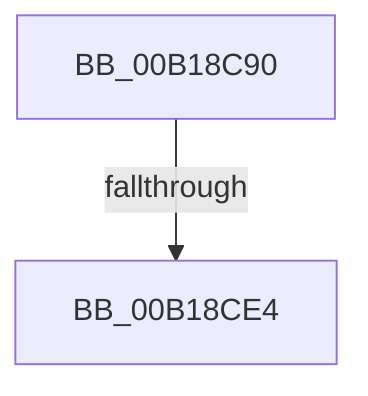

# sub_00B18C90

- RVA: `0x00B18C90`–`0x00B18CE9` (길이 `89` bytes)
- VA: `0x0000000140B18C90`
- 실행 섹션: `PAGE`
- PDB 이름 있음: `아니요`; PDB Function 태그: `아니요`
- unwind 정보 RVA: `0x0007C504`
- 디코드: `22`개 명령, `89/89` bytes 표시
- 미해석 바이트: `0` (있으면 어셈블리에 `.byte`로 보존)

> 이 문서는 커널 이미지의 기계어와 PDB 기호를 분석해 생성했습니다. 4번과 5번은 함수 원형과 자료형을 바이너리 사용 방식에서 추정한 C 해석이며 원본 소스 복구 결과는 아닙니다.

## 1. Dependencies

- 직접 호출 지점: **1**; 고유 호출 대상: **1**
- 직접 호출자로 확인된 함수: **0**
- RIP 상대 이미지 참조: **0**

### Outgoing calls
- `0x00B18CD5` → [MiCheckSecuredVad](../88/MiCheckSecuredVad_function_00881FB4.md) (function, `0x00881FB4`)

### Direct callers
- 이 함수 시작 RVA로 연결되는 직접 call은 확인되지 않았습니다. 간접 호출은 완전히 역산할 수 없습니다.

### Static image references
- 디코드된 RIP-relative 메모리 참조가 없습니다.

## 2. Other-region calls and transfers

- 다른 실행 섹션으로 향하는 call: **0**
- call이 아닌 외부 분기/꼬리 이동: **2**
  - `0x00B18CDE` → [MiCoalescePlaceholderAllocations + 0x165](../88/MiCoalescePlaceholderAllocations_function_0088095C.md) (`tail-transfer`)
  - `0x00B18CE4` → [MiCoalescePlaceholderAllocations + 0x14A](../88/MiCoalescePlaceholderAllocations_function_0088095C.md) (`tail-transfer`)

## 3. Assembly (complete function range)

```asm
00B18C90  8B 47 1C                        mov eax, dword ptr [rdi + 0x1c]
00B18C93  41 B9 55 00 00 00               mov r9d, 0x55
00B18C99  44 0F B6 47 21                  movzx r8d, byte ptr [rdi + 0x21]
00B18C9E  48 8B CF                        mov rcx, rdi
00B18CA1  0F B6 57 20                     movzx edx, byte ptr [rdi + 0x20]
00B18CA5  48 83 64 24 28 00               and qword ptr [rsp + 0x28], 0
00B18CAB  49 C1 E0 20                     shl r8, 0x20
00B18CAF  4C 0B C0                        or r8, rax
00B18CB2  48 C1 E2 20                     shl rdx, 0x20
00B18CB6  8B 47 18                        mov eax, dword ptr [rdi + 0x18]
00B18CB9  48 0B D0                        or rdx, rax
00B18CBC  8A 84 24 88 00 00 00            mov al, byte ptr [rsp + 0x88]
00B18CC3  4C 2B C2                        sub r8, rdx
00B18CC6  88 44 24 20                     mov byte ptr [rsp + 0x20], al
00B18CCA  49 FF C0                        inc r8
00B18CCD  48 C1 E2 0C                     shl rdx, 0xc
00B18CD1  49 C1 E0 0C                     shl r8, 0xc
00B18CD5  E8 DA 92 D6 FF                  call 0x140881fb4
00B18CDA  8B D8                           mov ebx, eax
00B18CDC  85 C0                           test eax, eax
00B18CDE  0F 88 DD 7D D6 FF               js 0x140880ac1
00B18CE4  E9 BD 7D D6 FF                  jmp 0x140880aa6
```

## 4. C-style interpretation (structured pseudocode)

```c
__int64 __fastcall sub_00B18C90(__int64 a1, __int64 a2, __int64 a3, __int64 a4, __int64 a5, __int64 a6, __int64 a7, __int64 a8, __int64 a9, __int64 a10, __int64 a11, __int64 a12, __int64 a13, __int64 a14, __int64 a15, __int64 a16, unsigned __int8 a17)
{
    __int64 result;
    unsigned __int8 v_stack_p20;

    a3 = (*(unsigned __int8 *)(v_rdi + 33)) << (32);
    a3 = (a3) | ((unsigned int)(*(unsigned int *)(v_rdi + 28)));
    a2 = (*(unsigned __int8 *)(v_rdi + 32)) << (32);
    a2 = (a2) | ((unsigned int)(*(unsigned int *)(v_rdi + 24)));
    a3 = (a3) - (a2);
    v_stack_p20 = a17;
    a3 = (a3) + 1;
    a2 = (a2) << (12);
    a3 = (a3) << (12);
    result = MiCheckSecuredVad(v_rdi, a2, a3, 85);
}
```

## 5. (Beta) C Style

```c
int64_t sub_00B18C90(int64_t Arg1, int64_t Arg2, int64_t Arg3, int64_t Arg4, int64_t Arg5, uint64_t Arg6, uint64_t Arg7, uint64_t Arg8, uint64_t Arg9, uint64_t Arg10, uint64_t Arg11, uint64_t Arg12, uint64_t Arg13, uint64_t Arg14, uint64_t Arg15, uint64_t Arg16, uint8_t Arg17)
{
    int64_t result;
    uint8_t v_stack_p20;

    Arg3 = (*(uint8_t *)(local_rdi + 0x21)) << (32);
    Arg3 = (Arg3) | ((uint32_t)(*(uint32_t *)(local_rdi + 0x1C)));
    Arg2 = (*(uint8_t *)(local_rdi + 0x20)) << (32);
    Arg2 = (Arg2) | ((uint32_t)(*(uint32_t *)(local_rdi + 0x18)));
    Arg3 = (Arg3) - (Arg2);
    v_stack_p20 = Arg17;
    Arg3 = (Arg3) + 1;
    Arg2 = (Arg2) << (12);
    Arg3 = (Arg3) << (12);
    result = MiCheckSecuredVad(local_rdi, Arg2, Arg3, 85);
}
```

## 6. Execution-region graph

[열기: 2D/3D 그래프와 함수 탐색 컨트롤 패널](../../../control-panel.html?section=page&rva=0x00B18C90&view=graph)

- 2D 그래프는 위에서 아래로 흐르고, 3D 그래프는 빈 공간을 드래그해 회전합니다. Shift+드래그는 이동, 휠은 확대·축소, 함수 노드 선택은 대상 보고서 이동입니다.

### Static fallback


