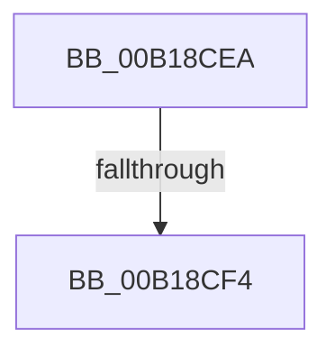

# sub_00B18CEA

- RVA: `0x00B18CEA`–`0x00B18D55` (길이 `107` bytes)
- VA: `0x0000000140B18CEA`
- 실행 섹션: `PAGE`
- PDB 이름 있음: `아니요`; PDB Function 태그: `아니요`
- unwind 정보 RVA: `0x0007C5C0`
- 디코드: `20`개 명령, `107/107` bytes 표시
- 미해석 바이트: `0` (있으면 어셈블리에 `.byte`로 보존)

> 이 문서는 커널 이미지의 기계어와 PDB 기호를 분석해 생성했습니다. 4번과 5번은 함수 원형과 자료형을 바이너리 사용 방식에서 추정한 C 해석이며 원본 소스 복구 결과는 아닙니다.

## 1. Dependencies

- 직접 호출 지점: **1**; 고유 호출 대상: **1**
- 직접 호출자로 확인된 함수: **0**
- RIP 상대 이미지 참조: **0**

### Outgoing calls
- `0x00B18D44` → [MiProtectEnclavePages](../../text/4D/MiProtectEnclavePages_function_004D5528.md) (function, `0x004D5528`)

### Direct callers
- 이 함수 시작 RVA로 연결되는 직접 call은 확인되지 않았습니다. 간접 호출은 완전히 역산할 수 없습니다.

### Static image references
- 디코드된 RIP-relative 메모리 참조가 없습니다.

## 2. Other-region calls and transfers

- 다른 실행 섹션으로 향하는 call: **1**
  - `0x00B18D44` → [MiProtectEnclavePages](../../text/4D/MiProtectEnclavePages_function_004D5528.md) (`PAGE` → `.text`)
- call이 아닌 외부 분기/꼬리 이동: **2**
  - `0x00B18CEE` → [MmProtectVirtualMemory + 0x202](../88/MmProtectVirtualMemory_function_00881050.md) (`tail-transfer`)
  - `0x00B18D50` → [MmProtectVirtualMemory + 0x38B](../88/MmProtectVirtualMemory_function_00881050.md) (`tail-transfer`)

## 3. Assembly (complete function range)

```asm
00B18CEA  0F BA E2 1B                     bt edx, 0x1b
00B18CEE  0F 83 5E 85 D6 FF               jae 0x140881252
00B18CF4  48 8B 84 24 48 01 00 00         mov rax, qword ptr [rsp + 0x148]
00B18CFC  48 89 44 24 50                  mov qword ptr [rsp + 0x50], rax
00B18D01  48 8B 84 24 40 01 00 00         mov rax, qword ptr [rsp + 0x140]
00B18D09  48 89 44 24 48                  mov qword ptr [rsp + 0x48], rax
00B18D0E  48 8B 84 24 58 01 00 00         mov rax, qword ptr [rsp + 0x158]
00B18D16  48 89 44 24 40                  mov qword ptr [rsp + 0x40], rax
00B18D1B  44 89 7C 24 38                  mov dword ptr [rsp + 0x38], r15d
00B18D20  44 89 6C 24 30                  mov dword ptr [rsp + 0x30], r13d
00B18D25  89 5C 24 28                     mov dword ptr [rsp + 0x28], ebx
00B18D29  4C 89 74 24 20                  mov qword ptr [rsp + 0x20], r14
00B18D2E  4D 8B CC                        mov r9, r12
00B18D31  4C 8B C7                        mov r8, rdi
00B18D34  48 8B 94 24 30 01 00 00         mov rdx, qword ptr [rsp + 0x130]
00B18D3C  48 8B 8C 24 38 01 00 00         mov rcx, qword ptr [rsp + 0x138]
00B18D44  E8 DF C7 9B FF                  call 0x1404d5528
00B18D49  89 44 24 60                     mov dword ptr [rsp + 0x60], eax
00B18D4D  48 8B CF                        mov rcx, rdi
00B18D50  E9 86 86 D6 FF                  jmp 0x1408813db
```

## 4. C-style interpretation (structured pseudocode)

```c
__int64 __fastcall sub_00B18CEA(__int64 a1, int a2, __int64 a3, __int64 a4, __int64 a5, __int64 a6, __int64 a7, __int64 a8, __int64 a9, __int64 a10, __int64 a11, __int64 a12, __int64 a13, __int64 a14, __int64 a15, __int64 a16, __int64 a17, __int64 a18, __int64 a19, __int64 a20, __int64 a21, __int64 a22, __int64 a23, __int64 a24, __int64 a25, __int64 a26, __int64 a27, __int64 a28, __int64 a29, __int64 a30, __int64 a31, __int64 a32, __int64 a33, __int64 a34, __int64 a35, __int64 a36, __int64 a37, __int64 a38, __int64 a39, __int64 a40, __int64 a41, __int64 a42, __int64 a43)
{
    __int64 result;
    unsigned __int64 v_stack_p20;
    unsigned int v_stack_p28;
    unsigned int v_stack_p30;
    unsigned int v_stack_p38;
    unsigned __int64 v_stack_p40;
    unsigned __int64 v_stack_p48;
    unsigned __int64 v_stack_p50;
    unsigned int v_stack_p60;

    v_stack_p50 = a41;
    v_stack_p48 = a40;
    v_stack_p40 = a43;
    v_stack_p38 = (unsigned int)(v_r15);
    v_stack_p30 = (unsigned int)(v_r13);
    v_stack_p28 = (unsigned int)(v_rbx);
    v_stack_p20 = v_r14;
    result = MiProtectEnclavePages(a39, a38, v_rdi, v_r12);
    v_stack_p60 = (unsigned int)(result);
}
```

## 5. (Beta) C Style

```c
int64_t sub_00B18CEA(int64_t Arg1, int32_t Arg2, int64_t Arg3, int64_t Arg4, uint64_t Arg5, uint64_t Arg6, uint64_t Arg7, uint64_t Arg8, uint64_t Arg9, uint64_t Arg10, uint64_t Arg11, uint64_t Arg12, uint64_t Arg13, uint64_t Arg14, uint64_t Arg15, uint64_t Arg16, uint64_t Arg17, uint64_t Arg18, uint64_t Arg19, uint64_t Arg20, uint64_t Arg21, uint64_t Arg22, uint64_t Arg23, uint64_t Arg24, uint64_t Arg25, uint64_t Arg26, uint64_t Arg27, uint64_t Arg28, uint64_t Arg29, uint64_t Arg30, uint64_t Arg31, uint64_t Arg32, uint64_t Arg33, uint64_t Arg34, uint64_t Arg35, uint64_t Arg36, uint64_t Arg37, int64_t Arg38, int64_t Arg39, int64_t Arg40, int64_t Arg41, uint64_t Arg42, int64_t Arg43)
{
    int64_t result;
    uint64_t v_stack_p20;
    uint32_t v_stack_p28;
    uint32_t v_stack_p30;
    uint32_t v_stack_p38;
    uint64_t v_stack_p40;
    uint64_t v_stack_p48;
    uint64_t v_stack_p50;
    uint32_t v_stack_p60;

    v_stack_p50 = Arg41;
    v_stack_p48 = Arg40;
    v_stack_p40 = Arg43;
    v_stack_p38 = (uint32_t)(local_r15);
    v_stack_p30 = (uint32_t)(local_r13);
    v_stack_p28 = (uint32_t)(local_rbx);
    v_stack_p20 = local_r14;
    result = MiProtectEnclavePages(Arg39, Arg38, local_rdi, local_r12);
    v_stack_p60 = (uint32_t)(result);
}
```

## 6. Execution-region graph

[열기: 2D/3D 그래프와 함수 탐색 컨트롤 패널](../../../control-panel.html?section=page&rva=0x00B18CEA&view=graph)

- 2D 그래프는 위에서 아래로 흐르고, 3D 그래프는 빈 공간을 드래그해 회전합니다. Shift+드래그는 이동, 휠은 확대·축소, 함수 노드 선택은 대상 보고서 이동입니다.

### Static fallback


