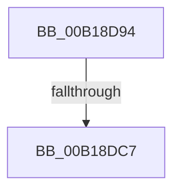

# sub_00B18D94

- RVA: `0x00B18D94`–`0x00B18DCC` (길이 `56` bytes)
- VA: `0x0000000140B18D94`
- 실행 섹션: `PAGE`
- PDB 이름 있음: `아니요`; PDB Function 태그: `아니요`
- unwind 정보 RVA: `0x0007C7B0`
- 디코드: `12`개 명령, `56/56` bytes 표시
- 미해석 바이트: `0` (있으면 어셈블리에 `.byte`로 보존)

> 이 문서는 커널 이미지의 기계어와 PDB 기호를 분석해 생성했습니다. 4번과 5번은 함수 원형과 자료형을 바이너리 사용 방식에서 추정한 C 해석이며 원본 소스 복구 결과는 아닙니다.

## 1. Dependencies

- 직접 호출 지점: **1**; 고유 호출 대상: **1**
- 직접 호출자로 확인된 함수: **0**
- RIP 상대 이미지 참조: **0**

### Outgoing calls
- `0x00B18DAF` → [PsReferencePartitionByHandle](../90/PsReferencePartitionByHandle_function_0090337C.md) (function, `0x0090337C`)

### Direct callers
- 이 함수 시작 RVA로 연결되는 직접 call은 확인되지 않았습니다. 간접 호출은 완전히 역산할 수 없습니다.

### Static image references
- 디코드된 RIP-relative 메모리 참조가 없습니다.

## 2. Other-region calls and transfers

- 다른 실행 섹션으로 향하는 call: **0**
- call이 아닌 외부 분기/꼬리 이동: **2**
  - `0x00B18DC1` → [NtAllocateVirtualMemory + 0x209](../88/NtAllocateVirtualMemory_function_00882D20.md) (`tail-transfer`)
  - `0x00B18DC7` → [NtAllocateVirtualMemory + 0x1AE](../88/NtAllocateVirtualMemory_function_00882D20.md) (`tail-transfer`)

## 3. Assembly (complete function range)

```asm
00B18D94  48 8D 44 24 78                  lea rax, [rsp + 0x78]
00B18D99  48 89 44 24 20                  mov qword ptr [rsp + 0x20], rax
00B18D9E  41 B9 4D 6D 56 61               mov r9d, 0x61566d4d
00B18DA4  44 0F B6 44 24 70               movzx r8d, byte ptr [rsp + 0x70]
00B18DAA  BA 02 00 00 00                  mov edx, 2
00B18DAF  E8 C8 A5 DE FF                  call 0x14090337c
00B18DB4  8B D8                           mov ebx, eax
00B18DB6  89 44 24 74                     mov dword ptr [rsp + 0x74], eax
00B18DBA  48 8B 7C 24 78                  mov rdi, qword ptr [rsp + 0x78]
00B18DBF  85 C0                           test eax, eax
00B18DC1  0F 88 62 A1 D6 FF               js 0x140882f29
00B18DC7  E9 02 A1 D6 FF                  jmp 0x140882ece
```

## 4. C-style interpretation (structured pseudocode)

```c
__int64 __fastcall sub_00B18D94(__int64 a1, __int64 a2, __int64 a3, __int64 a4, __int64 a5, __int64 a6, __int64 a7, __int64 a8, __int64 a9, __int64 a10, __int64 a11, __int64 a12, __int64 a13, unsigned __int8 a14, __int64 a15)
{
    __int64 result;
    unsigned __int64 v_stack_p20;
    unsigned int v_stack_p74;

    v_stack_p20 = a15;
    result = PsReferencePartitionByHandle(a1, 2, a14, (unsigned int)(0x61566D4DULL));
    v_stack_p74 = (unsigned int)(result);
}
```

## 5. (Beta) C Style

```c
int64_t sub_00B18D94(int64_t Arg1, int64_t Arg2, int64_t Arg3, int64_t Arg4, uint64_t Arg5, uint64_t Arg6, uint64_t Arg7, uint64_t Arg8, uint64_t Arg9, uint64_t Arg10, uint64_t Arg11, uint64_t Arg12, uint64_t Arg13, uint8_t Arg14, int64_t Arg15)
{
    int64_t result;
    uint64_t v_stack_p20;
    uint32_t v_stack_p74;

    v_stack_p20 = Arg15;
    result = PsReferencePartitionByHandle(Arg1, 2, Arg14, (uint32_t)(0x61566D4DULL));
    v_stack_p74 = (uint32_t)(result);
}
```

## 6. Execution-region graph

[열기: 2D/3D 그래프와 함수 탐색 컨트롤 패널](../../../control-panel.html?section=page&rva=0x00B18D94&view=graph)

- 2D 그래프는 위에서 아래로 흐르고, 3D 그래프는 빈 공간을 드래그해 회전합니다. Shift+드래그는 이동, 휠은 확대·축소, 함수 노드 선택은 대상 보고서 이동입니다.

### Static fallback


