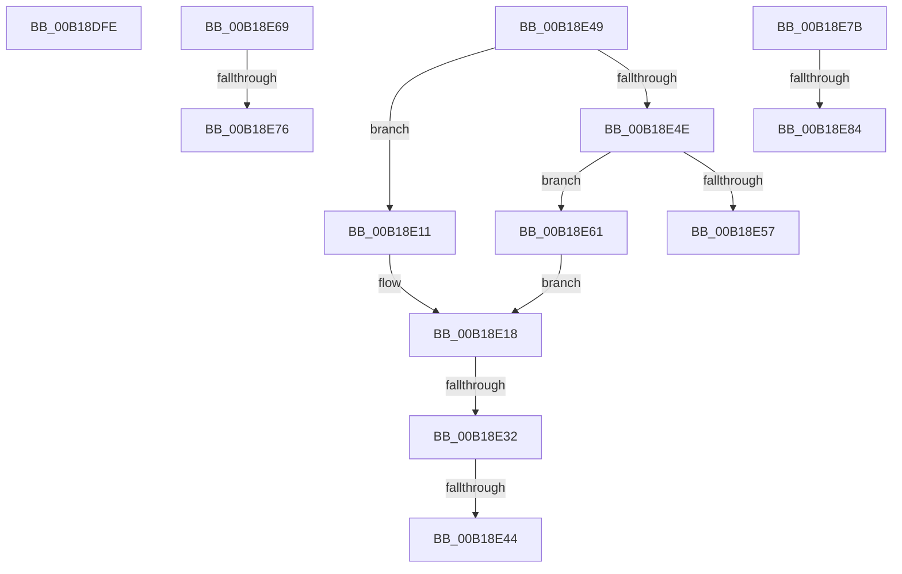

# sub_00B18DFE

- RVA: `0x00B18DFE`–`0x00B18E9A` (길이 `156` bytes)
- VA: `0x0000000140B18DFE`
- 실행 섹션: `PAGE`
- PDB 이름 있음: `아니요`; PDB Function 태그: `아니요`
- unwind 정보 RVA: `0x0007C810`
- 디코드: `35`개 명령, `156/156` bytes 표시
- 미해석 바이트: `0` (있으면 어셈블리에 `.byte`로 보존)

> 이 문서는 커널 이미지의 기계어와 PDB 기호를 분석해 생성했습니다. 4번과 5번은 함수 원형과 자료형을 바이너리 사용 방식에서 추정한 C 해석이며 원본 소스 복구 결과는 아닙니다.

## 1. Dependencies

- 직접 호출 지점: **1**; 고유 호출 대상: **1**
- 직접 호출자로 확인된 함수: **0**
- RIP 상대 이미지 참조: **0**

### Outgoing calls
- `0x00B18E4E` → [MiHugePagesSupported](../../text/4A/MiHugePagesSupported_function_004A0650.md) (function, `0x004A0650`)

### Direct callers
- 이 함수 시작 RVA로 연결되는 직접 call은 확인되지 않았습니다. 간접 호출은 완전히 역산할 수 없습니다.

### Static image references
- 디코드된 RIP-relative 메모리 참조가 없습니다.

## 2. Other-region calls and transfers

- 다른 실행 섹션으로 향하는 call: **1**
  - `0x00B18E4E` → [MiHugePagesSupported](../../text/4A/MiHugePagesSupported_function_004A0650.md) (`PAGE` → `.text`)
- call이 아닌 외부 분기/꼬리 이동: **9**
  - `0x00B18E0C` → [MiAllocateVirtualMemoryPrepare + 0x2CC](../88/MiAllocateVirtualMemoryPrepare_function_00883220.md) (`tail-transfer`)
  - `0x00B18E2C` → [MiAllocateVirtualMemoryPrepare + 0x156](../88/MiAllocateVirtualMemoryPrepare_function_00883220.md) (`tail-transfer`)
  - `0x00B18E3E` → [MiAllocateVirtualMemoryPrepare + 0x723](../88/MiAllocateVirtualMemoryPrepare_function_00883220.md) (`tail-transfer`)
  - `0x00B18E44` → [MiAllocateVirtualMemoryPrepare + 0x1CC](../88/MiAllocateVirtualMemoryPrepare_function_00883220.md) (`tail-transfer`)
  - `0x00B18E5C` → [MiAllocateVirtualMemoryPrepare + 0x1D1](../88/MiAllocateVirtualMemoryPrepare_function_00883220.md) (`tail-transfer`)
  - `0x00B18E70` → [MiAllocateVirtualMemoryPrepare + 0x1CC](../88/MiAllocateVirtualMemoryPrepare_function_00883220.md) (`tail-transfer`)
  - `0x00B18E76` → [MiAllocateVirtualMemoryPrepare + 0x325](../88/MiAllocateVirtualMemoryPrepare_function_00883220.md) (`tail-transfer`)
  - `0x00B18E7E` → [MiAllocateVirtualMemoryPrepare + 0x534](../88/MiAllocateVirtualMemoryPrepare_function_00883220.md) (`tail-transfer`)
  - `0x00B18E95` → [MiAllocateVirtualMemoryPrepare + 0x534](../88/MiAllocateVirtualMemoryPrepare_function_00883220.md) (`tail-transfer`)

## 3. Assembly (complete function range)

```asm
00B18DFE  8B 8C 24 A0 00 00 00            mov ecx, dword ptr [rsp + 0xa0]
00B18E05  8B 94 24 C8 00 00 00            mov edx, dword ptr [rsp + 0xc8]
00B18E0C  E9 DB A6 D6 FF                  jmp 0x1408834ec
00B18E11  F6 C3 08                        test bl, 8
00B18E14  4D 0F 45 C2                     cmovne r8, r10
00B18E18  8B C7                           mov eax, edi
00B18E1A  4C 89 84 24 A8 00 00 00         mov qword ptr [rsp + 0xa8], r8
00B18E22  25 00 00 40 20                  and eax, 0x20400000
00B18E27  3D 00 00 00 20                  cmp eax, 0x20000000
00B18E2C  0F 84 44 A5 D6 FF               je 0x140883376
00B18E32  8B C7                           mov eax, edi
00B18E34  25 00 00 40 20                  and eax, 0x20400000
00B18E39  3D 00 00 40 00                  cmp eax, 0x400000
00B18E3E  0F 84 FF AA D6 FF               je 0x140883943
00B18E44  E9 A3 A5 D6 FF                  jmp 0x1408833ec
00B18E49  F6 C3 10                        test bl, 0x10
00B18E4C  74 C3                           je 0x140b18e11
00B18E4E  E8 FD 77 98 FF                  call 0x1404a0650
00B18E53  85 C0                           test eax, eax
00B18E55  75 0A                           jne 0x140b18e61
00B18E57  BB BB 00 00 C0                  mov ebx, 0xc00000bb
00B18E5C  E9 90 A5 D6 FF                  jmp 0x1408833f1
00B18E61  41 B8 00 00 00 40               mov r8d, 0x40000000
00B18E67  EB AF                           jmp 0x140b18e18
00B18E69  49 8D 42 FF                     lea rax, [r10 - 1]
00B18E6D  49 85 C1                        test r9, rax
00B18E70  0F 85 76 A5 D6 FF               jne 0x1408833ec
00B18E76  E9 CA A6 D6 FF                  jmp 0x140883545
00B18E7B  F6 C3 10                        test bl, 0x10
00B18E7E  0F 84 D0 A8 D6 FF               je 0x140883754
00B18E84  48 C7 C0 00 00 00 C0            mov rax, 0xffffffffc0000000
00B18E8B  48 23 C8                        and rcx, rax
00B18E8E  48 FF C9                        dec rcx
00B18E91  49 89 4D 08                     mov qword ptr [r13 + 8], rcx
00B18E95  E9 BA A8 D6 FF                  jmp 0x140883754
```

## 4. C-style interpretation (structured pseudocode)

```c
__int64 __fastcall sub_00B18DFE(__int64 a1, __int64 a2, __int64 a3, __int64 a4, __int64 a5, __int64 a6, __int64 a7, __int64 a8, __int64 a9, __int64 a10, __int64 a11, __int64 a12, __int64 a13, __int64 a14, __int64 a15, __int64 a16, __int64 a17, __int64 a18, __int64 a19, unsigned int a20, __int64 a21, __int64 a22, __int64 a23, __int64 a24, unsigned int a25)
{
    unsigned __int64 v_stack_pA8;
}
```

## 5. (Beta) C Style

```c
int64_t sub_00B18DFE(int64_t Arg1, int64_t Arg2, int64_t Arg3, int64_t Arg4, uint64_t Arg5, uint64_t Arg6, uint64_t Arg7, uint64_t Arg8, uint64_t Arg9, uint64_t Arg10, uint64_t Arg11, uint64_t Arg12, uint64_t Arg13, uint64_t Arg14, uint64_t Arg15, uint64_t Arg16, uint64_t Arg17, uint64_t Arg18, uint64_t Arg19, uint32_t Arg20, uint64_t Arg21, uint64_t Arg22, uint64_t Arg23, uint64_t Arg24, uint32_t Arg25)
{
    uint64_t v_stack_pA8;
}
```

## 6. Execution-region graph

[열기: 2D/3D 그래프와 함수 탐색 컨트롤 패널](../../../control-panel.html?section=page&rva=0x00B18DFE&view=graph)

- 2D 그래프는 위에서 아래로 흐르고, 3D 그래프는 빈 공간을 드래그해 회전합니다. Shift+드래그는 이동, 휠은 확대·축소, 함수 노드 선택은 대상 보고서 이동입니다.

### Static fallback


