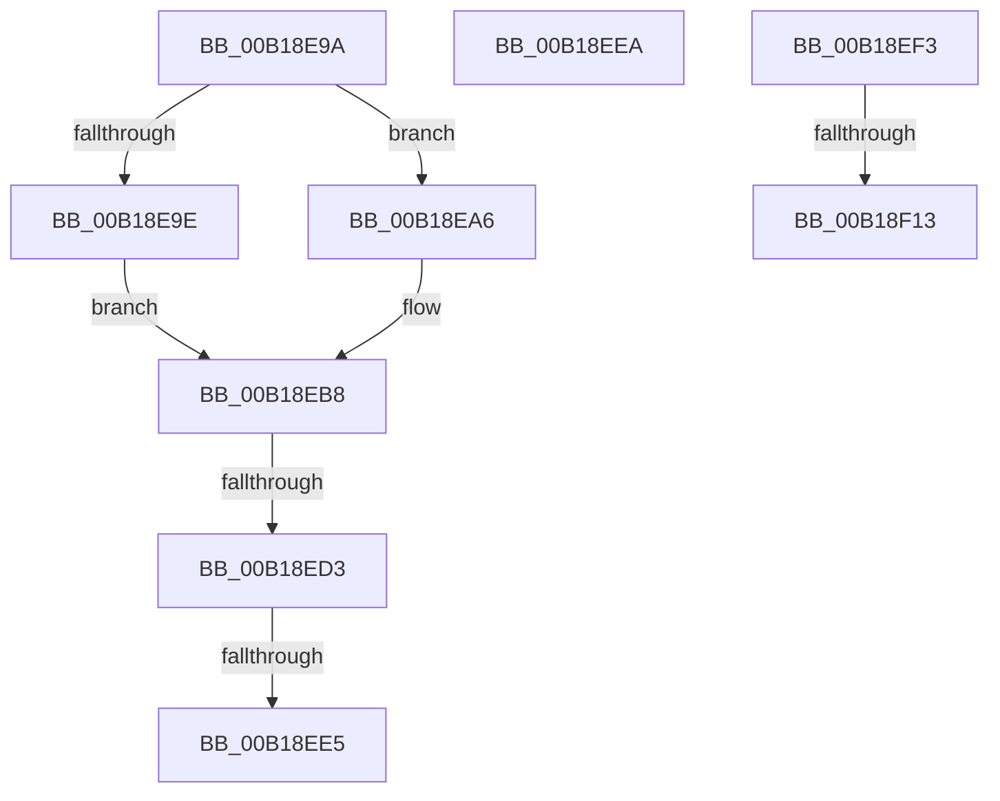

# sub_00B18E9A

- RVA: `0x00B18E9A`–`0x00B18F1F` (길이 `133` bytes)
- VA: `0x0000000140B18E9A`
- 실행 섹션: `PAGE`
- PDB 이름 있음: `아니요`; PDB Function 태그: `아니요`
- unwind 정보 RVA: `0x0007C848`
- 디코드: `32`개 명령, `133/133` bytes 표시
- 미해석 바이트: `0` (있으면 어셈블리에 `.byte`로 보존)

> 이 문서는 커널 이미지의 기계어와 PDB 기호를 분석해 생성했습니다. 4번과 5번은 함수 원형과 자료형을 바이너리 사용 방식에서 추정한 C 해석이며 원본 소스 복구 결과는 아닙니다.

## 1. Dependencies

- 직접 호출 지점: **1**; 고유 호출 대상: **1**
- 직접 호출자로 확인된 함수: **0**
- RIP 상대 이미지 참조: **0**

### Outgoing calls
- `0x00B18EF6` → [MiGetVadPageSize](../../text/42/MiGetVadPageSize_function_0042F0E0.md) (function, `0x0042F0E0`)

### Direct callers
- 이 함수 시작 RVA로 연결되는 직접 call은 확인되지 않았습니다. 간접 호출은 완전히 역산할 수 없습니다.

### Static image references
- 디코드된 RIP-relative 메모리 참조가 없습니다.

## 2. Other-region calls and transfers

- 다른 실행 섹션으로 향하는 call: **1**
  - `0x00B18EF6` → [MiGetVadPageSize](../../text/42/MiGetVadPageSize_function_0042F0E0.md) (`PAGE` → `.text`)
- call이 아닌 외부 분기/꼬리 이동: **6**
  - `0x00B18ECD` → [MiAllocateVirtualMemory + 0x6E1](../88/MiAllocateVirtualMemory_function_00883B40.md) (`tail-transfer`)
  - `0x00B18EDF` → [MiAllocateVirtualMemory + 0x10A](../88/MiAllocateVirtualMemory_function_00883B40.md) (`tail-transfer`)
  - `0x00B18EE5` → [MiAllocateVirtualMemory + 0x107](../88/MiAllocateVirtualMemory_function_00883B40.md) (`tail-transfer`)
  - `0x00B18EEE` → [MiAllocateVirtualMemory + 0x113](../88/MiAllocateVirtualMemory_function_00883B40.md) (`tail-transfer`)
  - `0x00B18F0D` → [MiAllocateVirtualMemory + 0x1D8](../88/MiAllocateVirtualMemory_function_00883B40.md) (`tail-transfer`)
  - `0x00B18F1A` → [MiAllocateVirtualMemory + 0x3C5](../88/MiAllocateVirtualMemory_function_00883B40.md) (`tail-transfer`)

## 3. Assembly (complete function range)

```asm
00B18E9A  A8 08                           test al, 8
00B18E9C  74 08                           je 0x140b18ea6
00B18E9E  41 B8 FF FF 1F 00               mov r8d, 0x1fffff
00B18EA4  EB 12                           jmp 0x140b18eb8
00B18EA6  A8 10                           test al, 0x10
00B18EA8  49 C7 C0 FF FF FF FF            mov r8, 0xffffffffffffffff
00B18EAF  B8 FF FF FF 3F                  mov eax, 0x3fffffff
00B18EB4  4C 0F 45 C0                     cmovne r8, rax
00B18EB8  48 8B 47 08                     mov rax, qword ptr [rdi + 8]
00B18EBC  48 FF C0                        inc rax
00B18EBF  49 85 C0                        test r8, rax
00B18EC2  0F 94 C1                        sete cl
00B18EC5  4C 85 07                        test qword ptr [rdi], r8
00B18EC8  0F 94 C0                        sete al
00B18ECB  84 C8                           test al, cl
00B18ECD  0F 84 4E B3 D6 FF               je 0x140884221
00B18ED3  81 E2 00 00 40 20               and edx, 0x20400000
00B18ED9  81 FA 00 00 40 00               cmp edx, 0x400000
00B18EDF  0F 84 65 AD D6 FF               je 0x140883c4a
00B18EE5  E9 5D AD D6 FF                  jmp 0x140883c47
00B18EEA  4C 8B 55 CF                     mov r10, qword ptr [rbp - 0x31]
00B18EEE  E9 60 AD D6 FF                  jmp 0x140883c53
00B18EF3  48 8B CE                        mov rcx, rsi
00B18EF6  E8 E5 61 91 FF                  call 0x14042f0e0
00B18EFB  48 C1 E0 0C                     shl rax, 0xc
00B18EFF  49 8D 4D 01                     lea rcx, [r13 + 1]
00B18F03  48 0B 4D B7                     or rcx, qword ptr [rbp - 0x49]
00B18F07  48 FF C8                        dec rax
00B18F0A  48 85 C1                        test rcx, rax
00B18F0D  0F 84 05 AE D6 FF               je 0x140883d18
00B18F13  C7 45 AF 0D 00 00 C0            mov dword ptr [rbp - 0x51], 0xc000000d
00B18F1A  E9 E6 AF D6 FF                  jmp 0x140883f05
```

## 4. C-style interpretation (structured pseudocode)

```c
__int64 __fastcall sub_00B18E9A(__int64 a1, int a2)
{
    __int64 result;

    if ((((unsigned __int8)(result)) & (8)) == 0) goto loc_00B18EA6;
    goto loc_00B18EB8;
loc_00B18EA6:
    a3 = -1;
    if ((((unsigned __int8)(result)) & (16)) != 0) { a3 = (unsigned int)(0x3FFFFFFFULL); }
loc_00B18EB8:
    result = (*(unsigned __int64 *)(v_rdi + 8)) + 1;
    a1 = (((a3) & (result)) == 0) ? 1 : 0;
    result = (((*(unsigned __int64 *)(v_rdi)) & (a3)) == 0) ? 1 : 0;
    a2 = (unsigned int)((a2) & (0x20400000ULL));
}
```

## 5. (Beta) C Style

```c
int64_t sub_00B18E9A(int64_t Arg1, int32_t Arg2)
{
    int64_t result;

    if ((((uint8_t)(result)) & (8)) == 0) goto loc_00B18EA6;
    goto loc_00B18EB8;
loc_00B18EA6:
    a3 = -1;
    if ((((uint8_t)(result)) & (16)) != 0) { a3 = (uint32_t)(0x3FFFFFFFULL); }
loc_00B18EB8:
    result = (*(uint64_t *)(local_rdi + 0x8)) + 1;
    Arg1 = (((a3) & (result)) == 0) ? 1 : 0;
    result = (((*(uint64_t *)(local_rdi)) & (a3)) == 0) ? 1 : 0;
    Arg2 = (uint32_t)((Arg2) & (0x20400000ULL));
}
```

## 6. Execution-region graph

[열기: 2D/3D 그래프와 함수 탐색 컨트롤 패널](../../../control-panel.html?section=page&rva=0x00B18E9A&view=graph)

- 2D 그래프는 위에서 아래로 흐르고, 3D 그래프는 빈 공간을 드래그해 회전합니다. Shift+드래그는 이동, 휠은 확대·축소, 함수 노드 선택은 대상 보고서 이동입니다.

### Static fallback


