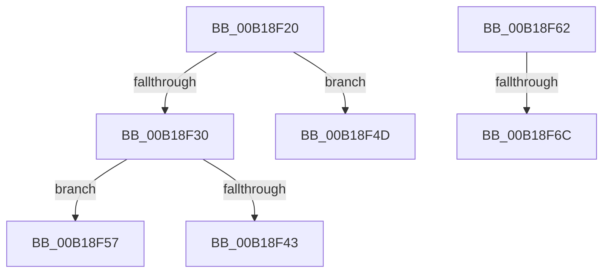

# sub_00B18F20

- RVA: `0x00B18F20`–`0x00B18F71` (길이 `81` bytes)
- VA: `0x0000000140B18F20`
- 실행 섹션: `PAGE`
- PDB 이름 있음: `아니요`; PDB Function 태그: `아니요`
- unwind 정보 RVA: `0x0007C884`
- 디코드: `19`개 명령, `81/81` bytes 표시
- 미해석 바이트: `0` (있으면 어셈블리에 `.byte`로 보존)

> 이 문서는 커널 이미지의 기계어와 PDB 기호를 분석해 생성했습니다. 4번과 5번은 함수 원형과 자료형을 바이너리 사용 방식에서 추정한 C 해석이며 원본 소스 복구 결과는 아닙니다.

## 1. Dependencies

- 직접 호출 지점: **2**; 고유 호출 대상: **2**
- 직접 호출자로 확인된 함수: **0**
- RIP 상대 이미지 참조: **1**

### Outgoing calls
- `0x00B18F24` → [MiGetProcessPartition](../../text/44/MiGetProcessPartition_function_00443B10.md) (function, `0x00443B10`)
- `0x00B18F3A` → [SeSinglePrivilegeCheck](../87/SeSinglePrivilegeCheck_function_00871E20.md) (function, `0x00871E20`)

### Direct callers
- 이 함수 시작 RVA로 연결되는 직접 call은 확인되지 않았습니다. 간접 호출은 완전히 역산할 수 없습니다.

### Static image references
- `0x00B18F33` → RVA `0x00FD9A78` (`PAGEDATA`; read)

## 2. Other-region calls and transfers

- 다른 실행 섹션으로 향하는 call: **1**
  - `0x00B18F24` → [MiGetProcessPartition](../../text/44/MiGetProcessPartition_function_00443B10.md) (`PAGE` → `.text`)
- call이 아닌 외부 분기/꼬리 이동: **5**
  - `0x00B18F48` → [MiReserveUserMemory + 0x41A](../88/MiReserveUserMemory_function_00884498.md) (`tail-transfer`)
  - `0x00B18F52` → [MiReserveUserMemory + 0x41A](../88/MiReserveUserMemory_function_00884498.md) (`tail-transfer`)
  - `0x00B18F5D` → [MiReserveUserMemory + 0x7C2](../88/MiReserveUserMemory_function_00884498.md) (`tail-transfer`)
  - `0x00B18F66` → [MiReserveUserMemory + 0x1FD](../88/MiReserveUserMemory_function_00884498.md) (`tail-transfer`)
  - `0x00B18F6C` → [MiReserveUserMemory + 0x8D9](../88/MiReserveUserMemory_function_00884498.md) (`tail-transfer`)

## 3. Assembly (complete function range)

```asm
00B18F20  48 8B 4E 58                     mov rcx, qword ptr [rsi + 0x58]
00B18F24  E8 E7 AB 92 FF                  call 0x140443b10
00B18F29  8B 40 04                        mov eax, dword ptr [rax + 4]
00B18F2C  A8 20                           test al, 0x20
00B18F2E  74 1D                           je 0x140b18f4d
00B18F30  8A 56 39                        mov dl, byte ptr [rsi + 0x39]
00B18F33  48 8B 0D 3E 0B 4C 00            mov rcx, qword ptr [rip + 0x4c0b3e]
00B18F3A  E8 E1 8E D5 FF                  call 0x140871e20
00B18F3F  84 C0                           test al, al
00B18F41  75 14                           jne 0x140b18f57
00B18F43  BF 61 00 00 C0                  mov edi, 0xc0000061
00B18F48  E9 65 B9 D6 FF                  jmp 0x1408848b2
00B18F4D  BF 0D 00 00 C0                  mov edi, 0xc000000d
00B18F52  E9 5B B9 D6 FF                  jmp 0x1408848b2
00B18F57  41 0F BA 6E 30 18               bts dword ptr [r14 + 0x30], 0x18
00B18F5D  E9 F8 BC D6 FF                  jmp 0x140884c5a
00B18F62  44 39 6E 30                     cmp dword ptr [rsi + 0x30], r13d
00B18F66  0F 85 29 B7 D6 FF               jne 0x140884695
00B18F6C  E9 00 BE D6 FF                  jmp 0x140884d71
```

## 4. C-style interpretation (structured pseudocode)

```c
__int64 __fastcall sub_00B18F20(void)
{
    __int64 result;

    result = MiGetProcessPartition(*(unsigned __int64 *)(v_rsi + 88), a2, a3, a4);
    if ((((unsigned __int8)((unsigned int)(*(unsigned int *)(result + 4)))) & (32)) == 0) goto loc_00B18F4D;
    result = SeSinglePrivilegeCheck(*(unsigned __int64 *)(v_rip + 4983614), *(unsigned __int8 *)(v_rsi + 57), a3, a4);
    if ((unsigned __int8)(result) != 0) goto loc_00B18F57;
loc_00B18F4D:
loc_00B18F57:
}
```

## 5. (Beta) C Style

```c
void sub_00B18F20(void)
{
    int64_t result;

    result = MiGetProcessPartition(*(uint64_t *)(local_rsi + 0x58), a2, a3, a4);
    if ((((uint8_t)((uint32_t)(*(uint32_t *)(result + 0x4)))) & (32)) == 0) goto loc_00B18F4D;
    result = SeSinglePrivilegeCheck(*(uint64_t *)(v_rip + 0x4C0B3E), *(uint8_t *)(local_rsi + 0x39), a3, a4);
    if ((uint8_t)(result) != 0) goto loc_00B18F57;
loc_00B18F4D:
loc_00B18F57:
}
```

## 6. Execution-region graph

[열기: 2D/3D 그래프와 함수 탐색 컨트롤 패널](../../../control-panel.html?section=page&rva=0x00B18F20&view=graph)

- 2D 그래프는 위에서 아래로 흐르고, 3D 그래프는 빈 공간을 드래그해 회전합니다. Shift+드래그는 이동, 휠은 확대·축소, 함수 노드 선택은 대상 보고서 이동입니다.

### Static fallback


