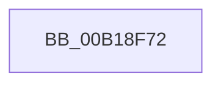

# sub_00B18F72

- RVA: `0x00B18F72`–`0x00B18F99` (길이 `39` bytes)
- VA: `0x0000000140B18F72`
- 실행 섹션: `PAGE`
- PDB 이름 있음: `아니요`; PDB Function 태그: `아니요`
- unwind 정보 RVA: `0x0007C9DC`
- 디코드: `9`개 명령, `39/39` bytes 표시
- 미해석 바이트: `0` (있으면 어셈블리에 `.byte`로 보존)

> 이 문서는 커널 이미지의 기계어와 PDB 기호를 분석해 생성했습니다. 4번과 5번은 함수 원형과 자료형을 바이너리 사용 방식에서 추정한 C 해석이며 원본 소스 복구 결과는 아닙니다.

## 1. Dependencies

- 직접 호출 지점: **2**; 고유 호출 대상: **2**
- 직접 호출자로 확인된 함수: **0**
- RIP 상대 이미지 참조: **0**

### Outgoing calls
- `0x00B18F76` → [KeAbPostRelease](../../text/2E/KeAbPostRelease_function_002E1600.md) (function, `0x002E1600`)
- `0x00B18F81` → [UNLOCK_ADDRESS_SPACE](../../text/2A/UNLOCK_ADDRESS_SPACE_function_002A4844.md) (function, `0x002A4844`)

### Direct callers
- 이 함수 시작 RVA로 연결되는 직접 call은 확인되지 않았습니다. 간접 호출은 완전히 역산할 수 없습니다.

### Static image references
- 디코드된 RIP-relative 메모리 참조가 없습니다.

## 2. Other-region calls and transfers

- 다른 실행 섹션으로 향하는 call: **2**
  - `0x00B18F76` → [KeAbPostRelease](../../text/2E/KeAbPostRelease_function_002E1600.md) (`PAGE` → `.text`)
  - `0x00B18F81` → [UNLOCK_ADDRESS_SPACE](../../text/2A/UNLOCK_ADDRESS_SPACE_function_002A4844.md) (`PAGE` → `.text`)
- call이 아닌 외부 분기/꼬리 이동: **1**
  - `0x00B18F94` → [sub_00885634 + 0x15B](../88/Unknown_function_00885634.md) (`tail-transfer`)

## 3. Assembly (complete function range)

```asm
00B18F72  49 8D 4E 28                     lea rcx, [r14 + 0x28]
00B18F76  E8 85 86 7C FF                  call 0x1402e1600
00B18F7B  49 8B D4                        mov rdx, r12
00B18F7E  49 8B CD                        mov rcx, r13
00B18F81  E8 BE B8 78 FF                  call 0x1402a4844
00B18F86  48 8B 5C 24 68                  mov rbx, qword ptr [rsp + 0x68]
00B18F8B  44 8B 7D 68                     mov r15d, dword ptr [rbp + 0x68]
00B18F8F  48 8B 7C 24 70                  mov rdi, qword ptr [rsp + 0x70]
00B18F94  E9 F6 C7 D6 FF                  jmp 0x14088578f
```

## 4. C-style interpretation (structured pseudocode)

```c
__int64 __fastcall sub_00B18F72(__int64 a1, __int64 a2, __int64 a3, __int64 a4, __int64 a5, __int64 a6, __int64 a7, __int64 a8, __int64 a9, __int64 a10, __int64 a11, __int64 a12, __int64 a13, __int64 a14)
{
    __int64 result;

    result = KeAbPostRelease(v_r14 + 40, a2, a3, a4);
    result = UNLOCK_ADDRESS_SPACE(v_r13, v_r12, a3, a4);
}
```

## 5. (Beta) C Style

```c
int64_t sub_00B18F72(int64_t Arg1, int64_t Arg2, int64_t Arg3, int64_t Arg4, uint64_t Arg5, uint64_t Arg6, uint64_t Arg7, uint64_t Arg8, uint64_t Arg9, uint64_t Arg10, uint64_t Arg11, uint64_t Arg12, int64_t Arg13, int64_t Arg14)
{
    int64_t result;

    result = KeAbPostRelease(local_r14 + 40, Arg2, Arg3, Arg4);
    result = UNLOCK_ADDRESS_SPACE(local_r13, local_r12, Arg3, Arg4);
}
```

## 6. Execution-region graph

[열기: 2D/3D 그래프와 함수 탐색 컨트롤 패널](../../../control-panel.html?section=page&rva=0x00B18F72&view=graph)

- 2D 그래프는 위에서 아래로 흐르고, 3D 그래프는 빈 공간을 드래그해 회전합니다. Shift+드래그는 이동, 휠은 확대·축소, 함수 노드 선택은 대상 보고서 이동입니다.

### Static fallback


