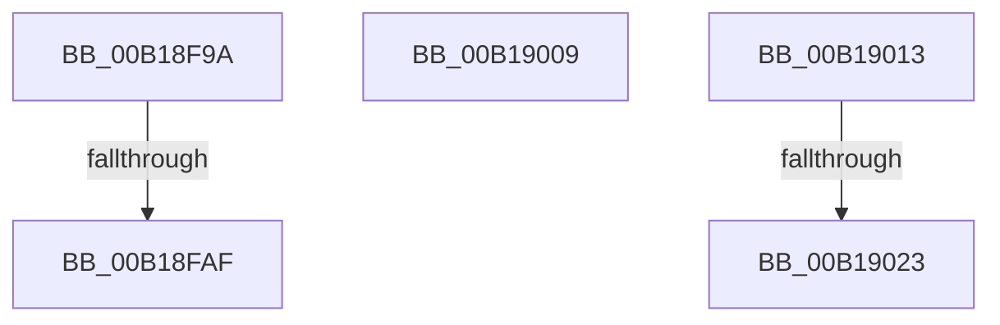

# sub_00B18F9A

- RVA: `0x00B18F9A`–`0x00B1902B` (길이 `145` bytes)
- VA: `0x0000000140B18F9A`
- 실행 섹션: `PAGE`
- PDB 이름 있음: `아니요`; PDB Function 태그: `아니요`
- unwind 정보 RVA: `0x0007CA14`
- 디코드: `33`개 명령, `145/145` bytes 표시
- 미해석 바이트: `0` (있으면 어셈블리에 `.byte`로 보존)

> 이 문서는 커널 이미지의 기계어와 PDB 기호를 분석해 생성했습니다. 4번과 5번은 함수 원형과 자료형을 바이너리 사용 방식에서 추정한 C 해석이며 원본 소스 복구 결과는 아닙니다.

## 1. Dependencies

- 직접 호출 지점: **1**; 고유 호출 대상: **1**
- 직접 호출자로 확인된 함수: **0**
- RIP 상대 이미지 참조: **0**

### Outgoing calls
- `0x00B18FD6` → [MiInitializeVadCellBitMap](../88/MiInitializeVadCellBitMap_function_00887B64.md) (function, `0x00887B64`)

### Direct callers
- 이 함수 시작 RVA로 연결되는 직접 call은 확인되지 않았습니다. 간접 호출은 완전히 역산할 수 없습니다.

### Static image references
- 디코드된 RIP-relative 메모리 참조가 없습니다.

## 2. Other-region calls and transfers

- 다른 실행 섹션으로 향하는 call: **0**
- call이 아닌 외부 분기/꼬리 이동: **5**
  - `0x00B18FA9` → [MiSelectUserAddress + 0xD6](../88/MiSelectUserAddress_function_00885C40.md) (`tail-transfer`)
  - `0x00B19004` → [MiSelectUserAddress + 0xD6](../88/MiSelectUserAddress_function_00885C40.md) (`tail-transfer`)
  - `0x00B1900E` → [MiSelectUserAddress + 0x11D](../88/MiSelectUserAddress_function_00885C40.md) (`tail-transfer`)
  - `0x00B1901D` → [MiSelectUserAddress + 0x181](../88/MiSelectUserAddress_function_00885C40.md) (`tail-transfer`)
  - `0x00B19026` → [MiSelectUserAddress + 0x245](../88/MiSelectUserAddress_function_00885C40.md) (`tail-transfer`)

## 3. Assembly (complete function range)

```asm
00B18F9A  49 8B C1                        mov rax, r9
00B18F9D  49 2B C2                        sub rax, r10
00B18FA0  48 FF C0                        inc rax
00B18FA3  48 3D 00 00 00 40               cmp rax, 0x40000000
00B18FA9  0F 82 67 CD D6 FF               jb 0x140885d16
00B18FAF  49 8B C1                        mov rax, r9
00B18FB2  4D 89 5D 40                     mov qword ptr [r13 + 0x40], r11
00B18FB6  48 C1 E8 10                     shr rax, 0x10
00B18FBA  BA 01 00 00 00                  mov edx, 1
00B18FBF  49 89 45 28                     mov qword ptr [r13 + 0x28], rax
00B18FC3  49 8B CD                        mov rcx, r13
00B18FC6  49 8D 41 01                     lea rax, [r9 + 1]
00B18FCA  49 C1 E3 10                     shl r11, 0x10
00B18FCE  49 89 45 30                     mov qword ptr [r13 + 0x30], rax
00B18FD2  4D 89 5D 38                     mov qword ptr [r13 + 0x38], r11
00B18FD6  E8 89 EB D6 FF                  call 0x140887b64
00B18FDB  44 8B 84 24 C0 00 00 00         mov r8d, dword ptr [rsp + 0xc0]
00B18FE3  85 C0                           test eax, eax
00B18FE5  4C 8B 8C 24 D0 00 00 00         mov r9, qword ptr [rsp + 0xd0]
00B18FED  48 8B CB                        mov rcx, rbx
00B18FF0  4C 8B 94 24 C8 00 00 00         mov r10, qword ptr [rsp + 0xc8]
00B18FF8  BA 02 00 00 00                  mov edx, 2
00B18FFD  48 0F 49 CA                     cmovns rcx, rdx
00B19001  48 8B D1                        mov rdx, rcx
00B19004  E9 0D CD D6 FF                  jmp 0x140885d16
00B19009  BB 01 00 00 00                  mov ebx, 1
00B1900E  E9 4A CD D6 FF                  jmp 0x140885d5d
00B19013  4D 3B DA                        cmp r11, r10
00B19016  4D 0F 42 DA                     cmovb r11, r10
00B1901A  4D 3B DE                        cmp r11, r14
00B1901D  0F 83 9E CD D6 FF               jae 0x140885dc1
00B19023  4D 8B F3                        mov r14, r11
00B19026  E9 5A CE D6 FF                  jmp 0x140885e85
```

## 4. C-style interpretation (structured pseudocode)

```c
__int64 __fastcall sub_00B18F9A(__int64 a1, __int64 a2, __int64 a3, __int64 a4, __int64 a5, __int64 a6, __int64 a7, __int64 a8, __int64 a9, __int64 a10, __int64 a11, __int64 a12, __int64 a13, __int64 a14, __int64 a15, __int64 a16, __int64 a17, __int64 a18, __int64 a19, __int64 a20, __int64 a21, __int64 a22, __int64 a23, unsigned int a24, __int64 a25, __int64 a26)
{
    __int64 result;
    __int64 v_r11;

    result = (a4) - (v_r10);
    result = (result) + 1;
    *(unsigned __int64 *)(v_r13 + 64) = v_r11;
    result = (a4) >> (16);
    *(unsigned __int64 *)(v_r13 + 40) = result;
    v_r11 = (v_r11) << (16);
    *(unsigned __int64 *)(v_r13 + 48) = a4 + 1;
    *(unsigned __int64 *)(v_r13 + 56) = v_r11;
    result = MiInitializeVadCellBitMap(v_r13, 1, a3, a4);
    a1 = v_rbx;
    if (!sign_flag) { a1 = 2; }
}
```

## 5. (Beta) C Style

```c
int64_t sub_00B18F9A(int64_t Arg1, int64_t Arg2, int64_t Arg3, void *Arg4, uint64_t Arg5, uint64_t Arg6, uint64_t Arg7, uint64_t Arg8, uint64_t Arg9, uint64_t Arg10, uint64_t Arg11, uint64_t Arg12, uint64_t Arg13, uint64_t Arg14, uint64_t Arg15, uint64_t Arg16, uint64_t Arg17, uint64_t Arg18, uint64_t Arg19, uint64_t Arg20, uint64_t Arg21, uint64_t Arg22, uint64_t Arg23, uint32_t Arg24, int64_t Arg25, int64_t Arg26)
{
    uint8_t *arg4 = (uint8_t *)Arg4;

    int64_t result;
    int64_t local_r11;

    result = (Arg4) - (local_r10);
    result = (result) + 1;
    *(uint64_t *)(local_r13 + 0x40) = local_r11;
    result = (Arg4) >> (16);
    *(uint64_t *)(local_r13 + 0x28) = result;
    local_r11 = (local_r11) << (16);
    *(void **)(local_r13 + 0x30) = Arg4 + 1;
    *(uint64_t *)(local_r13 + 0x38) = local_r11;
    result = MiInitializeVadCellBitMap(local_r13, 1, Arg3, Arg4);
    Arg1 = local_rbx;
    if (!sign_flag) { Arg1 = 2; }
}
```

### 관측된 메모리 오프셋

구조체 형식이 확인되지 않은 접근은 인자 기준의 오프셋으로만 기록했습니다.

| 기준 인자 | 오프셋 표현 | 폭 (bit) | 접근 |
|---|---:|---:|---|
| `Arg4` | `+ 0x1` | `64` | `R` |

## 6. Execution-region graph

[열기: 2D/3D 그래프와 함수 탐색 컨트롤 패널](../../../control-panel.html?section=page&rva=0x00B18F9A&view=graph)

- 2D 그래프는 위에서 아래로 흐르고, 3D 그래프는 빈 공간을 드래그해 회전합니다. Shift+드래그는 이동, 휠은 확대·축소, 함수 노드 선택은 대상 보고서 이동입니다.

### Static fallback


