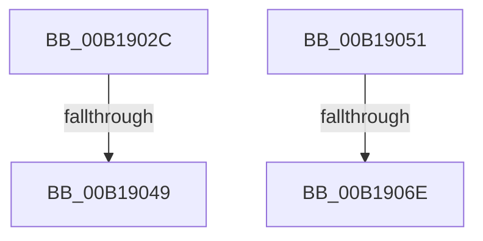

# sub_00B1902C

- RVA: `0x00B1902C`–`0x00B19076` (길이 `74` bytes)
- VA: `0x0000000140B1902C`
- 실행 섹션: `PAGE`
- PDB 이름 있음: `아니요`; PDB Function 태그: `아니요`
- unwind 정보 RVA: `0x0007CBA4`
- 디코드: `18`개 명령, `74/74` bytes 표시
- 미해석 바이트: `0` (있으면 어셈블리에 `.byte`로 보존)

> 이 문서는 커널 이미지의 기계어와 PDB 기호를 분석해 생성했습니다. 4번과 5번은 함수 원형과 자료형을 바이너리 사용 방식에서 추정한 C 해석이며 원본 소스 복구 결과는 아닙니다.

## 1. Dependencies

- 직접 호출 지점: **2**; 고유 호출 대상: **1**
- 직접 호출자로 확인된 함수: **0**
- RIP 상대 이미지 참조: **0**

### Outgoing calls
- `0x00B1903C` → [RtlAreBitsClearEx](../../text/41/RtlAreBitsClearEx_function_0041DBF0.md) (function, `0x0041DBF0`)
- `0x00B19061` → [RtlAreBitsClearEx](../../text/41/RtlAreBitsClearEx_function_0041DBF0.md) (function, `0x0041DBF0`)

### Direct callers
- 이 함수 시작 RVA로 연결되는 직접 call은 확인되지 않았습니다. 간접 호출은 완전히 역산할 수 없습니다.

### Static image references
- 디코드된 RIP-relative 메모리 참조가 없습니다.

## 2. Other-region calls and transfers

- 다른 실행 섹션으로 향하는 call: **2**
  - `0x00B1903C` → [RtlAreBitsClearEx](../../text/41/RtlAreBitsClearEx_function_0041DBF0.md) (`PAGE` → `.text`)
  - `0x00B19061` → [RtlAreBitsClearEx](../../text/41/RtlAreBitsClearEx_function_0041DBF0.md) (`PAGE` → `.text`)
- call이 아닌 외부 분기/꼬리 이동: **4**
  - `0x00B19043` → [MiCommitPageTablesForVad + 0x18A](../88/MiCommitPageTablesForVad_function_00886D50.md) (`tail-transfer`)
  - `0x00B1904C` → [MiCommitPageTablesForVad + 0x18A](../88/MiCommitPageTablesForVad_function_00886D50.md) (`tail-transfer`)
  - `0x00B19068` → [MiCommitPageTablesForVad + 0x23B](../88/MiCommitPageTablesForVad_function_00886D50.md) (`tail-transfer`)
  - `0x00B19071` → [MiCommitPageTablesForVad + 0x23B](../88/MiCommitPageTablesForVad_function_00886D50.md) (`tail-transfer`)

## 3. Assembly (complete function range)

```asm
00B1902C  48 8B D3                        mov rdx, rbx
00B1902F  41 B8 08 00 00 00               mov r8d, 8
00B19035  48 83 E2 F8                     and rdx, 0xfffffffffffffff8
00B19039  49 8B CD                        mov rcx, r13
00B1903C  E8 AF 4B 90 FF                  call 0x14041dbf0
00B19041  84 C0                           test al, al
00B19043  0F 84 91 DE D6 FF               je 0x140886eda
00B19049  49 FF C7                        inc r15
00B1904C  E9 89 DE D6 FF                  jmp 0x140886eda
00B19051  48 8B D3                        mov rdx, rbx
00B19054  41 B8 08 00 00 00               mov r8d, 8
00B1905A  48 83 E2 F8                     and rdx, 0xfffffffffffffff8
00B1905E  49 8B CD                        mov rcx, r13
00B19061  E8 8A 4B 90 FF                  call 0x14041dbf0
00B19066  84 C0                           test al, al
00B19068  0F 84 1D DF D6 FF               je 0x140886f8b
00B1906E  49 FF C7                        inc r15
00B19071  E9 15 DF D6 FF                  jmp 0x140886f8b
```

## 4. C-style interpretation (structured pseudocode)

```c
__int64 __fastcall sub_00B1902C(void)
{
    __int64 result;
    __int64 v_r15;

    a2 = (v_rbx) & (-8);
    result = RtlAreBitsClearEx(v_r13, a2, 8, a4);
    v_r15 = (v_r15) + 1;
}
```

## 5. (Beta) C Style

```c
void sub_00B1902C(void)
{
    int64_t result;
    int64_t local_r15;

    a2 = (local_rbx) & (-8);
    result = RtlAreBitsClearEx(local_r13, a2, 8, a4);
    local_r15 = (local_r15) + 1;
}
```

## 6. Execution-region graph

[열기: 2D/3D 그래프와 함수 탐색 컨트롤 패널](../../../control-panel.html?section=page&rva=0x00B1902C&view=graph)

- 2D 그래프는 위에서 아래로 흐르고, 3D 그래프는 빈 공간을 드래그해 회전합니다. Shift+드래그는 이동, 휠은 확대·축소, 함수 노드 선택은 대상 보고서 이동입니다.

### Static fallback


