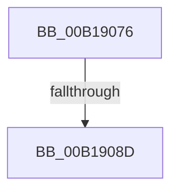

# sub_00B19076

- RVA: `0x00B19076`–`0x00B19096` (길이 `32` bytes)
- VA: `0x0000000140B19076`
- 실행 섹션: `PAGE`
- PDB 이름 있음: `아니요`; PDB Function 태그: `아니요`
- unwind 정보 RVA: `0x0007CCE4`
- 디코드: `8`개 명령, `32/32` bytes 표시
- 미해석 바이트: `0` (있으면 어셈블리에 `.byte`로 보존)

> 이 문서는 커널 이미지의 기계어와 PDB 기호를 분석해 생성했습니다. 4번과 5번은 함수 원형과 자료형을 바이너리 사용 방식에서 추정한 C 해석이며 원본 소스 복구 결과는 아닙니다.

## 1. Dependencies

- 직접 호출 지점: **1**; 고유 호출 대상: **1**
- 직접 호출자로 확인된 함수: **0**
- RIP 상대 이미지 참조: **0**

### Outgoing calls
- `0x00B1907E` → [MiUpControlAreaRefs](../../text/3B/MiUpControlAreaRefs_function_003B2BF0.md) (function, `0x003B2BF0`)

### Direct callers
- 이 함수 시작 RVA로 연결되는 직접 call은 확인되지 않았습니다. 간접 호출은 완전히 역산할 수 없습니다.

### Static image references
- 디코드된 RIP-relative 메모리 참조가 없습니다.

## 2. Other-region calls and transfers

- 다른 실행 섹션으로 향하는 call: **1**
  - `0x00B1907E` → [MiUpControlAreaRefs](../../text/3B/MiUpControlAreaRefs_function_003B2BF0.md) (`PAGE` → `.text`)
- call이 아닌 외부 분기/꼬리 이동: **2**
  - `0x00B19087` → [MiAllocateSplitVads + 0x90](../88/MiAllocateSplitVads_function_00887818.md) (`tail-transfer`)
  - `0x00B19091` → [MiAllocateSplitVads + 0xE5](../88/MiAllocateSplitVads_function_00887818.md) (`tail-transfer`)

## 3. Assembly (complete function range)

```asm
00B19076  BA 01 00 00 00                  mov edx, 1
00B1907B  48 8B CE                        mov rcx, rsi
00B1907E  E8 6D 9B 89 FF                  call 0x1403b2bf0
00B19083  8B D8                           mov ebx, eax
00B19085  85 C0                           test eax, eax
00B19087  0F 88 1B E8 D6 FF               js 0x1408878a8
00B1908D  83 4F 28 04                     or dword ptr [rdi + 0x28], 4
00B19091  E9 67 E8 D6 FF                  jmp 0x1408878fd
```

## 4. C-style interpretation (structured pseudocode)

```c
__int64 __fastcall sub_00B19076(void)
{
    __int64 result;

    result = MiUpControlAreaRefs(v_rsi, 1, a3, a4);
}
```

## 5. (Beta) C Style

```c
void sub_00B19076(void)
{
    int64_t result;

    result = MiUpControlAreaRefs(local_rsi, 1, a3, a4);
}
```

## 6. Execution-region graph

[열기: 2D/3D 그래프와 함수 탐색 컨트롤 패널](../../../control-panel.html?section=page&rva=0x00B19076&view=graph)

- 2D 그래프는 위에서 아래로 흐르고, 3D 그래프는 빈 공간을 드래그해 회전합니다. Shift+드래그는 이동, 휠은 확대·축소, 함수 노드 선택은 대상 보고서 이동입니다.

### Static fallback


