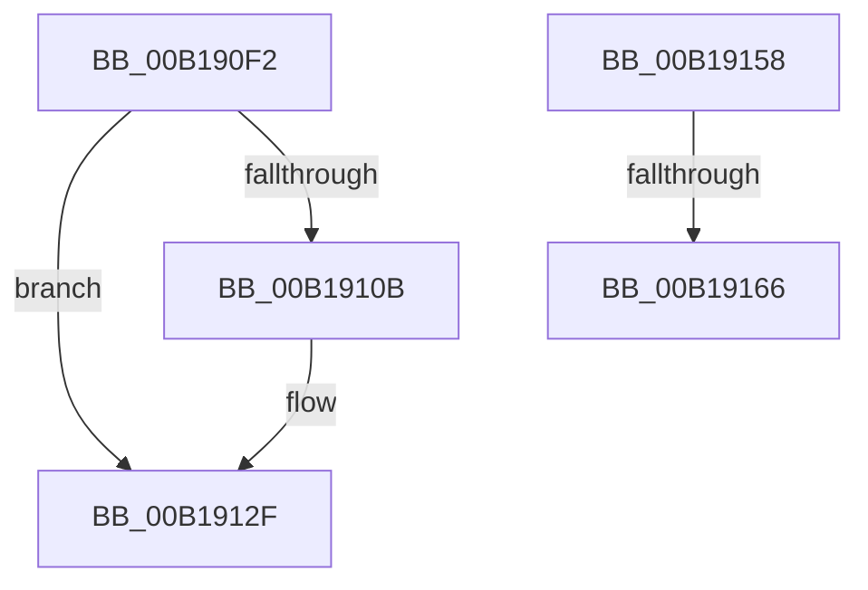

# sub_00B190F2

- RVA: `0x00B190F2`–`0x00B191AC` (길이 `186` bytes)
- VA: `0x0000000140B190F2`
- 실행 섹션: `PAGE`
- PDB 이름 있음: `아니요`; PDB Function 태그: `아니요`
- unwind 정보 RVA: `0x0007CEC0`
- 디코드: `49`개 명령, `186/186` bytes 표시
- 미해석 바이트: `0` (있으면 어셈블리에 `.byte`로 보존)

> 이 문서는 커널 이미지의 기계어와 PDB 기호를 분석해 생성했습니다. 4번과 5번은 함수 원형과 자료형을 바이너리 사용 방식에서 추정한 C 해석이며 원본 소스 복구 결과는 아닙니다.

## 1. Dependencies

- 직접 호출 지점: **4**; 고유 호출 대상: **4**
- 직접 호출자로 확인된 함수: **0**
- RIP 상대 이미지 참조: **1**

### Outgoing calls
- `0x00B19113` → [MiLocateLockedVadEvent](../../text/2A/MiLocateLockedVadEvent_function_002A7A0C.md) (function, `0x002A7A0C`)
- `0x00B19126` → [MiFreeLargePageView](../9B/MiFreeLargePageView_function_009BB3B4.md) (function, `0x009BB3B4`)
- `0x00B1916D` → [MiInitPerfMemoryFlags](../../text/4F/MiInitPerfMemoryFlags_function_004FBDCC.md) (function, `0x004FBDCC`)
- `0x00B191A1` → [MiLogPerfMemoryRangeEvent](../../text/4D/MiLogPerfMemoryRangeEvent_function_004D9D7C.md) (function, `0x004D9D7C`)

### Direct callers
- 이 함수 시작 RVA로 연결되는 직접 call은 확인되지 않았습니다. 간접 호출은 완전히 역산할 수 없습니다.

### Static image references
- `0x00B19158` → RVA `0x00FC6B04` (`ALMOSTRO`; read)

## 2. Other-region calls and transfers

- 다른 실행 섹션으로 향하는 call: **3**
  - `0x00B19113` → [MiLocateLockedVadEvent](../../text/2A/MiLocateLockedVadEvent_function_002A7A0C.md) (`PAGE` → `.text`)
  - `0x00B1916D` → [MiInitPerfMemoryFlags](../../text/4F/MiInitPerfMemoryFlags_function_004FBDCC.md) (`PAGE` → `.text`)
  - `0x00B191A1` → [MiLogPerfMemoryRangeEvent](../../text/4D/MiLogPerfMemoryRangeEvent_function_004D9D7C.md) (`PAGE` → `.text`)
- call이 아닌 외부 분기/꼬리 이동: **3**
  - `0x00B19153` → [MiDeleteVad + 0x17A](../88/MiDeleteVad_function_00888C80.md) (`tail-transfer`)
  - `0x00B19160` → [MiDeleteVad + 0x2A3](../88/MiDeleteVad_function_00888C80.md) (`tail-transfer`)
  - `0x00B191A7` → [MiDeleteVad + 0x2A3](../88/MiDeleteVad_function_00888C80.md) (`tail-transfer`)

## 3. Assembly (complete function range)

```asm
00B190F2  4C 8B 45 D8                     mov r8, qword ptr [rbp - 0x28]
00B190F6  49 2B D0                        sub rdx, r8
00B190F9  48 8B C2                        mov rax, rdx
00B190FC  89 57 34                        mov dword ptr [rdi + 0x34], edx
00B190FF  48 C1 E8 20                     shr rax, 0x20
00B19103  88 47 22                        mov byte ptr [rdi + 0x22], al
00B19106  48 85 D2                        test rdx, rdx
00B19109  74 24                           je 0x140b1912f
00B1910B  BA 10 00 00 00                  mov edx, 0x10
00B19110  48 8B CF                        mov rcx, rdi
00B19113  E8 F4 E8 78 FF                  call 0x1402a7a0c
00B19118  48 8B 4D 40                     mov rcx, qword ptr [rbp + 0x40]
00B1911C  44 8D 4A F1                     lea r9d, [rdx - 0xf]
00B19120  4C 8B C0                        mov r8, rax
00B19123  48 8B D7                        mov rdx, rdi
00B19126  E8 89 22 EA FF                  call 0x1409bb3b4
00B1912B  4C 8B 45 D8                     mov r8, qword ptr [rbp - 0x28]
00B1912F  48 8B 4D D0                     mov rcx, qword ptr [rbp - 0x30]
00B19133  48 8B C1                        mov rax, rcx
00B19136  89 4F 34                        mov dword ptr [rdi + 0x34], ecx
00B19139  48 C1 E8 20                     shr rax, 0x20
00B1913D  88 47 22                        mov byte ptr [rdi + 0x22], al
00B19140  49 2B C8                        sub rcx, r8
00B19143  48 8B 45 40                     mov rax, qword ptr [rbp + 0x40]
00B19147  F0 48 01 88 70 05 00 00         lock add qword ptr [rax + 0x570], rcx
00B1914F  4C 89 6D D8                     mov qword ptr [rbp - 0x28], r13
00B19153  E9 A2 FC D6 FF                  jmp 0x140888dfa
00B19158  8B 05 A6 D9 4A 00               mov eax, dword ptr [rip + 0x4ad9a6]
00B1915E  A8 01                           test al, 1
00B19160  0F 84 BD FD D6 FF               je 0x140888f23
00B19166  BA 0D 00 00 00                  mov edx, 0xd
00B1916B  33 C9                           xor ecx, ecx
00B1916D  E8 5A 2C 9E FF                  call 0x1404fbdcc
00B19172  8B 4F 1C                        mov ecx, dword ptr [rdi + 0x1c]
00B19175  44 8B C0                        mov r8d, eax
00B19178  44 0F B6 4F 21                  movzx r9d, byte ptr [rdi + 0x21]
00B1917D  0F B6 57 20                     movzx edx, byte ptr [rdi + 0x20]
00B19181  49 C1 E1 20                     shl r9, 0x20
00B19185  4C 0B C9                        or r9, rcx
00B19188  48 C1 E2 20                     shl rdx, 0x20
00B1918C  8B 4F 18                        mov ecx, dword ptr [rdi + 0x18]
00B1918F  48 0B D1                        or rdx, rcx
00B19192  49 8B CC                        mov rcx, r12
00B19195  4C 2B CA                        sub r9, rdx
00B19198  8B 96 D0 01 00 00               mov edx, dword ptr [rsi + 0x1d0]
00B1919E  49 FF C1                        inc r9
00B191A1  E8 D6 0B 9C FF                  call 0x1404d9d7c
00B191A6  90                              nop
00B191A7  E9 77 FD D6 FF                  jmp 0x140888f23
```

## 4. C-style interpretation (structured pseudocode)

```c
__int64 __fastcall sub_00B190F2(__int64 a1, __int64 a2)
{
    __int64 result;

    a2 = (a2) - (*(unsigned __int64 *)(v_rbp - 40));
    *(unsigned int *)(v_rdi + 52) = (unsigned int)(a2);
    result = (a2) >> (32);
    *(unsigned __int8 *)(v_rdi + 34) = (unsigned __int8)(result);
    if (a2 != 0) {
        a2 = 16;
        a1 = v_rdi;
        result = MiLocateLockedVadEvent(a1, a2, *(unsigned __int64 *)(v_rbp - 40), a4);
        a1 = *(unsigned __int64 *)(v_rbp + 64);
        a4 = a2 - 15;
        a3 = result;
        a2 = v_rdi;
        result = MiFreeLargePageView(a1, a2, a3, a4);
        a3 = *(unsigned __int64 *)(v_rbp - 40);
    }
    *(unsigned int *)(v_rdi + 52) = (unsigned int)(*(unsigned __int64 *)(v_rbp - 48));
    result = (*(unsigned __int64 *)(v_rbp - 48)) >> (32);
    *(unsigned __int8 *)(v_rdi + 34) = (unsigned __int8)(result);
    a1 = (*(unsigned __int64 *)(v_rbp - 48)) - (a3);
    *(unsigned __int64 *)(v_rbp - 40) = v_r13;
}
```

## 5. (Beta) C Style

```c
int64_t sub_00B190F2(int64_t Arg1, int64_t Arg2)
{
    int64_t result;

    Arg2 = (Arg2) - (*(uint64_t *)(local_rbp - 0x28));
    *(uint32_t *)(local_rdi + 0x34) = (uint32_t)(Arg2);
    result = (Arg2) >> (32);
    *(uint8_t *)(local_rdi + 0x22) = (uint8_t)(result);
    if (Arg2 != 0) {
        Arg2 = 16;
        Arg1 = local_rdi;
        result = MiLocateLockedVadEvent(Arg1, Arg2, *(uint64_t *)(local_rbp - 0x28), a4);
        Arg1 = *(uint64_t *)(local_rbp + 0x40);
        a4 = Arg2 - 15;
        a3 = result;
        Arg2 = local_rdi;
        result = MiFreeLargePageView(Arg1, Arg2, a3, a4);
        a3 = *(uint64_t *)(local_rbp - 0x28);
    }
    *(uint32_t *)(local_rdi + 0x34) = (uint32_t)(*(uint64_t *)(local_rbp - 0x30));
    result = (*(uint64_t *)(local_rbp - 0x30)) >> (32);
    *(uint8_t *)(local_rdi + 0x22) = (uint8_t)(result);
    Arg1 = (*(uint64_t *)(local_rbp - 0x30)) - (a3);
    *(uint64_t *)(local_rbp - 0x28) = local_r13;
}
```

## 6. Execution-region graph

[열기: 2D/3D 그래프와 함수 탐색 컨트롤 패널](../../../control-panel.html?section=page&rva=0x00B190F2&view=graph)

- 2D 그래프는 위에서 아래로 흐르고, 3D 그래프는 빈 공간을 드래그해 회전합니다. Shift+드래그는 이동, 휠은 확대·축소, 함수 노드 선택은 대상 보고서 이동입니다.

### Static fallback


