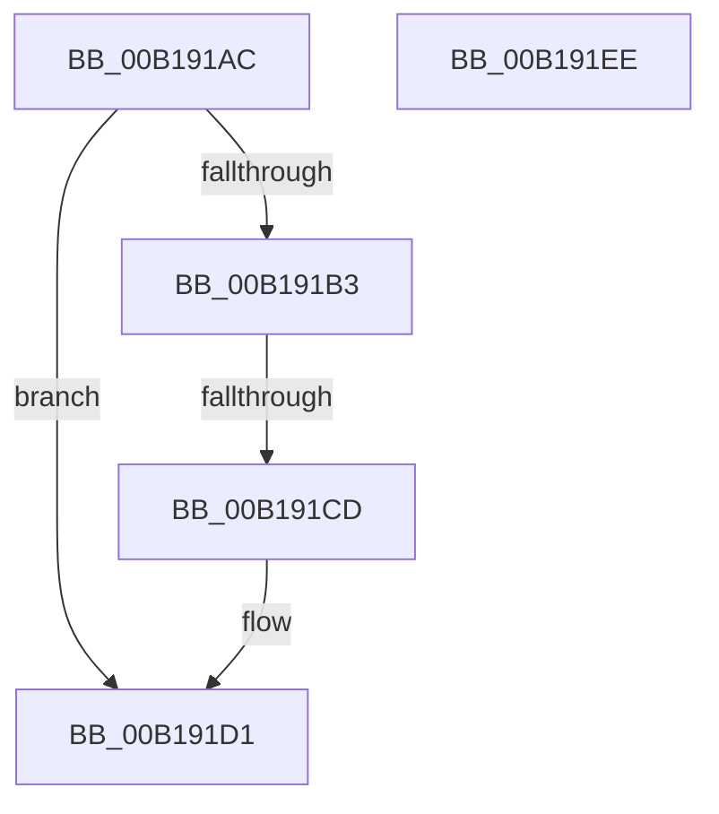

# sub_00B191AC

- RVA: `0x00B191AC`–`0x00B19205` (길이 `89` bytes)
- VA: `0x0000000140B191AC`
- 실행 섹션: `PAGE`
- PDB 이름 있음: `아니요`; PDB Function 태그: `아니요`
- unwind 정보 RVA: `0x0007CFA0`
- 디코드: `22`개 명령, `89/89` bytes 표시
- 미해석 바이트: `0` (있으면 어셈블리에 `.byte`로 보존)

> 이 문서는 커널 이미지의 기계어와 PDB 기호를 분석해 생성했습니다. 4번과 5번은 함수 원형과 자료형을 바이너리 사용 방식에서 추정한 C 해석이며 원본 소스 복구 결과는 아닙니다.

## 1. Dependencies

- 직접 호출 지점: **2**; 고유 호출 대상: **2**
- 직접 호출자로 확인된 함수: **0**
- RIP 상대 이미지 참조: **0**

### Outgoing calls
- `0x00B191BF` → [MmSecureVirtualMemoryAgainstWrites](../89/MmSecureVirtualMemoryAgainstWrites_function_00890164.md) (function, `0x00890164`)
- `0x00B191D8` → [AlpcpReferenceBlob](../89/AlpcpReferenceBlob_function_00890110.md) (function, `0x00890110`)

### Direct callers
- 이 함수 시작 RVA로 연결되는 직접 call은 확인되지 않았습니다. 간접 호출은 완전히 역산할 수 없습니다.

### Static image references
- 디코드된 RIP-relative 메모리 참조가 없습니다.

## 2. Other-region calls and transfers

- 다른 실행 섹션으로 향하는 call: **0**
- call이 아닌 외부 분기/꼬리 이동: **3**
  - `0x00B191C7` → [AlpcpPrepareViewForDelivery + 0x68](../88/AlpcpPrepareViewForDelivery_function_00889A44.md) (`tail-transfer`)
  - `0x00B191E9` → [AlpcpPrepareViewForDelivery + 0x68](../88/AlpcpPrepareViewForDelivery_function_00889A44.md) (`tail-transfer`)
  - `0x00B19200` → [AlpcpPrepareViewForDelivery + 0x68](../88/AlpcpPrepareViewForDelivery_function_00889A44.md) (`tail-transfer`)

## 3. Assembly (complete function range)

```asm
00B191AC  8B 47 48                        mov eax, dword ptr [rdi + 0x48]
00B191AF  A8 08                           test al, 8
00B191B1  75 1E                           jne 0x140b191d1
00B191B3  4C 8B 47 30                     mov r8, qword ptr [rdi + 0x30]
00B191B7  48 8B 57 28                     mov rdx, qword ptr [rdi + 0x28]
00B191BB  48 8B 4F 20                     mov rcx, qword ptr [rdi + 0x20]
00B191BF  E8 A0 6F D7 FF                  call 0x140890164
00B191C4  48 85 C0                        test rax, rax
00B191C7  0F 84 DF 08 D7 FF               je 0x140889aac
00B191CD  48 89 47 40                     mov qword ptr [rdi + 0x40], rax
00B191D1  83 67 48 FE                     and dword ptr [rdi + 0x48], 0xfffffffe
00B191D5  48 8B CF                        mov rcx, rdi
00B191D8  E8 33 6F D7 FF                  call 0x140890110
00B191DD  83 4E 30 01                     or dword ptr [rsi + 0x30], 1
00B191E1  48 89 7E 48                     mov qword ptr [rsi + 0x48], rdi
00B191E5  48 89 5E 50                     mov qword ptr [rsi + 0x50], rbx
00B191E9  E9 BE 08 D7 FF                  jmp 0x140889aac
00B191EE  83 4D 48 01                     or dword ptr [rbp + 0x48], 1
00B191F2  48 83 66 48 00                  and qword ptr [rsi + 0x48], 0
00B191F7  48 83 66 50 00                  and qword ptr [rsi + 0x50], 0
00B191FC  83 66 30 FE                     and dword ptr [rsi + 0x30], 0xfffffffe
00B19200  E9 A7 08 D7 FF                  jmp 0x140889aac
```

## 4. C-style interpretation (structured pseudocode)

```c
__int64 __fastcall sub_00B191AC(void)
{
    __int64 result;

    if ((((unsigned __int8)((unsigned int)(*(unsigned int *)(v_rdi + 72)))) & (8)) != 0) goto loc_00B191D1;
    result = MmSecureVirtualMemoryAgainstWrites(*(unsigned __int64 *)(v_rdi + 32), *(unsigned __int64 *)(v_rdi + 40), *(unsigned __int64 *)(v_rdi + 48), a4);
    *(unsigned __int64 *)(v_rdi + 64) = result;
loc_00B191D1:
    result = AlpcpReferenceBlob(v_rdi, *(unsigned __int64 *)(v_rdi + 40), *(unsigned __int64 *)(v_rdi + 48), a4);
    *(unsigned __int64 *)(v_rsi + 72) = v_rdi;
    *(unsigned __int64 *)(v_rsi + 80) = v_rbx;
}
```

## 5. (Beta) C Style

```c
void sub_00B191AC(void)
{
    int64_t result;

    if ((((uint8_t)((uint32_t)(*(uint32_t *)(local_rdi + 0x48)))) & (8)) != 0) goto loc_00B191D1;
    result = MmSecureVirtualMemoryAgainstWrites(*(uint64_t *)(local_rdi + 0x20), *(uint64_t *)(local_rdi + 0x28), *(uint64_t *)(local_rdi + 0x30), a4);
    *(uint64_t *)(local_rdi + 0x40) = result;
loc_00B191D1:
    result = AlpcpReferenceBlob(local_rdi, *(uint64_t *)(local_rdi + 0x28), *(uint64_t *)(local_rdi + 0x30), a4);
    *(uint64_t *)(local_rsi + 0x48) = local_rdi;
    *(uint64_t *)(local_rsi + 0x50) = local_rbx;
}
```

## 6. Execution-region graph

[열기: 2D/3D 그래프와 함수 탐색 컨트롤 패널](../../../control-panel.html?section=page&rva=0x00B191AC&view=graph)

- 2D 그래프는 위에서 아래로 흐르고, 3D 그래프는 빈 공간을 드래그해 회전합니다. Shift+드래그는 이동, 휠은 확대·축소, 함수 노드 선택은 대상 보고서 이동입니다.

### Static fallback


