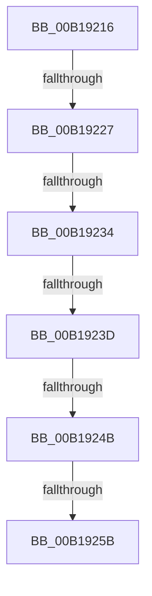

# sub_00B19216

- RVA: `0x00B19216`–`0x00B1927B` (길이 `101` bytes)
- VA: `0x0000000140B19216`
- 실행 섹션: `PAGE`
- PDB 이름 있음: `아니요`; PDB Function 태그: `아니요`
- unwind 정보 RVA: `0x0007D51C`
- 디코드: `23`개 명령, `101/101` bytes 표시
- 미해석 바이트: `0` (있으면 어셈블리에 `.byte`로 보존)

> 이 문서는 커널 이미지의 기계어와 PDB 기호를 분석해 생성했습니다. 4번과 5번은 함수 원형과 자료형을 바이너리 사용 방식에서 추정한 C 해석이며 원본 소스 복구 결과는 아닙니다.

## 1. Dependencies

- 직접 호출 지점: **4**; 고유 호출 대상: **4**
- 직접 호출자로 확인된 함수: **0**
- RIP 상대 이미지 참조: **0**

### Outgoing calls
- `0x00B1923D` → [PsGetProcessJob](../../text/47/PsGetProcessJob_function_0047AE30.md) (function, `0x0047AE30`)
- `0x00B1924E` → [PsGetJobEffectiveFreezeCount](../../text/5E/PsGetJobEffectiveFreezeCount_function_005E2D40.md) (function, `0x005E2D40`)
- `0x00B19264` → [AlpcpUnlockAndDereferenceTargetPortsAndCommunicationInfo](../88/AlpcpUnlockAndDereferenceTargetPortsAndCommunicationInfo_function_0088FE2C.md) (function, `0x0088FE2C`)
- `0x00B1926C` → [AlpcpUnlockMessage](../89/AlpcpUnlockMessage_function_00897AE0.md) (function, `0x00897AE0`)

### Direct callers
- 이 함수 시작 RVA로 연결되는 직접 call은 확인되지 않았습니다. 간접 호출은 완전히 역산할 수 없습니다.

### Static image references
- 디코드된 RIP-relative 메모리 참조가 없습니다.

## 2. Other-region calls and transfers

- 다른 실행 섹션으로 향하는 call: **2**
  - `0x00B1923D` → [PsGetProcessJob](../../text/47/PsGetProcessJob_function_0047AE30.md) (`PAGE` → `.text`)
  - `0x00B1924E` → [PsGetJobEffectiveFreezeCount](../../text/5E/PsGetJobEffectiveFreezeCount_function_005E2D40.md) (`PAGE` → `.text`)
- call이 아닌 외부 분기/꼬리 이동: **6**
  - `0x00B19221` → [AlpcpDispatchNewMessage + 0x1B2](../88/AlpcpDispatchNewMessage_function_0088DD20.md) (`tail-transfer`)
  - `0x00B1922E` → [AlpcpDispatchNewMessage + 0x1B2](../88/AlpcpDispatchNewMessage_function_0088DD20.md) (`tail-transfer`)
  - `0x00B19237` → [AlpcpDispatchNewMessage + 0x1B2](../88/AlpcpDispatchNewMessage_function_0088DD20.md) (`tail-transfer`)
  - `0x00B19245` → [AlpcpDispatchNewMessage + 0x1B2](../88/AlpcpDispatchNewMessage_function_0088DD20.md) (`tail-transfer`)
  - `0x00B19255` → [AlpcpDispatchNewMessage + 0x1B2](../88/AlpcpDispatchNewMessage_function_0088DD20.md) (`tail-transfer`)
  - `0x00B19276` → [AlpcpDispatchNewMessage + 0x2F2](../88/AlpcpDispatchNewMessage_function_0088DD20.md) (`tail-transfer`)

## 3. Assembly (complete function range)

```asm
00B19216  49 8B 46 08                     mov rax, qword ptr [r14 + 8]
00B1921A  F7 40 28 00 02 00 00            test dword ptr [rax + 0x28], 0x200
00B19221  0F 85 AB 4C D7 FF               jne 0x14088ded2
00B19227  48 8B 4B 18                     mov rcx, qword ptr [rbx + 0x18]
00B1922B  F6 C1 01                        test cl, 1
00B1922E  0F 85 9E 4C D7 FF               jne 0x14088ded2
00B19234  48 85 C9                        test rcx, rcx
00B19237  0F 84 95 4C D7 FF               je 0x14088ded2
00B1923D  E8 EE 1B 96 FF                  call 0x14047ae30
00B19242  48 85 C0                        test rax, rax
00B19245  0F 84 87 4C D7 FF               je 0x14088ded2
00B1924B  48 8B C8                        mov rcx, rax
00B1924E  E8 ED 9A AC FF                  call 0x1405e2d40
00B19253  85 C0                           test eax, eax
00B19255  0F 84 77 4C D7 FF               je 0x14088ded2
00B1925B  4C 8B C6                        mov r8, rsi
00B1925E  48 8B D3                        mov rdx, rbx
00B19261  49 8B CC                        mov rcx, r12
00B19264  E8 C3 6B D7 FF                  call 0x14088fe2c
00B19269  48 8B CF                        mov rcx, rdi
00B1926C  E8 6F E8 D7 FF                  call 0x140897ae0
00B19271  B8 36 00 00 C0                  mov eax, 0xc0000036
00B19276  E9 97 4D D7 FF                  jmp 0x14088e012
```

## 4. C-style interpretation (structured pseudocode)

```c
__int64 __fastcall sub_00B19216(void)
{
    __int64 result;

    result = PsGetProcessJob(*(unsigned __int64 *)(v_rbx + 24), a2, a3, a4);
    result = PsGetJobEffectiveFreezeCount(result, a2, a3, a4);
    result = AlpcpUnlockAndDereferenceTargetPortsAndCommunicationInfo(v_r12, v_rbx, v_rsi, a4);
    result = AlpcpUnlockMessage(v_rdi, v_rbx, v_rsi, a4);
}
```

## 5. (Beta) C Style

```c
void sub_00B19216(void)
{
    int64_t result;

    result = PsGetProcessJob(*(uint64_t *)(local_rbx + 0x18), a2, a3, a4);
    result = PsGetJobEffectiveFreezeCount(result, a2, a3, a4);
    result = AlpcpUnlockAndDereferenceTargetPortsAndCommunicationInfo(local_r12, local_rbx, local_rsi, a4);
    result = AlpcpUnlockMessage(local_rdi, local_rbx, local_rsi, a4);
}
```

## 6. Execution-region graph

[열기: 2D/3D 그래프와 함수 탐색 컨트롤 패널](../../../control-panel.html?section=page&rva=0x00B19216&view=graph)

- 2D 그래프는 위에서 아래로 흐르고, 3D 그래프는 빈 공간을 드래그해 회전합니다. Shift+드래그는 이동, 휠은 확대·축소, 함수 노드 선택은 대상 보고서 이동입니다.

### Static fallback


