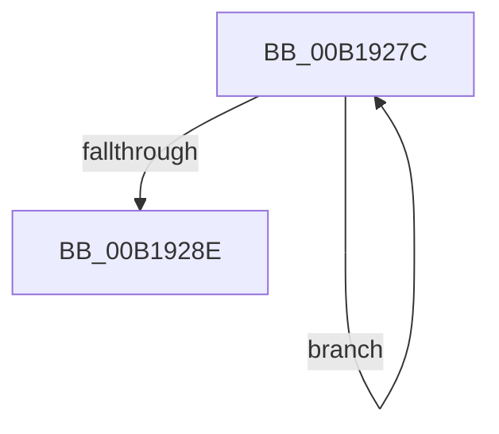

# sub_00B1927C

- RVA: `0x00B1927C`–`0x00B19293` (길이 `23` bytes)
- VA: `0x0000000140B1927C`
- 실행 섹션: `PAGE`
- PDB 이름 있음: `아니요`; PDB Function 태그: `아니요`
- unwind 정보 RVA: `0x0007D584`
- 디코드: `6`개 명령, `23/23` bytes 표시
- 미해석 바이트: `0` (있으면 어셈블리에 `.byte`로 보존)

> 이 문서는 커널 이미지의 기계어와 PDB 기호를 분석해 생성했습니다. 4번과 5번은 함수 원형과 자료형을 바이너리 사용 방식에서 추정한 C 해석이며 원본 소스 복구 결과는 아닙니다.

## 1. Dependencies

- 직접 호출 지점: **0**; 고유 호출 대상: **0**
- 직접 호출자로 확인된 함수: **0**
- RIP 상대 이미지 참조: **0**

### Outgoing calls
- 직접 디코드된 call 명령이 없습니다.

### Direct callers
- 이 함수 시작 RVA로 연결되는 직접 call은 확인되지 않았습니다. 간접 호출은 완전히 역산할 수 없습니다.

### Static image references
- 디코드된 RIP-relative 메모리 참조가 없습니다.

## 2. Other-region calls and transfers

- 다른 실행 섹션으로 향하는 call: **0**
- call이 아닌 외부 분기/꼬리 이동: **1**
  - `0x00B1928E` → [sub_0088EC77 + 0x11E](../88/Unknown_function_0088EC77.md) (`tail-transfer`)

## 3. Assembly (complete function range)

```asm
00B1927C  F0 41 21 31                     lock and dword ptr [r9], esi
00B19280  41 83 C0 E0                     add r8d, -0x20
00B19284  49 83 C1 04                     add r9, 4
00B19288  48 83 E8 01                     sub rax, 1
00B1928C  75 EE                           jne 0x140b1927c
00B1928E  E9 02 5B D7 FF                  jmp 0x14088ed95
```

## 4. C-style interpretation (structured pseudocode)

```c
__int64 __fastcall sub_00B1927C(__int64 a1, __int64 a2, int a3, __int64 a4)
{
    __int64 result;

    a3 = (unsigned int)((a3) + (-32));
    a4 = (a4) + (4);
    result = (result) - (1);
    if (condition_is_not_equal) goto loc_00B1927C;
}
```

## 5. (Beta) C Style

```c
int64_t sub_00B1927C(int64_t Arg1, int64_t Arg2, int32_t Arg3, void *Arg4)
{
    uint8_t *arg4 = (uint8_t *)Arg4;

    int64_t result;

    Arg3 = (uint32_t)((Arg3) + (-32));
    Arg4 = (Arg4) + (4);
    result = (result) - (1);
    if (condition_is_not_equal) goto loc_00B1927C;
}
```

### 관측된 메모리 오프셋

구조체 형식이 확인되지 않은 접근은 인자 기준의 오프셋으로만 기록했습니다.

| 기준 인자 | 오프셋 표현 | 폭 (bit) | 접근 |
|---|---:|---:|---|
| `Arg4` | `+ 0x0` | `32` | `R/W` |

## 6. Execution-region graph

[열기: 2D/3D 그래프와 함수 탐색 컨트롤 패널](../../../control-panel.html?section=page&rva=0x00B1927C&view=graph)

- 2D 그래프는 위에서 아래로 흐르고, 3D 그래프는 빈 공간을 드래그해 회전합니다. Shift+드래그는 이동, 휠은 확대·축소, 함수 노드 선택은 대상 보고서 이동입니다.

### Static fallback


