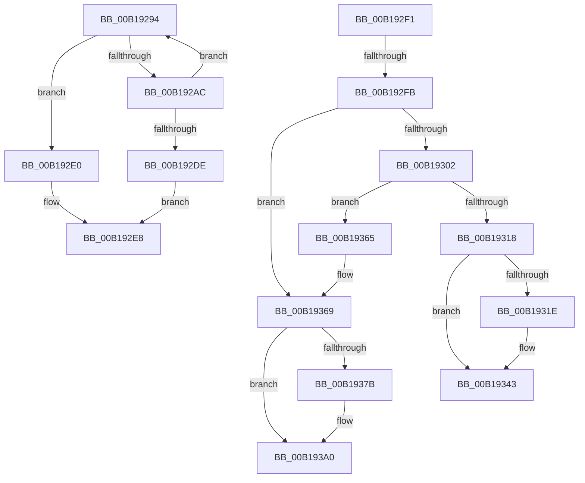

# sub_00B19294

- RVA: `0x00B19294`–`0x00B193BF` (길이 `299` bytes)
- VA: `0x0000000140B19294`
- 실행 섹션: `PAGE`
- PDB 이름 있음: `아니요`; PDB Function 태그: `아니요`
- unwind 정보 RVA: `0x0007D5F4`
- 디코드: `80`개 명령, `299/299` bytes 표시
- 미해석 바이트: `0` (있으면 어셈블리에 `.byte`로 보존)

> 이 문서는 커널 이미지의 기계어와 PDB 기호를 분석해 생성했습니다. 4번과 5번은 함수 원형과 자료형을 바이너리 사용 방식에서 추정한 C 해석이며 원본 소스 복구 결과는 아닙니다.

## 1. Dependencies

- 직접 호출 지점: **14**; 고유 호출 대상: **9**
- 직접 호출자로 확인된 함수: **0**
- RIP 상대 이미지 참조: **0**

### Outgoing calls
- `0x00B192A2` → [AlpcpReferenceBlob](../89/AlpcpReferenceBlob_function_00890110.md) (function, `0x00890110`)
- `0x00B192AF` → [AlpcpUnlockBlob](../88/AlpcpUnlockBlob_function_0088B990.md) (function, `0x0088B990`)
- `0x00B192B7` → [AlpcpLockForCachedReferenceBlob](../88/AlpcpLockForCachedReferenceBlob_function_0088A8B0.md) (function, `0x0088A8B0`)
- `0x00B192C2` → [AlpcpLocateView](../89/AlpcpLocateView_function_008900E8.md) (function, `0x008900E8`)
- `0x00B1930E` → [MmSecureVirtualMemoryAgainstWrites](../89/MmSecureVirtualMemoryAgainstWrites_function_00890164.md) (function, `0x00890164`)
- `0x00B19326` → [KeStackAttachProcess](../../text/21/KeStackAttachProcess_function_00216800.md) (function, `0x00216800`)
- `0x00B1932F` → [MmUnsecureVirtualMemory](../88/MmUnsecureVirtualMemory_function_0088A2A0.md) (function, `0x0088A2A0`)
- `0x00B1933A` → [KiUnstackDetachProcess](../../text/21/KiUnstackDetachProcess_function_00217D30.md) (function, `0x00217D30`)
- `0x00B1934F` → [AlpcpDereferenceBlobEx](../88/AlpcpDereferenceBlobEx_function_0088AF00.md) (function, `0x0088AF00`)
- `0x00B19370` → [AlpcpReferenceBlob](../89/AlpcpReferenceBlob_function_00890110.md) (function, `0x00890110`)
- `0x00B19383` → [KeStackAttachProcess](../../text/21/KeStackAttachProcess_function_00216800.md) (function, `0x00216800`)
- `0x00B1938C` → [MmUnsecureVirtualMemory](../88/MmUnsecureVirtualMemory_function_0088A2A0.md) (function, `0x0088A2A0`)
- `0x00B19397` → [KiUnstackDetachProcess](../../text/21/KiUnstackDetachProcess_function_00217D30.md) (function, `0x00217D30`)
- `0x00B193B4` → [AlpcpDereferenceBlobEx](../88/AlpcpDereferenceBlobEx_function_0088AF00.md) (function, `0x0088AF00`)

### Direct callers
- 이 함수 시작 RVA로 연결되는 직접 call은 확인되지 않았습니다. 간접 호출은 완전히 역산할 수 없습니다.

### Static image references
- 디코드된 RIP-relative 메모리 참조가 없습니다.

## 2. Other-region calls and transfers

- 다른 실행 섹션으로 향하는 call: **4**
  - `0x00B19326` → [KeStackAttachProcess](../../text/21/KeStackAttachProcess_function_00216800.md) (`PAGE` → `.text`)
  - `0x00B1933A` → [KiUnstackDetachProcess](../../text/21/KiUnstackDetachProcess_function_00217D30.md) (`PAGE` → `.text`)
  - `0x00B19383` → [KeStackAttachProcess](../../text/21/KeStackAttachProcess_function_00216800.md) (`PAGE` → `.text`)
  - `0x00B19397` → [KiUnstackDetachProcess](../../text/21/KiUnstackDetachProcess_function_00217D30.md) (`PAGE` → `.text`)
- call이 아닌 외부 분기/꼬리 이동: **4**
  - `0x00B192EC` → [AlpcpExposeViewAttributeInSenderContext + 0x74](../88/AlpcpExposeViewAttributeInSenderContext_function_0088F600.md) (`tail-transfer`)
  - `0x00B192F5` → [AlpcpExposeViewAttributeInSenderContext + 0x91](../88/AlpcpExposeViewAttributeInSenderContext_function_0088F600.md) (`tail-transfer`)
  - `0x00B19360` → [AlpcpExposeViewAttributeInSenderContext + 0xF7](../88/AlpcpExposeViewAttributeInSenderContext_function_0088F600.md) (`tail-transfer`)
  - `0x00B193BA` → [AlpcpExposeViewAttributeInSenderContext + 0xF7](../88/AlpcpExposeViewAttributeInSenderContext_function_0088F600.md) (`tail-transfer`)

## 3. Assembly (complete function range)

```asm
00B19294  48 8B CB                        mov rcx, rbx
00B19297  4C 89 45 B8                     mov qword ptr [rbp - 0x48], r8
00B1929B  4C 8B E8                        mov r13, rax
00B1929E  4C 89 4D B0                     mov qword ptr [rbp - 0x50], r9
00B192A2  E8 69 6E D7 FF                  call 0x140890110
00B192A7  48 85 C0                        test rax, rax
00B192AA  7F 34                           jg 0x140b192e0
00B192AC  48 8B CE                        mov rcx, rsi
00B192AF  E8 DC 26 D7 FF                  call 0x14088b990
00B192B4  48 8B CE                        mov rcx, rsi
00B192B7  E8 F4 15 D7 FF                  call 0x14088a8b0
00B192BC  49 8B D4                        mov rdx, r12
00B192BF  48 8B CE                        mov rcx, rsi
00B192C2  E8 21 6E D7 FF                  call 0x1408900e8
00B192C7  48 8B D8                        mov rbx, rax
00B192CA  4C 8B E8                        mov r13, rax
00B192CD  4C 8B C0                        mov r8, rax
00B192D0  48 8B D0                        mov rdx, rax
00B192D3  4C 8B C8                        mov r9, rax
00B192D6  48 8B C8                        mov rcx, rax
00B192D9  48 85 C0                        test rax, rax
00B192DC  75 B6                           jne 0x140b19294
00B192DE  EB 08                           jmp 0x140b192e8
00B192E0  48 8B 4D B0                     mov rcx, qword ptr [rbp - 0x50]
00B192E4  48 8B 55 B8                     mov rdx, qword ptr [rbp - 0x48]
00B192E8  48 89 5D B0                     mov qword ptr [rbp - 0x50], rbx
00B192EC  E9 83 63 D7 FF                  jmp 0x14088f674
00B192F1  48 3B 5E 48                     cmp rbx, qword ptr [rsi + 0x48]
00B192F5  0F 85 96 63 D7 FF               jne 0x14088f691
00B192FB  8B 47 48                        mov eax, dword ptr [rdi + 0x48]
00B192FE  A8 08                           test al, 8
00B19300  75 67                           jne 0x140b19369
00B19302  4C 8B 47 30                     mov r8, qword ptr [rdi + 0x30]
00B19306  48 8B 57 28                     mov rdx, qword ptr [rdi + 0x28]
00B1930A  48 8B 4F 20                     mov rcx, qword ptr [rdi + 0x20]
00B1930E  E8 51 6E D7 FF                  call 0x140890164
00B19313  48 85 C0                        test rax, rax
00B19316  75 4D                           jne 0x140b19365
00B19318  4C 39 6B 40                     cmp qword ptr [rbx + 0x40], r13
00B1931C  74 25                           je 0x140b19343
00B1931E  48 8B 4B 20                     mov rcx, qword ptr [rbx + 0x20]
00B19322  48 8D 55 C0                     lea rdx, [rbp - 0x40]
00B19326  E8 D5 D4 6F FF                  call 0x140216800
00B1932B  48 8B 4B 40                     mov rcx, qword ptr [rbx + 0x40]
00B1932F  E8 6C 0F D7 FF                  call 0x14088a2a0
00B19334  33 D2                           xor edx, edx
00B19336  48 8D 4D C0                     lea rcx, [rbp - 0x40]
00B1933A  E8 F1 E9 6F FF                  call 0x140217d30
00B1933F  4C 89 6B 40                     mov qword ptr [rbx + 0x40], r13
00B19343  83 4B 48 01                     or dword ptr [rbx + 0x48], 1
00B19347  BA 01 00 00 00                  mov edx, 1
00B1934C  48 8B CB                        mov rcx, rbx
00B1934F  E8 AC 1B D7 FF                  call 0x14088af00
00B19354  83 66 30 FE                     and dword ptr [rsi + 0x30], 0xfffffffe
00B19358  4C 89 6E 48                     mov qword ptr [rsi + 0x48], r13
00B1935C  4C 89 6E 50                     mov qword ptr [rsi + 0x50], r13
00B19360  E9 92 63 D7 FF                  jmp 0x14088f6f7
00B19365  48 89 47 40                     mov qword ptr [rdi + 0x40], rax
00B19369  83 67 48 FE                     and dword ptr [rdi + 0x48], 0xfffffffe
00B1936D  48 8B CF                        mov rcx, rdi
00B19370  E8 9B 6D D7 FF                  call 0x140890110
00B19375  4C 39 6B 40                     cmp qword ptr [rbx + 0x40], r13
00B19379  74 25                           je 0x140b193a0
00B1937B  48 8B 4B 20                     mov rcx, qword ptr [rbx + 0x20]
00B1937F  48 8D 55 C0                     lea rdx, [rbp - 0x40]
00B19383  E8 78 D4 6F FF                  call 0x140216800
00B19388  48 8B 4B 40                     mov rcx, qword ptr [rbx + 0x40]
00B1938C  E8 0F 0F D7 FF                  call 0x14088a2a0
00B19391  33 D2                           xor edx, edx
00B19393  48 8D 4D C0                     lea rcx, [rbp - 0x40]
00B19397  E8 94 E9 6F FF                  call 0x140217d30
00B1939C  4C 89 6B 40                     mov qword ptr [rbx + 0x40], r13
00B193A0  83 4B 48 01                     or dword ptr [rbx + 0x48], 1
00B193A4  BA 01 00 00 00                  mov edx, 1
00B193A9  48 8B CB                        mov rcx, rbx
00B193AC  48 89 7E 48                     mov qword ptr [rsi + 0x48], rdi
00B193B0  48 89 5E 50                     mov qword ptr [rsi + 0x50], rbx
00B193B4  E8 47 1B D7 FF                  call 0x14088af00
00B193B9  90                              nop
00B193BA  E9 38 63 D7 FF                  jmp 0x14088f6f7
```

## 4. C-style interpretation (structured pseudocode)

```c
__int64 __fastcall sub_00B19294(__int64 a1, __int64 a2, __int64 a3, __int64 a4)
{
    __int64 result;

    *(unsigned __int64 *)(v_rbp - 72) = a3;
    *(unsigned __int64 *)(v_rbp - 80) = a4;
    result = AlpcpReferenceBlob(v_rbx, a2, a3, a4);
    if (condition_is_greater) goto loc_00B192E0;
    result = AlpcpUnlockBlob(v_rsi, a2, a3, a4);
    result = AlpcpLockForCachedReferenceBlob(v_rsi, a2, a3, a4);
    result = AlpcpLocateView(v_rsi, v_r12, a3, a4);
    if (result != 0) goto loc_00B19294;
    goto loc_00B192E8;
loc_00B192E0:
loc_00B192E8:
    *(unsigned __int64 *)(v_rbp - 80) = result;
}
```

## 5. (Beta) C Style

```c
int64_t sub_00B19294(int64_t Arg1, int64_t Arg2, int64_t Arg3, int64_t Arg4)
{
    int64_t result;

    *(uint64_t *)(local_rbp - 0x48) = Arg3;
    *(uint64_t *)(local_rbp - 0x50) = Arg4;
    result = AlpcpReferenceBlob(local_rbx, Arg2, Arg3, Arg4);
    if (condition_is_greater) goto loc_00B192E0;
    result = AlpcpUnlockBlob(local_rsi, Arg2, Arg3, Arg4);
    result = AlpcpLockForCachedReferenceBlob(local_rsi, Arg2, Arg3, Arg4);
    result = AlpcpLocateView(local_rsi, local_r12, Arg3, Arg4);
    if (result != 0) goto loc_00B19294;
    goto loc_00B192E8;
loc_00B192E0:
loc_00B192E8:
    *(uint64_t *)(local_rbp - 0x50) = result;
}
```

## 6. Execution-region graph

[열기: 2D/3D 그래프와 함수 탐색 컨트롤 패널](../../../control-panel.html?section=page&rva=0x00B19294&view=graph)

- 2D 그래프는 위에서 아래로 흐르고, 3D 그래프는 빈 공간을 드래그해 회전합니다. Shift+드래그는 이동, 휠은 확대·축소, 함수 노드 선택은 대상 보고서 이동입니다.

### Static fallback


