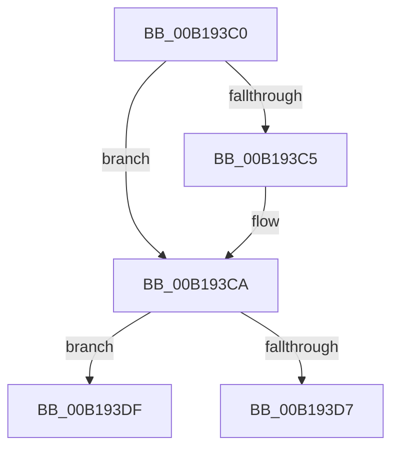

# sub_00B193C0

- RVA: `0x00B193C0`–`0x00B193E8` (길이 `40` bytes)
- VA: `0x0000000140B193C0`
- 실행 섹션: `PAGE`
- PDB 이름 있음: `아니요`; PDB Function 태그: `아니요`
- unwind 정보 RVA: `0x0007D630`
- 디코드: `11`개 명령, `40/40` bytes 표시
- 미해석 바이트: `0` (있으면 어셈블리에 `.byte`로 보존)

> 이 문서는 커널 이미지의 기계어와 PDB 기호를 분석해 생성했습니다. 4번과 5번은 함수 원형과 자료형을 바이너리 사용 방식에서 추정한 C 해석이며 원본 소스 복구 결과는 아닙니다.

## 1. Dependencies

- 직접 호출 지점: **0**; 고유 호출 대상: **0**
- 직접 호출자로 확인된 함수: **0**
- RIP 상대 이미지 참조: **0**

### Outgoing calls
- 직접 디코드된 call 명령이 없습니다.

### Direct callers
- 이 함수 시작 RVA로 연결되는 직접 call은 확인되지 않았습니다. 간접 호출은 완전히 역산할 수 없습니다.

### Static image references
- 디코드된 RIP-relative 메모리 참조가 없습니다.

## 2. Other-region calls and transfers

- 다른 실행 섹션으로 향하는 call: **0**
- call이 아닌 외부 분기/꼬리 이동: **2**
  - `0x00B193DA` → [AlpcpDispatchReplyToPort + 0xA8](../88/AlpcpDispatchReplyToPort_function_0088F880.md) (`tail-transfer`)
  - `0x00B193E3` → [AlpcpDispatchReplyToPort + 0xA8](../88/AlpcpDispatchReplyToPort_function_0088F880.md) (`tail-transfer`)

## 3. Assembly (complete function range)

```asm
00B193C0  4D 85 FF                        test r15, r15
00B193C3  74 05                           je 0x140b193ca
00B193C5  41 C6 47 0A 01                  mov byte ptr [r15 + 0xa], 1
00B193CA  48 8B 54 24 68                  mov rdx, qword ptr [rsp + 0x68]
00B193CF  4C 8B 2A                        mov r13, qword ptr [rdx]
00B193D2  4C 3B F6                        cmp r14, rsi
00B193D5  75 08                           jne 0x140b193df
00B193D7  4D 8B E5                        mov r12, r13
00B193DA  E9 49 65 D7 FF                  jmp 0x14088f928
00B193DF  4C 8B 62 08                     mov r12, qword ptr [rdx + 8]
00B193E3  E9 40 65 D7 FF                  jmp 0x14088f928
```

## 4. C-style interpretation (structured pseudocode)

```c
void __fastcall sub_00B193C0(__int64 a1, __int64 a2, __int64 a3, __int64 a4, __int64 a5, __int64 a6, __int64 a7, __int64 a8, __int64 a9, __int64 a10, __int64 a11, __int64 a12, __int64 a13)
{
    if (v_r15 != 0) {
        *(unsigned __int8 *)(v_r15 + 10) = 1;
    }
    if (v_r14 != v_rsi) goto loc_00B193DF;
loc_00B193DF:
}
```

## 5. (Beta) C Style

```c
void sub_00B193C0(int64_t Arg1, int64_t Arg2, int64_t Arg3, int64_t Arg4, uint64_t Arg5, uint64_t Arg6, uint64_t Arg7, uint64_t Arg8, uint64_t Arg9, uint64_t Arg10, uint64_t Arg11, uint64_t Arg12, void *Arg13)
{
    uint8_t *arg13 = (uint8_t *)Arg13;

    if (local_r15 != 0) {
        *(uint8_t *)(local_r15 + 0xA) = 1;
    }
    if (local_r14 != local_rsi) goto loc_00B193DF;
loc_00B193DF:
}
```

### 관측된 메모리 오프셋

구조체 형식이 확인되지 않은 접근은 인자 기준의 오프셋으로만 기록했습니다.

| 기준 인자 | 오프셋 표현 | 폭 (bit) | 접근 |
|---|---:|---:|---|
| `Arg13` | `+ 0x0` | `64` | `R` |
| `Arg13` | `+ 0x8` | `64` | `R` |

## 6. Execution-region graph

[열기: 2D/3D 그래프와 함수 탐색 컨트롤 패널](../../../control-panel.html?section=page&rva=0x00B193C0&view=graph)

- 2D 그래프는 위에서 아래로 흐르고, 3D 그래프는 빈 공간을 드래그해 회전합니다. Shift+드래그는 이동, 휠은 확대·축소, 함수 노드 선택은 대상 보고서 이동입니다.

### Static fallback


