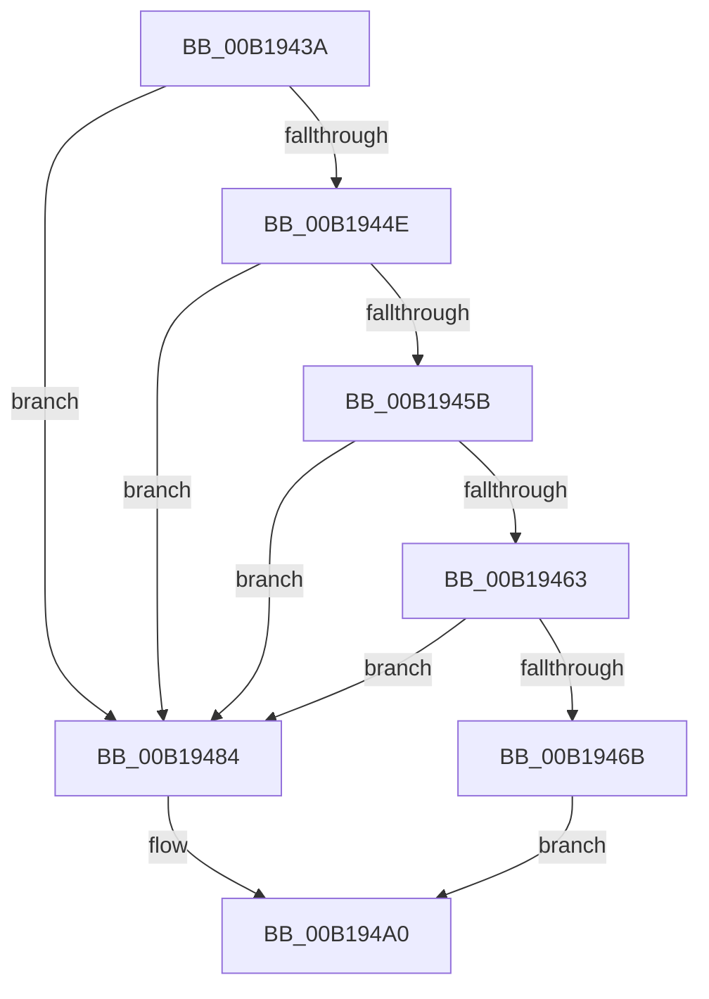

# sub_00B1943A

- RVA: `0x00B1943A`–`0x00B194AB` (길이 `113` bytes)
- VA: `0x0000000140B1943A`
- 실행 섹션: `PAGE`
- PDB 이름 있음: `아니요`; PDB Function 태그: `아니요`
- unwind 정보 RVA: `0x0007DB3C`
- 디코드: `32`개 명령, `113/113` bytes 표시
- 미해석 바이트: `0` (있으면 어셈블리에 `.byte`로 보존)

> 이 문서는 커널 이미지의 기계어와 PDB 기호를 분석해 생성했습니다. 4번과 5번은 함수 원형과 자료형을 바이너리 사용 방식에서 추정한 C 해석이며 원본 소스 복구 결과는 아닙니다.

## 1. Dependencies

- 직접 호출 지점: **5**; 고유 호출 대상: **5**
- 직접 호출자로 확인된 함수: **0**
- RIP 상대 이미지 참조: **0**

### Outgoing calls
- `0x00B19445` → [SeQueryServerSiloToken](../91/SeQueryServerSiloToken_function_00912F30.md) (function, `0x00912F30`)
- `0x00B19452` → [PsIsHostSilo](../../text/44/PsIsHostSilo_function_00443B30.md) (function, `0x00443B30`)
- `0x00B1946B` → [PsGetCurrentServerSilo](../../text/22/PsGetCurrentServerSilo_function_00225710.md) (function, `0x00225710`)
- `0x00B1947D` → [SepCopyClientTokenAndSetSilo](../79/SepCopyClientTokenAndSetSilo_function_0079CE34.md) (function, `0x0079CE34`)
- `0x00B1949B` → [SeCopyClientToken](../9E/SeCopyClientToken_function_009EC5A8.md) (function, `0x009EC5A8`)

### Direct callers
- 이 함수 시작 RVA로 연결되는 직접 call은 확인되지 않았습니다. 간접 호출은 완전히 역산할 수 없습니다.

### Static image references
- 디코드된 RIP-relative 메모리 참조가 없습니다.

## 2. Other-region calls and transfers

- 다른 실행 섹션으로 향하는 call: **2**
  - `0x00B19452` → [PsIsHostSilo](../../text/44/PsIsHostSilo_function_00443B30.md) (`PAGE` → `.text`)
  - `0x00B1946B` → [PsGetCurrentServerSilo](../../text/22/PsGetCurrentServerSilo_function_00225710.md) (`PAGE` → `.text`)
- call이 아닌 외부 분기/꼬리 이동: **1**
  - `0x00B194A6` → [sub_00891E2F](../89/Unknown_function_00891E2F.md) (`tail-transfer`)

## 3. Assembly (complete function range)

```asm
00B1943A  49 8B 7F 18                     mov rdi, qword ptr [r15 + 0x18]
00B1943E  48 8D 55 38                     lea rdx, [rbp + 0x38]
00B19442  49 8B CF                        mov rcx, r15
00B19445  E8 E6 9A DF FF                  call 0x140912f30
00B1944A  85 C0                           test eax, eax
00B1944C  78 36                           js 0x140b19484
00B1944E  48 8B 4D 38                     mov rcx, qword ptr [rbp + 0x38]
00B19452  E8 D9 A6 92 FF                  call 0x140443b30
00B19457  84 C0                           test al, al
00B19459  74 29                           je 0x140b19484
00B1945B  81 FF E7 03 00 00               cmp edi, 0x3e7
00B19461  75 21                           jne 0x140b19484
00B19463  48 C1 EF 20                     shr rdi, 0x20
00B19467  85 FF                           test edi, edi
00B19469  75 19                           jne 0x140b19484
00B1946B  E8 A0 C2 70 FF                  call 0x140225710
00B19470  8B 56 04                        mov edx, dword ptr [rsi + 4]
00B19473  4C 8D 4D C0                     lea r9, [rbp - 0x40]
00B19477  4C 8B C0                        mov r8, rax
00B1947A  49 8B CF                        mov rcx, r15
00B1947D  E8 B2 39 C8 FF                  call 0x14079ce34
00B19482  EB 1C                           jmp 0x140b194a0
00B19484  8B 56 04                        mov edx, dword ptr [rsi + 4]
00B19487  48 8D 45 C0                     lea rax, [rbp - 0x40]
00B1948B  48 89 44 24 28                  mov qword ptr [rsp + 0x28], rax
00B19490  45 33 C9                        xor r9d, r9d
00B19493  49 8B CF                        mov rcx, r15
00B19496  4C 89 6C 24 20                  mov qword ptr [rsp + 0x20], r13
00B1949B  E8 08 31 ED FF                  call 0x1409ec5a8
00B194A0  4C 8B 7D C0                     mov r15, qword ptr [rbp - 0x40]
00B194A4  8B F8                           mov edi, eax
00B194A6  E9 84 89 D7 FF                  jmp 0x140891e2f
```

## 4. C-style interpretation (structured pseudocode)

```c
__int64 __fastcall sub_00B1943A(void)
{
    __int64 result;
    __int64 v_rdi;
    unsigned __int64 v_stack_p20;
    unsigned __int64 v_stack_p28;

    result = SeQueryServerSiloToken(v_r15, v_rbp + 56, a3, a4);
    if (sign_flag) goto loc_00B19484;
    result = PsIsHostSilo(*(unsigned __int64 *)(v_rbp + 56), v_rbp + 56, a3, a4);
    if ((unsigned __int8)(result) == 0) goto loc_00B19484;
    if (((unsigned int)(*(unsigned __int64 *)(v_r15 + 24))) != 999) goto loc_00B19484;
    v_rdi = (*(unsigned __int64 *)(v_r15 + 24)) >> (32);
    if ((unsigned int)(v_rdi) != 0) goto loc_00B19484;
    result = PsGetCurrentServerSilo(*(unsigned __int64 *)(v_rbp + 56), v_rbp + 56, a3, a4);
    result = SepCopyClientTokenAndSetSilo(v_r15, (unsigned int)(*(unsigned int *)(v_rsi + 4)), result, v_rbp - 64);
    goto loc_00B194A0;
loc_00B19484:
    v_stack_p28 = v_rbp - 64;
    a4 = 0;
    v_stack_p20 = v_r13;
    result = SeCopyClientToken(v_r15, (unsigned int)(*(unsigned int *)(v_rsi + 4)), result, a4);
loc_00B194A0:
}
```

## 5. (Beta) C Style

```c
void sub_00B1943A(void)
{
    int64_t result;
    int64_t local_rdi;
    uint64_t v_stack_p20;
    uint64_t v_stack_p28;

    result = SeQueryServerSiloToken(local_r15, local_rbp + 56, a3, a4);
    if (sign_flag) goto loc_00B19484;
    result = PsIsHostSilo(*(uint64_t *)(local_rbp + 0x38), local_rbp + 56, a3, a4);
    if ((uint8_t)(result) == 0) goto loc_00B19484;
    if (((uint32_t)(*(uint64_t *)(local_r15 + 0x18))) != 999) goto loc_00B19484;
    local_rdi = (*(uint64_t *)(local_r15 + 0x18)) >> (32);
    if ((uint32_t)(local_rdi) != 0) goto loc_00B19484;
    result = PsGetCurrentServerSilo(*(uint64_t *)(local_rbp + 0x38), local_rbp + 56, a3, a4);
    result = SepCopyClientTokenAndSetSilo(local_r15, (uint32_t)(*(uint32_t *)(local_rsi + 0x4)), result, local_rbp - 64);
    goto loc_00B194A0;
loc_00B19484:
    v_stack_p28 = local_rbp - 64;
    a4 = 0;
    v_stack_p20 = local_r13;
    result = SeCopyClientToken(local_r15, (uint32_t)(*(uint32_t *)(local_rsi + 0x4)), result, a4);
loc_00B194A0:
}
```

## 6. Execution-region graph

[열기: 2D/3D 그래프와 함수 탐색 컨트롤 패널](../../../control-panel.html?section=page&rva=0x00B1943A&view=graph)

- 2D 그래프는 위에서 아래로 흐르고, 3D 그래프는 빈 공간을 드래그해 회전합니다. Shift+드래그는 이동, 휠은 확대·축소, 함수 노드 선택은 대상 보고서 이동입니다.

### Static fallback


