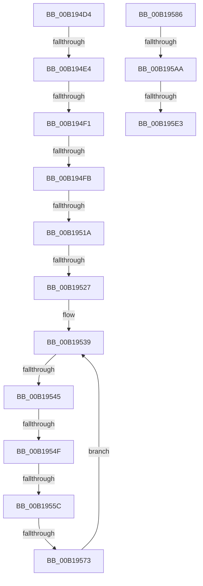

# sub_00B194D4

- RVA: `0x00B194D4`–`0x00B195F6` (길이 `290` bytes)
- VA: `0x0000000140B194D4`
- 실행 섹션: `PAGE`
- PDB 이름 있음: `아니요`; PDB Function 태그: `아니요`
- unwind 정보 RVA: `0x0007DCE0`
- 디코드: `65`개 명령, `290/290` bytes 표시
- 미해석 바이트: `0` (있으면 어셈블리에 `.byte`로 보존)

> 이 문서는 커널 이미지의 기계어와 PDB 기호를 분석해 생성했습니다. 4번과 5번은 함수 원형과 자료형을 바이너리 사용 방식에서 추정한 C 해석이며 원본 소스 복구 결과는 아닙니다.

## 1. Dependencies

- 직접 호출 지점: **0**; 고유 호출 대상: **0**
- 직접 호출자로 확인된 함수: **0**
- RIP 상대 이미지 참조: **8**

### Outgoing calls
- 직접 디코드된 call 명령이 없습니다.

### Direct callers
- 이 함수 시작 RVA로 연결되는 직접 call은 확인되지 않았습니다. 간접 호출은 완전히 역산할 수 없습니다.

### Static image references
- `0x00B194D4` → RVA `0x00F100B0` (`.data`; read)
- `0x00B194FB` → RVA `0x00F100B0` (`.data`; write)
- `0x00B1952A` → RVA `0x00F10090` (`.data`; read)
- `0x00B19563` → RVA `0x00F10098` (`.data`; read)
- `0x00B1957D` → RVA `0x00F10098` (`.data`; write)
- `0x00B1959A` → RVA `0x00F100B8` (`.data`; read)
- `0x00B195B8` → RVA `0x00F100B8` (`.data`; write)
- `0x00B195CF` → RVA `0x00F100A0` (`.data`; read)

## 2. Other-region calls and transfers

- 다른 실행 섹션으로 향하는 call: **0**
- call이 아닌 외부 분기/꼬리 이동: **12**
  - `0x00B194DE` → [sub_008926FB + 0x191](../89/Unknown_function_008926FB.md) (`tail-transfer`)
  - `0x00B194EB` → [sub_00892933](../89/Unknown_function_00892933.md) (`tail-transfer`)
  - `0x00B194F5` → [sub_00892933](../89/Unknown_function_00892933.md) (`tail-transfer`)
  - `0x00B19514` → [sub_00892933](../89/Unknown_function_00892933.md) (`tail-transfer`)
  - `0x00B19521` → [sub_00892933](../89/Unknown_function_00892933.md) (`tail-transfer`)
  - `0x00B1953F` → [sub_008926FB + 0x188](../89/Unknown_function_008926FB.md) (`tail-transfer`)
  - `0x00B19549` → [sub_00892933](../89/Unknown_function_00892933.md) (`tail-transfer`)
  - `0x00B19556` → [sub_00892933](../89/Unknown_function_00892933.md) (`tail-transfer`)
  - `0x00B1956D` → [sub_00892933](../89/Unknown_function_00892933.md) (`tail-transfer`)
  - `0x00B195A4` → [sub_00892933](../89/Unknown_function_00892933.md) (`tail-transfer`)
  - `0x00B195DD` → [sub_00892933](../89/Unknown_function_00892933.md) (`tail-transfer`)
  - `0x00B195F1` → [sub_008926FB + 0x191](../89/Unknown_function_008926FB.md) (`tail-transfer`)

## 3. Assembly (complete function range)

```asm
00B194D4  48 8B 0D D5 6B 3F 00            mov rcx, qword ptr [rip + 0x3f6bd5]
00B194DB  49 3B C9                        cmp rcx, r9
00B194DE  0F 84 A8 93 D7 FF               je 0x14089288c
00B194E4  48 8B 01                        mov rax, qword ptr [rcx]
00B194E7  4C 39 49 08                     cmp qword ptr [rcx + 8], r9
00B194EB  0F 85 42 94 D7 FF               jne 0x140892933
00B194F1  48 39 48 08                     cmp qword ptr [rax + 8], rcx
00B194F5  0F 85 38 94 D7 FF               jne 0x140892933
00B194FB  48 89 05 AE 6B 3F 00            mov qword ptr [rip + 0x3f6bae], rax
00B19502  4C 89 48 08                     mov qword ptr [rax + 8], r9
00B19506  48 8D 41 10                     lea rax, [rcx + 0x10]
00B1950A  89 69 2C                        mov dword ptr [rcx + 0x2c], ebp
00B1950D  4C 8B 00                        mov r8, qword ptr [rax]
00B19510  49 39 40 08                     cmp qword ptr [r8 + 8], rax
00B19514  0F 85 19 94 D7 FF               jne 0x140892933
00B1951A  48 8B 50 08                     mov rdx, qword ptr [rax + 8]
00B1951E  48 39 02                        cmp qword ptr [rdx], rax
00B19521  0F 85 0C 94 D7 FF               jne 0x140892933
00B19527  4C 89 02                        mov qword ptr [rdx], r8
00B1952A  4C 8D 15 5F 6B 3F 00            lea r10, [rip + 0x3f6b5f]
00B19531  49 89 50 08                     mov qword ptr [r8 + 8], rdx
00B19535  48 8D 51 30                     lea rdx, [rcx + 0x30]
00B19539  48 8B 02                        mov rax, qword ptr [rdx]
00B1953C  48 3B C2                        cmp rax, rdx
00B1953F  0F 84 3E 93 D7 FF               je 0x140892883
00B19545  48 39 50 08                     cmp qword ptr [rax + 8], rdx
00B19549  0F 85 E4 93 D7 FF               jne 0x140892933
00B1954F  4C 8B 00                        mov r8, qword ptr [rax]
00B19552  49 39 40 08                     cmp qword ptr [r8 + 8], rax
00B19556  0F 85 D7 93 D7 FF               jne 0x140892933
00B1955C  4C 89 02                        mov qword ptr [rdx], r8
00B1955F  49 89 50 08                     mov qword ptr [r8 + 8], rdx
00B19563  4C 8B 05 2E 6B 3F 00            mov r8, qword ptr [rip + 0x3f6b2e]
00B1956A  4D 39 10                        cmp qword ptr [r8], r10
00B1956D  0F 85 C0 93 D7 FF               jne 0x140892933
00B19573  4C 89 10                        mov qword ptr [rax], r10
00B19576  4C 89 40 08                     mov qword ptr [rax + 8], r8
00B1957A  49 89 00                        mov qword ptr [r8], rax
00B1957D  48 89 05 14 6B 3F 00            mov qword ptr [rip + 0x3f6b14], rax
00B19584  EB B3                           jmp 0x140b19539
00B19586  48 89 71 20                     mov qword ptr [rcx + 0x20], rsi
00B1958A  8B 86 08 01 00 00               mov eax, dword ptr [rsi + 0x108]
00B19590  89 41 28                        mov dword ptr [rcx + 0x28], eax
00B19593  C7 41 2C 01 00 00 00            mov dword ptr [rcx + 0x2c], 1
00B1959A  48 8B 05 17 6B 3F 00            mov rax, qword ptr [rip + 0x3f6b17]
00B195A1  4C 39 08                        cmp qword ptr [rax], r9
00B195A4  0F 85 89 93 D7 FF               jne 0x140892933
00B195AA  48 89 41 08                     mov qword ptr [rcx + 8], rax
00B195AE  48 8D 51 10                     lea rdx, [rcx + 0x10]
00B195B2  4C 89 09                        mov qword ptr [rcx], r9
00B195B5  48 89 08                        mov qword ptr [rax], rcx
00B195B8  48 89 0D F9 6A 3F 00            mov qword ptr [rip + 0x3f6af9], rcx
00B195BF  8B 41 28                        mov eax, dword ptr [rcx + 0x28]
00B195C2  48 C1 E8 02                     shr rax, 2
00B195C6  25 FF 03 00 00                  and eax, 0x3ff
00B195CB  48 C1 E0 04                     shl rax, 4
00B195CF  48 03 05 CA 6A 3F 00            add rax, qword ptr [rip + 0x3f6aca]
00B195D6  48 8B 48 08                     mov rcx, qword ptr [rax + 8]
00B195DA  48 39 01                        cmp qword ptr [rcx], rax
00B195DD  0F 85 50 93 D7 FF               jne 0x140892933
00B195E3  48 89 02                        mov qword ptr [rdx], rax
00B195E6  48 89 4A 08                     mov qword ptr [rdx + 8], rcx
00B195EA  48 89 11                        mov qword ptr [rcx], rdx
00B195ED  48 89 50 08                     mov qword ptr [rax + 8], rdx
00B195F1  E9 96 92 D7 FF                  jmp 0x14089288c
```

## 4. C-style interpretation (structured pseudocode)

```c
__int64 __fastcall sub_00B194D4(__int64 a1, __int64 a2, __int64 a3, __int64 a4)
{
    *(unsigned __int64 *)(v_rip + 4156334) = *(unsigned __int64 *)(*(unsigned __int64 *)(v_rip + 4156373));
    *(unsigned __int64 *)(*(unsigned __int64 *)(*(unsigned __int64 *)(v_rip + 4156373)) + 8) = a4;
    *(unsigned int *)(*(unsigned __int64 *)(v_rip + 4156373) + 44) = (unsigned int)(v_rbp);
    *(unsigned __int64 *)(*(unsigned __int64 *)(*(unsigned __int64 *)(v_rip + 4156373) + 16 + 8)) = *(unsigned __int64 *)(*(unsigned __int64 *)(v_rip + 4156373) + 16);
    *(unsigned __int64 *)(*(unsigned __int64 *)(*(unsigned __int64 *)(v_rip + 4156373) + 16) + 8) = *(unsigned __int64 *)(*(unsigned __int64 *)(v_rip + 4156373) + 16 + 8);
loc_00B19539:
    *(unsigned __int64 *)(*(unsigned __int64 *)(v_rip + 4156373) + 48) = *(unsigned __int64 *)(*(unsigned __int64 *)(*(unsigned __int64 *)(v_rip + 4156373) + 48));
    *(unsigned __int64 *)(*(unsigned __int64 *)(*(unsigned __int64 *)(*(unsigned __int64 *)(v_rip + 4156373) + 48)) + 8) = *(unsigned __int64 *)(v_rip + 4156373) + 48;
    *(unsigned __int64 *)(*(unsigned __int64 *)(*(unsigned __int64 *)(v_rip + 4156373) + 48)) = v_rip + 4156255;
    *(unsigned __int64 *)(*(unsigned __int64 *)(*(unsigned __int64 *)(v_rip + 4156373) + 48) + 8) = *(unsigned __int64 *)(v_rip + 4156206);
    *(unsigned __int64 *)(*(unsigned __int64 *)(v_rip + 4156206)) = *(unsigned __int64 *)(*(unsigned __int64 *)(v_rip + 4156373) + 48);
    *(unsigned __int64 *)(v_rip + 4156180) = *(unsigned __int64 *)(*(unsigned __int64 *)(v_rip + 4156373) + 48);
    goto loc_00B19539;
}
```

## 5. (Beta) C Style

```c
int64_t sub_00B194D4(int64_t Arg1, int64_t Arg2, int64_t Arg3, int64_t Arg4)
{
    *(uint64_t *)(v_rip + 0x3F6BAE) = *(uint64_t *)(*(uint64_t *)(v_rip + 0x3F6BD5));
    *(uint64_t *)(*(uint64_t *)(*(uint64_t *)(v_rip + 0x3F6BD5)) + 0x8) = Arg4;
    *(uint32_t *)(*(uint64_t *)(v_rip + 0x3F6BD5) + 0x2C) = (uint32_t)(local_rbp);
    *(uint64_t *)(*(uint64_t *)(*(uint64_t *)(v_rip + 0x3F6BD5) + 0x10 + 0x8)) = *(uint64_t *)(*(uint64_t *)(v_rip + 0x3F6BD5) + 0x10);
    *(uint64_t *)(*(uint64_t *)(*(uint64_t *)(v_rip + 0x3F6BD5) + 0x10) + 0x8) = *(uint64_t *)(*(uint64_t *)(v_rip + 0x3F6BD5) + 0x10 + 0x8);
loc_00B19539:
    *(uint64_t *)(*(uint64_t *)(v_rip + 0x3F6BD5) + 0x30) = *(uint64_t *)(*(uint64_t *)(*(uint64_t *)(v_rip + 0x3F6BD5) + 0x30));
    *(uint64_t *)(*(uint64_t *)(*(uint64_t *)(*(uint64_t *)(v_rip + 0x3F6BD5) + 0x30)) + 0x8) = *(uint64_t *)(v_rip + 0x3F6BD5) + 48;
    *(uint64_t *)(*(uint64_t *)(*(uint64_t *)(v_rip + 0x3F6BD5) + 0x30)) = v_rip + 4156255;
    *(uint64_t *)(*(uint64_t *)(*(uint64_t *)(v_rip + 0x3F6BD5) + 0x30) + 0x8) = *(uint64_t *)(v_rip + 0x3F6B2E);
    *(uint64_t *)(*(uint64_t *)(v_rip + 0x3F6B2E)) = *(uint64_t *)(*(uint64_t *)(v_rip + 0x3F6BD5) + 0x30);
    *(uint64_t *)(v_rip + 0x3F6B14) = *(uint64_t *)(*(uint64_t *)(v_rip + 0x3F6BD5) + 0x30);
    goto loc_00B19539;
}
```

## 6. Execution-region graph

[열기: 2D/3D 그래프와 함수 탐색 컨트롤 패널](../../../control-panel.html?section=page&rva=0x00B194D4&view=graph)

- 2D 그래프는 위에서 아래로 흐르고, 3D 그래프는 빈 공간을 드래그해 회전합니다. Shift+드래그는 이동, 휠은 확대·축소, 함수 노드 선택은 대상 보고서 이동입니다.

### Static fallback


