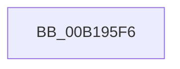

# sub_00B195F6

- RVA: `0x00B195F6`–`0x00B1961D` (길이 `39` bytes)
- VA: `0x0000000140B195F6`
- 실행 섹션: `PAGE`
- PDB 이름 있음: `아니요`; PDB Function 태그: `아니요`
- unwind 정보 RVA: `0x0007DE04`
- 디코드: `10`개 명령, `39/39` bytes 표시
- 미해석 바이트: `0` (있으면 어셈블리에 `.byte`로 보존)

> 이 문서는 커널 이미지의 기계어와 PDB 기호를 분석해 생성했습니다. 4번과 5번은 함수 원형과 자료형을 바이너리 사용 방식에서 추정한 C 해석이며 원본 소스 복구 결과는 아닙니다.

## 1. Dependencies

- 직접 호출 지점: **3**; 고유 호출 대상: **3**
- 직접 호출자로 확인된 함수: **0**
- RIP 상대 이미지 참조: **0**

### Outgoing calls
- `0x00B195F9` → [KeAbPostRelease](../../text/2E/KeAbPostRelease_function_002E1600.md) (function, `0x002E1600`)
- `0x00B19605` → [AlpcpEndInitialization](../A2/AlpcpEndInitialization_function_00A20C78.md) (function, `0x00A20C78`)
- `0x00B19612` → [AlpcpDereferenceBlobEx](../88/AlpcpDereferenceBlobEx_function_0088AF00.md) (function, `0x0088AF00`)

### Direct callers
- 이 함수 시작 RVA로 연결되는 직접 call은 확인되지 않았습니다. 간접 호출은 완전히 역산할 수 없습니다.

### Static image references
- 디코드된 RIP-relative 메모리 참조가 없습니다.

## 2. Other-region calls and transfers

- 다른 실행 섹션으로 향하는 call: **1**
  - `0x00B195F9` → [KeAbPostRelease](../../text/2E/KeAbPostRelease_function_002E1600.md) (`PAGE` → `.text`)
- call이 아닌 외부 분기/꼬리 이동: **1**
  - `0x00B19618` → [AlpcpCreateSection + 0x1F5](../89/AlpcpCreateSection_function_0089307C.md) (`tail-transfer`)

## 3. Assembly (complete function range)

```asm
00B195F6  48 8B CB                        mov rcx, rbx
00B195F9  E8 02 80 7C FF                  call 0x1402e1600
00B195FE  48 8B CF                        mov rcx, rdi
00B19601  4C 89 67 10                     mov qword ptr [rdi + 0x10], r12
00B19605  E8 6E 76 F0 FF                  call 0x140a20c78
00B1960A  BA 02 00 00 00                  mov edx, 2
00B1960F  48 8B CF                        mov rcx, rdi
00B19612  E8 E9 18 D7 FF                  call 0x14088af00
00B19617  90                              nop
00B19618  E9 54 9C D7 FF                  jmp 0x140893271
```

## 4. C-style interpretation (structured pseudocode)

```c
__int64 __fastcall sub_00B195F6(void)
{
    __int64 result;

    result = KeAbPostRelease(v_rbx, a2, a3, a4);
    *(unsigned __int64 *)(v_rdi + 16) = v_r12;
    result = AlpcpEndInitialization(v_rdi, a2, a3, a4);
    result = AlpcpDereferenceBlobEx(v_rdi, 2, a3, a4);
}
```

## 5. (Beta) C Style

```c
void sub_00B195F6(void)
{
    int64_t result;

    result = KeAbPostRelease(local_rbx, a2, a3, a4);
    *(uint64_t *)(local_rdi + 0x10) = local_r12;
    result = AlpcpEndInitialization(local_rdi, a2, a3, a4);
    result = AlpcpDereferenceBlobEx(local_rdi, 2, a3, a4);
}
```

## 6. Execution-region graph

[열기: 2D/3D 그래프와 함수 탐색 컨트롤 패널](../../../control-panel.html?section=page&rva=0x00B195F6&view=graph)

- 2D 그래프는 위에서 아래로 흐르고, 3D 그래프는 빈 공간을 드래그해 회전합니다. Shift+드래그는 이동, 휠은 확대·축소, 함수 노드 선택은 대상 보고서 이동입니다.

### Static fallback


