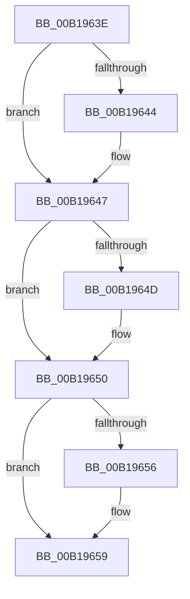

# sub_00B1963E

- RVA: `0x00B1963E`–`0x00B19664` (길이 `38` bytes)
- VA: `0x0000000140B1963E`
- 실행 섹션: `PAGE`
- PDB 이름 있음: `아니요`; PDB Function 태그: `아니요`
- unwind 정보 RVA: `0x0007DEE0`
- 디코드: `11`개 명령, `38/38` bytes 표시
- 미해석 바이트: `0` (있으면 어셈블리에 `.byte`로 보존)

> 이 문서는 커널 이미지의 기계어와 PDB 기호를 분석해 생성했습니다. 4번과 5번은 함수 원형과 자료형을 바이너리 사용 방식에서 추정한 C 해석이며 원본 소스 복구 결과는 아닙니다.

## 1. Dependencies

- 직접 호출 지점: **0**; 고유 호출 대상: **0**
- 직접 호출자로 확인된 함수: **0**
- RIP 상대 이미지 참조: **0**

### Outgoing calls
- 직접 디코드된 call 명령이 없습니다.

### Direct callers
- 이 함수 시작 RVA로 연결되는 직접 call은 확인되지 않았습니다. 간접 호출은 완전히 역산할 수 없습니다.

### Static image references
- 디코드된 RIP-relative 메모리 참조가 없습니다.

## 2. Other-region calls and transfers

- 다른 실행 섹션으로 향하는 call: **0**
- call이 아닌 외부 분기/꼬리 이동: **1**
  - `0x00B1965F` → [ObCaptureObjectStateForDuplication + 0x118](../89/ObCaptureObjectStateForDuplication_function_00893684.md) (`tail-transfer`)

## 3. Assembly (complete function range)

```asm
00B1963E  0F BA E3 1E                     bt ebx, 0x1e
00B19642  73 03                           jae 0x140b19647
00B19644  0B 58 50                        or ebx, dword ptr [rax + 0x50]
00B19647  0F BA E3 1D                     bt ebx, 0x1d
00B1964B  73 03                           jae 0x140b19650
00B1964D  0B 58 54                        or ebx, dword ptr [rax + 0x54]
00B19650  0F BA E3 1C                     bt ebx, 0x1c
00B19654  73 03                           jae 0x140b19659
00B19656  0B 58 58                        or ebx, dword ptr [rax + 0x58]
00B19659  81 E3 FF FF FF 0F               and ebx, 0xfffffff
00B1965F  E9 38 A1 D7 FF                  jmp 0x14089379c
```

## 4. C-style interpretation (structured pseudocode)

```c
void __fastcall sub_00B1963E(void)
{
    __int64 v_rbx;

    if (!(condition_is_above_or_equal)) {
        v_rbx = (unsigned int)((v_rbx) | (*(unsigned int *)(result + 80)));
    }
    if (!(condition_is_above_or_equal)) {
        v_rbx = (unsigned int)((v_rbx) | (*(unsigned int *)(result + 84)));
    }
    if (!(condition_is_above_or_equal)) {
        v_rbx = (unsigned int)((v_rbx) | (*(unsigned int *)(result + 88)));
    }
    v_rbx = (unsigned int)((v_rbx) & (0xFFFFFFFULL));
}
```

## 5. (Beta) C Style

```c
void sub_00B1963E(void)
{
    int64_t local_rbx;

    if (!(condition_is_above_or_equal)) {
        local_rbx = (uint32_t)((local_rbx) | (*(uint32_t *)(result + 0x50)));
    }
    if (!(condition_is_above_or_equal)) {
        local_rbx = (uint32_t)((local_rbx) | (*(uint32_t *)(result + 0x54)));
    }
    if (!(condition_is_above_or_equal)) {
        local_rbx = (uint32_t)((local_rbx) | (*(uint32_t *)(result + 0x58)));
    }
    local_rbx = (uint32_t)((local_rbx) & (0xFFFFFFFULL));
}
```

## 6. Execution-region graph

[열기: 2D/3D 그래프와 함수 탐색 컨트롤 패널](../../../control-panel.html?section=page&rva=0x00B1963E&view=graph)

- 2D 그래프는 위에서 아래로 흐르고, 3D 그래프는 빈 공간을 드래그해 회전합니다. Shift+드래그는 이동, 휠은 확대·축소, 함수 노드 선택은 대상 보고서 이동입니다.

### Static fallback


