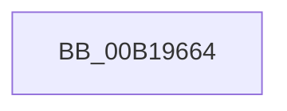

# sub_00B19664

- RVA: `0x00B19664`–`0x00B19681` (길이 `29` bytes)
- VA: `0x0000000140B19664`
- 실행 섹션: `PAGE`
- PDB 이름 있음: `아니요`; PDB Function 태그: `아니요`
- unwind 정보 RVA: `0x0007DFA0`
- 디코드: `6`개 명령, `29/29` bytes 표시
- 미해석 바이트: `0` (있으면 어셈블리에 `.byte`로 보존)

> 이 문서는 커널 이미지의 기계어와 PDB 기호를 분석해 생성했습니다. 4번과 5번은 함수 원형과 자료형을 바이너리 사용 방식에서 추정한 C 해석이며 원본 소스 복구 결과는 아닙니다.

## 1. Dependencies

- 직접 호출 지점: **2**; 고유 호출 대상: **2**
- 직접 호출자로 확인된 함수: **0**
- RIP 상대 이미지 참조: **0**

### Outgoing calls
- `0x00B19664` → [PsTransferProcessQuotaToSharedQuota](../../text/4C/PsTransferProcessQuotaToSharedQuota_function_004C42DC.md) (function, `0x004C42DC`)
- `0x00B19672` → [ObfDereferenceObjectWithTag](../../text/2F/ObfDereferenceObjectWithTag_function_002F78E0.md) (function, `0x002F78E0`)

### Direct callers
- 이 함수 시작 RVA로 연결되는 직접 call은 확인되지 않았습니다. 간접 호출은 완전히 역산할 수 없습니다.

### Static image references
- 디코드된 RIP-relative 메모리 참조가 없습니다.

## 2. Other-region calls and transfers

- 다른 실행 섹션으로 향하는 call: **2**
  - `0x00B19664` → [PsTransferProcessQuotaToSharedQuota](../../text/4C/PsTransferProcessQuotaToSharedQuota_function_004C42DC.md) (`PAGE` → `.text`)
  - `0x00B19672` → [ObfDereferenceObjectWithTag](../../text/2F/ObfDereferenceObjectWithTag_function_002F78E0.md) (`PAGE` → `.text`)
- call이 아닌 외부 분기/꼬리 이동: **1**
  - `0x00B1967C` → [AlpcpTransferQuotaMessage + 0x12](../89/AlpcpTransferQuotaMessage_function_008940D0.md) (`tail-transfer`)

## 3. Assembly (complete function range)

```asm
00B19664  E8 73 AC 9A FF                  call 0x1404c42dc
00B19669  BA 41 6C 70 63                  mov edx, 0x63706c41
00B1966E  48 89 43 30                     mov qword ptr [rbx + 0x30], rax
00B19672  E8 69 E2 7D FF                  call 0x1402f78e0
00B19677  0F BA 6B 28 0A                  bts dword ptr [rbx + 0x28], 0xa
00B1967C  E9 61 AA D7 FF                  jmp 0x1408940e2
```

## 4. C-style interpretation (structured pseudocode)

```c
__int64 __fastcall sub_00B19664(void)
{
    __int64 result;

    result = PsTransferProcessQuotaToSharedQuota(a1, a2, a3, a4);
    *(unsigned __int64 *)(v_rbx + 48) = result;
    result = ObfDereferenceObjectWithTag(a1, (unsigned int)(0x63706C41ULL), a3, a4);
}
```

## 5. (Beta) C Style

```c
void sub_00B19664(void)
{
    int64_t result;

    result = PsTransferProcessQuotaToSharedQuota(a1, a2, a3, a4);
    *(uint64_t *)(local_rbx + 0x30) = result;
    result = ObfDereferenceObjectWithTag(a1, (uint32_t)(0x63706C41ULL), a3, a4);
}
```

## 6. Execution-region graph

[열기: 2D/3D 그래프와 함수 탐색 컨트롤 패널](../../../control-panel.html?section=page&rva=0x00B19664&view=graph)

- 2D 그래프는 위에서 아래로 흐르고, 3D 그래프는 빈 공간을 드래그해 회전합니다. Shift+드래그는 이동, 휠은 확대·축소, 함수 노드 선택은 대상 보고서 이동입니다.

### Static fallback


