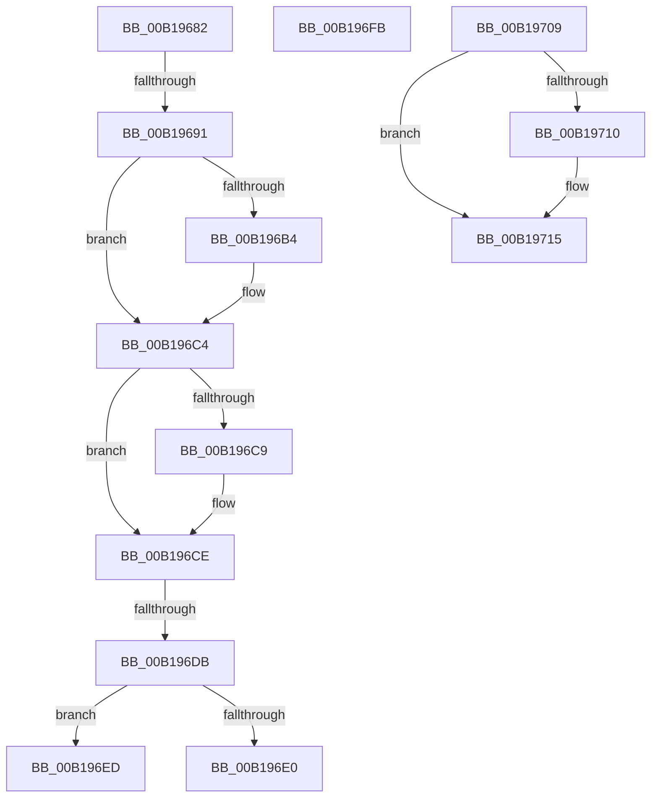

# sub_00B19682

- RVA: `0x00B19682`–`0x00B1973E` (길이 `188` bytes)
- VA: `0x0000000140B19682`
- 실행 섹션: `PAGE`
- PDB 이름 있음: `아니요`; PDB Function 태그: `아니요`
- unwind 정보 RVA: `0x0007DFCC`
- 디코드: `50`개 명령, `188/188` bytes 표시
- 미해석 바이트: `0` (있으면 어셈블리에 `.byte`로 보존)

> 이 문서는 커널 이미지의 기계어와 PDB 기호를 분석해 생성했습니다. 4번과 5번은 함수 원형과 자료형을 바이너리 사용 방식에서 추정한 C 해석이며 원본 소스 복구 결과는 아닙니다.

## 1. Dependencies

- 직접 호출 지점: **3**; 고유 호출 대상: **3**
- 직접 호출자로 확인된 함수: **0**
- RIP 상대 이미지 참조: **0**

### Outgoing calls
- `0x00B196A0` → [KeAbPreAcquire](../../text/21/KeAbPreAcquire_function_00210230.md) (function, `0x00210230`)
- `0x00B196BF` → [ExfAcquirePushLockSharedEx](../../text/21/ExfAcquirePushLockSharedEx_function_0021044C.md) (function, `0x0021044C`)
- `0x00B196FE` → [KeAbPostRelease](../../text/2E/KeAbPostRelease_function_002E1600.md) (function, `0x002E1600`)

### Direct callers
- 이 함수 시작 RVA로 연결되는 직접 call은 확인되지 않았습니다. 간접 호출은 완전히 역산할 수 없습니다.

### Static image references
- 디코드된 RIP-relative 메모리 참조가 없습니다.

## 2. Other-region calls and transfers

- 다른 실행 섹션으로 향하는 call: **3**
  - `0x00B196A0` → [KeAbPreAcquire](../../text/21/KeAbPreAcquire_function_00210230.md) (`PAGE` → `.text`)
  - `0x00B196BF` → [ExfAcquirePushLockSharedEx](../../text/21/ExfAcquirePushLockSharedEx_function_0021044C.md) (`PAGE` → `.text`)
  - `0x00B196FE` → [KeAbPostRelease](../../text/2E/KeAbPostRelease_function_002E1600.md) (`PAGE` → `.text`)
- call이 아닌 외부 분기/꼬리 이동: **6**
  - `0x00B1968B` → [AlpcpCancelMessage + 0x1D5](../89/AlpcpCancelMessage_function_00894120.md) (`tail-transfer`)
  - `0x00B196D5` → [AlpcpCancelMessage + 0xD3](../89/AlpcpCancelMessage_function_00894120.md) (`tail-transfer`)
  - `0x00B196E8` → [AlpcpCancelMessage + 0x507](../89/AlpcpCancelMessage_function_00894120.md) (`tail-transfer`)
  - `0x00B196F6` → [AlpcpCancelMessage + 0x507](../89/AlpcpCancelMessage_function_00894120.md) (`tail-transfer`)
  - `0x00B19704` → [AlpcpCancelMessage + 0x4BB](../89/AlpcpCancelMessage_function_00894120.md) (`tail-transfer`)
  - `0x00B19739` → [AlpcpCancelMessage + 0x3E3](../89/AlpcpCancelMessage_function_00894120.md) (`tail-transfer`)

## 3. Assembly (complete function range)

```asm
00B19682  83 FD 08                        cmp ebp, 8
00B19685  41 0F 94 C6                     sete r14b
00B19689  85 D2                           test edx, edx
00B1968B  0F 85 64 AC D7 FF               jne 0x1408942f5
00B19691  4D 8B 64 24 10                  mov r12, qword ptr [r12 + 0x10]
00B19696  33 D2                           xor edx, edx
00B19698  4D 8D 7C 24 F0                  lea r15, [r12 - 0x10]
00B1969D  49 8B CF                        mov rcx, r15
00B196A0  E8 8B 6B 6F FF                  call 0x140210230
00B196A5  4C 8B E8                        mov r13, rax
00B196A8  33 C0                           xor eax, eax
00B196AA  8D 48 11                        lea ecx, [rax + 0x11]
00B196AD  F0 49 0F B1 0F                  lock cmpxchg qword ptr [r15], rcx
00B196B2  74 10                           je 0x140b196c4
00B196B4  4D 8B CF                        mov r9, r15
00B196B7  4D 8B C5                        mov r8, r13
00B196BA  33 D2                           xor edx, edx
00B196BC  49 8B CF                        mov rcx, r15
00B196BF  E8 88 6D 6F FF                  call 0x14021044c
00B196C4  4D 85 ED                        test r13, r13
00B196C7  74 05                           je 0x140b196ce
00B196C9  41 C6 45 0A 01                  mov byte ptr [r13 + 0xa], 1
00B196CE  F7 43 28 00 02 00 00            test dword ptr [rbx + 0x28], 0x200
00B196D5  0F 85 18 AB D7 FF               jne 0x1408941f3
00B196DB  83 FD 08                        cmp ebp, 8
00B196DE  75 0D                           jne 0x140b196ed
00B196E0  49 8B 7C 24 10                  mov rdi, qword ptr [r12 + 0x10]
00B196E5  48 8B F7                        mov rsi, rdi
00B196E8  E9 3A AF D7 FF                  jmp 0x140894627
00B196ED  49 8B 3C 24                     mov rdi, qword ptr [r12]
00B196F1  49 8B 74 24 08                  mov rsi, qword ptr [r12 + 8]
00B196F6  E9 2C AF D7 FF                  jmp 0x140894627
00B196FB  48 8B CD                        mov rcx, rbp
00B196FE  E8 FD 7E 7C FF                  call 0x1402e1600
00B19703  90                              nop
00B19704  E9 D2 AE D7 FF                  jmp 0x1408945db
00B19709  33 D2                           xor edx, edx
00B1970B  4D 85 F6                        test r14, r14
00B1970E  74 05                           je 0x140b19715
00B19710  41 C6 46 0A 01                  mov byte ptr [r14 + 0xa], 1
00B19715  41 FF 8F CC 01 00 00            dec dword ptr [r15 + 0x1cc]
00B1971C  83 63 28 F8                     and dword ptr [rbx + 0x28], 0xfffffff8
00B19720  48 89 53 10                     mov qword ptr [rbx + 0x10], rdx
00B19724  48 8B 4B 08                     mov rcx, qword ptr [rbx + 8]
00B19728  48 8B 03                        mov rax, qword ptr [rbx]
00B1972B  48 89 01                        mov qword ptr [rcx], rax
00B1972E  48 8B 0B                        mov rcx, qword ptr [rbx]
00B19731  48 8B 43 08                     mov rax, qword ptr [rbx + 8]
00B19735  48 89 41 08                     mov qword ptr [rcx + 8], rax
00B19739  E9 C5 AD D7 FF                  jmp 0x140894503
```

## 4. C-style interpretation (structured pseudocode)

```c
__int64 __fastcall sub_00B19682(__int64 a1, int a2)
{
    __int64 result;
    __int64 v_r14;

    v_r14 = (((unsigned int)(v_rbp)) == 8) ? 1 : 0;
    a2 = 0;
    result = KeAbPreAcquire(*(unsigned __int64 *)(v_r12 + 16) - 16, a2, a3, a4);
    result = 0;
    if (!(condition_is_equal)) {
        a4 = *(unsigned __int64 *)(v_r12 + 16) - 16;
        a3 = 0;
        a2 = 0;
        a1 = *(unsigned __int64 *)(v_r12 + 16) - 16;
        result = ExfAcquirePushLockSharedEx(a1, a2, a3, a4);
    }
    if (result != 0) {
        *(unsigned __int8 *)(result + 10) = 1;
    }
    if (((unsigned int)(v_rbp)) != 8) goto loc_00B196ED;
loc_00B196ED:
}
```

## 5. (Beta) C Style

```c
int64_t sub_00B19682(int64_t Arg1, int32_t Arg2)
{
    int64_t result;
    int64_t local_r14;

    local_r14 = (((uint32_t)(local_rbp)) == 8) ? 1 : 0;
    Arg2 = 0;
    result = KeAbPreAcquire(*(uint64_t *)(local_r12 + 0x10) - 16, Arg2, a3, a4);
    result = 0;
    if (!(condition_is_equal)) {
        a4 = *(uint64_t *)(local_r12 + 0x10) - 16;
        a3 = 0;
        Arg2 = 0;
        Arg1 = *(uint64_t *)(local_r12 + 0x10) - 16;
        result = ExfAcquirePushLockSharedEx(Arg1, Arg2, a3, a4);
    }
    if (result != 0) {
        *(uint8_t *)(result + 0xA) = 1;
    }
    if (((uint32_t)(local_rbp)) != 8) goto loc_00B196ED;
loc_00B196ED:
}
```

## 6. Execution-region graph

[열기: 2D/3D 그래프와 함수 탐색 컨트롤 패널](../../../control-panel.html?section=page&rva=0x00B19682&view=graph)

- 2D 그래프는 위에서 아래로 흐르고, 3D 그래프는 빈 공간을 드래그해 회전합니다. Shift+드래그는 이동, 휠은 확대·축소, 함수 노드 선택은 대상 보고서 이동입니다.

### Static fallback


