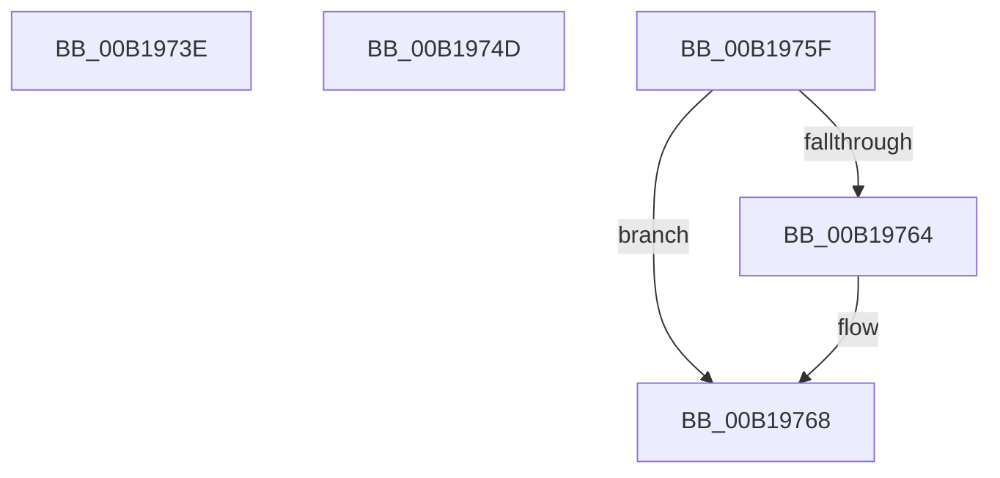

# sub_00B1973E

- RVA: `0x00B1973E`–`0x00B19799` (길이 `91` bytes)
- VA: `0x0000000140B1973E`
- 실행 섹션: `PAGE`
- PDB 이름 있음: `아니요`; PDB Function 태그: `아니요`
- unwind 정보 RVA: `0x0007E088`
- 디코드: `22`개 명령, `91/91` bytes 표시
- 미해석 바이트: `0` (있으면 어셈블리에 `.byte`로 보존)

> 이 문서는 커널 이미지의 기계어와 PDB 기호를 분석해 생성했습니다. 4번과 5번은 함수 원형과 자료형을 바이너리 사용 방식에서 추정한 C 해석이며 원본 소스 복구 결과는 아닙니다.

## 1. Dependencies

- 직접 호출 지점: **2**; 고유 호출 대상: **2**
- 직접 호출자로 확인된 함수: **0**
- RIP 상대 이미지 참조: **0**

### Outgoing calls
- `0x00B19741` → [AlpcpUnlockMessage](../89/AlpcpUnlockMessage_function_00897AE0.md) (function, `0x00897AE0`)
- `0x00B19750` → [KeAbPostRelease](../../text/2E/KeAbPostRelease_function_002E1600.md) (function, `0x002E1600`)

### Direct callers
- 이 함수 시작 RVA로 연결되는 직접 call은 확인되지 않았습니다. 간접 호출은 완전히 역산할 수 없습니다.

### Static image references
- 디코드된 RIP-relative 메모리 참조가 없습니다.

## 2. Other-region calls and transfers

- 다른 실행 섹션으로 향하는 call: **1**
  - `0x00B19750` → [KeAbPostRelease](../../text/2E/KeAbPostRelease_function_002E1600.md) (`PAGE` → `.text`)
- call이 아닌 외부 분기/꼬리 이동: **3**
  - `0x00B19748` → [AlpcpReceiveDirectMessagePort + 0x1CC](../89/AlpcpReceiveDirectMessagePort_function_008950B4.md) (`tail-transfer`)
  - `0x00B1975A` → [AlpcpReceiveDirectMessagePort + 0x1CC](../89/AlpcpReceiveDirectMessagePort_function_008950B4.md) (`tail-transfer`)
  - `0x00B19794` → [AlpcpReceiveDirectMessagePort + 0x182](../89/AlpcpReceiveDirectMessagePort_function_008950B4.md) (`tail-transfer`)

## 3. Assembly (complete function range)

```asm
00B1973E  49 8B CE                        mov rcx, r14
00B19741  E8 9A E3 D7 FF                  call 0x140897ae0
00B19746  8B C3                           mov eax, ebx
00B19748  E9 33 BB D7 FF                  jmp 0x140895280
00B1974D  48 8B CF                        mov rcx, rdi
00B19750  E8 AB 7E 7C FF                  call 0x1402e1600
00B19755  B8 41 00 00 C0                  mov eax, 0xc0000041
00B1975A  E9 21 BB D7 FF                  jmp 0x140895280
00B1975F  48 85 DB                        test rbx, rbx
00B19762  74 04                           je 0x140b19768
00B19764  C6 43 0A 01                     mov byte ptr [rbx + 0xa], 1
00B19768  41 0F BA 76 28 11               btr dword ptr [r14 + 0x28], 0x11
00B1976E  48 8B 54 24 30                  mov rdx, qword ptr [rsp + 0x30]
00B19773  48 8B 4A 58                     mov rcx, qword ptr [rdx + 0x58]
00B19777  48 8B 42 50                     mov rax, qword ptr [rdx + 0x50]
00B1977B  48 89 01                        mov qword ptr [rcx], rax
00B1977E  48 8B 4A 50                     mov rcx, qword ptr [rdx + 0x50]
00B19782  48 8B 42 58                     mov rax, qword ptr [rdx + 0x58]
00B19786  48 89 41 08                     mov qword ptr [rcx + 8], rax
00B1978A  FF 8D D0 01 00 00               dec dword ptr [rbp + 0x1d0]
00B19790  48 83 CB FF                     or rbx, 0xffffffffffffffff
00B19794  E9 9D BA D7 FF                  jmp 0x140895236
```

## 4. C-style interpretation (structured pseudocode)

```c
__int64 __fastcall sub_00B1973E(void)
{
    __int64 result;
    unsigned __int64 v_stack_p30;

    result = AlpcpUnlockMessage(v_r14, a2, a3, a4);
}
```

## 5. (Beta) C Style

```c
void sub_00B1973E(void)
{
    int64_t result;
    uint64_t v_stack_p30;

    result = AlpcpUnlockMessage(local_r14, a2, a3, a4);
}
```

## 6. Execution-region graph

[열기: 2D/3D 그래프와 함수 탐색 컨트롤 패널](../../../control-panel.html?section=page&rva=0x00B1973E&view=graph)

- 2D 그래프는 위에서 아래로 흐르고, 3D 그래프는 빈 공간을 드래그해 회전합니다. Shift+드래그는 이동, 휠은 확대·축소, 함수 노드 선택은 대상 보고서 이동입니다.

### Static fallback


