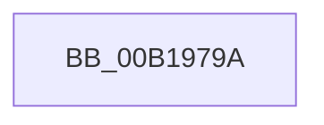

# sub_00B1979A

- RVA: `0x00B1979A`–`0x00B197C2` (길이 `40` bytes)
- VA: `0x0000000140B1979A`
- 실행 섹션: `PAGE`
- PDB 이름 있음: `아니요`; PDB Function 태그: `아니요`
- unwind 정보 RVA: `0x0007E198`
- 디코드: `8`개 명령, `40/40` bytes 표시
- 미해석 바이트: `0` (있으면 어셈블리에 `.byte`로 보존)

> 이 문서는 커널 이미지의 기계어와 PDB 기호를 분석해 생성했습니다. 4번과 5번은 함수 원형과 자료형을 바이너리 사용 방식에서 추정한 C 해석이며 원본 소스 복구 결과는 아닙니다.

## 1. Dependencies

- 직접 호출 지점: **1**; 고유 호출 대상: **1**
- 직접 호출자로 확인된 함수: **0**
- RIP 상대 이미지 참조: **0**

### Outgoing calls
- `0x00B197A6` → [AlpcpCancelMessage](../89/AlpcpCancelMessage_function_00894120.md) (function, `0x00894120`)

### Direct callers
- 이 함수 시작 RVA로 연결되는 직접 call은 확인되지 않았습니다. 간접 호출은 완전히 역산할 수 없습니다.

### Static image references
- 디코드된 RIP-relative 메모리 참조가 없습니다.

## 2. Other-region calls and transfers

- 다른 실행 섹션으로 향하는 call: **0**
- call이 아닌 외부 분기/꼬리 이동: **1**
  - `0x00B197BD` → [AlpcpReceiveLegacyMessage + 0x106](../89/AlpcpReceiveLegacyMessage_function_00895DE0.md) (`tail-transfer`)

## 3. Assembly (complete function range)

```asm
00B1979A  41 B8 00 00 01 00               mov r8d, 0x10000
00B197A0  48 8B D7                        mov rdx, rdi
00B197A3  48 8B C8                        mov rcx, rax
00B197A6  E8 75 A9 D7 FF                  call 0x140894120
00B197AB  4C 89 6C 24 40                  mov qword ptr [rsp + 0x40], r13
00B197B0  44 8B 54 24 30                  mov r10d, dword ptr [rsp + 0x30]
00B197B5  4C 8B A4 24 B0 00 00 00         mov r12, qword ptr [rsp + 0xb0]
00B197BD  E9 24 C7 D7 FF                  jmp 0x140895ee6
```

## 4. C-style interpretation (structured pseudocode)

```c
__int64 __fastcall sub_00B1979A(__int64 a1, __int64 a2, __int64 a3, __int64 a4, __int64 a5, unsigned int a6, __int64 a7, __int64 a8, __int64 a9, __int64 a10, __int64 a11, __int64 a12, __int64 a13, __int64 a14, __int64 a15, __int64 a16, __int64 a17, __int64 a18, __int64 a19, __int64 a20, __int64 a21, __int64 a22)
{
    __int64 result;
    unsigned __int64 v_stack_p40;

    result = AlpcpCancelMessage(result, v_rdi, (unsigned int)(0x10000ULL), a4);
    v_stack_p40 = v_r13;
}
```

## 5. (Beta) C Style

```c
int64_t sub_00B1979A(int64_t Arg1, int64_t Arg2, int64_t Arg3, int64_t Arg4, uint64_t Arg5, uint32_t Arg6, uint64_t Arg7, uint64_t Arg8, uint64_t Arg9, uint64_t Arg10, uint64_t Arg11, uint64_t Arg12, uint64_t Arg13, uint64_t Arg14, uint64_t Arg15, uint64_t Arg16, uint64_t Arg17, uint64_t Arg18, uint64_t Arg19, uint64_t Arg20, uint64_t Arg21, int64_t Arg22)
{
    int64_t result;
    uint64_t v_stack_p40;

    result = AlpcpCancelMessage(result, local_rdi, (uint32_t)(0x10000ULL), Arg4);
    v_stack_p40 = local_r13;
}
```

## 6. Execution-region graph

[열기: 2D/3D 그래프와 함수 탐색 컨트롤 패널](../../../control-panel.html?section=page&rva=0x00B1979A&view=graph)

- 2D 그래프는 위에서 아래로 흐르고, 3D 그래프는 빈 공간을 드래그해 회전합니다. Shift+드래그는 이동, 휠은 확대·축소, 함수 노드 선택은 대상 보고서 이동입니다.

### Static fallback


