# sub_00B197CC

- RVA: `0x00B197CC`–`0x00B19ABB` (길이 `751` bytes)
- VA: `0x0000000140B197CC`
- 실행 섹션: `PAGE`
- PDB 이름 있음: `아니요`; PDB Function 태그: `아니요`
- unwind 정보 RVA: `0x0007E27C`
- 디코드: `206`개 명령, `751/751` bytes 표시
- 미해석 바이트: `0` (있으면 어셈블리에 `.byte`로 보존)

> 이 문서는 커널 이미지의 기계어와 PDB 기호를 분석해 생성했습니다. 4번과 5번은 함수 원형과 자료형을 바이너리 사용 방식에서 추정한 C 해석이며 원본 소스 복구 결과는 아닙니다.

## 1. Dependencies

- 직접 호출 지점: **31**; 고유 호출 대상: **11**
- 직접 호출자로 확인된 함수: **0**
- RIP 상대 이미지 참조: **0**

### Outgoing calls
- `0x00B197CF` → [KeAbPostRelease](../../text/2E/KeAbPostRelease_function_002E1600.md) (function, `0x002E1600`)
- `0x00B197EA` → [ExfTryToWakePushLock](../../text/26/ExfTryToWakePushLock_function_00265DD0.md) (function, `0x00265DD0`)
- `0x00B197F4` → [KeAbPostRelease](../../text/2E/KeAbPostRelease_function_002E1600.md) (function, `0x002E1600`)
- `0x00B19801` → [KeAbPreAcquire](../../text/21/KeAbPreAcquire_function_00210230.md) (function, `0x00210230`)
- `0x00B1982B` → [ExfReleasePushLockShared](../../text/26/ExfReleasePushLockShared_function_00263440.md) (function, `0x00263440`)
- `0x00B19835` → [AlpcpReferenceBlob](../89/AlpcpReferenceBlob_function_00890110.md) (function, `0x00890110`)
- `0x00B1984B` → [ExfTryToWakePushLock](../../text/26/ExfTryToWakePushLock_function_00265DD0.md) (function, `0x00265DD0`)
- `0x00B19853` → [KeAbPostRelease](../../text/2E/KeAbPostRelease_function_002E1600.md) (function, `0x002E1600`)
- `0x00B1986E` → [ExfTryToWakePushLock](../../text/26/ExfTryToWakePushLock_function_00265DD0.md) (function, `0x00265DD0`)
- `0x00B19886` → [ExfReleasePushLockShared](../../text/26/ExfReleasePushLockShared_function_00263440.md) (function, `0x00263440`)
- `0x00B1988E` → [KeAbPostRelease](../../text/2E/KeAbPostRelease_function_002E1600.md) (function, `0x002E1600`)
- `0x00B19896` → [AlpcpLockForCachedReferenceBlob](../88/AlpcpLockForCachedReferenceBlob_function_0088A8B0.md) (function, `0x0088A8B0`)
- `0x00B198A7` → [KeAbPreAcquire](../../text/21/KeAbPreAcquire_function_00210230.md) (function, `0x00210230`)
- `0x00B198C8` → [ExfAcquirePushLockSharedEx](../../text/21/ExfAcquirePushLockSharedEx_function_0021044C.md) (function, `0x0021044C`)
- `0x00B198F2` → [KeAbPreAcquire](../../text/21/KeAbPreAcquire_function_00210230.md) (function, `0x00210230`)
- `0x00B1990B` → [ExfAcquirePushLockExclusiveEx](../../text/20/ExfAcquirePushLockExclusiveEx_function_0020FC90.md) (function, `0x0020FC90`)
- `0x00B19972` → [ExfTryToWakePushLock](../../text/26/ExfTryToWakePushLock_function_00265DD0.md) (function, `0x00265DD0`)
- `0x00B1997A` → [KeAbPostRelease](../../text/2E/KeAbPostRelease_function_002E1600.md) (function, `0x002E1600`)
- `0x00B19992` → [ExfReleasePushLockShared](../../text/26/ExfReleasePushLockShared_function_00263440.md) (function, `0x00263440`)
- `0x00B1999A` → [KeAbPostRelease](../../text/2E/KeAbPostRelease_function_002E1600.md) (function, `0x002E1600`)
- `0x00B199A2` → [AlpcpUnlockMessage](../89/AlpcpUnlockMessage_function_00897AE0.md) (function, `0x00897AE0`)
- `0x00B199C7` → [ExfReleasePushLockShared](../../text/26/ExfReleasePushLockShared_function_00263440.md) (function, `0x00263440`)
- `0x00B199CF` → [KeAbPostRelease](../../text/2E/KeAbPostRelease_function_002E1600.md) (function, `0x002E1600`)
- `0x00B199D7` → [AlpcpUnlockMessage](../89/AlpcpUnlockMessage_function_00897AE0.md) (function, `0x00897AE0`)
- `0x00B199EB` → [AlpcpRemoveMessagePort](../9F/AlpcpRemoveMessagePort_function_009F441C.md) (function, `0x009F441C`)
- `0x00B19A5A` → [AlpcpInsertMessagePendingQueue](../92/AlpcpInsertMessagePendingQueue_function_00922830.md) (function, `0x00922830`)
- `0x00B19A70` → [ExfTryToWakePushLock](../../text/26/ExfTryToWakePushLock_function_00265DD0.md) (function, `0x00265DD0`)
- `0x00B19A78` → [KeAbPostRelease](../../text/2E/KeAbPostRelease_function_002E1600.md) (function, `0x002E1600`)
- `0x00B19A92` → [ExfTryToWakePushLock](../../text/26/ExfTryToWakePushLock_function_00265DD0.md) (function, `0x00265DD0`)
- `0x00B19AA8` → [ExfReleasePushLockShared](../../text/26/ExfReleasePushLockShared_function_00263440.md) (function, `0x00263440`)
- `0x00B19AB0` → [KeAbPostRelease](../../text/2E/KeAbPostRelease_function_002E1600.md) (function, `0x002E1600`)

### Direct callers
- 이 함수 시작 RVA로 연결되는 직접 call은 확인되지 않았습니다. 간접 호출은 완전히 역산할 수 없습니다.

### Static image references
- 디코드된 RIP-relative 메모리 참조가 없습니다.

## 2. Other-region calls and transfers

- 다른 실행 섹션으로 향하는 call: **25**
  - `0x00B197CF` → [KeAbPostRelease](../../text/2E/KeAbPostRelease_function_002E1600.md) (`PAGE` → `.text`)
  - `0x00B197EA` → [ExfTryToWakePushLock](../../text/26/ExfTryToWakePushLock_function_00265DD0.md) (`PAGE` → `.text`)
  - `0x00B197F4` → [KeAbPostRelease](../../text/2E/KeAbPostRelease_function_002E1600.md) (`PAGE` → `.text`)
  - `0x00B19801` → [KeAbPreAcquire](../../text/21/KeAbPreAcquire_function_00210230.md) (`PAGE` → `.text`)
  - `0x00B1982B` → [ExfReleasePushLockShared](../../text/26/ExfReleasePushLockShared_function_00263440.md) (`PAGE` → `.text`)
  - `0x00B1984B` → [ExfTryToWakePushLock](../../text/26/ExfTryToWakePushLock_function_00265DD0.md) (`PAGE` → `.text`)
  - `0x00B19853` → [KeAbPostRelease](../../text/2E/KeAbPostRelease_function_002E1600.md) (`PAGE` → `.text`)
  - `0x00B1986E` → [ExfTryToWakePushLock](../../text/26/ExfTryToWakePushLock_function_00265DD0.md) (`PAGE` → `.text`)
  - `0x00B19886` → [ExfReleasePushLockShared](../../text/26/ExfReleasePushLockShared_function_00263440.md) (`PAGE` → `.text`)
  - `0x00B1988E` → [KeAbPostRelease](../../text/2E/KeAbPostRelease_function_002E1600.md) (`PAGE` → `.text`)
  - `0x00B198A7` → [KeAbPreAcquire](../../text/21/KeAbPreAcquire_function_00210230.md) (`PAGE` → `.text`)
  - `0x00B198C8` → [ExfAcquirePushLockSharedEx](../../text/21/ExfAcquirePushLockSharedEx_function_0021044C.md) (`PAGE` → `.text`)
  - `0x00B198F2` → [KeAbPreAcquire](../../text/21/KeAbPreAcquire_function_00210230.md) (`PAGE` → `.text`)
  - `0x00B1990B` → [ExfAcquirePushLockExclusiveEx](../../text/20/ExfAcquirePushLockExclusiveEx_function_0020FC90.md) (`PAGE` → `.text`)
  - `0x00B19972` → [ExfTryToWakePushLock](../../text/26/ExfTryToWakePushLock_function_00265DD0.md) (`PAGE` → `.text`)
  - `0x00B1997A` → [KeAbPostRelease](../../text/2E/KeAbPostRelease_function_002E1600.md) (`PAGE` → `.text`)
  - `0x00B19992` → [ExfReleasePushLockShared](../../text/26/ExfReleasePushLockShared_function_00263440.md) (`PAGE` → `.text`)
  - `0x00B1999A` → [KeAbPostRelease](../../text/2E/KeAbPostRelease_function_002E1600.md) (`PAGE` → `.text`)
  - `0x00B199C7` → [ExfReleasePushLockShared](../../text/26/ExfReleasePushLockShared_function_00263440.md) (`PAGE` → `.text`)
  - `0x00B199CF` → [KeAbPostRelease](../../text/2E/KeAbPostRelease_function_002E1600.md) (`PAGE` → `.text`)
  - `0x00B19A70` → [ExfTryToWakePushLock](../../text/26/ExfTryToWakePushLock_function_00265DD0.md) (`PAGE` → `.text`)
  - `0x00B19A78` → [KeAbPostRelease](../../text/2E/KeAbPostRelease_function_002E1600.md) (`PAGE` → `.text`)
  - `0x00B19A92` → [ExfTryToWakePushLock](../../text/26/ExfTryToWakePushLock_function_00265DD0.md) (`PAGE` → `.text`)
  - `0x00B19AA8` → [ExfReleasePushLockShared](../../text/26/ExfReleasePushLockShared_function_00263440.md) (`PAGE` → `.text`)
  - `0x00B19AB0` → [KeAbPostRelease](../../text/2E/KeAbPostRelease_function_002E1600.md) (`PAGE` → `.text`)
- call이 아닌 외부 분기/꼬리 이동: **5**
  - `0x00B1980F` → [AlpcpReceiveMessagePort + 0x54A](../89/AlpcpReceiveMessagePort_function_00896B40.md) (`tail-transfer`)
  - `0x00B19815` → [AlpcpReceiveMessagePort + 0x53C](../89/AlpcpReceiveMessagePort_function_00896B40.md) (`tail-transfer`)
  - `0x00B199AF` → [AlpcpReceiveMessagePort + 0x4B](../89/AlpcpReceiveMessagePort_function_00896B40.md) (`tail-transfer`)
  - `0x00B199DD` → [AlpcpReceiveMessagePort + 0x4B](../89/AlpcpReceiveMessagePort_function_00896B40.md) (`tail-transfer`)
  - `0x00B19AB6` → [AlpcpReceiveMessagePort + 0x476](../89/AlpcpReceiveMessagePort_function_00896B40.md) (`tail-transfer`)

## 3. Assembly (complete function range)

```asm
00B197CC  48 8B CE                        mov rcx, rsi
00B197CF  E8 2C 7E 7C FF                  call 0x1402e1600
00B197D4  45 85 FF                        test r15d, r15d
00B197D7  74 41                           je 0x140b1981a
00B197D9  48 8B C3                        mov rax, rbx
00B197DC  F0 49 0F C1 06                  lock xadd qword ptr [r14], rax
00B197E1  24 06                           and al, 6
00B197E3  3C 02                           cmp al, 2
00B197E5  75 08                           jne 0x140b197ef
00B197E7  49 8B CE                        mov rcx, r14
00B197EA  E8 E1 C5 74 FF                  call 0x140265dd0
00B197EF  33 ED                           xor ebp, ebp
00B197F1  49 8B CE                        mov rcx, r14
00B197F4  E8 07 7E 7C FF                  call 0x1402e1600
00B197F9  45 33 C0                        xor r8d, r8d
00B197FC  33 D2                           xor edx, edx
00B197FE  49 8B CE                        mov rcx, r14
00B19801  E8 2A 6A 6F FF                  call 0x140210230
00B19806  F0 49 0F BA 2E 00               lock bts qword ptr [r14], 0
00B1980C  48 8B F0                        mov rsi, rax
00B1980F  0F 83 75 D8 D7 FF               jae 0x14089708a
00B19815  E9 62 D8 D7 FF                  jmp 0x14089707c
00B1981A  B8 11 00 00 00                  mov eax, 0x11
00B1981F  33 ED                           xor ebp, ebp
00B19821  F0 49 0F B1 2E                  lock cmpxchg qword ptr [r14], rbp
00B19826  74 C9                           je 0x140b197f1
00B19828  49 8B CE                        mov rcx, r14
00B1982B  E8 10 9C 74 FF                  call 0x140263440
00B19830  EB BF                           jmp 0x140b197f1
00B19832  48 8B CD                        mov rcx, rbp
00B19835  E8 D6 68 D7 FF                  call 0x140890110
00B1983A  48 8B C3                        mov rax, rbx
00B1983D  F0 48 0F C1 06                  lock xadd qword ptr [rsi], rax
00B19842  24 06                           and al, 6
00B19844  3C 02                           cmp al, 2
00B19846  75 08                           jne 0x140b19850
00B19848  48 8B CE                        mov rcx, rsi
00B1984B  E8 80 C5 74 FF                  call 0x140265dd0
00B19850  48 8B CE                        mov rcx, rsi
00B19853  E8 A8 7D 7C FF                  call 0x1402e1600
00B19858  45 85 FF                        test r15d, r15d
00B1985B  74 18                           je 0x140b19875
00B1985D  48 8B C3                        mov rax, rbx
00B19860  F0 49 0F C1 06                  lock xadd qword ptr [r14], rax
00B19865  24 06                           and al, 6
00B19867  3C 02                           cmp al, 2
00B19869  75 20                           jne 0x140b1988b
00B1986B  49 8B CE                        mov rcx, r14
00B1986E  E8 5D C5 74 FF                  call 0x140265dd0
00B19873  EB 16                           jmp 0x140b1988b
00B19875  B8 11 00 00 00                  mov eax, 0x11
00B1987A  33 D2                           xor edx, edx
00B1987C  F0 49 0F B1 16                  lock cmpxchg qword ptr [r14], rdx
00B19881  74 08                           je 0x140b1988b
00B19883  49 8B CE                        mov rcx, r14
00B19886  E8 B5 9B 74 FF                  call 0x140263440
00B1988B  49 8B CE                        mov rcx, r14
00B1988E  E8 6D 7D 7C FF                  call 0x1402e1600
00B19893  48 8B CD                        mov rcx, rbp
00B19896  E8 15 10 D7 FF                  call 0x14088a8b0
00B1989B  66 FF 4D E2                     dec word ptr [rbp - 0x1e]
00B1989F  45 33 C0                        xor r8d, r8d
00B198A2  33 D2                           xor edx, edx
00B198A4  49 8B CE                        mov rcx, r14
00B198A7  E8 84 69 6F FF                  call 0x140210230
00B198AC  4C 8B F8                        mov r15, rax
00B198AF  B9 11 00 00 00                  mov ecx, 0x11
00B198B4  33 C0                           xor eax, eax
00B198B6  F0 49 0F B1 0E                  lock cmpxchg qword ptr [r14], rcx
00B198BB  74 10                           je 0x140b198cd
00B198BD  4D 8B CE                        mov r9, r14
00B198C0  4D 8B C7                        mov r8, r15
00B198C3  33 D2                           xor edx, edx
00B198C5  49 8B CE                        mov rcx, r14
00B198C8  E8 7F 6B 6F FF                  call 0x14021044c
00B198CD  4D 85 FF                        test r15, r15
00B198D0  74 05                           je 0x140b198d7
00B198D2  41 C6 47 0A 01                  mov byte ptr [r15 + 0xa], 1
00B198D7  8B 87 A0 01 00 00               mov eax, dword ptr [rdi + 0x1a0]
00B198DD  33 C9                           xor ecx, ecx
00B198DF  44 8B F9                        mov r15d, ecx
00B198E2  A8 50                           test al, 0x50
00B198E4  0F 85 CA 00 00 00               jne 0x140b199b4
00B198EA  45 33 C0                        xor r8d, r8d
00B198ED  33 D2                           xor edx, edx
00B198EF  48 8B CE                        mov rcx, rsi
00B198F2  E8 39 69 6F FF                  call 0x140210230
00B198F7  F0 48 0F BA 2E 00               lock bts qword ptr [rsi], 0
00B198FD  4C 8B E8                        mov r13, rax
00B19900  73 0E                           jae 0x140b19910
00B19902  4C 8B C6                        mov r8, rsi
00B19905  48 8B D0                        mov rdx, rax
00B19908  48 8B CE                        mov rcx, rsi
00B1990B  E8 80 63 6F FF                  call 0x14020fc90
00B19910  4D 85 ED                        test r13, r13
00B19913  74 05                           je 0x140b1991a
00B19915  41 C6 45 0A 01                  mov byte ptr [r13 + 0xa], 1
00B1991A  4C 8D 87 A0 00 00 00            lea r8, [rdi + 0xa0]
00B19921  49 8B 10                        mov rdx, qword ptr [r8]
00B19924  49 3B D0                        cmp rdx, r8
00B19927  74 0A                           je 0x140b19933
00B19929  48 85 D2                        test rdx, rdx
00B1992C  74 05                           je 0x140b19933
00B1992E  45 33 ED                        xor r13d, r13d
00B19931  EB 25                           jmp 0x140b19958
00B19933  48 8D 87 90 00 00 00            lea rax, [rdi + 0x90]
00B1993A  4D 8B EF                        mov r13, r15
00B1993D  48 8B 08                        mov rcx, qword ptr [rax]
00B19940  48 3B C8                        cmp rcx, rax
00B19943  49 0F 44 CF                     cmove rcx, r15
00B19947  48 3B E9                        cmp rbp, rcx
00B1994A  0F 84 95 00 00 00               je 0x140b199e5
00B19950  49 3B D0                        cmp rdx, r8
00B19953  75 03                           jne 0x140b19958
00B19955  49 8B D7                        mov rdx, r15
00B19958  48 3B EA                        cmp rbp, rdx
00B1995B  0F 84 84 00 00 00               je 0x140b199e5
00B19961  48 8B C3                        mov rax, rbx
00B19964  F0 48 0F C1 06                  lock xadd qword ptr [rsi], rax
00B19969  24 06                           and al, 6
00B1996B  3C 02                           cmp al, 2
00B1996D  75 08                           jne 0x140b19977
00B1996F  48 8B CE                        mov rcx, rsi
00B19972  E8 59 C4 74 FF                  call 0x140265dd0
00B19977  48 8B CE                        mov rcx, rsi
00B1997A  E8 81 7C 7C FF                  call 0x1402e1600
00B1997F  41 BF 11 00 00 00               mov r15d, 0x11
00B19985  41 8B C7                        mov eax, r15d
00B19988  F0 4D 0F B1 2E                  lock cmpxchg qword ptr [r14], r13
00B1998D  74 08                           je 0x140b19997
00B1998F  49 8B CE                        mov rcx, r14
00B19992  E8 A9 9A 74 FF                  call 0x140263440
00B19997  49 8B CE                        mov rcx, r14
00B1999A  E8 61 7C 7C FF                  call 0x1402e1600
00B1999F  48 8B CD                        mov rcx, rbp
00B199A2  E8 39 E1 D7 FF                  call 0x140897ae0
00B199A7  4C 8B AC 24 90 00 00 00         mov r13, qword ptr [rsp + 0x90]
00B199AF  E9 D7 D1 D7 FF                  jmp 0x140896b8b
00B199B4  41 BF 11 00 00 00               mov r15d, 0x11
00B199BA  41 8B C7                        mov eax, r15d
00B199BD  F0 49 0F B1 0E                  lock cmpxchg qword ptr [r14], rcx
00B199C2  74 08                           je 0x140b199cc
00B199C4  49 8B CE                        mov rcx, r14
00B199C7  E8 74 9A 74 FF                  call 0x140263440
00B199CC  49 8B CE                        mov rcx, r14
00B199CF  E8 2C 7C 7C FF                  call 0x1402e1600
00B199D4  48 8B CD                        mov rcx, rbp
00B199D7  E8 04 E1 D7 FF                  call 0x140897ae0
00B199DC  90                              nop
00B199DD  E9 A9 D1 D7 FF                  jmp 0x140896b8b
00B199E2  45 33 ED                        xor r13d, r13d
00B199E5  48 8B D5                        mov rdx, rbp
00B199E8  48 8B CF                        mov rcx, rdi
00B199EB  E8 2C AA ED FF                  call 0x1409f441c
00B199F0  F7 45 28 00 02 00 00            test dword ptr [rbp + 0x28], 0x200
00B199F7  74 4F                           je 0x140b19a48
00B199F9  48 8B 85 88 00 00 00            mov rax, qword ptr [rbp + 0x88]
00B19A00  48 F7 D8                        neg rax
00B19A03  1B C9                           sbb ecx, ecx
00B19A05  81 E1 00 00 00 80               and ecx, 0x80000000
00B19A0B  8B D1                           mov edx, ecx
00B19A0D  0F BA EA 1E                     bts edx, 0x1e
00B19A11  48 83 BD 90 00 00 00 00         cmp qword ptr [rbp + 0x90], 0
00B19A19  0F 44 D1                        cmove edx, ecx
00B19A1C  8B CA                           mov ecx, edx
00B19A1E  0F BA E9 1C                     bts ecx, 0x1c
00B19A22  48 83 BD 98 00 00 00 00         cmp qword ptr [rbp + 0x98], 0
00B19A2A  0F 44 CA                        cmove ecx, edx
00B19A2D  85 8C 24 B0 00 00 00            test dword ptr [rsp + 0xb0], ecx
00B19A34  75 12                           jne 0x140b19a48
00B19A36  B8 FF DF FF FF                  mov eax, 0xffffdfff
00B19A3B  66 21 85 F4 00 00 00            and word ptr [rbp + 0xf4], ax
00B19A42  66 FF 4D E2                     dec word ptr [rbp - 0x1e]
00B19A46  EB 17                           jmp 0x140b19a5f
00B19A48  B8 00 20 00 00                  mov eax, 0x2000
00B19A4D  48 8B D5                        mov rdx, rbp
00B19A50  66 09 85 F4 00 00 00            or word ptr [rbp + 0xf4], ax
00B19A57  48 8B CF                        mov rcx, rdi
00B19A5A  E8 D1 8D E0 FF                  call 0x140922830
00B19A5F  48 8B C3                        mov rax, rbx
00B19A62  F0 48 0F C1 06                  lock xadd qword ptr [rsi], rax
00B19A67  24 06                           and al, 6
00B19A69  3C 02                           cmp al, 2
00B19A6B  75 08                           jne 0x140b19a75
00B19A6D  48 8B CE                        mov rcx, rsi
00B19A70  E8 5B C3 74 FF                  call 0x140265dd0
00B19A75  48 8B CE                        mov rcx, rsi
00B19A78  E8 83 7B 7C FF                  call 0x1402e1600
00B19A7D  45 85 FF                        test r15d, r15d
00B19A80  74 17                           je 0x140b19a99
00B19A82  F0 49 0F C1 1E                  lock xadd qword ptr [r14], rbx
00B19A87  80 E3 06                        and bl, 6
00B19A8A  80 FB 02                        cmp bl, 2
00B19A8D  75 1E                           jne 0x140b19aad
00B19A8F  49 8B CE                        mov rcx, r14
00B19A92  E8 39 C3 74 FF                  call 0x140265dd0
00B19A97  EB 14                           jmp 0x140b19aad
00B19A99  B8 11 00 00 00                  mov eax, 0x11
00B19A9E  F0 4D 0F B1 2E                  lock cmpxchg qword ptr [r14], r13
00B19AA3  74 08                           je 0x140b19aad
00B19AA5  49 8B CE                        mov rcx, r14
00B19AA8  E8 93 99 74 FF                  call 0x140263440
00B19AAD  49 8B CE                        mov rcx, r14
00B19AB0  E8 4B 7B 7C FF                  call 0x1402e1600
00B19AB5  90                              nop
00B19AB6  E9 FB D4 D7 FF                  jmp 0x140896fb6
```

## 4. C-style interpretation (structured pseudocode)

```c
__int64 __fastcall sub_00B197CC(__int64 a1, int a2, int a3)
{
    __int64 result;
    __int64 v_rbp;
    unsigned __int64 v_stack_p90;
    unsigned int v_stack_pB0;

    result = KeAbPostRelease(v_rsi, a2, a3, a4);
    if ((unsigned int)(v_r15) == 0) goto loc_00B1981A;
    result = (unsigned __int8)((v_rbx) & (6));
    if (((unsigned __int8)(result)) == 2) {
        a1 = v_r14;
        result = ExfTryToWakePushLock(a1, a2, a3, a4);
    }
    v_rbp = 0;
loc_00B197F1:
    result = KeAbPostRelease(v_r14, a2, a3, a4);
    a3 = 0;
    a2 = 0;
    result = KeAbPreAcquire(v_r14, a2, a3, a4);
loc_00B1981A:
    v_rbp = 0;
    if (condition_is_equal) goto loc_00B197F1;
    result = ExfReleasePushLockShared(v_r14, a2, a3, a4);
    goto loc_00B197F1;
}
```

## 5. (Beta) C Style

```c
int64_t sub_00B197CC(int64_t Arg1, int32_t Arg2, int32_t Arg3)
{
    int64_t result;
    int64_t local_rbp;
    uint64_t v_stack_p90;
    uint32_t v_stack_pB0;

    result = KeAbPostRelease(local_rsi, Arg2, Arg3, a4);
    if ((uint32_t)(local_r15) == 0) goto loc_00B1981A;
    result = (uint8_t)((local_rbx) & (6));
    if (((uint8_t)(result)) == 2) {
        Arg1 = local_r14;
        result = ExfTryToWakePushLock(Arg1, Arg2, Arg3, a4);
    }
    local_rbp = 0;
loc_00B197F1:
    result = KeAbPostRelease(local_r14, Arg2, Arg3, a4);
    Arg3 = 0;
    Arg2 = 0;
    result = KeAbPreAcquire(local_r14, Arg2, Arg3, a4);
loc_00B1981A:
    local_rbp = 0;
    if (condition_is_equal) goto loc_00B197F1;
    result = ExfReleasePushLockShared(local_r14, Arg2, Arg3, a4);
    goto loc_00B197F1;
}
```

## 6. Execution-region graph

[열기: 2D/3D 그래프와 함수 탐색 컨트롤 패널](../../../control-panel.html?section=page&rva=0x00B197CC&view=graph)

- 2D 그래프는 위에서 아래로 흐르고, 3D 그래프는 빈 공간을 드래그해 회전합니다. Shift+드래그는 이동, 휠은 확대·축소, 함수 노드 선택은 대상 보고서 이동입니다.

### Static fallback

```mermaid
flowchart TD
  bb_00B197CC[BB_00B197CC]
  bb_00B197D9[BB_00B197D9]
  bb_00B197E7[BB_00B197E7]
  bb_00B197EF[BB_00B197EF]
  bb_00B197F1[BB_00B197F1]
  bb_00B19815[BB_00B19815]
  bb_00B1981A[BB_00B1981A]
  bb_00B19828[BB_00B19828]
  bb_00B19832[BB_00B19832]
  bb_00B19848[BB_00B19848]
  bb_00B19850[BB_00B19850]
  bb_00B1985D[BB_00B1985D]
  bb_00B1986B[BB_00B1986B]
  bb_00B19875[BB_00B19875]
  bb_00B19883[BB_00B19883]
  bb_00B1988B[BB_00B1988B]
  bb_00B198BD[BB_00B198BD]
  bb_00B198CD[BB_00B198CD]
  bb_00B198D2[BB_00B198D2]
  bb_00B198D7[BB_00B198D7]
  bb_00B198EA[BB_00B198EA]
  bb_00B19902[BB_00B19902]
  bb_00B19910[BB_00B19910]
  bb_00B19915[BB_00B19915]
  bb_00B1991A[BB_00B1991A]
  bb_00B19929[BB_00B19929]
  bb_00B1992E[BB_00B1992E]
  bb_00B19933[BB_00B19933]
  bb_00B19950[BB_00B19950]
  bb_00B19955[BB_00B19955]
  bb_00B19958[BB_00B19958]
  bb_00B19961[BB_00B19961]
  bb_00B1996F[BB_00B1996F]
  bb_00B19977[BB_00B19977]
  bb_00B1998F[BB_00B1998F]
  bb_00B19997[BB_00B19997]
  bb_00B199B4[BB_00B199B4]
  bb_00B199C4[BB_00B199C4]
  bb_00B199CC[BB_00B199CC]
  bb_00B199E2[BB_00B199E2]
  bb_00B199E5[BB_00B199E5]
  bb_00B199F9[BB_00B199F9]
  bb_00B19A36[BB_00B19A36]
  bb_00B19A48[BB_00B19A48]
  bb_00B19A5F[BB_00B19A5F]
  bb_00B19A6D[BB_00B19A6D]
  bb_00B19A75[BB_00B19A75]
  bb_00B19A82[BB_00B19A82]
  bb_00B19A8F[BB_00B19A8F]
  bb_00B19A99[BB_00B19A99]
  bb_00B19AA5[BB_00B19AA5]
  bb_00B19AAD[BB_00B19AAD]
  bb_00B197CC -->|branch| bb_00B1981A
  bb_00B197CC -->|fallthrough| bb_00B197D9
  bb_00B197D9 -->|branch| bb_00B197EF
  bb_00B197D9 -->|fallthrough| bb_00B197E7
  bb_00B197E7 -->|flow| bb_00B197EF
  bb_00B197EF -->|flow| bb_00B197F1
  bb_00B197F1 -->|fallthrough| bb_00B19815
  bb_00B1981A -->|branch| bb_00B197F1
  bb_00B1981A -->|fallthrough| bb_00B19828
  bb_00B19828 -->|branch| bb_00B197F1
  bb_00B19832 -->|branch| bb_00B19850
  bb_00B19832 -->|fallthrough| bb_00B19848
  bb_00B19848 -->|flow| bb_00B19850
  bb_00B19850 -->|branch| bb_00B19875
  bb_00B19850 -->|fallthrough| bb_00B1985D
  bb_00B1985D -->|branch| bb_00B1988B
  bb_00B1985D -->|fallthrough| bb_00B1986B
  bb_00B1986B -->|branch| bb_00B1988B
  bb_00B19875 -->|branch| bb_00B1988B
  bb_00B19875 -->|fallthrough| bb_00B19883
  bb_00B19883 -->|flow| bb_00B1988B
  bb_00B1988B -->|branch| bb_00B198CD
  bb_00B1988B -->|fallthrough| bb_00B198BD
  bb_00B198BD -->|flow| bb_00B198CD
  bb_00B198CD -->|branch| bb_00B198D7
  bb_00B198CD -->|fallthrough| bb_00B198D2
  bb_00B198D2 -->|flow| bb_00B198D7
  bb_00B198D7 -->|branch| bb_00B199B4
  bb_00B198D7 -->|fallthrough| bb_00B198EA
  bb_00B198EA -->|branch| bb_00B19910
  bb_00B198EA -->|fallthrough| bb_00B19902
  bb_00B19902 -->|flow| bb_00B19910
  bb_00B19910 -->|branch| bb_00B1991A
  bb_00B19910 -->|fallthrough| bb_00B19915
  bb_00B19915 -->|flow| bb_00B1991A
  bb_00B1991A -->|branch| bb_00B19933
  bb_00B1991A -->|fallthrough| bb_00B19929
  bb_00B19929 -->|branch| bb_00B19933
  bb_00B19929 -->|fallthrough| bb_00B1992E
  bb_00B1992E -->|branch| bb_00B19958
  bb_00B19933 -->|branch| bb_00B199E5
  bb_00B19933 -->|fallthrough| bb_00B19950
  bb_00B19950 -->|branch| bb_00B19958
  bb_00B19950 -->|fallthrough| bb_00B19955
  bb_00B19955 -->|flow| bb_00B19958
  bb_00B19958 -->|branch| bb_00B199E5
  bb_00B19958 -->|fallthrough| bb_00B19961
  bb_00B19961 -->|branch| bb_00B19977
  bb_00B19961 -->|fallthrough| bb_00B1996F
  bb_00B1996F -->|flow| bb_00B19977
  bb_00B19977 -->|branch| bb_00B19997
  bb_00B19977 -->|fallthrough| bb_00B1998F
  bb_00B1998F -->|flow| bb_00B19997
  bb_00B199B4 -->|branch| bb_00B199CC
  bb_00B199B4 -->|fallthrough| bb_00B199C4
  bb_00B199C4 -->|flow| bb_00B199CC
  bb_00B199E2 -->|flow| bb_00B199E5
  bb_00B199E5 -->|branch| bb_00B19A48
  bb_00B199E5 -->|fallthrough| bb_00B199F9
  bb_00B199F9 -->|branch| bb_00B19A48
  bb_00B199F9 -->|fallthrough| bb_00B19A36
  bb_00B19A36 -->|branch| bb_00B19A5F
  bb_00B19A48 -->|flow| bb_00B19A5F
  bb_00B19A5F -->|branch| bb_00B19A75
  bb_00B19A5F -->|fallthrough| bb_00B19A6D
  bb_00B19A6D -->|flow| bb_00B19A75
  bb_00B19A75 -->|branch| bb_00B19A99
  bb_00B19A75 -->|fallthrough| bb_00B19A82
  bb_00B19A82 -->|branch| bb_00B19AAD
  bb_00B19A82 -->|fallthrough| bb_00B19A8F
  bb_00B19A8F -->|branch| bb_00B19AAD
  bb_00B19A99 -->|branch| bb_00B19AAD
  bb_00B19A99 -->|fallthrough| bb_00B19AA5
  bb_00B19AA5 -->|flow| bb_00B19AAD
```


