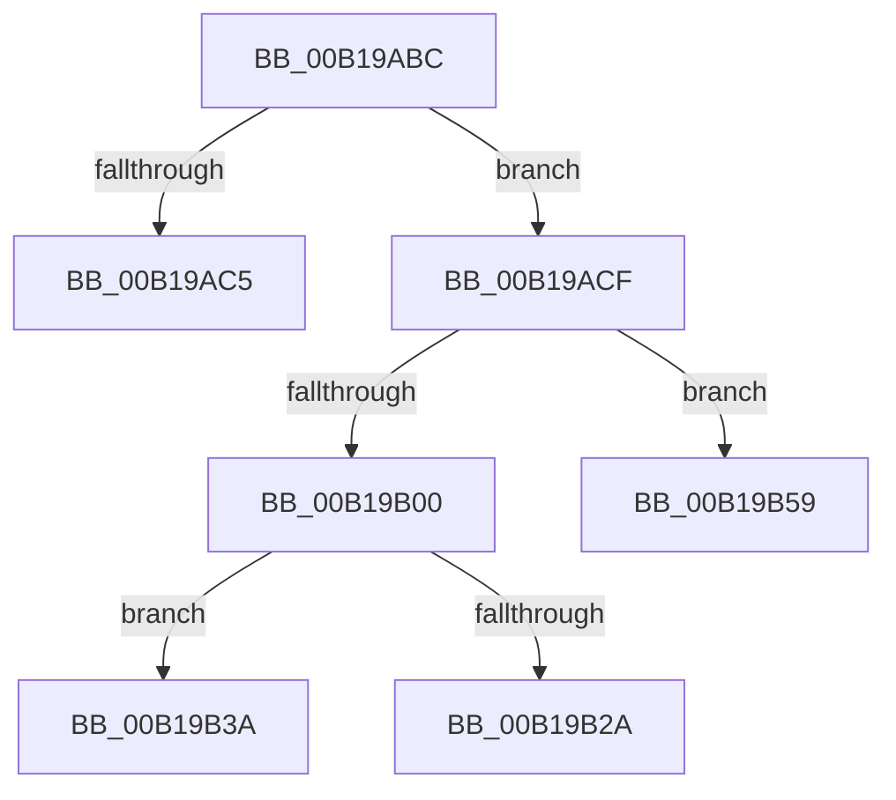

# sub_00B19ABC

- RVA: `0x00B19ABC`–`0x00B19B63` (길이 `167` bytes)
- VA: `0x0000000140B19ABC`
- 실행 섹션: `PAGE`
- PDB 이름 있음: `아니요`; PDB Function 태그: `아니요`
- unwind 정보 RVA: `0x0007E44C`
- 디코드: `40`개 명령, `167/167` bytes 표시
- 미해석 바이트: `0` (있으면 어셈블리에 `.byte`로 보존)

> 이 문서는 커널 이미지의 기계어와 PDB 기호를 분석해 생성했습니다. 4번과 5번은 함수 원형과 자료형을 바이너리 사용 방식에서 추정한 C 해석이며 원본 소스 복구 결과는 아닙니다.

## 1. Dependencies

- 직접 호출 지점: **3**; 고유 호출 대상: **3**
- 직접 호출자로 확인된 함수: **0**
- RIP 상대 이미지 참조: **1**

### Outgoing calls
- `0x00B19AF7` → [ObReferenceObjectByHandle](../86/ObReferenceObjectByHandle_function_00868DB0.md) (function, `0x00868DB0`)
- `0x00B19B1F` → [IopGetSetSpecificExtension](../../text/42/IopGetSetSpecificExtension_function_0042EE80.md) (function, `0x0042EE80`)
- `0x00B19B2F` → [ObfDereferenceObject](../../text/2F/ObfDereferenceObject_function_002F9350.md) (function, `0x002F9350`)

### Direct callers
- 이 함수 시작 RVA로 연결되는 직접 call은 확인되지 않았습니다. 간접 호출은 완전히 역산할 수 없습니다.

### Static image references
- `0x00B19ACF` → RVA `0x00FC6EF0` (`ALMOSTRO`; read)

## 2. Other-region calls and transfers

- 다른 실행 섹션으로 향하는 call: **2**
  - `0x00B19B1F` → [IopGetSetSpecificExtension](../../text/42/IopGetSetSpecificExtension_function_0042EE80.md) (`PAGE` → `.text`)
  - `0x00B19B2F` → [ObfDereferenceObject](../../text/2F/ObfDereferenceObject_function_002F9350.md) (`PAGE` → `.text`)
- call이 아닌 외부 분기/꼬리 이동: **4**
  - `0x00B19ACA` → [IopRetrieveTransactionParameters + 0xF9](../89/IopRetrieveTransactionParameters_function_00898520.md) (`tail-transfer`)
  - `0x00B19B35` → [IopRetrieveTransactionParameters + 0xF7](../89/IopRetrieveTransactionParameters_function_00898520.md) (`tail-transfer`)
  - `0x00B19B54` → [IopRetrieveTransactionParameters + 0xF7](../89/IopRetrieveTransactionParameters_function_00898520.md) (`tail-transfer`)
  - `0x00B19B5E` → [IopRetrieveTransactionParameters + 0xF7](../89/IopRetrieveTransactionParameters_function_00898520.md) (`tail-transfer`)

## 3. Assembly (complete function range)

```asm
00B19ABC  80 BE 89 00 00 00 00            cmp byte ptr [rsi + 0x89], 0
00B19AC3  75 0A                           jne 0x140b19acf
00B19AC5  B8 3F 00 19 C0                  mov eax, 0xc019003f
00B19ACA  E9 4A EB D7 FF                  jmp 0x140898619
00B19ACF  4C 8B 05 1A D4 4A 00            mov r8, qword ptr [rip + 0x4ad41a]
00B19AD6  48 89 5C 24 40                  mov qword ptr [rsp + 0x40], rbx
00B19ADB  48 89 5C 24 28                  mov qword ptr [rsp + 0x28], rbx
00B19AE0  48 8D 44 24 40                  lea rax, [rsp + 0x40]
00B19AE5  48 89 44 24 20                  mov qword ptr [rsp + 0x20], rax
00B19AEA  41 B1 01                        mov r9b, 1
00B19AED  BA 37 00 12 00                  mov edx, 0x120037
00B19AF2  48 8B 4C 24 38                  mov rcx, qword ptr [rsp + 0x38]
00B19AF7  E8 B4 F2 D4 FF                  call 0x140868db0
00B19AFC  85 C0                           test eax, eax
00B19AFE  78 59                           js 0x140b19b59
00B19B00  48 89 5C 24 28                  mov qword ptr [rsp + 0x28], rbx
00B19B05  48 8D 44 24 48                  lea rax, [rsp + 0x48]
00B19B0A  48 89 44 24 20                  mov qword ptr [rsp + 0x20], rax
00B19B0F  41 B1 01                        mov r9b, 1
00B19B12  BB 10 00 00 00                  mov ebx, 0x10
00B19B17  44 8B C3                        mov r8d, ebx
00B19B1A  33 D2                           xor edx, edx
00B19B1C  49 8B CC                        mov rcx, r12
00B19B1F  E8 5C 53 91 FF                  call 0x14042ee80
00B19B24  8B F8                           mov edi, eax
00B19B26  85 C0                           test eax, eax
00B19B28  79 10                           jns 0x140b19b3a
00B19B2A  48 8B 4C 24 40                  mov rcx, qword ptr [rsp + 0x40]
00B19B2F  E8 1C F8 7D FF                  call 0x1402f9350
00B19B34  90                              nop
00B19B35  E9 DD EA D7 FF                  jmp 0x140898617
00B19B3A  48 8B 4C 24 48                  mov rcx, qword ptr [rsp + 0x48]
00B19B3F  66 89 19                        mov word ptr [rcx], bx
00B19B42  0F B7 44 24 30                  movzx eax, word ptr [rsp + 0x30]
00B19B47  66 89 41 02                     mov word ptr [rcx + 2], ax
00B19B4B  48 8B 44 24 40                  mov rax, qword ptr [rsp + 0x40]
00B19B50  48 89 41 08                     mov qword ptr [rcx + 8], rax
00B19B54  E9 BE EA D7 FF                  jmp 0x140898617
00B19B59  BF 18 00 19 C0                  mov edi, 0xc0190018
00B19B5E  E9 B4 EA D7 FF                  jmp 0x140898617
```

## 4. C-style interpretation (structured pseudocode)

```c
__int64 __fastcall sub_00B19ABC(__int64 a1, __int64 a2, __int64 a3, __int64 a4, __int64 a5, unsigned __int16 a6, __int64 a7, __int64 a8, __int64 a9)
{
    __int64 result;
    unsigned __int64 v_stack_p20;
    unsigned __int64 v_stack_p28;
    unsigned __int64 v_stack_p40;

    if ((*(unsigned __int8 *)(v_rsi + 137)) != 0) goto loc_00B19ACF;
loc_00B19ACF:
    v_stack_p40 = v_rbx;
    v_stack_p28 = v_rbx;
    v_stack_p20 = a8;
    result = ObReferenceObjectByHandle(a7, (unsigned int)(0x120037ULL), *(unsigned __int64 *)(v_rip + 4903962), 1);
    if (sign_flag) goto loc_00B19B59;
    v_stack_p28 = v_rbx;
    v_stack_p20 = a9;
    a2 = 0;
    result = IopGetSetSpecificExtension(v_r12, a2, 16, 1);
    if (!sign_flag) goto loc_00B19B3A;
    result = ObfDereferenceObject(a8, a2, 16, 1);
loc_00B19B3A:
    *(unsigned __int16 *)(a9) = 16;
    *(unsigned __int16 *)(a9 + 2) = a6;
    *(unsigned __int64 *)(a9 + 8) = a8;
loc_00B19B59:
}
```

## 5. (Beta) C Style

```c
int64_t sub_00B19ABC(int64_t Arg1, int64_t Arg2, int64_t Arg3, int64_t Arg4, uint64_t Arg5, uint16_t Arg6, int64_t Arg7, int64_t Arg8, void *Arg9)
{
    uint8_t *arg9 = (uint8_t *)Arg9;

    int64_t result;
    uint64_t v_stack_p20;
    uint64_t v_stack_p28;
    uint64_t v_stack_p40;

    if ((*(uint8_t *)(local_rsi + 0x89)) != 0) goto loc_00B19ACF;
loc_00B19ACF:
    v_stack_p40 = local_rbx;
    v_stack_p28 = local_rbx;
    v_stack_p20 = Arg8;
    result = ObReferenceObjectByHandle(Arg7, (uint32_t)(0x120037ULL), *(uint64_t *)(v_rip + 0x4AD41A), 1);
    if (sign_flag) goto loc_00B19B59;
    v_stack_p28 = local_rbx;
    v_stack_p20 = Arg9;
    Arg2 = 0;
    result = IopGetSetSpecificExtension(local_r12, Arg2, 16, 1);
    if (!sign_flag) goto loc_00B19B3A;
    result = ObfDereferenceObject(Arg8, Arg2, 16, 1);
loc_00B19B3A:
    *(uint16_t *)(arg9) = 16;
    *(uint16_t *)(arg9 + 0x2) = Arg6;
    *(uint64_t *)(arg9 + 0x8) = Arg8;
loc_00B19B59:
}
```

### 관측된 메모리 오프셋

구조체 형식이 확인되지 않은 접근은 인자 기준의 오프셋으로만 기록했습니다.

| 기준 인자 | 오프셋 표현 | 폭 (bit) | 접근 |
|---|---:|---:|---|
| `Arg9` | `+ 0x0` | `16` | `W` |
| `Arg9` | `+ 0x2` | `16` | `W` |
| `Arg9` | `+ 0x8` | `64` | `W` |

## 6. Execution-region graph

[열기: 2D/3D 그래프와 함수 탐색 컨트롤 패널](../../../control-panel.html?section=page&rva=0x00B19ABC&view=graph)

- 2D 그래프는 위에서 아래로 흐르고, 3D 그래프는 빈 공간을 드래그해 회전합니다. Shift+드래그는 이동, 휠은 확대·축소, 함수 노드 선택은 대상 보고서 이동입니다.

### Static fallback


