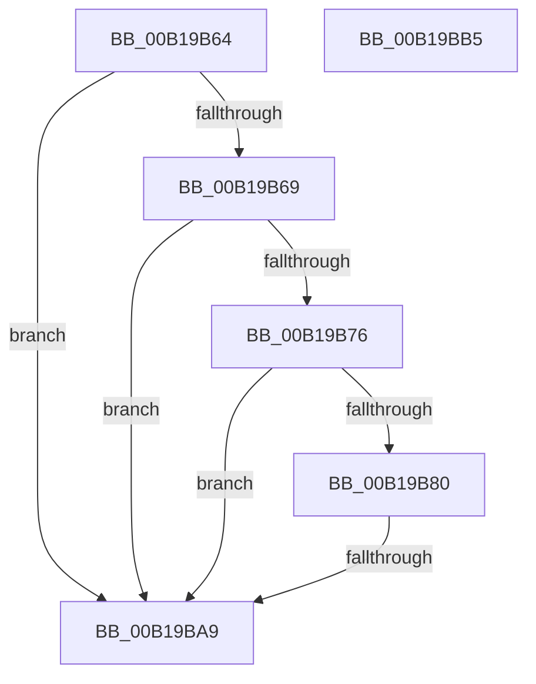

# sub_00B19B64

- RVA: `0x00B19B64`–`0x00B19BD0` (길이 `108` bytes)
- VA: `0x0000000140B19B64`
- 실행 섹션: `PAGE`
- PDB 이름 있음: `아니요`; PDB Function 태그: `아니요`
- unwind 정보 RVA: `0x0007E508`
- 디코드: `23`개 명령, `108/108` bytes 표시
- 미해석 바이트: `0` (있으면 어셈블리에 `.byte`로 보존)

> 이 문서는 커널 이미지의 기계어와 PDB 기호를 분석해 생성했습니다. 4번과 5번은 함수 원형과 자료형을 바이너리 사용 방식에서 추정한 C 해석이며 원본 소스 복구 결과는 아닙니다.

## 1. Dependencies

- 직접 호출 지점: **2**; 고유 호출 대상: **2**
- 직접 호출자로 확인된 함수: **0**
- RIP 상대 이미지 참조: **2**

### Outgoing calls
- `0x00B19B8B` → [SeSinglePrivilegeCheck](../87/SeSinglePrivilegeCheck_function_00871E20.md) (function, `0x00871E20`)
- `0x00B19BC5` → [MiUnmapViewOfSection](../88/MiUnmapViewOfSection_function_0088A4C4.md) (function, `0x0088A4C4`)

### Direct callers
- 이 함수 시작 RVA로 연결되는 직접 call은 확인되지 않았습니다. 간접 호출은 완전히 역산할 수 없습니다.

### Static image references
- `0x00B19B69` → RVA `0x00FC6A88` (`ALMOSTRO`; read)
- `0x00B19B84` → RVA `0x00FD9AD0` (`PAGEDATA`; read)

## 2. Other-region calls and transfers

- 다른 실행 섹션으로 향하는 call: **0**
- call이 아닌 외부 분기/꼬리 이동: **3**
  - `0x00B19BA3` → [MiMapViewOfSection + 0x137](../89/MiMapViewOfSection_function_00898F10.md) (`tail-transfer`)
  - `0x00B19BB0` → [MiMapViewOfSection + 0x137](../89/MiMapViewOfSection_function_00898F10.md) (`tail-transfer`)
  - `0x00B19BCB` → [MiMapViewOfSection + 0x413](../89/MiMapViewOfSection_function_00898F10.md) (`tail-transfer`)

## 3. Assembly (complete function range)

```asm
00B19B64  4D 39 2F                        cmp qword ptr [r15], r13
00B19B67  75 40                           jne 0x140b19ba9
00B19B69  48 F7 05 14 CF 4A 00 00 00 02 00  test qword ptr [rip + 0x4acf14], 0x20000
00B19B74  75 33                           jne 0x140b19ba9
00B19B76  41 F7 46 38 00 00 02 00         test dword ptr [r14 + 0x38], 0x20000
00B19B7E  75 29                           jne 0x140b19ba9
00B19B80  0F B6 53 39                     movzx edx, byte ptr [rbx + 0x39]
00B19B84  48 8B 0D 45 FF 4B 00            mov rcx, qword ptr [rip + 0x4bff45]
00B19B8B  E8 90 82 D5 FF                  call 0x140871e20
00B19B90  4C 8B 5C 24 48                  mov r11, qword ptr [rsp + 0x48]
00B19B95  41 B9 00 20 00 00               mov r9d, 0x2000
00B19B9B  41 BA 00 00 01 00               mov r10d, 0x10000
00B19BA1  84 C0                           test al, al
00B19BA3  0F 85 9E F4 D7 FF               jne 0x140899047
00B19BA9  81 63 28 FF FF FF DF            and dword ptr [rbx + 0x28], 0xdfffffff
00B19BB0  E9 92 F4 D7 FF                  jmp 0x140899047
00B19BB5  48 8B 54 24 40                  mov rdx, qword ptr [rsp + 0x40]
00B19BBA  45 33 C9                        xor r9d, r9d
00B19BBD  48 8B 4C 24 48                  mov rcx, qword ptr [rsp + 0x48]
00B19BC2  45 33 C0                        xor r8d, r8d
00B19BC5  E8 FA 08 D7 FF                  call 0x14088a4c4
00B19BCA  90                              nop
00B19BCB  E9 53 F7 D7 FF                  jmp 0x140899323
```

## 4. C-style interpretation (structured pseudocode)

```c
__int64 __fastcall sub_00B19B64(__int64 a1, __int64 a2, int a3, __int64 a4, __int64 a5, __int64 a6, __int64 a7, __int64 a8, __int64 a9)
{
    __int64 result;
    unsigned __int64 v_stack_p40;
    unsigned __int64 v_stack_p48;

    if ((*(unsigned __int64 *)(v_r15)) != v_r13) goto loc_00B19BA9;
    if (((*(unsigned __int64 *)(v_rip + 4902676)) & (0x20000ULL)) != 0) goto loc_00B19BA9;
    if (((*(unsigned int *)(v_r14 + 56)) & (0x20000ULL)) != 0) goto loc_00B19BA9;
    result = SeSinglePrivilegeCheck(*(unsigned __int64 *)(v_rip + 4980549), *(unsigned __int8 *)(v_rbx + 57), a3, a4);
loc_00B19BA9:
}
```

## 5. (Beta) C Style

```c
int64_t sub_00B19B64(int64_t Arg1, int64_t Arg2, int32_t Arg3, int64_t Arg4, uint64_t Arg5, uint64_t Arg6, uint64_t Arg7, uint64_t Arg8, int64_t Arg9)
{
    int64_t result;
    uint64_t v_stack_p40;
    uint64_t v_stack_p48;

    if ((*(uint64_t *)(local_r15)) != local_r13) goto loc_00B19BA9;
    if (((*(uint64_t *)(v_rip + 0x4ACF14)) & (0x20000ULL)) != 0) goto loc_00B19BA9;
    if (((*(uint32_t *)(local_r14 + 0x38)) & (0x20000ULL)) != 0) goto loc_00B19BA9;
    result = SeSinglePrivilegeCheck(*(uint64_t *)(v_rip + 0x4BFF45), *(uint8_t *)(local_rbx + 0x39), Arg3, Arg4);
loc_00B19BA9:
}
```

## 6. Execution-region graph

[열기: 2D/3D 그래프와 함수 탐색 컨트롤 패널](../../../control-panel.html?section=page&rva=0x00B19B64&view=graph)

- 2D 그래프는 위에서 아래로 흐르고, 3D 그래프는 빈 공간을 드래그해 회전합니다. Shift+드래그는 이동, 휠은 확대·축소, 함수 노드 선택은 대상 보고서 이동입니다.

### Static fallback


