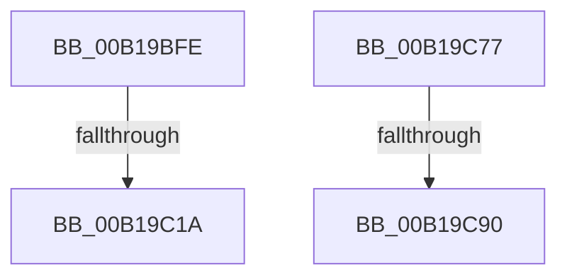

# sub_00B19BFE

- RVA: `0x00B19BFE`–`0x00B19CD4` (길이 `214` bytes)
- VA: `0x0000000140B19BFE`
- 실행 섹션: `PAGE`
- PDB 이름 있음: `아니요`; PDB Function 태그: `아니요`
- unwind 정보 RVA: `0x0007ECCC`
- 디코드: `46`개 명령, `214/214` bytes 표시
- 미해석 바이트: `0` (있으면 어셈블리에 `.byte`로 보존)

> 이 문서는 커널 이미지의 기계어와 PDB 기호를 분석해 생성했습니다. 4번과 5번은 함수 원형과 자료형을 바이너리 사용 방식에서 추정한 C 해석이며 원본 소스 복구 결과는 아닙니다.

## 1. Dependencies

- 직접 호출 지점: **4**; 고유 호출 대상: **2**
- 직접 호출자로 확인된 함수: **0**
- RIP 상대 이미지 참조: **0**

### Outgoing calls
- `0x00B19C0D` → [IopSymlinkAllocateAndAddECP](../8A/IopSymlinkAllocateAndAddECP_function_008A1E20.md) (function, `0x008A1E20`)
- `0x00B19C5F` → [IopSymlinkInitializeSymlinkInfo](../8A/IopSymlinkInitializeSymlinkInfo_function_008A1BF8.md) (function, `0x008A1BF8`)
- `0x00B19C83` → [IopSymlinkAllocateAndAddECP](../8A/IopSymlinkAllocateAndAddECP_function_008A1E20.md) (function, `0x008A1E20`)
- `0x00B19CC9` → [IopSymlinkInitializeSymlinkInfo](../8A/IopSymlinkInitializeSymlinkInfo_function_008A1BF8.md) (function, `0x008A1BF8`)

### Direct callers
- 이 함수 시작 RVA로 연결되는 직접 call은 확인되지 않았습니다. 간접 호출은 완전히 역산할 수 없습니다.

### Static image references
- 디코드된 RIP-relative 메모리 참조가 없습니다.

## 2. Other-region calls and transfers

- 다른 실행 섹션으로 향하는 call: **0**
- call이 아닌 외부 분기/꼬리 이동: **4**
  - `0x00B19C14` → [IopSymlinkCreateECP + 0xC9](../8A/IopSymlinkCreateECP_function_008A1F90.md) (`tail-transfer`)
  - `0x00B19C72` → [IopSymlinkCreateECP + 0xC3](../8A/IopSymlinkCreateECP_function_008A1F90.md) (`tail-transfer`)
  - `0x00B19C8A` → [IopSymlinkCreateECP + 0xC9](../8A/IopSymlinkCreateECP_function_008A1F90.md) (`tail-transfer`)
  - `0x00B19CCF` → [IopSymlinkCreateECP + 0xC3](../8A/IopSymlinkCreateECP_function_008A1F90.md) (`tail-transfer`)

## 3. Assembly (complete function range)

```asm
00B19BFE  44 0F B7 C6                     movzx r8d, si
00B19C02  48 8D 94 24 88 00 00 00         lea rdx, [rsp + 0x88]
00B19C0A  48 8B CD                        mov rcx, rbp
00B19C0D  E8 0E 82 D8 FF                  call 0x1408a1e20
00B19C12  85 C0                           test eax, eax
00B19C14  0F 88 3F 84 D8 FF               js 0x1408a2059
00B19C1A  0F B7 43 02                     movzx eax, word ptr [rbx + 2]
00B19C1E  8D 56 20                        lea edx, [rsi + 0x20]
00B19C21  48 8B B4 24 88 00 00 00         mov rsi, qword ptr [rsp + 0x88]
00B19C29  44 0F B7 0F                     movzx r9d, word ptr [rdi]
00B19C2D  48 8B CE                        mov rcx, rsi
00B19C30  4C 8B 47 08                     mov r8, qword ptr [rdi + 8]
00B19C34  4C 89 6C 24 48                  mov qword ptr [rsp + 0x48], r13
00B19C39  66 89 44 24 40                  mov word ptr [rsp + 0x40], ax
00B19C3E  0F B7 43 04                     movzx eax, word ptr [rbx + 4]
00B19C42  66 89 44 24 38                  mov word ptr [rsp + 0x38], ax
00B19C47  0F B7 43 10                     movzx eax, word ptr [rbx + 0x10]
00B19C4B  66 89 44 24 30                  mov word ptr [rsp + 0x30], ax
00B19C50  48 8B 43 18                     mov rax, qword ptr [rbx + 0x18]
00B19C54  48 89 44 24 28                  mov qword ptr [rsp + 0x28], rax
00B19C59  66 44 89 6C 24 20               mov word ptr [rsp + 0x20], r13w
00B19C5F  E8 94 7F D8 FF                  call 0x1408a1bf8
00B19C64  0F B7 4E 10                     movzx ecx, word ptr [rsi + 0x10]
00B19C68  66 2B 4B 10                     sub cx, word ptr [rbx + 0x10]
00B19C6C  66 03 0B                        add cx, word ptr [rbx]
00B19C6F  66 89 0E                        mov word ptr [rsi], cx
00B19C72  E9 DC 83 D8 FF                  jmp 0x1408a2053
00B19C77  44 0F B7 07                     movzx r8d, word ptr [rdi]
00B19C7B  48 8D 94 24 88 00 00 00         lea rdx, [rsp + 0x88]
00B19C83  E8 98 81 D8 FF                  call 0x1408a1e20
00B19C88  85 C0                           test eax, eax
00B19C8A  0F 88 C9 83 D8 FF               js 0x1408a2059
00B19C90  44 0F B7 0F                     movzx r9d, word ptr [rdi]
00B19C94  48 8B B4 24 88 00 00 00         mov rsi, qword ptr [rsp + 0x88]
00B19C9C  4C 8B 47 08                     mov r8, qword ptr [rdi + 8]
00B19CA0  48 8B CE                        mov rcx, rsi
00B19CA3  4C 89 6C 24 48                  mov qword ptr [rsp + 0x48], r13
00B19CA8  66 44 89 6C 24 40               mov word ptr [rsp + 0x40], r13w
00B19CAE  41 8D 51 20                     lea edx, [r9 + 0x20]
00B19CB2  66 44 89 64 24 38               mov word ptr [rsp + 0x38], r12w
00B19CB8  66 44 89 6C 24 30               mov word ptr [rsp + 0x30], r13w
00B19CBE  4C 89 6C 24 28                  mov qword ptr [rsp + 0x28], r13
00B19CC3  66 44 89 6C 24 20               mov word ptr [rsp + 0x20], r13w
00B19CC9  E8 2A 7F D8 FF                  call 0x1408a1bf8
00B19CCE  90                              nop
00B19CCF  E9 7F 83 D8 FF                  jmp 0x1408a2053
```

## 4. C-style interpretation (structured pseudocode)

```c
__int64 __fastcall sub_00B19BFE(__int64 a1, __int64 a2, __int64 a3, __int64 a4, __int64 a5, __int64 a6, __int64 a7, __int64 a8, __int64 a9, __int64 a10, __int64 a11, __int64 a12, __int64 a13, __int64 a14, __int64 a15, __int64 a16, __int64 a17)
{
    __int64 result;
    unsigned __int16 v_stack_p20;
    unsigned __int64 v_stack_p28;
    unsigned __int16 v_stack_p30;
    unsigned __int16 v_stack_p38;
    unsigned __int16 v_stack_p40;
    unsigned __int64 v_stack_p48;
    unsigned __int64 v_stack_p88;

    result = IopSymlinkAllocateAndAddECP(v_rbp, a17, (unsigned __int16)(v_rsi), a4);
    v_stack_p48 = v_r13;
    v_stack_p40 = (unsigned __int16)(*(unsigned __int16 *)(v_rbx + 2));
    v_stack_p38 = (unsigned __int16)(*(unsigned __int16 *)(v_rbx + 4));
    v_stack_p30 = (unsigned __int16)(*(unsigned __int16 *)(v_rbx + 16));
    v_stack_p28 = *(unsigned __int64 *)(v_rbx + 24);
    v_stack_p20 = (unsigned __int16)(v_r13);
    result = IopSymlinkInitializeSymlinkInfo(a17, v_rsi + 32, *(unsigned __int64 *)(v_rdi + 8), *(unsigned __int16 *)(v_rdi));
    a1 = (unsigned __int16)((*(unsigned __int16 *)(a17 + 16)) - (*(unsigned __int16 *)(v_rbx + 16)));
    a1 = (unsigned __int16)((a1) + (*(unsigned __int16 *)(v_rbx)));
    *(unsigned __int16 *)(a17) = (unsigned __int16)(a1);
}
```

## 5. (Beta) C Style

```c
int64_t sub_00B19BFE(int64_t Arg1, int64_t Arg2, int64_t Arg3, int64_t Arg4, uint64_t Arg5, uint64_t Arg6, uint64_t Arg7, uint64_t Arg8, uint64_t Arg9, uint64_t Arg10, uint64_t Arg11, uint64_t Arg12, uint64_t Arg13, uint64_t Arg14, uint64_t Arg15, uint64_t Arg16, void *Arg17)
{
    uint8_t *arg17 = (uint8_t *)Arg17;

    int64_t result;
    uint16_t v_stack_p20;
    uint64_t v_stack_p28;
    uint16_t v_stack_p30;
    uint16_t v_stack_p38;
    uint16_t v_stack_p40;
    uint64_t v_stack_p48;
    uint64_t v_stack_p88;

    result = IopSymlinkAllocateAndAddECP(local_rbp, Arg17, (uint16_t)(local_rsi), Arg4);
    v_stack_p48 = local_r13;
    v_stack_p40 = (uint16_t)(*(uint16_t *)(local_rbx + 0x2));
    v_stack_p38 = (uint16_t)(*(uint16_t *)(local_rbx + 0x4));
    v_stack_p30 = (uint16_t)(*(uint16_t *)(local_rbx + 0x10));
    v_stack_p28 = *(uint64_t *)(local_rbx + 0x18);
    v_stack_p20 = (uint16_t)(local_r13);
    result = IopSymlinkInitializeSymlinkInfo(Arg17, local_rsi + 32, *(uint64_t *)(local_rdi + 0x8), *(uint16_t *)(local_rdi));
    Arg1 = (uint16_t)((*(uint16_t *)(arg17 + 0x10)) - (*(uint16_t *)(local_rbx + 0x10)));
    Arg1 = (uint16_t)((Arg1) + (*(uint16_t *)(local_rbx)));
    *(uint16_t *)(arg17) = (uint16_t)(Arg1);
}
```

### 관측된 메모리 오프셋

구조체 형식이 확인되지 않은 접근은 인자 기준의 오프셋으로만 기록했습니다.

| 기준 인자 | 오프셋 표현 | 폭 (bit) | 접근 |
|---|---:|---:|---|
| `Arg17` | `+ 0x0` | `16` | `W` |
| `Arg17` | `+ 0x10` | `16` | `R` |

## 6. Execution-region graph

[열기: 2D/3D 그래프와 함수 탐색 컨트롤 패널](../../../control-panel.html?section=page&rva=0x00B19BFE&view=graph)

- 2D 그래프는 위에서 아래로 흐르고, 3D 그래프는 빈 공간을 드래그해 회전합니다. Shift+드래그는 이동, 휠은 확대·축소, 함수 노드 선택은 대상 보고서 이동입니다.

### Static fallback


