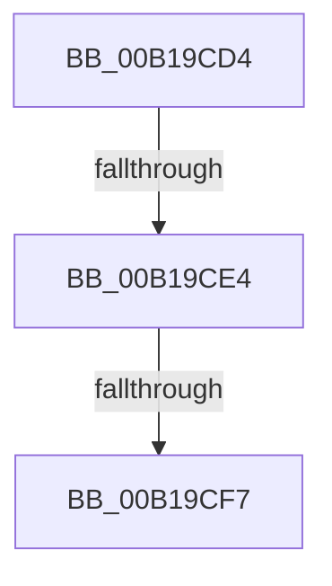

# sub_00B19CD4

- RVA: `0x00B19CD4`–`0x00B19CFC` (길이 `40` bytes)
- VA: `0x0000000140B19CD4`
- 실행 섹션: `PAGE`
- PDB 이름 있음: `아니요`; PDB Function 태그: `아니요`
- unwind 정보 RVA: `0x0007EDF0`
- 디코드: `8`개 명령, `40/40` bytes 표시
- 미해석 바이트: `0` (있으면 어셈블리에 `.byte`로 보존)

> 이 문서는 커널 이미지의 기계어와 PDB 기호를 분석해 생성했습니다. 4번과 5번은 함수 원형과 자료형을 바이너리 사용 방식에서 추정한 C 해석이며 원본 소스 복구 결과는 아닙니다.

## 1. Dependencies

- 직접 호출 지점: **1**; 고유 호출 대상: **1**
- 직접 호출자로 확인된 함수: **0**
- RIP 상대 이미지 참조: **0**

### Outgoing calls
- `0x00B19CEA` → [PsIsProcessInSilo](../../text/41/PsIsProcessInSilo_function_004185E0.md) (function, `0x004185E0`)

### Direct callers
- 이 함수 시작 RVA로 연결되는 직접 call은 확인되지 않았습니다. 간접 호출은 완전히 역산할 수 없습니다.

### Static image references
- 디코드된 RIP-relative 메모리 참조가 없습니다.

## 2. Other-region calls and transfers

- 다른 실행 섹션으로 향하는 call: **1**
  - `0x00B19CEA` → [PsIsProcessInSilo](../../text/41/PsIsProcessInSilo_function_004185E0.md) (`PAGE` → `.text`)
- call이 아닌 외부 분기/꼬리 이동: **3**
  - `0x00B19CDE` → [sub_008A2AAB + 0x12E](../8A/Unknown_function_008A2AAB.md) (`tail-transfer`)
  - `0x00B19CF1` → [sub_008A2AAB + 0x13D](../8A/Unknown_function_008A2AAB.md) (`tail-transfer`)
  - `0x00B19CF7` → [sub_008A2AAB + 0x12E](../8A/Unknown_function_008A2AAB.md) (`tail-transfer`)

## 3. Assembly (complete function range)

```asm
00B19CD4  F7 83 F4 01 00 00 00 00 00 04   test dword ptr [rbx + 0x1f4], 0x4000000
00B19CDE  0F 84 F5 8E D8 FF               je 0x1408a2bd9
00B19CE4  48 8B D7                        mov rdx, rdi
00B19CE7  48 8B CB                        mov rcx, rbx
00B19CEA  E8 F1 E8 8F FF                  call 0x1404185e0
00B19CEF  84 C0                           test al, al
00B19CF1  0F 85 F1 8E D8 FF               jne 0x1408a2be8
00B19CF7  E9 DD 8E D8 FF                  jmp 0x1408a2bd9
```

## 4. C-style interpretation (structured pseudocode)

```c
__int64 __fastcall sub_00B19CD4(void)
{
    __int64 result;

    result = PsIsProcessInSilo(v_rbx, v_rdi, a3, a4);
}
```

## 5. (Beta) C Style

```c
void sub_00B19CD4(void)
{
    int64_t result;

    result = PsIsProcessInSilo(local_rbx, local_rdi, a3, a4);
}
```

## 6. Execution-region graph

[열기: 2D/3D 그래프와 함수 탐색 컨트롤 패널](../../../control-panel.html?section=page&rva=0x00B19CD4&view=graph)

- 2D 그래프는 위에서 아래로 흐르고, 3D 그래프는 빈 공간을 드래그해 회전합니다. Shift+드래그는 이동, 휠은 확대·축소, 함수 노드 선택은 대상 보고서 이동입니다.

### Static fallback


