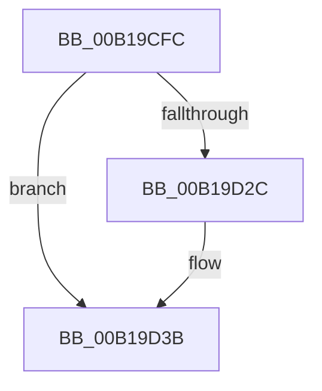

# sub_00B19CFC

- RVA: `0x00B19CFC`–`0x00B19D4F` (길이 `83` bytes)
- VA: `0x0000000140B19CFC`
- 실행 섹션: `PAGE`
- PDB 이름 있음: `아니요`; PDB Function 태그: `아니요`
- unwind 정보 RVA: `0x0007EE34`
- 디코드: `21`개 명령, `83/83` bytes 표시
- 미해석 바이트: `0` (있으면 어셈블리에 `.byte`로 보존)

> 이 문서는 커널 이미지의 기계어와 PDB 기호를 분석해 생성했습니다. 4번과 5번은 함수 원형과 자료형을 바이너리 사용 방식에서 추정한 C 해석이며 원본 소스 복구 결과는 아닙니다.

## 1. Dependencies

- 직접 호출 지점: **3**; 고유 호출 대상: **3**
- 직접 호출자로 확인된 함수: **0**
- RIP 상대 이미지 참조: **1**

### Outgoing calls
- `0x00B19D03` → [EtwTelemetryCoverageReport](../../text/46/EtwTelemetryCoverageReport_function_00460430.md) (function, `0x00460430`)
- `0x00B19D17` → [PspLockProcessExclusive](../../text/46/PspLockProcessExclusive_function_00460164.md) (function, `0x00460164`)
- `0x00B19D41` → [PspUnlockProcessExclusive](../../text/46/PspUnlockProcessExclusive_function_004601C0.md) (function, `0x004601C0`)

### Direct callers
- 이 함수 시작 RVA로 연결되는 직접 call은 확인되지 않았습니다. 간접 호출은 완전히 역산할 수 없습니다.

### Static image references
- `0x00B19CFC` → RVA `0x00E08690` (`.data`; read)

## 2. Other-region calls and transfers

- 다른 실행 섹션으로 향하는 call: **3**
  - `0x00B19D03` → [EtwTelemetryCoverageReport](../../text/46/EtwTelemetryCoverageReport_function_00460430.md) (`PAGE` → `.text`)
  - `0x00B19D17` → [PspLockProcessExclusive](../../text/46/PspLockProcessExclusive_function_00460164.md) (`PAGE` → `.text`)
  - `0x00B19D41` → [PspUnlockProcessExclusive](../../text/46/PspUnlockProcessExclusive_function_004601C0.md) (`PAGE` → `.text`)
- call이 아닌 외부 분기/꼬리 이동: **1**
  - `0x00B19D4A` → [DbgkForwardException + 0xCA](../8A/DbgkForwardException_function_008A2D60.md) (`tail-transfer`)

## 3. Assembly (complete function range)

```asm
00B19CFC  48 8D 0D 8D E9 2E 00            lea rcx, [rip + 0x2ee98d]
00B19D03  E8 28 67 94 FF                  call 0x140460430
00B19D08  65 48 8B 1C 25 88 01 00 00      mov rbx, qword ptr gs:[0x188]
00B19D11  48 8B CF                        mov rcx, rdi
00B19D14  48 8B D3                        mov rdx, rbx
00B19D17  E8 48 64 94 FF                  call 0x140460164
00B19D1C  0F B6 8F FB 05 00 00            movzx ecx, byte ptr [rdi + 0x5fb]
00B19D23  0F B6 C1                        movzx eax, cl
00B19D26  24 07                           and al, 7
00B19D28  3C 07                           cmp al, 7
00B19D2A  73 0F                           jae 0x140b19d3b
00B19D2C  8D 41 01                        lea eax, [rcx + 1]
00B19D2F  32 C1                           xor al, cl
00B19D31  24 07                           and al, 7
00B19D33  32 C1                           xor al, cl
00B19D35  88 87 FB 05 00 00               mov byte ptr [rdi + 0x5fb], al
00B19D3B  48 8B D3                        mov rdx, rbx
00B19D3E  48 8B CF                        mov rcx, rdi
00B19D41  E8 7A 64 94 FF                  call 0x1404601c0
00B19D46  8B 44 24 30                     mov eax, dword ptr [rsp + 0x30]
00B19D4A  E9 DB 90 D8 FF                  jmp 0x1408a2e2a
```

## 4. C-style interpretation (structured pseudocode)

```c
__int64 __fastcall sub_00B19CFC(__int64 a1, __int64 a2, __int64 a3, __int64 a4, __int64 a5, unsigned int a6)
{
    __int64 result;

    result = EtwTelemetryCoverageReport(v_rip + 3074445, a2, a3, a4);
    result = PspLockProcessExclusive(v_rdi, *(unsigned __int64 *)(gs_base + (0 + 392)), a3, a4);
    result = (unsigned __int8)(((unsigned __int8)(*(unsigned __int8 *)(v_rdi + 1531))) & (7));
    if (((unsigned __int8)(result)) < 7) {
        result = *(unsigned __int8 *)(v_rdi + 1531) + 1;
        result = (unsigned __int8)((result) ^ ((unsigned __int8)(*(unsigned __int8 *)(v_rdi + 1531))));
        result = (unsigned __int8)((result) & (7));
        result = (unsigned __int8)((result) ^ ((unsigned __int8)(*(unsigned __int8 *)(v_rdi + 1531))));
        *(unsigned __int8 *)(v_rdi + 1531) = (unsigned __int8)(result);
    }
    result = PspUnlockProcessExclusive(v_rdi, *(unsigned __int64 *)(gs_base + (0 + 392)), a3, a4);
}
```

## 5. (Beta) C Style

```c
int64_t sub_00B19CFC(int64_t Arg1, int64_t Arg2, int64_t Arg3, int64_t Arg4, uint64_t Arg5, uint32_t Arg6)
{
    int64_t result;

    result = EtwTelemetryCoverageReport(v_rip + 3074445, Arg2, Arg3, Arg4);
    result = PspLockProcessExclusive(local_rdi, *(uint64_t *)(gs_base + (0 + 0x188)), Arg3, Arg4);
    result = (uint8_t)(((uint8_t)(*(uint8_t *)(local_rdi + 0x5FB))) & (7));
    if (((uint8_t)(result)) < 7) {
        result = *(uint8_t *)(local_rdi + 0x5FB) + 1;
        result = (uint8_t)((result) ^ ((uint8_t)(*(uint8_t *)(local_rdi + 0x5FB))));
        result = (uint8_t)((result) & (7));
        result = (uint8_t)((result) ^ ((uint8_t)(*(uint8_t *)(local_rdi + 0x5FB))));
        *(uint8_t *)(local_rdi + 0x5FB) = (uint8_t)(result);
    }
    result = PspUnlockProcessExclusive(local_rdi, *(uint64_t *)(gs_base + (0 + 0x188)), Arg3, Arg4);
}
```

## 6. Execution-region graph

[열기: 2D/3D 그래프와 함수 탐색 컨트롤 패널](../../../control-panel.html?section=page&rva=0x00B19CFC&view=graph)

- 2D 그래프는 위에서 아래로 흐르고, 3D 그래프는 빈 공간을 드래그해 회전합니다. Shift+드래그는 이동, 휠은 확대·축소, 함수 노드 선택은 대상 보고서 이동입니다.

### Static fallback


