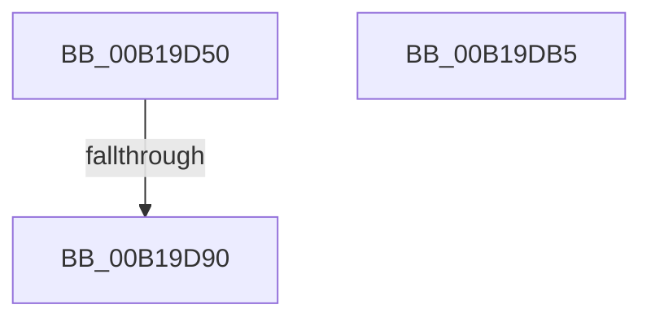

# sub_00B19D50

- RVA: `0x00B19D50`–`0x00B19DBD` (길이 `109` bytes)
- VA: `0x0000000140B19D50`
- 실행 섹션: `PAGE`
- PDB 이름 있음: `아니요`; PDB Function 태그: `아니요`
- unwind 정보 RVA: `0x0007F188`
- 디코드: `25`개 명령, `109/109` bytes 표시
- 미해석 바이트: `0` (있으면 어셈블리에 `.byte`로 보존)

> 이 문서는 커널 이미지의 기계어와 PDB 기호를 분석해 생성했습니다. 4번과 5번은 함수 원형과 자료형을 바이너리 사용 방식에서 추정한 C 해석이며 원본 소스 복구 결과는 아닙니다.

## 1. Dependencies

- 직접 호출 지점: **1**; 고유 호출 대상: **1**
- 직접 호출자로 확인된 함수: **0**
- RIP 상대 이미지 참조: **2**

### Outgoing calls
- `0x00B19DA7` → [memcpy](../../text/6C/memcpy_function_006C6840.md) (function, `0x006C6840`)

### Direct callers
- 이 함수 시작 RVA로 연결되는 직접 call은 확인되지 않았습니다. 간접 호출은 완전히 역산할 수 없습니다.

### Static image references
- `0x00B19D56` → RVA `0x00AFC990` (` ?? ::NNGAKEGL::`string'`; read)
- `0x00B19D5D` → RVA `0x00AFCBC0` (` ?? ::NNGAKEGL::`string'`; read)

## 2. Other-region calls and transfers

- 다른 실행 섹션으로 향하는 call: **1**
  - `0x00B19DA7` → [memcpy](../../text/6C/memcpy_function_006C6840.md) (`PAGE` → `.text`)
- call이 아닌 외부 분기/꼬리 이동: **3**
  - `0x00B19D8A` → [IopQueryNameInternal + 0x5FB](../8A/IopQueryNameInternal_function_008A6770.md) (`tail-transfer`)
  - `0x00B19DB0` → [IopQueryNameInternal + 0x4C1](../8A/IopQueryNameInternal_function_008A6770.md) (`tail-transfer`)
  - `0x00B19DB8` → [IopQueryNameInternal + 0x458](../8A/IopQueryNameInternal_function_008A6770.md) (`tail-transfer`)

## 3. Assembly (complete function range)

```asm
00B19D50  8B C8                           mov ecx, eax
00B19D52  0F BA E0 13                     bt eax, 0x13
00B19D56  48 8D 05 33 2C FE FF            lea rax, [rip - 0x1d3cd]
00B19D5D  48 8D 15 5C 2E FE FF            lea rdx, [rip - 0x1d1a4]
00B19D64  48 0F 43 D0                     cmovae rdx, rax
00B19D68  B8 14 00 00 00                  mov eax, 0x14
00B19D6D  41 B8 04 00 00 00               mov r8d, 4
00B19D73  0F BA E1 13                     bt ecx, 0x13
00B19D77  66 41 0F 43 C0                  cmovae ax, r8w
00B19D7C  44 0F B7 C0                     movzx r8d, ax
00B19D80  41 8D 40 10                     lea eax, [r8 + 0x10]
00B19D84  89 44 24 40                     mov dword ptr [rsp + 0x40], eax
00B19D88  3B C7                           cmp eax, edi
00B19D8A  0F 87 DB CF D8 FF               ja 0x1408a6d6b
00B19D90  41 8B D9                        mov ebx, r9d
00B19D93  41 8D 40 FE                     lea eax, [r8 - 2]
00B19D97  66 89 06                        mov word ptr [rsi], ax
00B19D9A  66 44 89 46 02                  mov word ptr [rsi + 2], r8w
00B19D9F  48 8D 4E 10                     lea rcx, [rsi + 0x10]
00B19DA3  48 89 4E 08                     mov qword ptr [rsi + 8], rcx
00B19DA7  E8 94 CA BA FF                  call 0x1406c6840
00B19DAC  8B 54 24 40                     mov edx, dword ptr [rsp + 0x40]
00B19DB0  E9 7C CE D8 FF                  jmp 0x1408a6c31
00B19DB5  8D 47 F0                        lea eax, [rdi - 0x10]
00B19DB8  E9 0B CE D8 FF                  jmp 0x1408a6bc8
```

## 4. C-style interpretation (structured pseudocode)

```c
__int64 __fastcall sub_00B19D50(__int64 a1, __int64 a2, __int64 a3, int a4, __int64 a5, __int64 a6, __int64 a7, unsigned int a8)
{
    __int64 result;
    unsigned int v_stack_p40;

    a2 = v_rip - 119204;
    if (condition_is_above_or_equal) { a2 = v_rip - 119757; }
    result = 20;
    if (condition_is_above_or_equal) { result = 4; }
    v_stack_p40 = (unsigned int)((unsigned __int16)(result) + 16);
    *(unsigned __int16 *)(v_rsi) = (unsigned __int16)((unsigned __int16)(result) - 2);
    *(unsigned __int16 *)(v_rsi + 2) = (unsigned __int16)((unsigned __int16)(result));
    *(unsigned __int64 *)(v_rsi + 8) = v_rsi + 16;
    result = memcpy(v_rsi + 16, a2, (unsigned __int16)(result), a4);
}
```

## 5. (Beta) C Style

```c
int64_t sub_00B19D50(int64_t Arg1, int64_t Arg2, int64_t Arg3, int32_t Arg4, uint64_t Arg5, uint64_t Arg6, uint64_t Arg7, uint32_t Arg8)
{
    int64_t result;
    uint32_t v_stack_p40;

    Arg2 = v_rip - 119204;
    if (condition_is_above_or_equal) { Arg2 = v_rip - 119757; }
    result = 20;
    if (condition_is_above_or_equal) { result = 4; }
    v_stack_p40 = (uint32_t)((uint16_t)(result) + 16);
    *(uint16_t *)(local_rsi) = (uint16_t)((uint16_t)(result) - 2);
    *(uint16_t *)(local_rsi + 0x2) = (uint16_t)((uint16_t)(result));
    *(uint64_t *)(local_rsi + 0x8) = local_rsi + 16;
    result = memcpy(local_rsi + 16, Arg2, (uint16_t)(result), Arg4);
}
```

## 6. Execution-region graph

[열기: 2D/3D 그래프와 함수 탐색 컨트롤 패널](../../../control-panel.html?section=page&rva=0x00B19D50&view=graph)

- 2D 그래프는 위에서 아래로 흐르고, 3D 그래프는 빈 공간을 드래그해 회전합니다. Shift+드래그는 이동, 휠은 확대·축소, 함수 노드 선택은 대상 보고서 이동입니다.

### Static fallback


