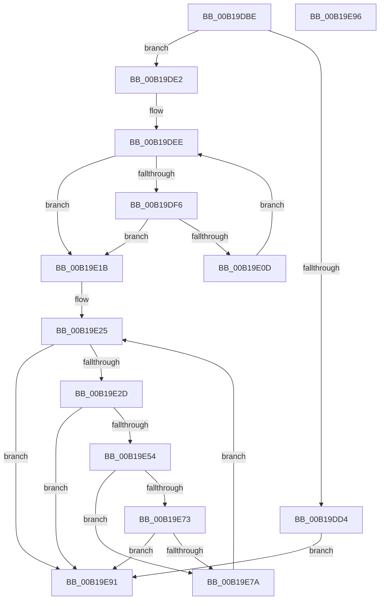

# sub_00B19DBE

- RVA: `0x00B19DBE`–`0x00B19EB1` (길이 `243` bytes)
- VA: `0x0000000140B19DBE`
- 실행 섹션: `PAGE`
- PDB 이름 있음: `아니요`; PDB Function 태그: `아니요`
- unwind 정보 RVA: `0x0007F240`
- 디코드: `57`개 명령, `243/243` bytes 표시
- 미해석 바이트: `0` (있으면 어셈블리에 `.byte`로 보존)

> 이 문서는 커널 이미지의 기계어와 PDB 기호를 분석해 생성했습니다. 4번과 5번은 함수 원형과 자료형을 바이너리 사용 방식에서 추정한 C 해석이며 원본 소스 복구 결과는 아닙니다.

## 1. Dependencies

- 직접 호출 지점: **1**; 고유 호출 대상: **1**
- 직접 호출자로 확인된 함수: **0**
- RIP 상대 이미지 참조: **1**

### Outgoing calls
- `0x00B19E5F` → [ObQueryTypeInfo](../8A/ObQueryTypeInfo_function_008A8CAC.md) (function, `0x008A8CAC`)

### Direct callers
- 이 함수 시작 RVA로 연결되는 직접 call은 확인되지 않았습니다. 간접 호출은 완전히 역산할 수 없습니다.

### Static image references
- `0x00B19E88` → RVA `0x00000000` (`image boundary/outside`; read)

## 2. Other-region calls and transfers

- 다른 실행 섹션으로 향하는 call: **0**
- call이 아닌 외부 분기/꼬리 이동: **2**
  - `0x00B19E91` → [NtQueryObject + 0x242](../8A/NtQueryObject_function_008A6DB0.md) (`tail-transfer`)
  - `0x00B19EAC` → [NtQueryObject + 0x242](../8A/NtQueryObject_function_008A6DB0.md) (`tail-transfer`)

## 3. Assembly (complete function range)

```asm
00B19DBE  C7 44 24 54 08 00 00 00         mov dword ptr [rsp + 0x54], 8
00B19DC6  4C 89 B4 24 20 01 00 00         mov qword ptr [rsp + 0x120], r14
00B19DCE  41 83 FB 04                     cmp r11d, 4
00B19DD2  73 0E                           jae 0x140b19de2
00B19DD4  BF 04 00 00 C0                  mov edi, 0xc0000004
00B19DD9  89 7C 24 50                     mov dword ptr [rsp + 0x50], edi
00B19DDD  E9 AF 00 00 00                  jmp 0x140b19e91
00B19DE2  41 89 1E                        mov dword ptr [r14], ebx
00B19DE5  8B CB                           mov ecx, ebx
00B19DE7  89 5C 24 68                     mov dword ptr [rsp + 0x68], ebx
00B19DEB  44 8B C3                        mov r8d, ebx
00B19DEE  81 F9 00 01 00 00               cmp ecx, 0x100
00B19DF4  73 25                           jae 0x140b19e1b
00B19DF6  8B C1                           mov eax, ecx
00B19DF8  48 8B 84 C2 80 F6 F0 00         mov rax, qword ptr [rdx + rax*8 + 0xf0f680]
00B19E00  48 89 84 24 98 00 00 00         mov qword ptr [rsp + 0x98], rax
00B19E08  48 85 C0                        test rax, rax
00B19E0B  74 0E                           je 0x140b19e1b
00B19E0D  41 FF C0                        inc r8d
00B19E10  45 89 06                        mov dword ptr [r14], r8d
00B19E13  FF C1                           inc ecx
00B19E15  89 4C 24 68                     mov dword ptr [rsp + 0x68], ecx
00B19E19  EB D3                           jmp 0x140b19dee
00B19E1B  89 5C 24 68                     mov dword ptr [rsp + 0x68], ebx
00B19E1F  41 BF 00 00 00 80               mov r15d, 0x80000000
00B19E25  81 FB 00 01 00 00               cmp ebx, 0x100
00B19E2B  73 64                           jae 0x140b19e91
00B19E2D  44 8B 54 24 54                  mov r10d, dword ptr [rsp + 0x54]
00B19E32  4D 03 D6                        add r10, r14
00B19E35  4C 89 94 24 28 01 00 00         mov qword ptr [rsp + 0x128], r10
00B19E3D  8B C3                           mov eax, ebx
00B19E3F  48 8B 8C C2 80 F6 F0 00         mov rcx, qword ptr [rdx + rax*8 + 0xf0f680]
00B19E47  48 89 8C 24 98 00 00 00         mov qword ptr [rsp + 0x98], rcx
00B19E4F  48 85 C9                        test rcx, rcx
00B19E52  74 3D                           je 0x140b19e91
00B19E54  4C 8D 4C 24 54                  lea r9, [rsp + 0x54]
00B19E59  45 8B C3                        mov r8d, r11d
00B19E5C  49 8B D2                        mov rdx, r10
00B19E5F  E8 48 EE D8 FF                  call 0x1408a8cac
00B19E64  8B F8                           mov edi, eax
00B19E66  89 44 24 50                     mov dword ptr [rsp + 0x50], eax
00B19E6A  42 8D 0C 38                     lea ecx, [rax + r15]
00B19E6E  41 85 CF                        test r15d, ecx
00B19E71  75 07                           jne 0x140b19e7a
00B19E73  3D 04 00 00 C0                  cmp eax, 0xc0000004
00B19E78  75 17                           jne 0x140b19e91
00B19E7A  FF C3                           inc ebx
00B19E7C  89 5C 24 68                     mov dword ptr [rsp + 0x68], ebx
00B19E80  44 8B 9C 24 78 01 00 00         mov r11d, dword ptr [rsp + 0x178]
00B19E88  48 8D 15 71 61 4E FF            lea rdx, [rip - 0xb19e8f]
00B19E8F  EB 94                           jmp 0x140b19e25
00B19E91  E9 5C D1 D8 FF                  jmp 0x1408a6ff2
00B19E96  8B F8                           mov edi, eax
00B19E98  89 44 24 50                     mov dword ptr [rsp + 0x50], eax
00B19E9C  4C 8B AC 24 80 01 00 00         mov r13, qword ptr [rsp + 0x180]
00B19EA4  48 8B B4 24 88 00 00 00         mov rsi, qword ptr [rsp + 0x88]
00B19EAC  E9 41 D1 D8 FF                  jmp 0x1408a6ff2
```

## 4. C-style interpretation (structured pseudocode)

```c
__int64 __fastcall sub_00B19DBE(__int64 a1, __int64 a2, __int64 a3, __int64 a4, __int64 a5, __int64 a6, __int64 a7, __int64 a8, __int64 a9, __int64 a10, __int64 a11, __int64 a12, __int64 a13, __int64 a14, __int64 a15, __int64 a16, __int64 a17, __int64 a18, __int64 a19, __int64 a20, __int64 a21, __int64 a22, __int64 a23, __int64 a24, __int64 a25, __int64 a26, __int64 a27, __int64 a28, __int64 a29, __int64 a30, __int64 a31, __int64 a32, __int64 a33, __int64 a34, __int64 a35, __int64 a36, __int64 a37, __int64 a38, __int64 a39, __int64 a40, __int64 a41, __int64 a42, __int64 a43, __int64 a44, __int64 a45, __int64 a46, unsigned int a47)
{
    __int64 result;
    __int64 v_r10;
    __int64 v_rbx;
    unsigned __int64 v_stack_p120;
    unsigned __int64 v_stack_p128;
    unsigned __int64 v_stack_p180;
    unsigned int v_stack_p50;
    unsigned int v_stack_p54;
    unsigned int v_stack_p68;
    unsigned __int64 v_stack_p88;
    unsigned __int64 v_stack_p98;

    v_stack_p54 = 8;
    v_stack_p120 = v_r14;
    if (((unsigned int)(v_r11)) >= 4) goto loc_00B19DE2;
    v_stack_p50 = (unsigned int)((unsigned int)(0xC0000004ULL));
    goto loc_00B19E91;
loc_00B19DE2:
    *(unsigned int *)(v_r14) = (unsigned int)(v_rbx);
    v_stack_p68 = (unsigned int)(v_rbx);
loc_00B19DEE:
    if (((unsigned int)((unsigned int)((unsigned int)(v_rbx)))) >= 256) goto loc_00B19E1B;
    v_stack_p98 = *(unsigned __int64 *)(a2 + (unsigned int)((unsigned int)((unsigned int)((unsigned int)(v_rbx)))) * 8 + 15791744);
    if (*(unsigned __int64 *)(a2 + (unsigned int)((unsigned int)((unsigned int)((unsigned int)(v_rbx)))) * 8 + 15791744) == 0) goto loc_00B19E1B;
    a3 = (unsigned int)(((unsigned int)((unsigned int)(v_rbx))) + 1);
    *(unsigned int *)(v_r14) = (unsigned int)(a3);
    a1 = (unsigned int)(((unsigned int)((unsigned int)(v_rbx))) + 1);
    v_stack_p68 = (unsigned int)(a1);
    goto loc_00B19DEE;
loc_00B19E1B:
    v_stack_p68 = (unsigned int)(v_rbx);
loc_00B19E25:
    if (((unsigned int)(v_rbx)) >= 256) goto loc_00B19E91;
    v_r10 = ((unsigned int)(v_stack_p54)) + (v_r14);
    v_stack_p128 = v_r10;
    v_stack_p98 = *(unsigned __int64 *)(a2 + (unsigned int)((unsigned int)(v_rbx)) * 8 + 15791744);
    if (*(unsigned __int64 *)(a2 + (unsigned int)((unsigned int)(v_rbx)) * 8 + 15791744) == 0) goto loc_00B19E91;
    result = ObQueryTypeInfo(*(unsigned __int64 *)(a2 + (unsigned int)((unsigned int)(v_rbx)) * 8 + 15791744), v_r10, (unsigned int)((unsigned int)(v_r11)), v_stack_p54);
    v_stack_p50 = (unsigned int)(result);
    if ((((unsigned int)((unsigned int)(0x80000000ULL))) & ((unsigned int)(result + (unsigned int)(0x80000000ULL) * 1))) != 0) goto loc_00B19E7A;
    if (((unsigned int)(result)) != 0xC0000004ULL) goto loc_00B19E91;
loc_00B19E7A:
    v_rbx = (unsigned int)((v_rbx) + 1);
    v_stack_p68 = (unsigned int)(v_rbx);
    goto loc_00B19E25;
loc_00B19E91:
}
```

## 5. (Beta) C Style

```c
int64_t sub_00B19DBE(int64_t Arg1, void *Arg2, int64_t Arg3, int64_t Arg4, uint64_t Arg5, uint64_t Arg6, uint64_t Arg7, uint64_t Arg8, uint64_t Arg9, uint64_t Arg10, uint64_t Arg11, uint64_t Arg12, uint64_t Arg13, uint64_t Arg14, uint64_t Arg15, uint64_t Arg16, uint64_t Arg17, uint64_t Arg18, uint64_t Arg19, uint64_t Arg20, uint64_t Arg21, uint64_t Arg22, uint64_t Arg23, uint64_t Arg24, uint64_t Arg25, uint64_t Arg26, uint64_t Arg27, uint64_t Arg28, uint64_t Arg29, uint64_t Arg30, uint64_t Arg31, uint64_t Arg32, uint64_t Arg33, uint64_t Arg34, uint64_t Arg35, uint64_t Arg36, uint64_t Arg37, uint64_t Arg38, uint64_t Arg39, uint64_t Arg40, uint64_t Arg41, uint64_t Arg42, uint64_t Arg43, uint64_t Arg44, uint64_t Arg45, uint64_t Arg46, uint32_t Arg47)
{
    uint8_t *arg2 = (uint8_t *)Arg2;

    int64_t result;
    int64_t local_r10;
    int64_t local_rbx;
    uint64_t v_stack_p120;
    uint64_t v_stack_p128;
    uint64_t v_stack_p180;
    uint32_t v_stack_p50;
    uint32_t v_stack_p54;
    uint32_t v_stack_p68;
    uint64_t v_stack_p88;
    uint64_t v_stack_p98;

    v_stack_p54 = 8;
    v_stack_p120 = local_r14;
    if (((uint32_t)(local_r11)) >= 4) goto loc_00B19DE2;
    v_stack_p50 = (uint32_t)((uint32_t)(0xC0000004ULL));
    goto loc_00B19E91;
loc_00B19DE2:
    *(uint32_t *)(local_r14) = (uint32_t)(local_rbx);
    v_stack_p68 = (uint32_t)(local_rbx);
loc_00B19DEE:
    if (((uint32_t)((uint32_t)((uint32_t)(local_rbx)))) >= 256) goto loc_00B19E1B;
    v_stack_p98 = *(uint64_t *)(arg2 + (uint32_t)((uint32_t)((uint32_t)((uint32_t)(local_rbx)))) * 8 + 0xF0F680);
    if (*(uint64_t *)(arg2 + (uint32_t)((uint32_t)((uint32_t)((uint32_t)(local_rbx)))) * 8 + 0xF0F680) == 0) goto loc_00B19E1B;
    Arg3 = (uint32_t)(((uint32_t)((uint32_t)(local_rbx))) + 1);
    *(uint32_t *)(local_r14) = (uint32_t)(Arg3);
    Arg1 = (uint32_t)(((uint32_t)((uint32_t)(local_rbx))) + 1);
    v_stack_p68 = (uint32_t)(Arg1);
    goto loc_00B19DEE;
loc_00B19E1B:
    v_stack_p68 = (uint32_t)(local_rbx);
loc_00B19E25:
    if (((uint32_t)(local_rbx)) >= 256) goto loc_00B19E91;
    local_r10 = ((uint32_t)(v_stack_p54)) + (local_r14);
    v_stack_p128 = local_r10;
    v_stack_p98 = *(uint64_t *)(arg2 + (uint32_t)((uint32_t)(local_rbx)) * 8 + 0xF0F680);
    if (*(uint64_t *)(arg2 + (uint32_t)((uint32_t)(local_rbx)) * 8 + 0xF0F680) == 0) goto loc_00B19E91;
    result = ObQueryTypeInfo(*(uint64_t *)(arg2 + (uint32_t)((uint32_t)(local_rbx)) * 8 + 0xF0F680), local_r10, (uint32_t)((uint32_t)(local_r11)), v_stack_p54);
    v_stack_p50 = (uint32_t)(result);
    if ((((uint32_t)((uint32_t)(0x80000000ULL))) & ((uint32_t)(result + (uint32_t)(0x80000000ULL) * 1))) != 0) goto loc_00B19E7A;
    if (((uint32_t)(result)) != 0xC0000004ULL) goto loc_00B19E91;
loc_00B19E7A:
    local_rbx = (uint32_t)((local_rbx) + 1);
    v_stack_p68 = (uint32_t)(local_rbx);
    goto loc_00B19E25;
loc_00B19E91:
}
```

### 관측된 메모리 오프셋

구조체 형식이 확인되지 않은 접근은 인자 기준의 오프셋으로만 기록했습니다.

| 기준 인자 | 오프셋 표현 | 폭 (bit) | 접근 |
|---|---:|---:|---|
| `Arg2` | `+ 0xF0F680 + rax*8` | `64` | `R` |

## 6. Execution-region graph

[열기: 2D/3D 그래프와 함수 탐색 컨트롤 패널](../../../control-panel.html?section=page&rva=0x00B19DBE&view=graph)

- 2D 그래프는 위에서 아래로 흐르고, 3D 그래프는 빈 공간을 드래그해 회전합니다. Shift+드래그는 이동, 휠은 확대·축소, 함수 노드 선택은 대상 보고서 이동입니다.

### Static fallback


