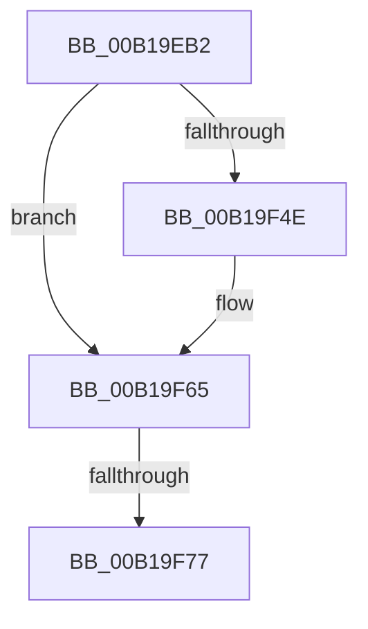

# sub_00B19EB2

- RVA: `0x00B19EB2`–`0x00B19F84` (길이 `210` bytes)
- VA: `0x0000000140B19EB2`
- 실행 섹션: `PAGE`
- PDB 이름 있음: `아니요`; PDB Function 태그: `아니요`
- unwind 정보 RVA: `0x0007F5B0`
- 디코드: `48`개 명령, `210/210` bytes 표시
- 미해석 바이트: `0` (있으면 어셈블리에 `.byte`로 보존)

> 이 문서는 커널 이미지의 기계어와 PDB 기호를 분석해 생성했습니다. 4번과 5번은 함수 원형과 자료형을 바이너리 사용 방식에서 추정한 C 해석이며 원본 소스 복구 결과는 아닙니다.

## 1. Dependencies

- 직접 호출 지점: **4**; 고유 호출 대상: **4**
- 직접 호출자로 확인된 함수: **0**
- RIP 상대 이미지 참조: **0**

### Outgoing calls
- `0x00B19EDC` → [memcpy](../../text/6C/memcpy_function_006C6840.md) (function, `0x006C6840`)
- `0x00B19EF6` → [NtResetEvent](../8A/NtResetEvent_function_008AA2D0.md) (function, `0x008AA2D0`)
- `0x00B19F3F` → [IopXxxControlFile](../8E/IopXxxControlFile_function_008E9AD0.md) (function, `0x008E9AD0`)
- `0x00B19F5B` → [NtWaitForSingleObject](../86/NtWaitForSingleObject_function_00868BD0.md) (function, `0x00868BD0`)

### Direct callers
- 이 함수 시작 RVA로 연결되는 직접 call은 확인되지 않았습니다. 간접 호출은 완전히 역산할 수 없습니다.

### Static image references
- 디코드된 RIP-relative 메모리 참조가 없습니다.

## 2. Other-region calls and transfers

- 다른 실행 섹션으로 향하는 call: **1**
  - `0x00B19EDC` → [memcpy](../../text/6C/memcpy_function_006C6840.md) (`PAGE` → `.text`)
- call이 아닌 외부 분기/꼬리 이동: **2**
  - `0x00B19F71` → [PfSnPrefetchFileMetadata + 0x107](../8A/PfSnPrefetchFileMetadata_function_008AA178.md) (`tail-transfer`)
  - `0x00B19F7F` → [PfSnPrefetchFileMetadata + 0x13C](../8A/PfSnPrefetchFileMetadata_function_008AA178.md) (`tail-transfer`)

## 3. Assembly (complete function range)

```asm
00B19EB2  44 8B EA                        mov r13d, edx
00B19EB5  41 8D 0C 2E                     lea ecx, [r14 + rbp]
00B19EB9  48 8D 49 02                     lea rcx, [rcx + 2]
00B19EBD  8B C7                           mov eax, edi
00B19EBF  41 2B C6                        sub eax, r14d
00B19EC2  3B C2                           cmp eax, edx
00B19EC4  48 8D 14 CE                     lea rdx, [rsi + rcx*8]
00B19EC8  49 8D 4F 10                     lea rcx, [r15 + 0x10]
00B19ECC  44 0F 42 E8                     cmovb r13d, eax
00B19ED0  45 89 6F 04                     mov dword ptr [r15 + 4], r13d
00B19ED4  46 8D 04 ED 00 00 00 00         lea r8d, [r13*8]
00B19EDC  E8 5F C9 BA FF                  call 0x1406c6840
00B19EE1  41 8B 47 04                     mov eax, dword ptr [r15 + 4]
00B19EE5  33 D2                           xor edx, edx
00B19EE7  48 8B 8C 24 C8 00 00 00         mov rcx, qword ptr [rsp + 0xc8]
00B19EEF  8D 1C C5 10 00 00 00            lea ebx, [rax*8 + 0x10]
00B19EF6  E8 D5 03 D9 FF                  call 0x1408aa2d0
00B19EFB  48 8B 94 24 C8 00 00 00         mov rdx, qword ptr [rsp + 0xc8]
00B19F03  33 C0                           xor eax, eax
00B19F05  48 8B 8C 24 A8 00 00 00         mov rcx, qword ptr [rsp + 0xa8]
00B19F0D  45 33 C9                        xor r9d, r9d
00B19F10  89 44 24 58                     mov dword ptr [rsp + 0x58], eax
00B19F14  45 33 C0                        xor r8d, r8d
00B19F17  88 44 24 50                     mov byte ptr [rsp + 0x50], al
00B19F1B  89 44 24 48                     mov dword ptr [rsp + 0x48], eax
00B19F1F  48 89 44 24 40                  mov qword ptr [rsp + 0x40], rax
00B19F24  48 8D 44 24 60                  lea rax, [rsp + 0x60]
00B19F29  89 5C 24 38                     mov dword ptr [rsp + 0x38], ebx
00B19F2D  4C 89 7C 24 30                  mov qword ptr [rsp + 0x30], r15
00B19F32  C7 44 24 28 20 01 09 00         mov dword ptr [rsp + 0x28], 0x90120
00B19F3A  48 89 44 24 20                  mov qword ptr [rsp + 0x20], rax
00B19F3F  E8 8C FB DC FF                  call 0x1408e9ad0
00B19F44  44 8B D0                        mov r10d, eax
00B19F47  3D 03 01 00 00                  cmp eax, 0x103
00B19F4C  75 17                           jne 0x140b19f65
00B19F4E  48 8B 8C 24 C8 00 00 00         mov rcx, qword ptr [rsp + 0xc8]
00B19F56  45 33 C0                        xor r8d, r8d
00B19F59  33 D2                           xor edx, edx
00B19F5B  E8 70 EC D4 FF                  call 0x140868bd0
00B19F60  44 8B 54 24 60                  mov r10d, dword ptr [rsp + 0x60]
00B19F65  B9 00 00 00 C0                  mov ecx, 0xc0000000
00B19F6A  41 8B C2                        mov eax, r10d
00B19F6D  23 C1                           and eax, ecx
00B19F6F  3B C1                           cmp eax, ecx
00B19F71  0F 84 08 03 D9 FF               je 0x1408aa27f
00B19F77  45 03 F5                        add r14d, r13d
00B19F7A  BA 00 03 00 00                  mov edx, 0x300
00B19F7F  E9 30 03 D9 FF                  jmp 0x1408aa2b4
```

## 4. C-style interpretation (structured pseudocode)

```c
__int64 __fastcall sub_00B19EB2(__int64 a1, int a2, __int64 a3, int a4, __int64 a5, __int64 a6, __int64 a7, __int64 a8, __int64 a9, __int64 a10, __int64 a11, unsigned int a12, __int64 a13, __int64 a14, __int64 a15, __int64 a16, __int64 a17, __int64 a18, __int64 a19, __int64 a20, __int64 a21, __int64 a22, __int64 a23, __int64 a24, __int64 a25)
{
    __int64 result;
    __int64 v_r10;
    __int64 v_r13;
    __int64 v_r14;
    unsigned __int64 v_stack_p20;
    unsigned int v_stack_p28;
    unsigned __int64 v_stack_p30;
    unsigned int v_stack_p38;
    unsigned __int64 v_stack_p40;
    unsigned int v_stack_p48;
    unsigned __int8 v_stack_p50;
    unsigned int v_stack_p58;

    result = (unsigned int)(((unsigned int)((unsigned int)(v_rdi))) - ((unsigned int)(v_r14)));
    v_r13 = (unsigned int)(a2);
    if (((unsigned int)(result)) < a2) { v_r13 = (unsigned int)(result); }
    *(unsigned int *)(v_r15 + 4) = (unsigned int)(v_r13);
    result = memcpy(v_r15 + 16, v_rsi + v_r14 + v_rbp * 1 + 2 * 8, v_r13 * 8, a4);
    a2 = 0;
    result = NtResetEvent(a25, a2, v_r13 * 8, a4);
    result = 0;
    a4 = 0;
    v_stack_p58 = 0;
    a3 = 0;
    v_stack_p50 = 0;
    v_stack_p48 = 0;
    v_stack_p40 = 0;
    v_stack_p38 = (unsigned int)((unsigned int)(*(unsigned int *)(v_r15 + 4)) * 8 + 16);
    v_stack_p30 = v_r15;
    v_stack_p28 = 0x90120ULL;
    v_stack_p20 = a12;
    result = IopXxxControlFile(a21, a25, a3, a4);
    v_r10 = (unsigned int)((unsigned int)(result));
    if (((unsigned int)(result)) == 259) {
        a1 = a25;
        a3 = 0;
        a2 = 0;
        result = NtWaitForSingleObject(a1, a2, a3, a4);
        v_r10 = a12;
    }
    result = (unsigned int)(((unsigned int)((unsigned int)(v_r10))) & ((unsigned int)((unsigned int)(0xC0000000ULL))));
    v_r14 = (unsigned int)((v_r14) + ((unsigned int)(v_r13)));
}
```

## 5. (Beta) C Style

```c
int64_t sub_00B19EB2(int64_t Arg1, int32_t Arg2, int64_t Arg3, int32_t Arg4, uint64_t Arg5, uint64_t Arg6, uint64_t Arg7, uint64_t Arg8, uint64_t Arg9, uint64_t Arg10, uint64_t Arg11, uint32_t Arg12, uint64_t Arg13, uint64_t Arg14, uint64_t Arg15, uint64_t Arg16, uint64_t Arg17, uint64_t Arg18, uint64_t Arg19, uint64_t Arg20, int64_t Arg21, uint64_t Arg22, uint64_t Arg23, uint64_t Arg24, int64_t Arg25)
{
    int64_t result;
    int64_t local_r10;
    int64_t local_r13;
    int64_t local_r14;
    uint64_t v_stack_p20;
    uint32_t v_stack_p28;
    uint64_t v_stack_p30;
    uint32_t v_stack_p38;
    uint64_t v_stack_p40;
    uint32_t v_stack_p48;
    uint8_t v_stack_p50;
    uint32_t v_stack_p58;

    result = (uint32_t)(((uint32_t)((uint32_t)(local_rdi))) - ((uint32_t)(local_r14)));
    local_r13 = (uint32_t)(Arg2);
    if (((uint32_t)(result)) < Arg2) { local_r13 = (uint32_t)(result); }
    *(uint32_t *)(local_r15 + 0x4) = (uint32_t)(local_r13);
    result = memcpy(local_r15 + 16, local_rsi + local_r14 + local_rbp * 1 + 2 * 8, local_r13 * 8, Arg4);
    Arg2 = 0;
    result = NtResetEvent(Arg25, Arg2, local_r13 * 8, Arg4);
    result = 0;
    Arg4 = 0;
    v_stack_p58 = 0;
    Arg3 = 0;
    v_stack_p50 = 0;
    v_stack_p48 = 0;
    v_stack_p40 = 0;
    v_stack_p38 = (uint32_t)((uint32_t)(*(uint32_t *)(local_r15 + 0x4)) * 8 + 16);
    v_stack_p30 = local_r15;
    v_stack_p28 = 0x90120ULL;
    v_stack_p20 = Arg12;
    result = IopXxxControlFile(Arg21, Arg25, Arg3, Arg4);
    local_r10 = (uint32_t)((uint32_t)(result));
    if (((uint32_t)(result)) == 259) {
        Arg1 = Arg25;
        Arg3 = 0;
        Arg2 = 0;
        result = NtWaitForSingleObject(Arg1, Arg2, Arg3, Arg4);
        local_r10 = Arg12;
    }
    result = (uint32_t)(((uint32_t)((uint32_t)(local_r10))) & ((uint32_t)((uint32_t)(0xC0000000ULL))));
    local_r14 = (uint32_t)((local_r14) + ((uint32_t)(local_r13)));
}
```

## 6. Execution-region graph

[열기: 2D/3D 그래프와 함수 탐색 컨트롤 패널](../../../control-panel.html?section=page&rva=0x00B19EB2&view=graph)

- 2D 그래프는 위에서 아래로 흐르고, 3D 그래프는 빈 공간을 드래그해 회전합니다. Shift+드래그는 이동, 휠은 확대·축소, 함수 노드 선택은 대상 보고서 이동입니다.

### Static fallback


