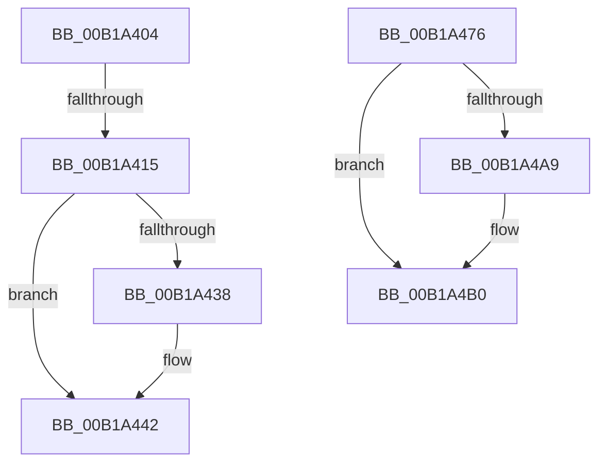

# sub_00B1A404

- RVA: `0x00B1A404`–`0x00B1A4B7` (길이 `179` bytes)
- VA: `0x0000000140B1A404`
- 실행 섹션: `PAGE`
- PDB 이름 있음: `아니요`; PDB Function 태그: `아니요`
- unwind 정보 RVA: `0x0007F79C`
- 디코드: `42`개 명령, `179/179` bytes 표시
- 미해석 바이트: `0` (있으면 어셈블리에 `.byte`로 보존)

> 이 문서는 커널 이미지의 기계어와 PDB 기호를 분석해 생성했습니다. 4번과 5번은 함수 원형과 자료형을 바이너리 사용 방식에서 추정한 C 해석이며 원본 소스 복구 결과는 아닙니다.

## 1. Dependencies

- 직접 호출 지점: **5**; 고유 호출 대상: **5**
- 직접 호출자로 확인된 함수: **0**
- RIP 상대 이미지 참조: **0**

### Outgoing calls
- `0x00B1A42B` → [IoAllocateMdl](../../text/29/IoAllocateMdl_function_0029EBF0.md) (function, `0x0029EBF0`)
- `0x00B1A43D` → [RtlRaiseStatus](../../text/2F/RtlRaiseStatus_function_002F6A50.md) (function, `0x002F6A50`)
- `0x00B1A45E` → [IopProbeAndLockPages](../../text/45/IopProbeAndLockPages_function_0045641C.md) (function, `0x0045641C`)
- `0x00B1A49A` → [IopExceptionCleanupEx](../8A/IopExceptionCleanupEx_function_008AE5C8.md) (function, `0x008AE5C8`)
- `0x00B1A4AB` → [ExFreePoolWithTag](../../poolcode/B8/ExFreePoolWithTag_function_00B82870.md) (function, `0x00B82870`)

### Direct callers
- 이 함수 시작 RVA로 연결되는 직접 call은 확인되지 않았습니다. 간접 호출은 완전히 역산할 수 없습니다.

### Static image references
- 디코드된 RIP-relative 메모리 참조가 없습니다.

## 2. Other-region calls and transfers

- 다른 실행 섹션으로 향하는 call: **4**
  - `0x00B1A42B` → [IoAllocateMdl](../../text/29/IoAllocateMdl_function_0029EBF0.md) (`PAGE` → `.text`)
  - `0x00B1A43D` → [RtlRaiseStatus](../../text/2F/RtlRaiseStatus_function_002F6A50.md) (`PAGE` → `.text`)
  - `0x00B1A45E` → [IopProbeAndLockPages](../../text/45/IopProbeAndLockPages_function_0045641C.md) (`PAGE` → `.text`)
  - `0x00B1A4AB` → [ExFreePoolWithTag](../../poolcode/B8/ExFreePoolWithTag_function_00B82870.md) (`PAGE` → `POOLCODE`)
- call이 아닌 외부 분기/꼬리 이동: **3**
  - `0x00B1A40F` → [NtQueryEaFile + 0x428](../8A/NtQueryEaFile_function_008AC1B0.md) (`tail-transfer`)
  - `0x00B1A471` → [NtQueryEaFile + 0x434](../8A/NtQueryEaFile_function_008AC1B0.md) (`tail-transfer`)
  - `0x00B1A4B2` → [NtQueryEaFile + 0x4BE](../8A/NtQueryEaFile_function_008AC1B0.md) (`tail-transfer`)

## 3. Assembly (complete function range)

```asm
00B1A404  44 8B A4 24 E8 00 00 00         mov r12d, dword ptr [rsp + 0xe8]
00B1A40C  45 85 E4                        test r12d, r12d
00B1A40F  0F 84 C3 21 D9 FF               je 0x1408ac5d8
00B1A415  48 89 7C 24 20                  mov qword ptr [rsp + 0x20], rdi
00B1A41A  41 B1 01                        mov r9b, 1
00B1A41D  45 33 C0                        xor r8d, r8d
00B1A420  41 8B D4                        mov edx, r12d
00B1A423  48 8B 8C 24 E0 00 00 00         mov rcx, qword ptr [rsp + 0xe0]
00B1A42B  E8 C0 47 78 FF                  call 0x14029ebf0
00B1A430  48 8B C8                        mov rcx, rax
00B1A433  48 85 C0                        test rax, rax
00B1A436  75 0A                           jne 0x140b1a442
00B1A438  B9 9A 00 00 C0                  mov ecx, 0xc000009a
00B1A43D  E8 0E C6 7D FF                  call 0x1402f6a50
00B1A442  41 0F B6 47 B8                  movzx eax, byte ptr [r15 - 0x48]
00B1A447  89 44 24 20                     mov dword ptr [rsp + 0x20], eax
00B1A44B  4C 8B 4C 24 68                  mov r9, qword ptr [rsp + 0x68]
00B1A450  41 B8 01 00 00 00               mov r8d, 1
00B1A456  44 8A 64 24 41                  mov r12b, byte ptr [rsp + 0x41]
00B1A45B  41 8A D4                        mov dl, r12b
00B1A45E  E8 B9 BF 93 FF                  call 0x14045641c
00B1A463  48 8B 4C 24 68                  mov rcx, qword ptr [rsp + 0x68]
00B1A468  8B 84 24 E8 00 00 00            mov eax, dword ptr [rsp + 0xe8]
00B1A46F  33 D2                           xor edx, edx
00B1A471  E9 6E 21 D9 FF                  jmp 0x1408ac5e4
00B1A476  8B D8                           mov ebx, eax
00B1A478  48 8B 4C 24 58                  mov rcx, qword ptr [rsp + 0x58]
00B1A47D  0F B6 51 50                     movzx edx, byte ptr [rcx + 0x50]
00B1A481  D1 EA                           shr edx, 1
00B1A483  83 E2 01                        and edx, 1
00B1A486  88 54 24 20                     mov byte ptr [rsp + 0x20], dl
00B1A48A  4C 8B 4C 24 60                  mov r9, qword ptr [rsp + 0x60]
00B1A48F  45 33 C0                        xor r8d, r8d
00B1A492  48 8B 94 24 80 00 00 00         mov rdx, qword ptr [rsp + 0x80]
00B1A49A  E8 29 41 D9 FF                  call 0x1408ae5c8
00B1A49F  48 8B 4C 24 48                  mov rcx, qword ptr [rsp + 0x48]
00B1A4A4  48 85 C9                        test rcx, rcx
00B1A4A7  74 07                           je 0x140b1a4b0
00B1A4A9  33 D2                           xor edx, edx
00B1A4AB  E8 C0 83 06 00                  call 0x140b82870
00B1A4B0  8B C3                           mov eax, ebx
00B1A4B2  E9 B7 21 D9 FF                  jmp 0x1408ac66e
```

## 4. C-style interpretation (structured pseudocode)

```c
__int64 __fastcall sub_00B1A404(__int64 a1, __int64 a2, int a3, __int64 a4, __int64 a5, __int64 a6, __int64 a7, __int64 a8, __int64 a9, __int64 a10, __int64 a11, __int64 a12, __int64 a13, __int64 a14, __int64 a15, __int64 a16, __int64 a17, __int64 a18, __int64 a19, __int64 a20, __int64 a21, __int64 a22, __int64 a23, __int64 a24, __int64 a25, __int64 a26, __int64 a27, __int64 a28, unsigned int a29)
{
    __int64 result;
    unsigned __int64 v_stack_p20;
    unsigned __int8 v_stack_p41;
    unsigned __int64 v_stack_p48;
    unsigned __int64 v_stack_p58;
    unsigned __int64 v_stack_p60;
    unsigned __int64 v_stack_p80;

    v_stack_p20 = v_rdi;
    a3 = 0;
    result = IoAllocateMdl(a28, (unsigned int)((unsigned int)((unsigned int)(a29))), a3, 1);
    if (result == 0) {
        a1 = 0xC000009AULL;
        result = RtlRaiseStatus(a1, (unsigned int)((unsigned int)((unsigned int)(a29))), a3, 1);
    }
    v_stack_p20 = (unsigned int)(*(unsigned __int8 *)(v_r15 - 72));
    result = IopProbeAndLockPages(a1, (unsigned __int8)(v_stack_p41), 1, a13);
    a2 = 0;
}
```

## 5. (Beta) C Style

```c
int64_t sub_00B1A404(int64_t Arg1, int64_t Arg2, int32_t Arg3, int64_t Arg4, uint64_t Arg5, uint64_t Arg6, uint64_t Arg7, uint64_t Arg8, uint64_t Arg9, uint64_t Arg10, uint64_t Arg11, uint64_t Arg12, int64_t Arg13, uint64_t Arg14, uint64_t Arg15, uint64_t Arg16, uint64_t Arg17, uint64_t Arg18, uint64_t Arg19, uint64_t Arg20, uint64_t Arg21, uint64_t Arg22, uint64_t Arg23, uint64_t Arg24, uint64_t Arg25, uint64_t Arg26, uint64_t Arg27, int64_t Arg28, uint32_t Arg29)
{
    int64_t result;
    uint64_t v_stack_p20;
    uint8_t v_stack_p41;
    uint64_t v_stack_p48;
    uint64_t v_stack_p58;
    uint64_t v_stack_p60;
    uint64_t v_stack_p80;

    v_stack_p20 = local_rdi;
    Arg3 = 0;
    result = IoAllocateMdl(Arg28, (uint32_t)((uint32_t)((uint32_t)(Arg29))), Arg3, 1);
    if (result == 0) {
        Arg1 = 0xC000009AULL;
        result = RtlRaiseStatus(Arg1, (uint32_t)((uint32_t)((uint32_t)(Arg29))), Arg3, 1);
    }
    v_stack_p20 = (uint32_t)(*(uint8_t *)(local_r15 - 0x48));
    result = IopProbeAndLockPages(Arg1, (uint8_t)(v_stack_p41), 1, Arg13);
    Arg2 = 0;
}
```

## 6. Execution-region graph

[열기: 2D/3D 그래프와 함수 탐색 컨트롤 패널](../../../control-panel.html?section=page&rva=0x00B1A404&view=graph)

- 2D 그래프는 위에서 아래로 흐르고, 3D 그래프는 빈 공간을 드래그해 회전합니다. Shift+드래그는 이동, 휠은 확대·축소, 함수 노드 선택은 대상 보고서 이동입니다.

### Static fallback


