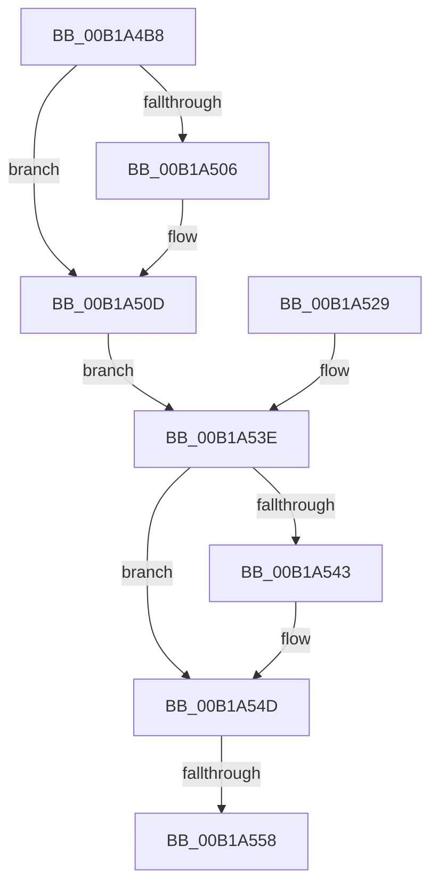

# sub_00B1A4B8

- RVA: `0x00B1A4B8`–`0x00B1A566` (길이 `174` bytes)
- VA: `0x0000000140B1A4B8`
- 실행 섹션: `PAGE`
- PDB 이름 있음: `아니요`; PDB Function 태그: `아니요`
- unwind 정보 RVA: `0x0007F800`
- 디코드: `45`개 명령, `174/174` bytes 표시
- 미해석 바이트: `0` (있으면 어셈블리에 `.byte`로 보존)

> 이 문서는 커널 이미지의 기계어와 PDB 기호를 분석해 생성했습니다. 4번과 5번은 함수 원형과 자료형을 바이너리 사용 방식에서 추정한 C 해석이며 원본 소스 복구 결과는 아닙니다.

## 1. Dependencies

- 직접 호출 지점: **6**; 고유 호출 대상: **6**
- 직접 호출자로 확인된 함수: **0**
- RIP 상대 이미지 참조: **0**

### Outgoing calls
- `0x00B1A4D3` → [ExAllocatePool2](../../poolcode/B8/ExAllocatePool2_function_00B820F0.md) (function, `0x00B820F0`)
- `0x00B1A4E9` → [memcpy](../../text/6C/memcpy_function_006C6840.md) (function, `0x006C6840`)
- `0x00B1A4F7` → [IopGetDriverPathInformation](../../text/59/IopGetDriverPathInformation_function_005973A8.md) (function, `0x005973A8`)
- `0x00B1A508` → [RtlRaiseStatus](../../text/2F/RtlRaiseStatus_function_002F6A50.md) (function, `0x002F6A50`)
- `0x00B1A548` → [ExFreePoolWithTag](../../poolcode/B8/ExFreePoolWithTag_function_00B82870.md) (function, `0x00B82870`)
- `0x00B1A55B` → [IopReleaseFileObjectLock](../../text/25/IopReleaseFileObjectLock_function_00250A90.md) (function, `0x00250A90`)

### Direct callers
- 이 함수 시작 RVA로 연결되는 직접 call은 확인되지 않았습니다. 간접 호출은 완전히 역산할 수 없습니다.

### Static image references
- 디코드된 RIP-relative 메모리 참조가 없습니다.

## 2. Other-region calls and transfers

- 다른 실행 섹션으로 향하는 call: **6**
  - `0x00B1A4D3` → [ExAllocatePool2](../../poolcode/B8/ExAllocatePool2_function_00B820F0.md) (`PAGE` → `POOLCODE`)
  - `0x00B1A4E9` → [memcpy](../../text/6C/memcpy_function_006C6840.md) (`PAGE` → `.text`)
  - `0x00B1A4F7` → [IopGetDriverPathInformation](../../text/59/IopGetDriverPathInformation_function_005973A8.md) (`PAGE` → `.text`)
  - `0x00B1A508` → [RtlRaiseStatus](../../text/2F/RtlRaiseStatus_function_002F6A50.md) (`PAGE` → `.text`)
  - `0x00B1A548` → [ExFreePoolWithTag](../../poolcode/B8/ExFreePoolWithTag_function_00B82870.md) (`PAGE` → `POOLCODE`)
  - `0x00B1A55B` → [IopReleaseFileObjectLock](../../text/25/IopReleaseFileObjectLock_function_00250A90.md) (`PAGE` → `.text`)
- call이 아닌 외부 분기/꼬리 이동: **2**
  - `0x00B1A552` → [NtQueryVolumeInformationFile + 0x4E0](../8A/NtQueryVolumeInformationFile_function_008AC8C0.md) (`tail-transfer`)
  - `0x00B1A561` → [NtQueryVolumeInformationFile + 0x4E0](../8A/NtQueryVolumeInformationFile_function_008AC8C0.md) (`tail-transfer`)

## 3. Assembly (complete function range)

```asm
00B1A4B8  4C 89 7C 24 58                  mov qword ptr [rsp + 0x58], r15
00B1A4BD  44 8B A4 24 C8 00 00 00         mov r12d, dword ptr [rsp + 0xc8]
00B1A4C5  41 B8 49 6F 53 42               mov r8d, 0x42536f49
00B1A4CB  41 8B D4                        mov edx, r12d
00B1A4CE  B9 61 00 00 00                  mov ecx, 0x61
00B1A4D3  E8 18 7C 06 00                  call 0x140b820f0
00B1A4D8  48 8B F0                        mov rsi, rax
00B1A4DB  48 89 44 24 58                  mov qword ptr [rsp + 0x58], rax
00B1A4E0  45 8B C4                        mov r8d, r12d
00B1A4E3  49 8B D5                        mov rdx, r13
00B1A4E6  48 8B C8                        mov rcx, rax
00B1A4E9  E8 52 C3 BA FF                  call 0x1406c6840
00B1A4EE  45 8B C4                        mov r8d, r12d
00B1A4F1  48 8B D6                        mov rdx, rsi
00B1A4F4  48 8B CF                        mov rcx, rdi
00B1A4F7  E8 AC CE A7 FF                  call 0x1405973a8
00B1A4FC  8B D8                           mov ebx, eax
00B1A4FE  89 44 24 44                     mov dword ptr [rsp + 0x44], eax
00B1A502  85 C0                           test eax, eax
00B1A504  79 07                           jns 0x140b1a50d
00B1A506  8B C8                           mov ecx, eax
00B1A508  E8 43 C5 7D FF                  call 0x1402f6a50
00B1A50D  0F B6 06                        movzx eax, byte ptr [rsi]
00B1A510  41 88 45 00                     mov byte ptr [r13], al
00B1A514  48 8B 84 24 B8 00 00 00         mov rax, qword ptr [rsp + 0xb8]
00B1A51C  44 89 38                        mov dword ptr [rax], r15d
00B1A51F  48 C7 40 08 0C 00 00 00         mov qword ptr [rax + 8], 0xc
00B1A527  EB 15                           jmp 0x140b1a53e
00B1A529  8B D8                           mov ebx, eax
00B1A52B  89 44 24 44                     mov dword ptr [rsp + 0x44], eax
00B1A52F  48 8B 7C 24 48                  mov rdi, qword ptr [rsp + 0x48]
00B1A534  48 8B 74 24 58                  mov rsi, qword ptr [rsp + 0x58]
00B1A539  4C 8B 74 24 60                  mov r14, qword ptr [rsp + 0x60]
00B1A53E  48 85 F6                        test rsi, rsi
00B1A541  74 0A                           je 0x140b1a54d
00B1A543  33 D2                           xor edx, edx
00B1A545  48 8B CE                        mov rcx, rsi
00B1A548  E8 23 83 06 00                  call 0x140b82870
00B1A54D  41 8B 06                        mov eax, dword ptr [r14]
00B1A550  A8 02                           test al, 2
00B1A552  0F 84 48 28 D9 FF               je 0x1408acda0
00B1A558  48 8B CF                        mov rcx, rdi
00B1A55B  E8 30 65 73 FF                  call 0x140250a90
00B1A560  90                              nop
00B1A561  E9 3A 28 D9 FF                  jmp 0x1408acda0
```

## 4. C-style interpretation (structured pseudocode)

```c
__int64 __fastcall sub_00B1A4B8(__int64 a1, __int64 a2, __int64 a3, __int64 a4, __int64 a5, __int64 a6, __int64 a7, __int64 a8, __int64 a9, __int64 a10, __int64 a11, __int64 a12, __int64 a13, __int64 a14, __int64 a15, __int64 a16, __int64 a17, __int64 a18, __int64 a19, __int64 a20, __int64 a21, __int64 a22, __int64 a23, __int64 a24, unsigned int a25)
{
    __int64 result;
    unsigned int v_stack_p44;
    unsigned __int64 v_stack_p48;
    unsigned __int64 v_stack_p58;
    unsigned __int64 v_stack_p60;

    v_stack_p58 = v_r15;
    result = ExAllocatePool2(97, (unsigned int)((unsigned int)((unsigned int)(a25))), (unsigned int)(0x42536F49ULL), a4);
    v_stack_p58 = result;
    result = memcpy(result, v_r13, (unsigned int)((unsigned int)((unsigned int)(a25))), a4);
    result = IopGetDriverPathInformation(v_rdi, result, (unsigned int)((unsigned int)((unsigned int)(a25))), a4);
    v_stack_p44 = (unsigned int)(result);
    if (sign_flag) {
        a1 = (unsigned int)(result);
        result = RtlRaiseStatus(a1, result, (unsigned int)((unsigned int)((unsigned int)(a25))), a4);
    }
    *(unsigned __int8 *)(v_r13) = (unsigned __int8)(*(unsigned __int8 *)(result));
    *(unsigned int *)(a23) = (unsigned int)(v_r15);
    *(unsigned __int64 *)(a23 + 8) = 12;
    goto loc_00B1A53E;
loc_00B1A53E:
    result = a23;
    if (result != 0) {
        a2 = 0;
        a1 = result;
        result = ExFreePoolWithTag(a1, a2, (unsigned int)((unsigned int)((unsigned int)(a25))), a4);
    }
    result = IopReleaseFileObjectLock(v_rdi, a2, (unsigned int)((unsigned int)((unsigned int)(a25))), a4);
}
```

## 5. (Beta) C Style

```c
int64_t sub_00B1A4B8(int64_t Arg1, int64_t Arg2, int64_t Arg3, int64_t Arg4, uint64_t Arg5, uint64_t Arg6, uint64_t Arg7, uint64_t Arg8, uint64_t Arg9, uint64_t Arg10, uint64_t Arg11, uint64_t Arg12, uint64_t Arg13, uint64_t Arg14, uint64_t Arg15, uint64_t Arg16, uint64_t Arg17, uint64_t Arg18, uint64_t Arg19, uint64_t Arg20, uint64_t Arg21, uint64_t Arg22, void *Arg23, uint64_t Arg24, uint32_t Arg25)
{
    uint8_t *arg23 = (uint8_t *)Arg23;

    int64_t result;
    uint32_t v_stack_p44;
    uint64_t v_stack_p48;
    uint64_t v_stack_p58;
    uint64_t v_stack_p60;

    v_stack_p58 = local_r15;
    result = ExAllocatePool2(97, (uint32_t)((uint32_t)((uint32_t)(Arg25))), (uint32_t)(0x42536F49ULL), Arg4);
    v_stack_p58 = result;
    result = memcpy(result, local_r13, (uint32_t)((uint32_t)((uint32_t)(Arg25))), Arg4);
    result = IopGetDriverPathInformation(local_rdi, result, (uint32_t)((uint32_t)((uint32_t)(Arg25))), Arg4);
    v_stack_p44 = (uint32_t)(result);
    if (sign_flag) {
        Arg1 = (uint32_t)(result);
        result = RtlRaiseStatus(Arg1, result, (uint32_t)((uint32_t)((uint32_t)(Arg25))), Arg4);
    }
    *(uint8_t *)(local_r13) = (uint8_t)(*(uint8_t *)(result));
    *(uint32_t *)(arg23) = (uint32_t)(local_r15);
    *(uint64_t *)(arg23 + 0x8) = 12;
    goto loc_00B1A53E;
loc_00B1A53E:
    result = Arg23;
    if (result != 0) {
        Arg2 = 0;
        Arg1 = result;
        result = ExFreePoolWithTag(Arg1, Arg2, (uint32_t)((uint32_t)((uint32_t)(Arg25))), Arg4);
    }
    result = IopReleaseFileObjectLock(local_rdi, Arg2, (uint32_t)((uint32_t)((uint32_t)(Arg25))), Arg4);
}
```

### 관측된 메모리 오프셋

구조체 형식이 확인되지 않은 접근은 인자 기준의 오프셋으로만 기록했습니다.

| 기준 인자 | 오프셋 표현 | 폭 (bit) | 접근 |
|---|---:|---:|---|
| `Arg23` | `+ 0x0` | `32` | `W` |
| `Arg23` | `+ 0x8` | `64` | `W` |

## 6. Execution-region graph

[열기: 2D/3D 그래프와 함수 탐색 컨트롤 패널](../../../control-panel.html?section=page&rva=0x00B1A4B8&view=graph)

- 2D 그래프는 위에서 아래로 흐르고, 3D 그래프는 빈 공간을 드래그해 회전합니다. Shift+드래그는 이동, 휠은 확대·축소, 함수 노드 선택은 대상 보고서 이동입니다.

### Static fallback


