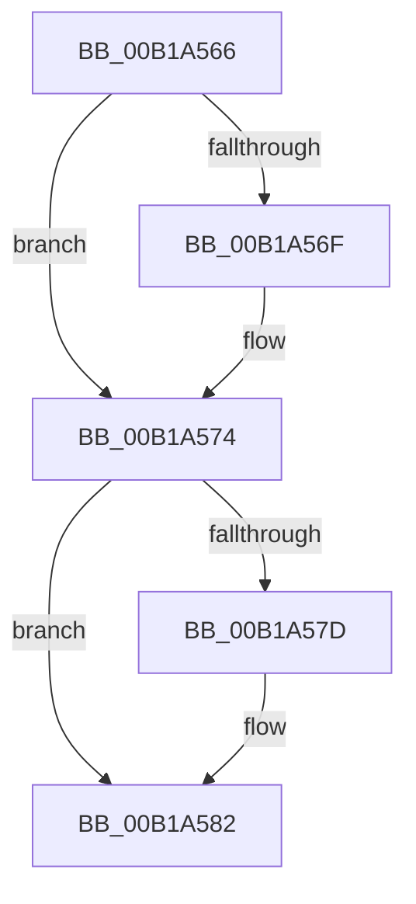

# sub_00B1A566

- RVA: `0x00B1A566`–`0x00B1A58F` (길이 `41` bytes)
- VA: `0x0000000140B1A566`
- 실행 섹션: `PAGE`
- PDB 이름 있음: `아니요`; PDB Function 태그: `아니요`
- unwind 정보 RVA: `0x0007F994`
- 디코드: `10`개 명령, `41/41` bytes 표시
- 미해석 바이트: `0` (있으면 어셈블리에 `.byte`로 보존)

> 이 문서는 커널 이미지의 기계어와 PDB 기호를 분석해 생성했습니다. 4번과 5번은 함수 원형과 자료형을 바이너리 사용 방식에서 추정한 C 해석이며 원본 소스 복구 결과는 아닙니다.

## 1. Dependencies

- 직접 호출 지점: **0**; 고유 호출 대상: **0**
- 직접 호출자로 확인된 함수: **0**
- RIP 상대 이미지 참조: **0**

### Outgoing calls
- 직접 디코드된 call 명령이 없습니다.

### Direct callers
- 이 함수 시작 RVA로 연결되는 직접 call은 확인되지 않았습니다. 간접 호출은 완전히 역산할 수 없습니다.

### Static image references
- 디코드된 RIP-relative 메모리 참조가 없습니다.

## 2. Other-region calls and transfers

- 다른 실행 섹션으로 향하는 call: **0**
- call이 아닌 외부 분기/꼬리 이동: **1**
  - `0x00B1A58A` → [NtQueryInformationFile + 0xA7A](../8A/NtQueryInformationFile_function_008AD630.md) (`tail-transfer`)

## 3. Assembly (complete function range)

```asm
00B1A566  41 F7 06 00 00 00 08            test dword ptr [r14], 0x8000000
00B1A56D  74 05                           je 0x140b1a574
00B1A56F  83 CA 04                        or edx, 4
00B1A572  89 11                           mov dword ptr [rcx], edx
00B1A574  41 F7 06 00 00 00 02            test dword ptr [r14], 0x2000000
00B1A57B  74 05                           je 0x140b1a582
00B1A57D  83 CA 01                        or edx, 1
00B1A580  89 11                           mov dword ptr [rcx], edx
00B1A582  48 C7 46 38 04 00 00 00         mov qword ptr [rsi + 0x38], 4
00B1A58A  E9 1B 3B D9 FF                  jmp 0x1408ae0aa
```

## 4. C-style interpretation (structured pseudocode)

```c
void __fastcall sub_00B1A566(__int64 a1, int a2)
{
    if (((*(unsigned int *)(v_r14)) & (0x8000000ULL)) != 0) {
        a2 = (unsigned int)((a2) | (4));
        *(unsigned int *)(a1) = a2;
    }
    if (((*(unsigned int *)(v_r14)) & (0x2000000ULL)) != 0) {
        a2 = (unsigned int)((a2) | (1));
        *(unsigned int *)(a1) = a2;
    }
    *(unsigned __int64 *)(v_rsi + 56) = 4;
}
```

## 5. (Beta) C Style

```c
void sub_00B1A566(void *Arg1, int32_t Arg2)
{
    uint8_t *arg1 = (uint8_t *)Arg1;

    if (((*(uint32_t *)(local_r14)) & (0x8000000ULL)) != 0) {
        Arg2 = (uint32_t)((Arg2) | (4));
        *(uint32_t *)(arg1) = Arg2;
    }
    if (((*(uint32_t *)(local_r14)) & (0x2000000ULL)) != 0) {
        Arg2 = (uint32_t)((Arg2) | (1));
        *(uint32_t *)(arg1) = Arg2;
    }
    *(uint64_t *)(local_rsi + 0x38) = 4;
}
```

### 관측된 메모리 오프셋

구조체 형식이 확인되지 않은 접근은 인자 기준의 오프셋으로만 기록했습니다.

| 기준 인자 | 오프셋 표현 | 폭 (bit) | 접근 |
|---|---:|---:|---|
| `Arg1` | `+ 0x0` | `32` | `W` |

## 6. Execution-region graph

[열기: 2D/3D 그래프와 함수 탐색 컨트롤 패널](../../../control-panel.html?section=page&rva=0x00B1A566&view=graph)

- 2D 그래프는 위에서 아래로 흐르고, 3D 그래프는 빈 공간을 드래그해 회전합니다. Shift+드래그는 이동, 휠은 확대·축소, 함수 노드 선택은 대상 보고서 이동입니다.

### Static fallback


