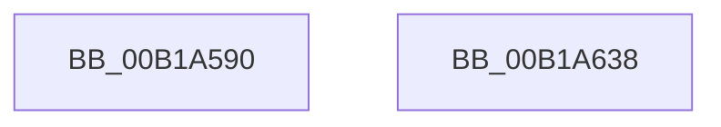

# sub_00B1A590

- RVA: `0x00B1A590`–`0x00B1A6A5` (길이 `277` bytes)
- VA: `0x0000000140B1A590`
- 실행 섹션: `PAGE`
- PDB 이름 있음: `아니요`; PDB Function 태그: `아니요`
- unwind 정보 RVA: `0x0007FB44`
- 디코드: `61`개 명령, `277/277` bytes 표시
- 미해석 바이트: `0` (있으면 어셈블리에 `.byte`로 보존)

> 이 문서는 커널 이미지의 기계어와 PDB 기호를 분석해 생성했습니다. 4번과 5번은 함수 원형과 자료형을 바이너리 사용 방식에서 추정한 C 해석이며 원본 소스 복구 결과는 아닙니다.

## 1. Dependencies

- 직접 호출 지점: **4**; 고유 호출 대상: **2**
- 직접 호출자로 확인된 함수: **0**
- RIP 상대 이미지 참조: **3**

### Outgoing calls
- `0x00B1A5B9` → [tlgCreate1Sz_wchar_t](../../text/42/tlgCreate1Sz_wchar_t_function_00426198.md) (function, `0x00426198`)
- `0x00B1A62D` → [tlgWriteTransfer_EtwWriteTransfer](../../text/42/tlgWriteTransfer_EtwWriteTransfer_function_004260E0.md) (function, `0x004260E0`)
- `0x00B1A656` → [tlgCreate1Sz_wchar_t](../../text/42/tlgCreate1Sz_wchar_t_function_00426198.md) (function, `0x00426198`)
- `0x00B1A69A` → [tlgWriteTransfer_EtwWriteTransfer](../../text/42/tlgWriteTransfer_EtwWriteTransfer_function_004260E0.md) (function, `0x004260E0`)

### Direct callers
- 이 함수 시작 RVA로 연결되는 직접 call은 확인되지 않았습니다. 간접 호출은 완전히 역산할 수 없습니다.

### Static image references
- `0x00B1A5CA` → RVA `0x00048BBB` (`.rdata`; read)
- `0x00B1A60B` → RVA `0x00E074D8` (`.data`; read)
- `0x00B1A668` → RVA `0x00048B7E` (`.rdata`; read)

## 2. Other-region calls and transfers

- 다른 실행 섹션으로 향하는 call: **4**
  - `0x00B1A5B9` → [tlgCreate1Sz_wchar_t](../../text/42/tlgCreate1Sz_wchar_t_function_00426198.md) (`PAGE` → `.text`)
  - `0x00B1A62D` → [tlgWriteTransfer_EtwWriteTransfer](../../text/42/tlgWriteTransfer_EtwWriteTransfer_function_004260E0.md) (`PAGE` → `.text`)
  - `0x00B1A656` → [tlgCreate1Sz_wchar_t](../../text/42/tlgCreate1Sz_wchar_t_function_00426198.md) (`PAGE` → `.text`)
  - `0x00B1A69A` → [tlgWriteTransfer_EtwWriteTransfer](../../text/42/tlgWriteTransfer_EtwWriteTransfer_function_004260E0.md) (`PAGE` → `.text`)
- call이 아닌 외부 분기/꼬리 이동: **2**
  - `0x00B1A633` → [PfSnEndTrace + 0x73](../8B/PfSnEndTrace_function_008B04A8.md) (`tail-transfer`)
  - `0x00B1A6A0` → [PfSnEndTrace + 0x278](../8B/PfSnEndTrace_function_008B04A8.md) (`tail-transfer`)

## 3. Assembly (complete function range)

```asm
00B1A590  48 8B 81 60 01 00 00            mov rax, qword ptr [rcx + 0x160]
00B1A597  48 8D 54 24 60                  lea rdx, [rsp + 0x60]
00B1A59C  83 65 CC 00                     and dword ptr [rbp - 0x34], 0
00B1A5A0  48 8D 4D D0                     lea rcx, [rbp - 0x30]
00B1A5A4  48 89 44 24 50                  mov qword ptr [rsp + 0x50], rax
00B1A5A9  48 8D 44 24 50                  lea rax, [rsp + 0x50]
00B1A5AE  48 89 45 C0                     mov qword ptr [rbp - 0x40], rax
00B1A5B2  C7 45 C8 08 00 00 00            mov dword ptr [rbp - 0x38], 8
00B1A5B9  E8 DA BB 90 FF                  call 0x140426198
00B1A5BE  8B 4D 9C                        mov ecx, dword ptr [rbp - 0x64]
00B1A5C1  48 8D 44 24 34                  lea rax, [rsp + 0x34]
00B1A5C6  83 65 EC 00                     and dword ptr [rbp - 0x14], 0
00B1A5CA  48 8D 15 EA E5 52 FF            lea rdx, [rip - 0xad1a16]
00B1A5D1  83 65 FC 00                     and dword ptr [rbp - 4], 0
00B1A5D5  45 33 C0                        xor r8d, r8d
00B1A5D8  83 65 0C 00                     and dword ptr [rbp + 0xc], 0
00B1A5DC  48 89 45 E0                     mov qword ptr [rbp - 0x20], rax
00B1A5E0  8B 83 90 01 00 00               mov eax, dword ptr [rbx + 0x190]
00B1A5E6  89 44 24 38                     mov dword ptr [rsp + 0x38], eax
00B1A5EA  48 8D 44 24 38                  lea rax, [rsp + 0x38]
00B1A5EF  48 89 45 F0                     mov qword ptr [rbp - 0x10], rax
00B1A5F3  8A 43 58                        mov al, byte ptr [rbx + 0x58]
00B1A5F6  88 44 24 30                     mov byte ptr [rsp + 0x30], al
00B1A5FA  48 8D 44 24 30                  lea rax, [rsp + 0x30]
00B1A5FF  48 89 45 00                     mov qword ptr [rbp], rax
00B1A603  48 8D 45 A0                     lea rax, [rbp - 0x60]
00B1A607  89 4C 24 34                     mov dword ptr [rsp + 0x34], ecx
00B1A60B  48 8D 0D C6 CE 2E 00            lea rcx, [rip + 0x2ecec6]
00B1A612  44 89 4D E8                     mov dword ptr [rbp - 0x18], r9d
00B1A616  44 89 4D F8                     mov dword ptr [rbp - 8], r9d
00B1A61A  45 33 C9                        xor r9d, r9d
00B1A61D  48 89 44 24 28                  mov qword ptr [rsp + 0x28], rax
00B1A622  C7 44 24 20 07 00 00 00         mov dword ptr [rsp + 0x20], 7
00B1A62A  89 7D 08                        mov dword ptr [rbp + 8], edi
00B1A62D  E8 AE BA 90 FF                  call 0x1404260e0
00B1A632  90                              nop
00B1A633  E9 E3 5E D9 FF                  jmp 0x1408b051b
00B1A638  83 65 CC 00                     and dword ptr [rbp - 0x34], 0
00B1A63C  48 8D 44 24 38                  lea rax, [rsp + 0x38]
00B1A641  48 8D 54 24 60                  lea rdx, [rsp + 0x60]
00B1A646  48 89 45 C0                     mov qword ptr [rbp - 0x40], rax
00B1A64A  48 8D 4D D0                     lea rcx, [rbp - 0x30]
00B1A64E  89 74 24 38                     mov dword ptr [rsp + 0x38], esi
00B1A652  44 89 55 C8                     mov dword ptr [rbp - 0x38], r10d
00B1A656  E8 3D BB 90 FF                  call 0x140426198
00B1A65B  44 8B 4D 9C                     mov r9d, dword ptr [rbp - 0x64]
00B1A65F  48 8D 44 24 34                  lea rax, [rsp + 0x34]
00B1A664  83 65 EC 00                     and dword ptr [rbp - 0x14], 0
00B1A668  48 8D 15 0F E5 52 FF            lea rdx, [rip - 0xad1af1]
00B1A66F  48 89 45 E0                     mov qword ptr [rbp - 0x20], rax
00B1A673  48 8D 0D 5E CE 2E 00            lea rcx, [rip + 0x2ece5e]
00B1A67A  48 8D 45 A0                     lea rax, [rbp - 0x60]
00B1A67E  44 89 4C 24 34                  mov dword ptr [rsp + 0x34], r9d
00B1A683  48 89 44 24 28                  mov qword ptr [rsp + 0x28], rax
00B1A688  45 33 C9                        xor r9d, r9d
00B1A68B  45 33 C0                        xor r8d, r8d
00B1A68E  C7 44 24 20 05 00 00 00         mov dword ptr [rsp + 0x20], 5
00B1A696  44 89 55 E8                     mov dword ptr [rbp - 0x18], r10d
00B1A69A  E8 41 BA 90 FF                  call 0x1404260e0
00B1A69F  90                              nop
00B1A6A0  E9 7B 60 D9 FF                  jmp 0x1408b0720
```

## 4. C-style interpretation (structured pseudocode)

```c
__int64 __fastcall sub_00B1A590(__int64 a1, __int64 a2, int a3, int a4, __int64 a5, __int64 a6, __int64 a7, __int64 a8, __int64 a9, __int64 a10, __int64 a11, __int64 a12)
{
    __int64 result;
    unsigned int v_stack_p20;
    unsigned __int64 v_stack_p28;
    unsigned __int8 v_stack_p30;
    unsigned __int64 v_stack_p34;
    unsigned int v_stack_p38;
    unsigned __int64 v_stack_p50;
    unsigned __int64 v_stack_p60;

    v_stack_p50 = *(unsigned __int64 *)(a1 + 352);
    *(unsigned __int64 *)(v_rbp - 64) = a10;
    *(unsigned int *)(v_rbp - 56) = 8;
    result = tlgCreate1Sz_wchar_t(v_rbp - 48, a12, a3, a4);
    a3 = 0;
    *(unsigned __int64 *)(v_rbp - 32) = v_stack_p34;
    v_stack_p38 = (unsigned int)((unsigned int)(*(unsigned int *)(v_rbx + 400)));
    *(unsigned __int64 *)(v_rbp - 16) = a7;
    v_stack_p30 = (unsigned __int8)(*(unsigned __int8 *)(v_rbx + 88));
    *(unsigned __int64 *)(v_rbp) = a6;
    v_stack_p34 = (unsigned int)((unsigned int)(*(unsigned int *)(v_rbp - 100)));
    *(unsigned int *)(v_rbp - 24) = a4;
    *(unsigned int *)(v_rbp - 8) = a4;
    a4 = 0;
    v_stack_p28 = v_rbp - 96;
    v_stack_p20 = 7;
    *(unsigned int *)(v_rbp + 8) = (unsigned int)(v_rdi);
    result = tlgWriteTransfer_EtwWriteTransfer(v_rip + 3067590, v_rip - 11344406, a3, a4);
}
```

## 5. (Beta) C Style

```c
int64_t sub_00B1A590(void *Arg1, int64_t Arg2, int32_t Arg3, int32_t Arg4, uint64_t Arg5, int64_t Arg6, int64_t Arg7, uint64_t Arg8, uint64_t Arg9, int64_t Arg10, uint64_t Arg11, int64_t Arg12)
{
    uint8_t *arg1 = (uint8_t *)Arg1;

    int64_t result;
    uint32_t v_stack_p20;
    uint64_t v_stack_p28;
    uint8_t v_stack_p30;
    uint64_t v_stack_p34;
    uint32_t v_stack_p38;
    uint64_t v_stack_p50;
    uint64_t v_stack_p60;

    v_stack_p50 = *(uint64_t *)(arg1 + 0x160);
    *(uint64_t *)(local_rbp - 0x40) = Arg10;
    *(uint32_t *)(local_rbp - 0x38) = 8;
    result = tlgCreate1Sz_wchar_t(local_rbp - 48, Arg12, Arg3, Arg4);
    Arg3 = 0;
    *(uint64_t *)(local_rbp - 0x20) = v_stack_p34;
    v_stack_p38 = (uint32_t)((uint32_t)(*(uint32_t *)(local_rbx + 0x190)));
    *(uint64_t *)(local_rbp - 0x10) = Arg7;
    v_stack_p30 = (uint8_t)(*(uint8_t *)(local_rbx + 0x58));
    *(uint64_t *)(local_rbp) = Arg6;
    v_stack_p34 = (uint32_t)((uint32_t)(*(uint32_t *)(local_rbp - 0x64)));
    *(uint32_t *)(local_rbp - 0x18) = Arg4;
    *(uint32_t *)(local_rbp - 0x8) = Arg4;
    Arg4 = 0;
    v_stack_p28 = local_rbp - 96;
    v_stack_p20 = 7;
    *(uint32_t *)(local_rbp + 0x8) = (uint32_t)(local_rdi);
    result = tlgWriteTransfer_EtwWriteTransfer(v_rip + 3067590, v_rip - 11344406, Arg3, Arg4);
}
```

### 관측된 메모리 오프셋

구조체 형식이 확인되지 않은 접근은 인자 기준의 오프셋으로만 기록했습니다.

| 기준 인자 | 오프셋 표현 | 폭 (bit) | 접근 |
|---|---:|---:|---|
| `Arg1` | `+ 0x160` | `64` | `R` |

## 6. Execution-region graph

[열기: 2D/3D 그래프와 함수 탐색 컨트롤 패널](../../../control-panel.html?section=page&rva=0x00B1A590&view=graph)

- 2D 그래프는 위에서 아래로 흐르고, 3D 그래프는 빈 공간을 드래그해 회전합니다. Shift+드래그는 이동, 휠은 확대·축소, 함수 노드 선택은 대상 보고서 이동입니다.

### Static fallback


