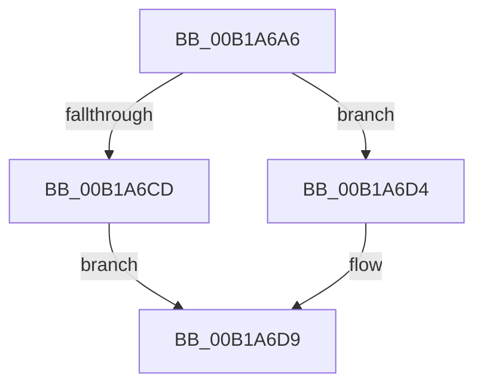

# sub_00B1A6A6

- RVA: `0x00B1A6A6`–`0x00B1A6E0` (길이 `58` bytes)
- VA: `0x0000000140B1A6A6`
- 실행 섹션: `PAGE`
- PDB 이름 있음: `아니요`; PDB Function 태그: `아니요`
- unwind 정보 RVA: `0x000824C0`
- 디코드: `15`개 명령, `58/58` bytes 표시
- 미해석 바이트: `0` (있으면 어셈블리에 `.byte`로 보존)

> 이 문서는 커널 이미지의 기계어와 PDB 기호를 분석해 생성했습니다. 4번과 5번은 함수 원형과 자료형을 바이너리 사용 방식에서 추정한 C 해석이며 원본 소스 복구 결과는 아닙니다.

## 1. Dependencies

- 직접 호출 지점: **4**; 고유 호출 대상: **4**
- 직접 호출자로 확인된 함수: **0**
- RIP 상대 이미지 참조: **0**

### Outgoing calls
- `0x00B1A6A6` → [HvpGetCellPaged](../85/HvpGetCellPaged_function_00854CB0.md) (function, `0x00854CB0`)
- `0x00B1A6B8` → [memcpy](../../text/6C/memcpy_function_006C6840.md) (function, `0x006C6840`)
- `0x00B1A6CD` → [HvpReleaseCellFlat](../85/HvpReleaseCellFlat_function_0085CC20.md) (function, `0x0085CC20`)
- `0x00B1A6D4` → [HvpReleaseCellPaged](../85/HvpReleaseCellPaged_function_00855F40.md) (function, `0x00855F40`)

### Direct callers
- 이 함수 시작 RVA로 연결되는 직접 call은 확인되지 않았습니다. 간접 호출은 완전히 역산할 수 없습니다.

### Static image references
- 디코드된 RIP-relative 메모리 참조가 없습니다.

## 2. Other-region calls and transfers

- 다른 실행 섹션으로 향하는 call: **1**
  - `0x00B1A6B8` → [memcpy](../../text/6C/memcpy_function_006C6840.md) (`PAGE` → `.text`)
- call이 아닌 외부 분기/꼬리 이동: **1**
  - `0x00B1A6DB` → [CmpConcatenateValueLists + 0xA9](../8B/CmpConcatenateValueLists_function_008B0ECC.md) (`tail-transfer`)

## 3. Assembly (complete function range)

```asm
00B1A6A6  E8 05 A6 D3 FF                  call 0x140854cb0
00B1A6AB  44 8B 06                        mov r8d, dword ptr [rsi]
00B1A6AE  48 8B D0                        mov rdx, rax
00B1A6B1  49 C1 E0 02                     shl r8, 2
00B1A6B5  49 8B CC                        mov rcx, r12
00B1A6B8  E8 83 C1 BA FF                  call 0x1406c6840
00B1A6BD  F6 83 8C 00 00 00 01            test byte ptr [rbx + 0x8c], 1
00B1A6C4  48 8D 55 40                     lea rdx, [rbp + 0x40]
00B1A6C8  48 8B CB                        mov rcx, rbx
00B1A6CB  74 07                           je 0x140b1a6d4
00B1A6CD  E8 4E 25 D4 FF                  call 0x14085cc20
00B1A6D2  EB 05                           jmp 0x140b1a6d9
00B1A6D4  E8 67 B8 D3 FF                  call 0x140855f40
00B1A6D9  8B 3E                           mov edi, dword ptr [rsi]
00B1A6DB  E9 95 68 D9 FF                  jmp 0x1408b0f75
```

## 4. C-style interpretation (structured pseudocode)

```c
__int64 __fastcall sub_00B1A6A6(void)
{
    __int64 result;

    result = HvpGetCellPaged(a1, a2, a3, a4);
    a3 = ((unsigned int)(*(unsigned int *)(v_rsi))) << (2);
    result = memcpy(v_r12, result, a3, a4);
    if (((*(unsigned __int8 *)(v_rbx + 140)) & (1)) == 0) goto loc_00B1A6D4;
    result = HvpReleaseCellFlat(v_rbx, v_rbp + 64, a3, a4);
    goto loc_00B1A6D9;
loc_00B1A6D4:
    result = HvpReleaseCellPaged(v_rbx, v_rbp + 64, a3, a4);
loc_00B1A6D9:
}
```

## 5. (Beta) C Style

```c
void sub_00B1A6A6(void)
{
    int64_t result;

    result = HvpGetCellPaged(a1, a2, a3, a4);
    a3 = ((uint32_t)(*(uint32_t *)(local_rsi))) << (2);
    result = memcpy(local_r12, result, a3, a4);
    if (((*(uint8_t *)(local_rbx + 0x8C)) & (1)) == 0) goto loc_00B1A6D4;
    result = HvpReleaseCellFlat(local_rbx, local_rbp + 64, a3, a4);
    goto loc_00B1A6D9;
loc_00B1A6D4:
    result = HvpReleaseCellPaged(local_rbx, local_rbp + 64, a3, a4);
loc_00B1A6D9:
}
```

## 6. Execution-region graph

[열기: 2D/3D 그래프와 함수 탐색 컨트롤 패널](../../../control-panel.html?section=page&rva=0x00B1A6A6&view=graph)

- 2D 그래프는 위에서 아래로 흐르고, 3D 그래프는 빈 공간을 드래그해 회전합니다. Shift+드래그는 이동, 휠은 확대·축소, 함수 노드 선택은 대상 보고서 이동입니다.

### Static fallback


